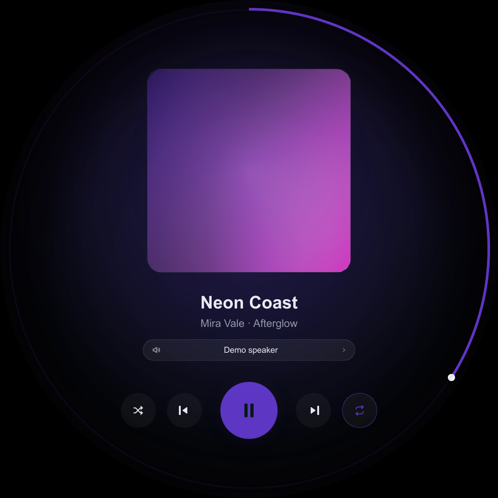
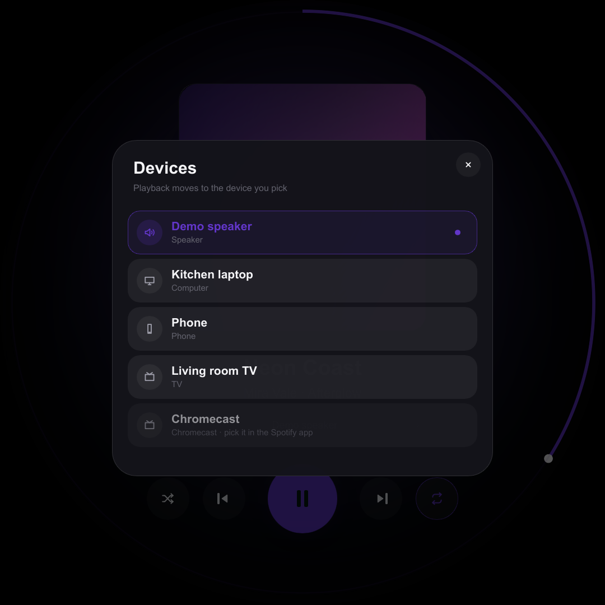
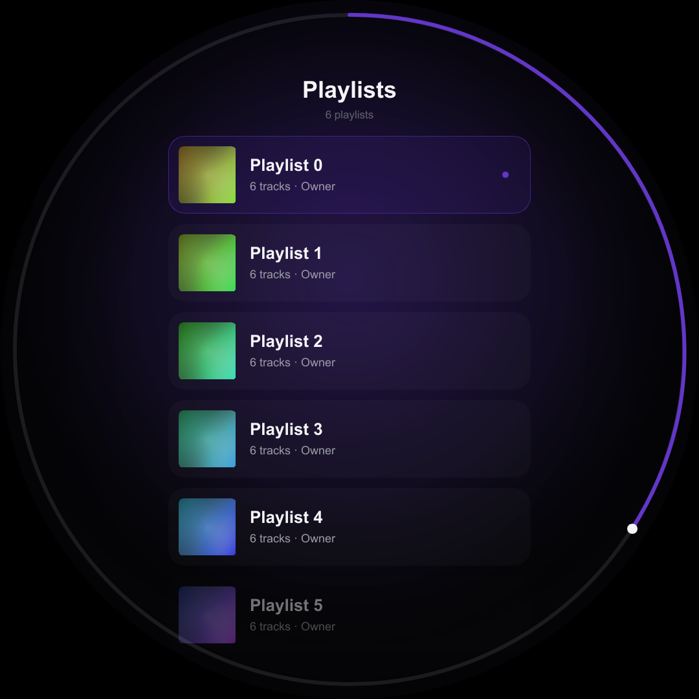
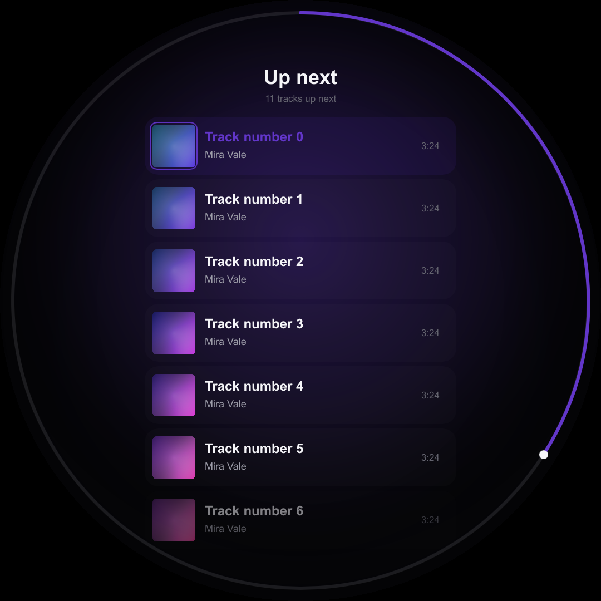
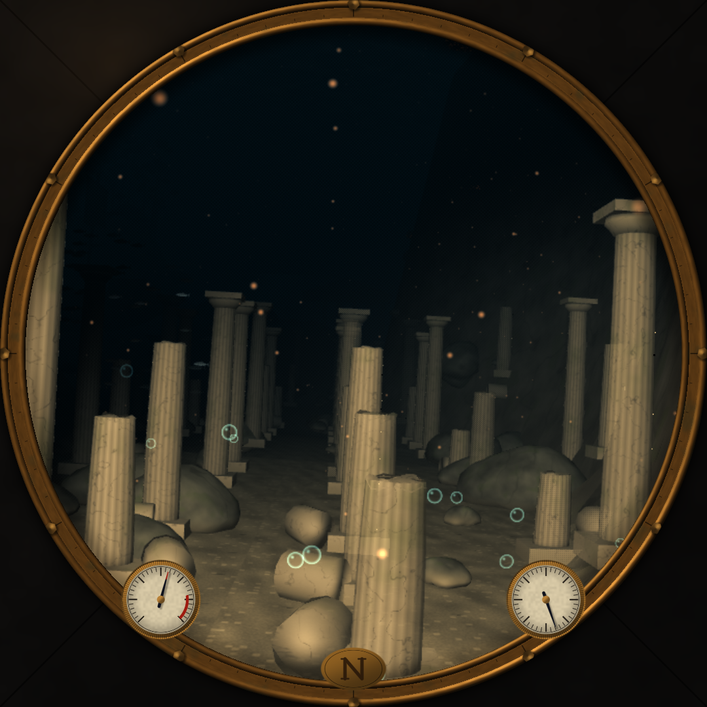
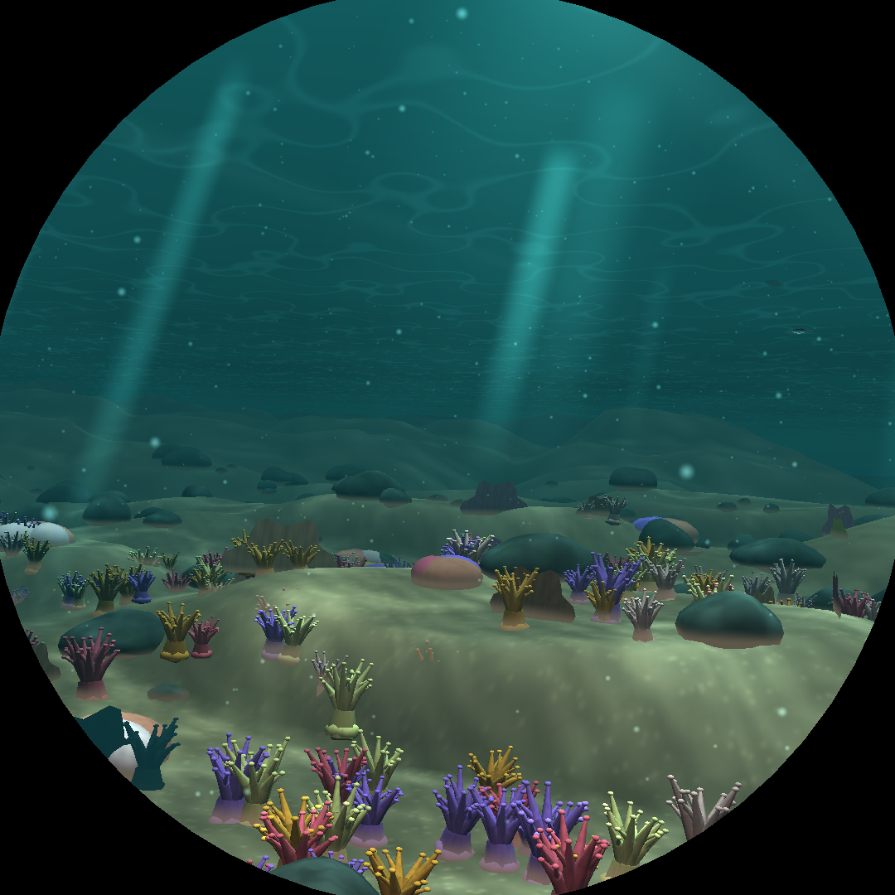
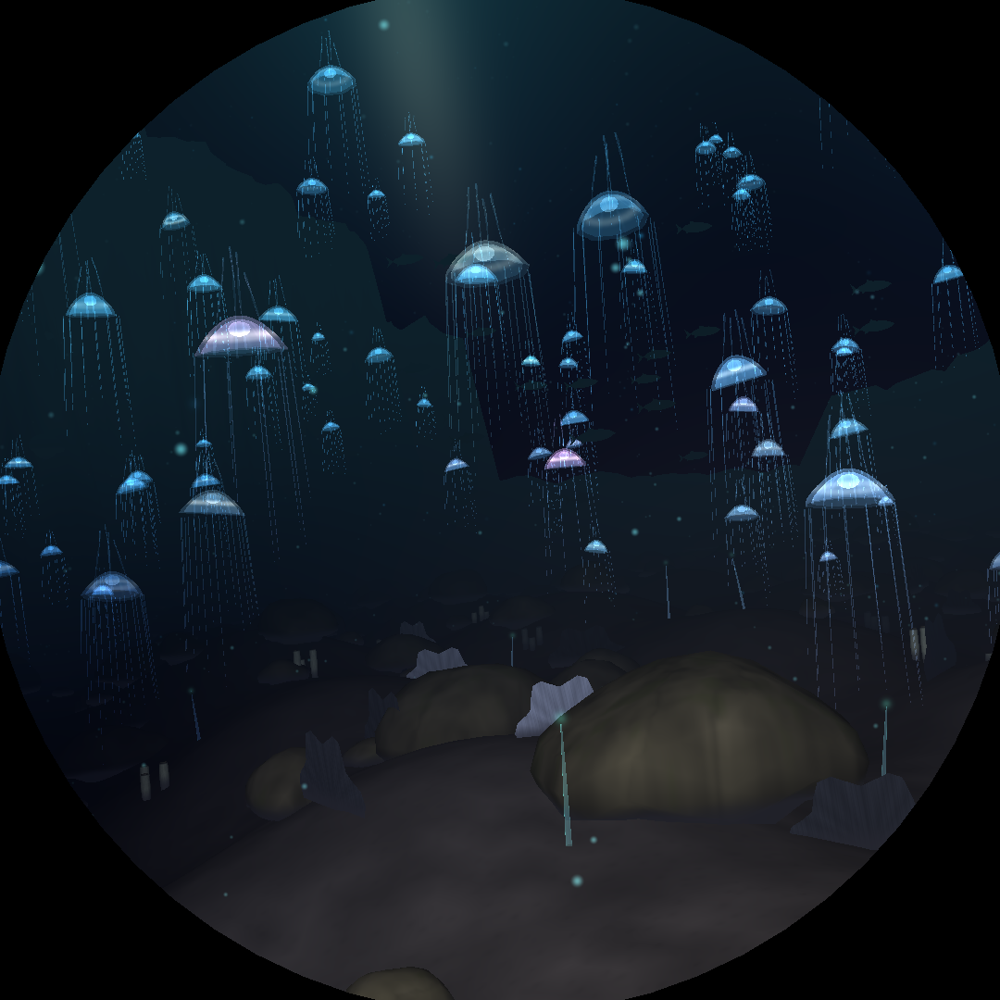

# Spotify Round

A round, 1080 × 1080 **Spotify now-playing display** for the Raspberry Pi 5, written in Rust with
[Slint](https://slint.dev) for the interface and [Animato](https://github.com/AarambhDevHub/animato)
for motion.

<p align="center">
  
  
  
  
  
  
</p>

The display is a **remote control and a visualiser**, not a speaker: it drives whichever Spotify
device is currently active (phone, speaker, desktop app). Playback control therefore needs a
Spotify **Premium** account.

---

## Features

- **Now playing** with square album art (softened corners) and a progress ring around the rim of the
  panel, drawn by a wgpu shader rather than re-tessellated Slint paths.
- **Ambient colour**: the accent, glow and controls take their palette from the artwork, and
  cross-fade perceptually when the track changes.
- **Controls**: play/pause, previous, next, seek, shuffle and repeat (off / all / one).
- **Output device**: the player names the Spotify Connect device it is driving; tap the pill under
  the track to list every device that is open (phone, speaker, TV, desktop app) and move playback
  there without touching anything else. Devices Spotify lists but does not let the API control — a
  Chromecast that is casting, for instance — are shown dimmed with the reason, instead of vanishing
  from the list.
- **Playlists** screen: browse your library, tap to start playing.
- **Queue** screen: the current track plus everything up next — tap an entry to play from there. The
  list opens on the track that is playing, so switching playlists never leaves you scrolled into the
  middle of a stale queue.
- **Motion**: an overshooting artwork reveal, a pulsing "current track" ring and sliding screen
  transitions between the pages.
- **Idle visualisers**: when nothing is playing — or a track has been paused for half a minute — one
  of the procedural scenes takes over the screen, chosen at random on every visit. The **Earth** is a
  rotating Blue Marble with Black Marble city lights, drifting clouds and their shadows, sun glint,
  sunset colour along the terminator and a scattering atmosphere. The **Nautilus** is the view from its salon window on a Jules Verne voyage, drawn as a
  3D scene: seventeen seas from sunlit kelp shallows, a coral reef and a seagrass meadow to a blue
  hole, a lava cave, a drowned city, a glass-sponge reef, the abyss and the polar ice (see [docs/nautilus.md](docs/nautilus.md)). The **Solar tour**
  is a grand tour of invented star systems: a star — red, orange and yellow dwarfs, white and blue
  stars, a swollen red giant or a tiny white dwarf, each lighting its worlds in its own colour —
  five to eight planets (temperate, ocean, desert, ice, lava, barren, gas and ice giants, some
  ringed) and moons of the kinds ours has (cratered, icy, volcanic, hazy, captured rock). Some
  giants have a moon as big as a planet, a world of its own mapped in full with air, seas and
  clouds. The tour drops out of a hyperjump, orbits three planets (and such a moon after its giant)
  while a scanner surveys each, and jumps on to the next star. It never stops: transfers leave and
  enter each orbit at its speed, the way it runs, and the camera keeps the destination in view. Crossings fly
  real manoeuvres, each named and explained on screen as it happens
  ([docs/solar-assist.jpg](docs/solar-assist.jpg)): a departure burn, a coast along a transfer
  ellipse round the star (a Hohmann transfer when it sweeps half way round), a gravity assist past a
  planet on the way (its turn and the speed traded worked out from the planet's mass), or an Oberth
  dive to perihelion past the star, burning where thrust counts most, then a capture burn into
  orbit, and an escape burn before the jump. Each burn shows from the cockpit: dust streaking
  past, the engines' glow round the rim, a shudder, and an amber readout of the thrust and the
  change of speed set against what is done of it. Close to a world a pass adds grain and lit
  slopes finer than the maps ([docs/solar-low-detail.jpg](docs/solar-low-detail.jpg), before and
  after), drawn only near the ground. Clouds are shaded as a layer with depth — tops facing the
  sun bright and their far sides grey, thicker toward the limb, thin edges glowing with the star
  behind them — and close up a second, higher shell holds the densest clouds, so they stand
  up from the deck, slide past it as the camera moves and break the horizon
  ([docs/solar-cloud-layers.jpg](docs/solar-cloud-layers.jpg), without and with).
  A minimap of the system shows the orbits, the planets, the route and the ship
  ([docs/solar-flyby.jpg](docs/solar-flyby.jpg), [docs/solar-moon.jpg](docs/solar-moon.jpg)), beside a HUD of the
  destination, ETA, distance and real orbital speeds. Each jump uses one of five named drives, each
  with its own look — Lumen Drift, Tachyon Tunnel, Fold Drive, Ion Slipstream and Bubble Drive
  ([docs/solar-warps.jpg](docs/solar-warps.jpg): Lumen Drift a blaze of blue rays, Fold Drive a starfield streaming past warped space, Bubble Drive a lensing bubble round the ship, the stars inside churned by its warp) — and while in orbit a scanner surveys the planet
  with progress bars and results in real units: atmosphere (pressure and gas mix), gravimetry,
  climate, magnetic field, surface radiation and a search for biosignatures
  ([docs/solar-scanner.jpg](docs/solar-scanner.jpg)). Planet maps stream in on the GPU a few rows
  a frame while it travels (`SOLAR_SEED`, `SOLAR_GEN_ROWS`; screenshots of every key moment:
  `SOLAR_SHOTS_SEEDS=5,11 cargo test --release solar::tests::screenshots -- --ignored`, and of
  every drive: `solar::tests::warps`). Swipe down on the player
  to summon the visualiser, swipe left or right on the dive to travel on to the next sea or back,
  and tap anywhere to fade back.
- **Now-playing card** on every idle scene: the cover, the track, its artists and the playlist (or
  album) it plays from, with previous, play/pause and next, and an add button that shows whether
  the track is in your Liked Songs and saves or removes it. Once the visualiser is up it stays
  when playback resumes — the card shows what plays — until you tap the scene. The button needs
  the `user-library-read` and `user-library-modify` scopes; a token granted before them asks you to
  sign in again.
- **Touch first**: swipes are the only navigation — right for the queue, left for playlists, with the
  player in the middle — and dragging along the rim of the screen scrubs. Everything is laid out
  inside the circle so nothing hides in the corners of the round panel.
- **Demo mode** (`--mock`) with a built-in library and procedurally generated covers — no Spotify
  account or network needed, useful for developing on a laptop.
- **PKCE OAuth** with a loopback listener, a QR code on screen, and a CLI flow for headless setups.
  A phone that scans the code cannot call back to `127.0.0.1` on the display, so the display also
  serves a small login page on the local network that takes the authorization code back.
  Refresh tokens are stored with `0600` permissions.

---

## Hardware

| Part | Notes |
| --- | --- |
| Raspberry Pi 5 (2 GB is enough) | Raspberry Pi OS Bookworm, 64-bit |
| 5″ round HDMI display, 1080 × 1080 | e.g. Waveshare 5″ 1080×1080 round LCD with USB touch |
| USB touch panel | shows up as a normal libinput touchscreen |

The UI is authored at exactly 1080 × 1080 logical pixels and keeps interactive elements inside a
~500 px radius, so it also looks right in a window on a desktop.

---

## 1. Create a Spotify application

1. Open the [Spotify developer dashboard](https://developer.spotify.com/dashboard) and create an app.
2. Add this **redirect URI** (character-for-character):

   ```
   http://127.0.0.1:8888/callback
   ```

   Spotify only allows `http://` for **loopback IP literals**; `http://localhost` is rejected.
   If you change `redirect_port` in the config you must register the matching URI.

3. Copy the **client ID** (no client secret is needed — the app uses PKCE).

Playback control requires Spotify Premium; without it the display still shows what is playing but
Spotify answers `403 PREMIUM_REQUIRED` for transport commands.

---

## 2. Build

On the Pi (or on any machine, for the demo mode):

```bash
sudo apt update
sudo apt install -y build-essential pkg-config libfontconfig1-dev libfreetype6-dev \
    libxkbcommon-dev libwayland-dev libegl1-mesa-dev libgl1-mesa-dev fonts-inter \
    libvulkan1 mesa-vulkan-drivers

curl --proto '=https' --tlsv1.2 -sSf https://sh.rustup.rs | sh
source "$HOME/.cargo/env"

git clone <this repository> spotify-round
cd spotify-round
cargo build --release
```

`fonts-inter` gives the intended typography; without it Slint falls back to the system sans-serif.

### Building on a Mac or another arm64 machine

Building on the Pi takes a while. With Docker, `deploy/build-for-pi.sh` builds the same binary in an
arm64 Debian 13 container, which matches Raspberry Pi OS, and leaves it in `target/pi/`; on a Mac
with Apple silicon the container runs natively, so it is quick, and rebuilds are incremental. Copy it
over the one the kiosk runs, and restart it:

```bash
deploy/build-for-pi.sh
scp target/pi/spotify-round <user>@<pi>:spotify-round/target/release/spotify-round.new
ssh -t <user>@<pi> 'cd spotify-round/target/release && mv spotify-round.new spotify-round \
    && sudo systemctl restart cage-kiosk'
```

`--tests` also builds the test binary, `target/pi/spotify-round-tests`, to run the benchmarks on the
Pi without a Rust toolchain there, for example `./spotify-round-tests dive3d::tests::frame_cost
--ignored --nocapture`. Arguments after `--` go to cargo: `deploy/build-for-pi.sh -- --features kms`.

Debug builds are usable too: `Cargo.toml` keeps the app at `opt-level = 1` with line tables but
optimizes every dependency (`opt-level = 2`). Unoptimized Slint/Skia/wgpu cannot repaint a
1080 × 1080 scene at 60 Hz — the UI stutters at ~14 fps even on a fast desktop GPU — while the
optimized dependencies reach the frame budget.

---

## 3. Configure

The app reads (and creates on first run):

| Platform | Path |
| --- | --- |
| Linux | `~/.config/spotify-round/config.toml` |
| Windows | `%APPDATA%\spotify-round\config\config.toml` |

```toml
client_id = "your-client-id"

# Must match the redirect URI registered in the Spotify dashboard.
redirect_port = 8888

# Host a phone should use to reach the login page. Defaults to the address of
# the default route (for example 192.168.1.24); set it when the display has
# several interfaces or a name that resolves on your network.
# login_host = "spotify-round.local"

# Playback polling interval. Spotify's rate limit is generous at one second.
poll_ms = 1000

# Show the frame-rate readout from the start (the F key toggles it).
# show_fps = false
```

`SPOTIFY_ROUND_CLIENT_ID` and `SPOTIFY_ROUND_CONFIG_DIR` override the file and the directory, which
is handy for systemd units.

---

## 4. Authorize once

### From a phone (the QR code on the display)

Tap **Authorize**: the display starts listening, shows a QR code and opens the authorization URL in
its own browser if it has one. Scan the code with the phone.

Spotify redirects to the registered `http://127.0.0.1:8888/callback`, which on a phone means the
phone itself and cannot work — Spotify refuses any other `http://` redirect. The QR code therefore
points at a login page the display serves on the local network instead:

1. Open the page (`http://<display-address>:8888/`, also printed in the log), tap **Open Spotify**
   and approve access.
2. The phone ends up on a `127.0.0.1` page that does not load. That is expected: copy the whole
   address from the address bar.
3. Go back to the login page and paste it into the field; pasting submits the form. The display
   exchanges the code and starts.

The listener exists only while a login is running, accepts nothing but the page, the redirect and
the paste, and the code is useless without the PKCE verifier that never leaves the display.

### On the display (has a browser)

Start the app and tap **Authorize**. It opens the authorization URL with `xdg-open` and finishes the
login on the built-in loopback listener.

```bash
spotify-round
```

### On the display (no browser, e.g. Pi OS Lite)

Run the flow on a computer that has a browser, then copy the token file over:

```bash
# on the laptop, with the same client ID configured
spotify-round auth

# then
scp ~/.config/spotify-round/tokens.json pi@spotify-round.local:~/.config/spotify-round/
```

### Over SSH

`spotify-round auth --no-browser` prints both URLs and waits. Either forward the callback port so
the redirect reaches the Pi, or open the printed login page in any browser on the network and paste
the address back:

```bash
ssh -L 8888:127.0.0.1:8888 pi@spotify-round.local 'spotify-round auth --no-browser'
# open the printed URL in the browser on your laptop
```

---

## 5. Run

```bash
spotify-round              # full screen, Spotify
spotify-round --windowed   # a 1080×1080 window, for development
spotify-round --mock --windowed   # demo library, no account needed
spotify-round --fps        # start with the frame-rate readout showing
```

Tap the top of the circle, or press **F** on a keyboard, to show or hide the frame-rate readout: a pill at the top of the circle,
where the round glass still has room for it, with the frames the window presented in the last
second, the milliseconds the UI thread spent drawing each (`ui`) and the GPU milliseconds per frame
(`gpu`). The player only draws when something changes, mostly the ring moving half a pixel, so its
frame rate follows the track's length (about 30 fps for a 3½-minute song); the milliseconds show how
much of the 16.7 ms budget a frame takes. While the visualizer runs it shows the window's frames,
the visualizer's own frame rate, the milliseconds its thread spent on each frame and the GPU
milliseconds per frame. On the Pi the GPU figure comes from the V3D render engine's cumulative busy
counter in `/sys/class/drm/card*/device/gpu_stats`, sampled once a second and divided by the frames
drawn; for the visualizer, where the adapter has timestamp queries and `SPOTIFY_ROUND_PROFILE` is
set, it comes from `wgpu-profiler` instead. If neither source exists the readout says `gpu —` rather than inventing a
number. Above 16 ms the GPU cannot keep
60 fps. The window only counts frames from the first time the readout is shown, because counting
costs the Pi a render pass a frame. With `SPOTIFY_ROUND_FULL_SPEED` set, the same one-second line is
also written to `/tmp/spotify-round-fps` — window fps, screen, idle, scene fps, scene ms and gpu ms
(-1 when no GPU source exists) — for measuring a kiosk whose console cannot be read over SSH.

### Controls

| Gesture | Action |
| --- | --- |
| Tap the artwork or the big button | play / pause |
| Tap the device pill under the track | move playback to another Spotify Connect device |
| Tap ◀ / ▶ | previous / next (dimmed when Spotify has nowhere to go) |
| Drag along the ring at the edge | seek / scrub (the arc follows the drag) |
| Tap shuffle / repeat | toggle shuffle / cycle repeat |
| Swipe left | playlists |
| Swipe right | queue |
| Swipe down | idle visualiser — it picks Earth or the Nautilus at random (a tap returns to the player) |
| Swipe left / right on the Nautilus | travel on to the next stretch of sea / back to the last |
| Tap a playlist | start it and return to now playing |
| Tap the top of the circle | show / hide the frame-rate readout (also over the visualiser) |
| Tap a queue entry | restart the playlist from that item |

---

## Run as a kiosk on the Pi

### Raspberry Pi OS with the desktop

Start the display when you log in, with either of these (not both, or it starts twice):

- **Autostart entry:** copy `deploy/spotify-round.desktop` to `~/.config/autostart/` and set its
  `Exec` to the binary in your checkout. Autostart does not expand `~`, so the path must be absolute.
- **systemd user unit:** this one restarts the display if it ever exits.

  ```bash
  mkdir -p ~/.config/systemd/user
  cp deploy/spotify-round.service ~/.config/systemd/user/
  systemctl --user daemon-reload
  systemctl --user enable --now spotify-round.service
  ```

  It expects the checkout at `~/spotify-round`; edit `ExecStart` if yours is elsewhere.

Set the Pi to log in to the desktop automatically (`sudo raspi-config` → System Options → Boot /
Auto Login).

Full screen, the display hides the mouse pointer itself, so nothing else is needed for that: many
round panels' touch controllers report themselves as a mouse, and the compositor would otherwise
draw an arrow over the screen. (`unclutter` would not help anyway: it only works under X11, and
Raspberry Pi OS and cage both run Wayland.) Run with `--windowed` to keep the pointer.

### Raspberry Pi OS Lite + cage

[cage](https://github.com/cage-kiosk/cage) is a Wayland compositor that shows one application full
screen and nothing else. `deploy/cage-kiosk.service` is a **system** unit that runs the display in it
on tty1, with a login session of its own so cage can take over the screen and the touch input. It
takes over directly from the [boot splash](#boot-splash), so tty1's login prompt is switched off
(SSH still works, and Ctrl+Alt+F2 reaches a login console):

```bash
sudo apt install cage
sudo cp deploy/cage-kiosk.service /etc/systemd/system/
sudo cp deploy/cage.pam /etc/pam.d/cage
sudo systemctl disable getty@tty1.service
sudo systemctl daemon-reload
sudo systemctl set-default graphical.target
sudo systemctl enable --now cage-kiosk.service
```

Edit the unit first: it runs as `pi` from `/home/pi/spotify-round`. Current Raspberry Pi OS has no
default `pi` user, so put in the user you created and the path to your checkout. That user needs
to be in the `video`, `render` and `input` groups, as the first user on Raspberry Pi OS is:
`groups` shows them, and `sudo usermod -aG video,render,input <user>` adds any that are missing. The
display logs to the journal: `journalctl -u cage-kiosk -f`.

The app hides the pointer over its own window, but cage draws its arrow before the app has a say:
when the touch controller enumerates as a mouse, cage puts its arrow on the screen, and touches never
move it into the app. Make every cursor transparent for the kiosk's user, once (no root needed;
cage picks it up when it next starts):

```bash
python3 deploy/invisible-cursors.py
```

### Without any compositor (DRM/KMS)

cage costs a little GPU time and memory that the Pi can spend elsewhere. Building with the `kms`
feature lets the app own the display and draw through DRM/KMS on its own:

```bash
sudo apt install libseat-dev libinput-dev libudev-dev
cargo build --release --features kms
```

Run it from a virtual console (or from a systemd unit with `StandardInput=tty`, `TTYPath=/dev/tty1`,
`TTYReset=yes`) as a user in the `video` and `render` groups. `SLINT_BACKEND` overrides the choice if
you want to experiment (`winit-software`, `linuxkms-femtovg`, …).

### Panel geometry

Most 1080×1080 round HDMI panels need the mode forced. In `/boot/firmware/cmdline.txt` add:

```
video=HDMI-A-1:1080x1080@60
```

and in `/boot/firmware/config.txt`:

```
disable_overscan=1
hdmi_drive=2
```

The app requests full screen and draws a 1080×1080 surface; if your panel reports a different mode,
use `SLINT_SCALE_FACTOR` or the compositor's output scaling.

### Boot splash

Out of the box the Pi shows the rainbow square, then scrolling kernel and systemd logs, then a login
prompt, before cage takes over. To show a splash from early in boot until the display is up
instead:

1. **Silence the console.** In `/boot/firmware/cmdline.txt` (one line), change `console=tty1` to
   `console=tty3` so the logs go to a console nobody looks at, and append:

   ```
   quiet splash loglevel=3 logo.nologo vt.global_cursor_default=0 plymouth.ignore-serial-consoles
   ```

   In `/boot/firmware/config.txt`, make sure these are set. The first removes the rainbow square;
   the second (the default) builds the initramfs that Plymouth starts from:

   ```
   disable_splash=1
   auto_initramfs=1
   ```

2. **Install Plymouth and the theme.** `deploy/plymouth/kiosk` shows the Spotify logo
   (`splash.png`, 250 × 250) centred on black. Replace `splash.png` to show another image; it is
   scaled down to fit the screen, never up. Without a `splash.png` the theme shows "Spotify Round"
   as text instead, which is what `plymouth-label` is for.

   ```bash
   sudo apt install plymouth plymouth-label
   sudo cp -r deploy/plymouth/kiosk /usr/share/plymouth/themes/
   sudo plymouth-set-default-theme -R kiosk   # -R rebuilds the initramfs
   ```

3. **Hand over to cage.** `deploy/cage-kiosk.service` already does this: it starts while the splash
   is still up and closes it with `plymouth quit --retain-splash`, so the splash's last frame stays
   on the screen until cage draws its first frame. That only works on tty1, where Plymouth draws, and
   with tty1 left uncleared. That is why the unit runs on tty1, has no `TTYReset` or
   `TTYVTDisallocate`, and the getty on tty1 is disabled.

Reboot. The splash appears about 2.5 s into boot and the display takes over at about 13 s on a
Pi 5. To see the splash without rebooting (from SSH, with the kiosk stopped):

```bash
sudo plymouthd && sudo plymouth --show-splash && sleep 5 && sudo plymouth quit
```

### Display stays black after power-on

A round panel powered from the Pi's USB port (the Waveshare's touch cable carries its power) starts
up at the same moment as the Pi. About half the time its controller then never locks onto the HDMI
signal and stays black, even though the Pi is sending a picture. Re-sending the signal does not
help. Turning the panel's power off and on once HDMI is running always does.

The Pi cannot tell when this has happened. HDMI connect status, the EDID and hotplug events all run
off the 5 V the Pi puts on the HDMI cable, so they look the same whether the panel is working,
stuck or switched off. The panel does not answer on CEC either. So every boot power-cycles the panel
once, early, through the USB ports. On a Pi 5 every port shares one power switch, which only cuts
power when all of them are off:

```bash
sudo apt install uhubctl
sudo install -m 755 deploy/display-power-cycle /usr/local/sbin/
sudo cp deploy/display-power-cycle.service /etc/systemd/system/
sudo systemctl daemon-reload
sudo systemctl enable display-power-cycle.service
```

It runs about 2.5 s into boot without holding anything up. Power is off for 4 s and the panel is back
at about 9 s, well before the app at about 13 s, so boot takes no longer. If the panel still comes
up black now and then, give it longer off with `OFF_SECONDS` in the script. Every USB device drops
off the bus for those seconds, so don't use this if you boot from a USB drive.

---

## How it is built

```
src/
├── main.rs            CLI entry point, logging, rustls provider
├── app.rs             controller: polling, commands, view models, animation tick
├── ui.rs              every Slint property write + offscreen preview renderer
├── motion.rs          Animato: accent tween, reveal, pulse
├── visuals.rs         idle scene registry and the render thread; picks a scene at random
├── globe.rs           idle scene: the Earth, a wgpu fragment shader over the day, night, cloud and relief maps, lit through a model of the air
├── noise3d.rs         a 64³ volume of smooth noise and its gradient, which the planet and solar shaders sample
├── shader_lab.rs      tests that compile WGSL experiments and dump the planet and solar shaders for shader-db
├── solar/             idle scene: the grand tour of star systems
│   ├── system.rs      seeded stars, planets, rings and moons, with real masses and orbital speeds
│   ├── tour.rs        the timeline: transfers, orbits, departure, hyperjump; camera and HUD at any moment
│   ├── scan.rs        the orbital survey: what each scan finds about a planet, and when
│   ├── stream.rs      paints planet, moon and sky maps on the GPU a band of rows per frame, into two slots
│   ├── generate.wgsl  the map generator for every kind of body
│   └── frame.wgsl     background (stars, galaxy, glare, warp) and one ray-traced quad per body
├── shaders/           WESL package, linked to WGSL by `build.rs`
│   ├── common.wesl    shared smoothing, distance and noise functions
│   ├── scene.wesl     the dive: water, seabed, models, glass and sprites
├── dive3d/            idle scene: the Nautilus' voyage, rasterised in 3D
│   ├── mod.rs         renderer: passes, pipelines, lighting; draws the sea full-panel
│   ├── helm.rs        how the boat moves: a 20 m hull's track, height, pitch, roll and clearances
│   ├── heightmap.rs   the random seabed of each visit: rolling ground, ridges and canyons
│   ├── terrain.rs     the seabed in tiles, built as they come into view and dropped behind
│   ├── textures.rs    the procedural surfaces: rock, planks, marble, scales, coral, basalt…
│   ├── world.rs       what is in the water each frame: features, swimmers, lights, sprites
│   ├── places.rs      named moments of the voyage, for screenshots and reference sheets
│   └── mesh.rs        every model, generated at start-up, reordered by meshoptimizer
├── voyage.rs          the voyage itself: distance travelled, swipes, and the dive profile behind the depth gauge
├── ring.rs            the player's backdrop: glow, vignette and progress rim in one wgpu fragment shader
├── gpu.rs             the single wgpu/Vulkan device, handed to Slint before the window exists
├── artwork.rs         download → decode → rounded mask → accent colour → cache
├── browser.rs         xdg-open / start / open
├── config.rs          config.toml, token paths, permissions
├── format.rs          time and pluralisation
├── service/
│   ├── mod.rs         `Source` = live Spotify API or demo backend
│   ├── api.rs         typed Spotify Web API client
│   ├── auth.rs        PKCE OAuth, callback listener and phone login page, token refresh
│   └── mock.rs        in-memory demo library
ui/
├── main.slint         window, ambience, screen router
├── theme.slint        design tokens
├── state.slint        Player / Devices / Library / App / Idle globals
├── components/        icons, buttons, artwork, rim ring, rows, toast…
└── screens/           now playing, device picker, playlists, queue, login, idle
assets/earth/          Blue Marble day, night and clouds (4K), relief and water maps (2K)
build.rs               Slint + WESL build steps; the WGSL artifacts go to OUT_DIR
```

**Shader and mesh tooling.** The shaders are a small [WESL](https://wesl-lang.dev/) package under
`src/shaders/`: `common.wesl` is imported by the two root shaders, and `build.rs` links each root to
plain WGSL in `OUT_DIR` before wgpu sees it. The models are reordered with
[meshoptimizer](https://github.com/zeux/meshoptimizer) (`meshopt`) for vertex fetch and post-transform
cache locality, and the CPU mesh math uses [`glam`](https://github.com/bitshifter/glam-rs).
`wgpu-profiler` wraps the Nautilus encoder when `SPOTIFY_ROUND_PROFILE=1` and the adapter exposes
timestamp queries. The Pi 5's V3D does not, so there it is compiled in but left off and the
`V3D` sysfs accounting is used instead.

**Threading.** Slint runs on the main thread. A Tokio runtime polls `/me/player` once a second and
performs commands; results are marshalled back with `upgrade_in_event_loop`. `slint::Image` is not
`Send`, so artwork is decoded to a `SharedPixelBuffer` on a worker thread and turned into an image on
the UI thread. A timer on the UI thread ticks once per frame at the panel's refresh rate (16⅔ ms for
60 Hz, not the 16 ms that would make it 62.5 Hz) and advances the progress clock between polls. The
rim is not a Slint path: `ring.rs` draws the track and the played sector with one
fragment shader into one of three textures, and Slint only composites the latest one. That removes
per-frame SVG parsing and stroke tessellation, and a paused track repeats the same input so the rim
is not redrawn at all.

**Hardware acceleration.** Before any window exists, `src/gpu.rs` opens a wgpu device (Vulkan first)
and hands it to Slint with `BackendSelector::require_wgpu_30(WGPUConfiguration::Manual { .. })`, so
Skia composites the whole UI through Vulkan (`-v` logs the adapter and the graphics API in use).
That API sits behind Slint's `unstable-wgpu-30` flag, so the feature and `slint::wgpu_30` names move
with wgpu releases; the idle scenes and the progress rim render on the same device and their frames are
handed over as textures, so nothing round-trips through the CPU. On a Pi without a compositor build
with `--features kms` to draw straight through DRM/KMS instead of winit:

```bash
cargo build --release --features kms
```

that feature pulls in libseat and libinput, so `libseat-dev`, `libinput-dev` and `libudev-dev` have to
be installed for the build. Playback position is interpolated from a monotonic clock and a poll only
re-anchors it when it disagrees by more than a second, which keeps the rim moving forwards at a
constant rate instead of twitching as the answers arrive.

**What the Pi's GPU can afford.** The Pi 5's VideoCore VII (V3D) is short of arithmetic: about
46 billion shader operations a second, so a full-screen pass at 1080 × 1080 costs roughly
`instructions per pixel × 0.025 ms`, and a shader too large for its registers runs at half the
thread count and pays more besides. Passes, blending and buffer uploads are cheap by comparison.
`cargo test gpu_cost -- --ignored --nocapture` (or `spotify-round-tests gpu_cost …` on the Pi)
measures them on the GPU at hand, and `V3D_DEBUG=shaderdb` makes Mesa print each shader's
instruction and thread count. That needs no Pi: `deploy/v3d-shaderdb/shaderdb.sh <checkout>` builds
the Pi OS release of Mesa in Docker with its V3D noop `drm-shim`, compiles every pipeline of the
scenes with the Pi 5's own compiler and prints each shader's instructions, threads and spills by
pipeline label and entry point (about a minute once the image is built);
`deploy/v3d-shaderdb/compare.py a.txt b.txt` shows what changed between two checkouts. Its
numbers match the Pi's own `V3D_DEBUG=shaderdb` shader for shader. **Run
`deploy/v3d-shaderdb/check.sh` before committing a shader change**: it fails if any shader runs at
fewer threads than in `deploy/v3d-shaderdb/baseline.txt` or starts spilling, the cliff a change can
fall off with no visible difference in the code (`check.sh . --update` accepts a new baseline).
The baseline covers the globe, the dive and the Solar tour: every Solar pipeline
runs at four threads with no spills. They get there by reading smooth noise from a small 3D
texture (`src/noise3d.rs`) instead of hashing it, and by splitting each look into many small
pipelines, specialised with override constants and blended together in one render pass, rather
than one large shader.
**Estimating a frame's GPU time without a Pi**: `deploy/pi-estimate.sh` counts every draw's pixels
at each key moment of the solar tour on this machine's driver (pipeline
statistics queries; Mesa's lavapipe has them), then costs them with the Pi compiler's numbers from
`deploy/v3d-shaderdb/baseline.txt`: milliseconds a frame per moment, the heaviest passes, and what
streaming maps adds. It prints a floor beside each estimate: on the V3D a `discard` does not stop the
shader (the pixel is masked and the rest runs), but work inside an `if` is skipped for 16-pixel
groups that all leave it, so a shader that branches instead of discarding approaches the floor. The
scale comes from `--ms-per-inst` (0.025, from `gpu_cost` on the Pi); one real measurement of a
moment calibrates it. What it showed for the solar tour, and what was done about it (all four cut
the estimate by about a third to a half): a depth mask of each body's solid disc drawn first, so the
GPU skips shading anything a nearer body hides, the background included; bodies drawn as a fan of
triangles round their silhouette instead of a rectangle; body shaders that branch instead of
discarding; and the galaxy and stars baked into a 4096 × 2048 map once a system (16 rows a frame,
64 MB for this system and the next) instead of three layers of stars worked out per pixel.
`spotify-round-tests gpu_cost::videocore_vii --ignored` asserts that the headless adapter really is
the Pi 5's V3D; run it before trusting a Pi measurement. So:

- Slint draws the window with **Skia**, which compiles a small shader for each kind of draw.
  femtovg, Slint's other GPU renderer, runs one 1090-instruction shader for every paint type: a
  full-screen femtovg layer cost about 5 ms on the Pi against 0.4 ms for a trivial shader, and the
  player alone 25 ms of the 16.7 ms a frame has. `--no-default-features --features femtovg,full-hd`
  switches back, to compare.
- The Nautilus' sea is the panel's full **1080 × 1080** with **one** sample, handed to Slint as one
  texture. Its budget and what it spends it on are in [docs/nautilus.md](docs/nautilus.md) and
  [docs/pipeline-optimization.md](docs/pipeline-optimization.md).
- What can be drawn together is: the player's glow, vignette and rim are one opaque texture from
  `ring.rs`, and the globe paints the space behind itself, so those screens are one full-screen layer
  for Slint. The Nautilus is one full-panel sea texture.
- Shaders are specialised where they branch on something fixed for a draw: the dive's model
  shader gets a pipeline per material and per grounded flag, so a swimming fish does not carry the
  seabed bedding its rocks need, and the globe works out once what never changes for a pixel (where
  it lies on the maps, the air towards the viewer) instead of every frame.
- No rendering notifier is installed unless the frame-rate readout asks for one: while one is set,
  Slint submits the window clear in a pass of its own.
- Every submission is made on the UI thread (`Graphics::submit`). wgpu drains the queue before it
  reconfigures the window's surface and fails if another thread submits meanwhile, which Slint
  does on the UI thread whenever the swapchain goes out of date.
- The visualizer keeps two frames in flight, no more. A scene thread that submits on its own clock
  queues work ahead of the window's frames faster than the GPU finishes it, until every frame on
  screen is late.

`SPOTIFY_ROUND_SCENE=globe` (or `nautilus` or `solar`) shows that scene from the start, for measuring one with
`SPOTIFY_ROUND_FULL_SPEED`. `WGPU_BACKEND` picks the backend (`gl`, `vulkan`). The display runs on
Vulkan, because wgpu's OpenGL ES backend cannot present to cage's window; the tests and benchmarks
run headless on the Pi's OpenGL ES driver, which is faster there (it has early-Z).

**Optimistic UI.** Commands apply their result before Spotify confirms it, so the display never lags
behind a press. Play/pause, shuffle, repeat, seek, skips and playlist starts update the model
immediately; a `Pending` record marks what was asked for, and a poll that still describes the old
state is ignored until Spotify agrees (or three seconds pass). Skips borrow the upcoming item from a
warm `/me/player/queue` cache and keep a short history, so `next` and `previous` change the artwork
on the press; starting a playlist shows that playlist's cover with "Starting playlist" until the
first track is reported. Spotify's `actions.disallows` flags grey out a skip button that would have
nowhere to go, and a refused skip dims it for that item. The device picker lists
`/me/player/devices` when it is opened (the answer is reused for ten seconds), and picking a device
posts it to `PUT /me/player`; the player's device pill switches on the press, before the next poll
confirms it. The device model is deliberately loose, because the API is: `id` and `type` are both
nullable, `type`'s casing varies (`CastVideo`, `TV`, `AVR`), and a device with `is_restricted` or no
id is listed but cannot be driven. Rejecting any of those would fail the whole response — including
the playback poll — so they are decoded into `Option`s and handled per row.

**Motion.** [Animato](https://github.com/AarambhDevHub/animato) computes the values that need
continuous simulation: a `Tween<Color>` for the ambilight (interpolated in linear-light space), an
`EaseOutBack` tween for the artwork reveal and a ping-pong tween for the queue's current-track pulse.
Geometry transitions (screen slides, fades) use Slint's declarative animations so they run at the
display refresh rate.

**Idle visualisers.** `screens/idle.slint` fades a full-screen overlay in when there is nothing left to
show: three seconds after Spotify reports nothing playing, or thirty seconds after a loaded track was
paused. Resuming playback closes it again, and a tap on the visuals returns to the player and keeps
them away until playback resumes.

Each visit picks a scene at random from the renderers that came up. `visuals.rs` owns that registry and
the render thread: a scene implements `Visual`, is added to `Scene`, and gets a block of three render
targets; the UI only needs a scene index and a frame, so adding another visualisation does not touch
the Slint screens. Both scenes are drawn with [wgpu](https://wgpu.rs) on the Vulkan device the UI itself
uses, straight into textures that Slint samples from the same device. Nothing is read back or
re-uploaded, so a frame never leaves the GPU. Frames are drawn at 60 fps and only while the overlay is
visible; at rest the thread sleeps and the display draws no power at all. `-vv` logs the achieved rate.

**Earth.** The planet is drawn in `globe.rs` with one fragment shader that projects the sphere, samples
the maps and lights it through a model of the atmosphere, in linear light.

- **Day side** — NASA Blue Marble; **night side** — Black Marble city lights, warm amber where they
  are faint and whiter where they are dense, dimmed by cloud.
- **Sun** — one light that travels once round the planet every half hour, so the terminator sweeps
  across the disc: full daylight, then a few minutes of the night side with its city lights, then
  daylight again. The planet turns on its axis, tilted 23.4°.
- **Air** — Rayleigh scattering, strongest in the blue. Sunlight crossing a long path of air near the
  terminator is reddened, so the ground and, a little longer, the cloud tops glow with sunset colour
  there; the air in front of the ground dims it and adds a blue haze that thickens toward the limb;
  and outside the limb the air glows where the sun reaches it, thinning out exponentially with
  height and lingering past the terminator, where the high air is still lit. On the night side only
  a faint green line of airglow remains.
- **Relief** — the normal map tilts the lighting, so mountain belts and trenches catch the light.
- **Water** — the sea darkens and catches the sun in a soft glint spread by the waves, with a Fresnel
  sheen of sky toward the limb, broken up by the cloud sheet.
- **Clouds** — a sheet that turns a little faster than the ground, so the weather visibly moves over
  the continents. It casts shadows away from the sun, longer as the sun sinks, and hides the city
  lights underneath.

The maps are 4096 × 2048 (2048 × 1024 for relief and water), which on the 850-pixel disc is still about
one and a half texels per pixel at the centre. `build.rs` builds every mip chain (the day map's in linear
light, so it stays gamma-correct) and compresses every level to the block formats the Pi's GPU samples
directly (`src/etc.rs`): the day map as ETC2 with the water mask in its alpha, the city lights and the
clouds as EAC R11, the relief's two slopes as EAC RG11. A little extra level of detail bias when sampling
keeps the city lights from sparkling as the map is minified; sampling is 4x anisotropic for the day map,
the clouds and the lights. All of it comes to 25 MB of GPU memory (80 MB as RGBA8, 420 MB for the 8K maps
this replaced), nothing is decoded at start-up, and the frame is 0.6 ms faster on the Pi than with the
uncompressed maps. A GPU without ETC2 gets the same maps decompressed on upload. `SIZE`,
`FPS`, `REVOLUTION`, `SUN_PERIOD`, `PLANET`, `ATMOSPHERE`, `AIR`, `SCALE_HEIGHT`, `SUNLIGHT`,
`CLOUD_DRIFT` and `OBLIQUITY` are the knobs.

Earth textures: NASA **Blue Marble** (day) and **Black Marble** (night lights), as distributed by
[solarsystemscope.com](https://www.solarsystemscope.com/textures/) under
[CC BY 4.0](https://creativecommons.org/licenses/by/4.0/). They live in `assets/earth/`.

**The Nautilus.** The view from the Nautilus' salon window, after *Twenty Thousand Leagues Under the
Seas*, drawn as a real 3D scene in `dive3d/`: a voyage of seventeen five-minute legs through a new,
random seabed on every visit, sailed by a helm that moves the boat as the twenty-metre hull it is.
What it must show, sea by sea, how it may move and what it may cost on the Pi are in
**[docs/nautilus.md](docs/nautilus.md)**, together with the reference sheets and the benchmarks
that check it. It needs a Vulkan driver on the Pi (`sudo apt install libvulkan1
mesa-vulkan-drivers`); if the adapter cannot be created the overlay is left empty and a warning is
logged, and nothing else in the display depends on it.

<p align="center">
  
  
</p>

### Idle rendering, Slint and screensavers

The idle scene is an app-supplied wgpu texture, not a Slint-drawn image. The render thread keeps
three slots per scene (`SLOTS = 3`), hands Slint one `Image::try_from(texture)` per slot once, and
switches the visible slot by index. That is the path Slint's
[wgpu texture example](https://github.com/slint-ui/slint/tree/master/examples/wgpu_texture) uses: no
CPU readback and no per-frame image copy.

A few practical constraints found while checking this against Slint's renderer:

- Keep the handed texture **opaque and full-frame**. Slint's Skia/WGPU path can treat an
  app-supplied texture as unpremultiplied or only partially redrawn
  ([slint#13203](https://github.com/slint-ui/slint/issues/13203)); the sea is `Rgba8Unorm` with
  alpha 1, and the static overlay was removed so there is exactly one image layer.
- Keep the UI's image model stable and swap the index, rather than replacing the model every frame.
  `set_idle_frames` runs when a scene is built; `show_idle_frame` runs per frame.
- The render thread is already visibility-gated by `running`; when the visualizer is hidden it
  sleeps and does not submit GPU work. That is the right place to save power, rather than making
  Slint redraw a hidden layer.
- Actual screen blanking/DPMS belongs to the Wayland compositor or the panel (`cage`, `wlopm`,
  DPMS), not to Slint. The app should keep rendering only while its visualizer is visible and let
  the compositor own idle blanking. This is also why the renderer does not install a continuous
  Slint timer.
- The two-frame GPU fence (`in_flight`) is deliberate: one frame in flight leaves the V3D idle
  while Slint is compositing; more than two queues work ahead of the display.

**Tap versus swipe.** Slint reports a click for every press and release on a `TouchArea`, however far
the finger travelled, and the pages slide under the finger while swiping — so a swipe that ended over a
list row would also select it. Rows therefore use `components/tap_area.slint`, which compares the
release point with the press point and stays quiet once the finger has moved more than a few pixels.

**Why square artwork with a rounded mask?** Slint clips to rectangles, so the artwork pipeline applies
an anti-aliased rounded-rectangle mask while decoding. The same decoded buffer provides the accent
colour used for the rim, glow and buttons. The slider lives on the rim of the panel, outside the
pager, so it stays put while the screens slide.

---

## Development

```bash
cargo fmt
cargo clippy --all-targets -- -D warnings
cargo test
```

There is also an offscreen renderer used for design review. It renders the real UI with the
software backend into `target/preview/*.png`:

```bash
cargo test preview -- --ignored --nocapture
```

Handy environment variables:

| Variable | Effect |
| --- | --- |
| `SLINT_BACKEND` | Override the backend, e.g. `winit-software` or `linuxkms-femtovg` |
| `SLINT_FULLSCREEN` | `1` to start full screen (the app already does, unless run with `--windowed`) |
| `SLINT_SCALE_FACTOR` | Render the 1080 px design at another physical size |
| `SPOTIFY_ROUND_LOG` | `tracing` filter, e.g. `spotify_round=debug` |

---

## Troubleshooting

**"Open Spotify on a device, then try again"** — there is no active Spotify Connect device. Start
playback somewhere first; the display controls that device. The device pill on the player lists
whatever Spotify can see, so a device that is missing there needs to be opened in the Spotify app.

**A Chromecast or Google Home is missing from the device list** — Spotify's Web API only sees
Spotify Connect devices, and it says as much: the endpoint returns "available Spotify Connect
devices", with "some device models … not supported". A Cast endpoint only joins the list once
Spotify's Cast receiver is running on it, which means starting playback there from the Spotify app;
spotcast's documentation puts it plainly: Cast devices "will not show unless active". Waking a
sleeping Cast device needs the Google Cast protocol, which the Web API does not expose, so the
display cannot do it. Devices that are listed but not controllable carry `id: null` and
`is_restricted: true` — Spotify's guidance is that such a device returns a null id — and the picker
shows them dimmed with "pick it in the Spotify app" rather than dropping them. If the list is empty
altogether, check that the token was granted `user-read-playback-state` (the app always requests it;
an old token file may not have it — re-authorize).

**Commands do nothing / `403 PREMIUM_REQUIRED`** — Spotify requires Premium for remote control.

**"Spotify is busy, retrying shortly"** — a rate limit was hit; the poller backs off automatically
and resumes.

**Authorization fails immediately** — the redirect URI must match the dashboard exactly, including
the port, and must be a loopback IP (`127.0.0.1`), not `localhost`.

**The phone says "can't connect to 127.0.0.1"** — expected: that address is the phone. Paste the
address from the address bar into the login page the display serves, or set `login_host` if the
detected address is not the one your phone can reach (a VPN, several interfaces, or a name that
resolves on your network). The page is only reachable while a login is running.

**The round display is black after power-on, but the Pi is running** — the panel missed the HDMI
signal while it was starting up. See [Display stays black after power-on](#display-stays-black-after-power-on).

**Boot logs or a login prompt show before the display** — see [Boot splash](#boot-splash).

**Window is huge on my laptop** — run with `--windowed` and, if your screen is smaller than 1080 px,
`SLINT_SCALE_FACTOR=0.6`.

**Blurry text on the Pi** — install `fonts-inter` and make sure the compositor is not scaling the
output away from 1:1.

**The animation stutters** — check the `-v` log for the `graphics` line. `backend=Vulkan` with a
`V3D` adapter means the GPU is drawing; anything else means wgpu fell back to another backend
(usually a missing `/dev/dri` device or a VNC session). Then press **F**: the readout's `gpu` figure
is how long the GPU took for the visualizer's last frames, which tells a scene that is too heavy
from a screen that is waiting on something else.

---

## License

MIT — see [LICENSE](LICENSE).
