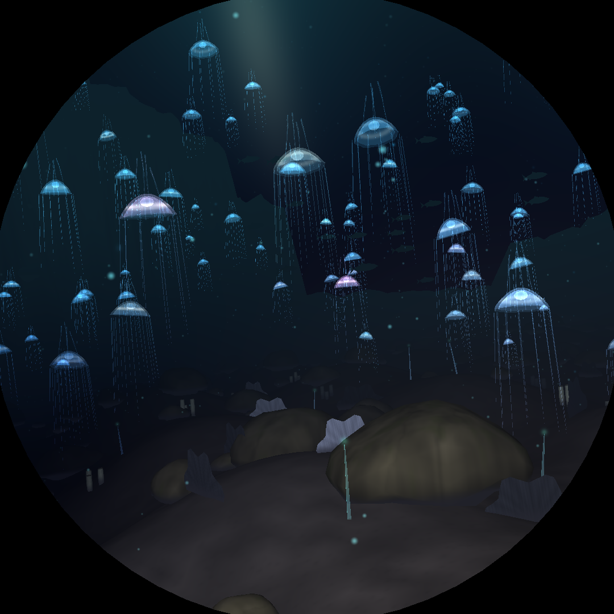
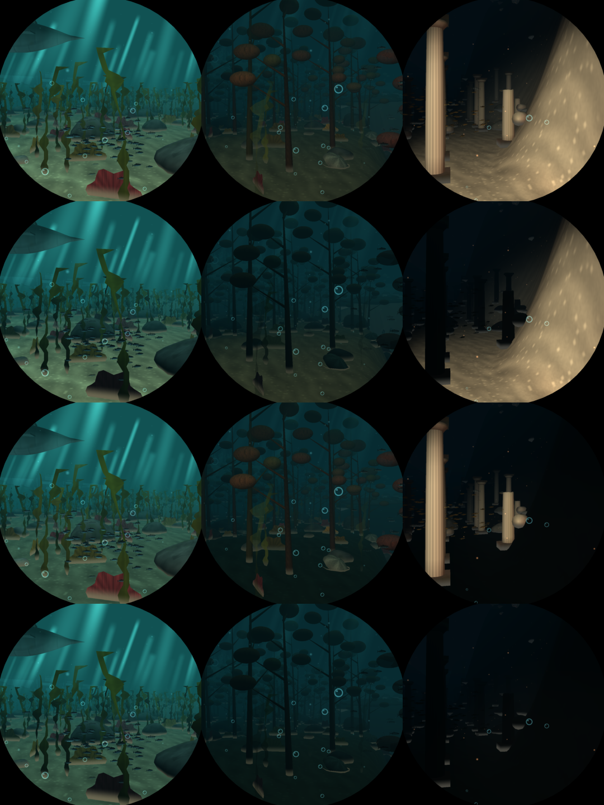
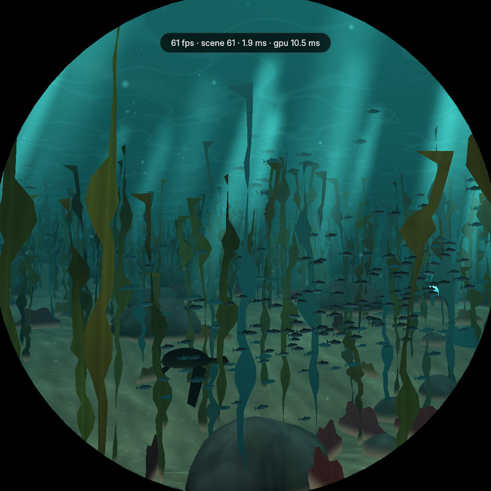

# Spotify Round

A round, 1080 × 1080 **Spotify now-playing display** for the Raspberry Pi 5, written in Rust with
[Slint](https://slint.dev) for the interface and [Animato](https://github.com/AarambhDevHub/animato)
for motion.

<p align="center">
  
  
  
  
  
  
</p>

The display is a **remote control and a visualiser**, not a speaker: it drives whichever Spotify
device is currently active (phone, speaker, desktop app). Playback control therefore needs a
Spotify **Premium** account.

---

## Features

- **Now playing** with square album art (softened corners) and a progress ring around the rim of the
  panel, drawn by a wgpu shader rather than re-tessellated Slint paths.
- **Ambient colour**: the accent, glow and controls take their palette from the artwork, and
  cross-fade perceptually when the track changes.
- **Controls**: play/pause, previous, next, seek, shuffle and repeat (off / all / one).
- **Output device**: the player names the Spotify Connect device it is driving; tap the pill under
  the track to list every device that is open (phone, speaker, TV, desktop app) and move playback
  there without touching anything else. Devices Spotify lists but does not let the API control — a
  Chromecast that is casting, for instance — are shown dimmed with the reason, instead of vanishing
  from the list.
- **Playlists** screen: browse your library, tap to start playing.
- **Queue** screen: the current track plus everything up next — tap an entry to play from there. The
  list opens on the track that is playing, so switching playlists never leaves you scrolled into the
  middle of a stale queue.
- **Motion**: an overshooting artwork reveal, a pulsing "current track" ring and sliding screen
  transitions between the pages.
- **Idle visualisers**: when nothing is playing — or a track has been paused for half a minute — one
  of the procedural scenes takes over the screen, chosen at random on every visit. The **Earth** is a
  rotating Blue Marble with Black Marble city lights, drifting clouds and their shadows, sun glint, sunset colour along the terminator and a scattering
  atmosphere. The **Nautilus** is the view from its salon window on a Jules Verne voyage, drawn as a 3D scene: the boat
  travels from sunlit kelp shallows and a bright coral garden, through the submarine forest of Crespo,
  the golden sargasso, the terraced trench and the galleons of Vigo Bay, past smoking hydrothermal
  vents, the ruins of Atlantis and the salt flats of a brine lake, into a lava cave, through a bloom
  of jellyfish, down to the abyss and its giant squid, then up under the aurora-lit polar ice.
  Each shallow sea has its own water ceiling overhead; the sky itself only shows where a ray can
  leave the water, through Snell's window or a lead in the polar ice. Swipe down on the
  player to summon the visualiser, swipe left or right on the dive to
  travel on to the next stretch of sea or back, and tap anywhere to fade back.
- **Touch first**: swipes are the only navigation — right for the queue, left for playlists, with the
  player in the middle — and dragging along the rim of the screen scrubs. Everything is laid out
  inside the circle so nothing hides in the corners of the round panel.
- **Demo mode** (`--mock`) with a built-in library and procedurally generated covers — no Spotify
  account or network needed, useful for developing on a laptop.
- **PKCE OAuth** with a loopback listener, a QR code on screen, and a CLI flow for headless setups.
  A phone that scans the code cannot call back to `127.0.0.1` on the display, so the display also
  serves a small login page on the local network that takes the authorization code back.
  Refresh tokens are stored with `0600` permissions.

---

## Hardware

| Part | Notes |
| --- | --- |
| Raspberry Pi 5 (2 GB is enough) | Raspberry Pi OS Bookworm, 64-bit |
| 5″ round HDMI display, 1080 × 1080 | e.g. Waveshare 5″ 1080×1080 round LCD with USB touch |
| USB touch panel | shows up as a normal libinput touchscreen |

The UI is authored at exactly 1080 × 1080 logical pixels and keeps interactive elements inside a
~500 px radius, so it also looks right in a window on a desktop.

---

## 1. Create a Spotify application

1. Open the [Spotify developer dashboard](https://developer.spotify.com/dashboard) and create an app.
2. Add this **redirect URI** (character-for-character):

   ```
   http://127.0.0.1:8888/callback
   ```

   Spotify only allows `http://` for **loopback IP literals**; `http://localhost` is rejected.
   If you change `redirect_port` in the config you must register the matching URI.

3. Copy the **client ID** (no client secret is needed — the app uses PKCE).

Playback control requires Spotify Premium; without it the display still shows what is playing but
Spotify answers `403 PREMIUM_REQUIRED` for transport commands.

---

## 2. Build

On the Pi (or on any machine, for the demo mode):

```bash
sudo apt update
sudo apt install -y build-essential pkg-config libfontconfig1-dev libfreetype6-dev \
    libxkbcommon-dev libwayland-dev libegl1-mesa-dev libgl1-mesa-dev fonts-inter \
    libvulkan1 mesa-vulkan-drivers

curl --proto '=https' --tlsv1.2 -sSf https://sh.rustup.rs | sh
source "$HOME/.cargo/env"

git clone <this repository> spotify-round
cd spotify-round
cargo build --release
```

`fonts-inter` gives the intended typography; without it Slint falls back to the system sans-serif.

### Building on a Mac or another arm64 machine

Building on the Pi takes a while. With Docker, `deploy/build-for-pi.sh` builds the same binary in an
arm64 Debian 13 container, which matches Raspberry Pi OS, and leaves it in `target/pi/`; on a Mac
with Apple silicon the container runs natively, so it is quick, and rebuilds are incremental. Copy it
over the one the kiosk runs, and restart it:

```bash
deploy/build-for-pi.sh
scp target/pi/spotify-round <user>@<pi>:spotify-round/target/release/spotify-round.new
ssh -t <user>@<pi> 'cd spotify-round/target/release && mv spotify-round.new spotify-round \
    && sudo systemctl restart cage-kiosk'
```

`--tests` also builds the test binary, `target/pi/spotify-round-tests`, to run the benchmarks on the
Pi without a Rust toolchain there, for example `./spotify-round-tests dive3d::tests::frame_cost
--ignored --nocapture`. Arguments after `--` go to cargo: `deploy/build-for-pi.sh -- --features kms`.

Debug builds are usable too: `Cargo.toml` keeps the app at `opt-level = 1` with line tables but
optimizes every dependency (`opt-level = 2`). Unoptimized Slint/Skia/wgpu cannot repaint a
1080 × 1080 scene at 60 Hz — the UI stutters at ~14 fps even on a fast desktop GPU — while the
optimized dependencies reach the frame budget.

---

## 3. Configure

The app reads (and creates on first run):

| Platform | Path |
| --- | --- |
| Linux | `~/.config/spotify-round/config.toml` |
| Windows | `%APPDATA%\spotify-round\config\config.toml` |

```toml
client_id = "your-client-id"

# Must match the redirect URI registered in the Spotify dashboard.
redirect_port = 8888

# Host a phone should use to reach the login page. Defaults to the address of
# the default route (for example 192.168.1.24); set it when the display has
# several interfaces or a name that resolves on your network.
# login_host = "spotify-round.local"

# Playback polling interval. Spotify's rate limit is generous at one second.
poll_ms = 1000

# Show the frame-rate readout from the start (the F key toggles it).
# show_fps = false
```

`SPOTIFY_ROUND_CLIENT_ID` and `SPOTIFY_ROUND_CONFIG_DIR` override the file and the directory, which
is handy for systemd units.

---

## 4. Authorize once

### From a phone (the QR code on the display)

Tap **Authorize**: the display starts listening, shows a QR code and opens the authorization URL in
its own browser if it has one. Scan the code with the phone.

Spotify redirects to the registered `http://127.0.0.1:8888/callback`, which on a phone means the
phone itself and cannot work — Spotify refuses any other `http://` redirect. The QR code therefore
points at a login page the display serves on the local network instead:

1. Open the page (`http://<display-address>:8888/`, also printed in the log), tap **Open Spotify**
   and approve access.
2. The phone ends up on a `127.0.0.1` page that does not load. That is expected: copy the whole
   address from the address bar.
3. Go back to the login page and paste it into the field; pasting submits the form. The display
   exchanges the code and starts.

The listener exists only while a login is running, accepts nothing but the page, the redirect and
the paste, and the code is useless without the PKCE verifier that never leaves the display.

### On the display (has a browser)

Start the app and tap **Authorize**. It opens the authorization URL with `xdg-open` and finishes the
login on the built-in loopback listener.

```bash
spotify-round
```

### On the display (no browser, e.g. Pi OS Lite)

Run the flow on a computer that has a browser, then copy the token file over:

```bash
# on the laptop, with the same client ID configured
spotify-round auth

# then
scp ~/.config/spotify-round/tokens.json pi@spotify-round.local:~/.config/spotify-round/
```

### Over SSH

`spotify-round auth --no-browser` prints both URLs and waits. Either forward the callback port so
the redirect reaches the Pi, or open the printed login page in any browser on the network and paste
the address back:

```bash
ssh -L 8888:127.0.0.1:8888 pi@spotify-round.local 'spotify-round auth --no-browser'
# open the printed URL in the browser on your laptop
```

---

## 5. Run

```bash
spotify-round              # full screen, Spotify
spotify-round --windowed   # a 1080×1080 window, for development
spotify-round --mock --windowed   # demo library, no account needed
spotify-round --fps        # start with the frame-rate readout showing
```

Press **F** on a keyboard to show or hide the frame-rate readout: a pill at the top of the circle,
where the round glass still has room for it, with the frames the window presented in the last
second and, while the visualizer runs, its own frame rate, the milliseconds its thread spent on
each frame and the GPU milliseconds per frame (`gpu`). On the Pi the GPU figure comes from the
V3D render engine's cumulative busy counter in
`/sys/class/drm/card*/device/gpu_stats`, sampled once a second and divided by the frames drawn;
where the adapter has timestamp queries and `SPOTIFY_ROUND_PROFILE` is set it comes from
`wgpu-profiler` instead. If neither source exists the readout says `gpu —` rather than inventing a
number. Above 16 ms the GPU cannot keep
60 fps. The window only counts frames from the first time the readout is shown, because counting
costs the Pi a render pass a frame. With `SPOTIFY_ROUND_FULL_SPEED` set, the same one-second line is
also written to `/tmp/spotify-round-fps` — window fps, screen, idle, scene fps, scene ms and gpu ms
(-1 when no GPU source exists) — for measuring a kiosk whose console cannot be read over SSH.

### Controls

| Gesture | Action |
| --- | --- |
| Tap the artwork or the big button | play / pause |
| Tap the device pill under the track | move playback to another Spotify Connect device |
| Tap ◀ / ▶ | previous / next (dimmed when Spotify has nowhere to go) |
| Drag along the ring at the edge | seek / scrub (the arc follows the drag) |
| Tap shuffle / repeat | toggle shuffle / cycle repeat |
| Swipe left | playlists |
| Swipe right | queue |
| Swipe down | idle visualiser — it picks Earth or the Nautilus at random (a tap returns to the player) |
| Swipe left / right on the Nautilus | travel on to the next stretch of sea / back to the last |
| Tap a playlist | start it and return to now playing |
| Tap a queue entry | restart the playlist from that item |

---

## Run as a kiosk on the Pi

### Raspberry Pi OS with the desktop

Start the display when you log in, with either of these (not both, or it starts twice):

- **Autostart entry:** copy `deploy/spotify-round.desktop` to `~/.config/autostart/` and set its
  `Exec` to the binary in your checkout. Autostart does not expand `~`, so the path must be absolute.
- **systemd user unit:** this one restarts the display if it ever exits.

  ```bash
  mkdir -p ~/.config/systemd/user
  cp deploy/spotify-round.service ~/.config/systemd/user/
  systemctl --user daemon-reload
  systemctl --user enable --now spotify-round.service
  ```

  It expects the checkout at `~/spotify-round`; edit `ExecStart` if yours is elsewhere.

Set the Pi to log in to the desktop automatically (`sudo raspi-config` → System Options → Boot /
Auto Login).

Full screen, the display hides the mouse pointer itself, so nothing else is needed for that: many
round panels' touch controllers report themselves as a mouse, and the compositor would otherwise
draw an arrow over the screen. (`unclutter` would not help anyway: it only works under X11, and
Raspberry Pi OS and cage both run Wayland.) Run with `--windowed` to keep the pointer.

### Raspberry Pi OS Lite + cage

[cage](https://github.com/cage-kiosk/cage) is a Wayland compositor that shows one application full
screen and nothing else. `deploy/cage-kiosk.service` is a **system** unit that runs the display in it
on its own console, tty7, which it brings to the screen at start (Ctrl+Alt+F1 still reaches the
login console), with a login session of its own so cage can take over the screen and the
touch input:

```bash
sudo apt install cage
sudo cp deploy/cage-kiosk.service /etc/systemd/system/
sudo cp deploy/cage.pam /etc/pam.d/cage
sudo systemctl daemon-reload
sudo systemctl set-default graphical.target
sudo systemctl enable --now cage-kiosk.service
```

Edit the unit first: it runs as `pi` from `/home/pi/spotify-round`. Current Raspberry Pi OS has no
default `pi` user, so put in the user you created and the path to your checkout. That user needs
to be in the `video`, `render` and `input` groups, as the first user on Raspberry Pi OS is:
`groups` shows them, and `sudo usermod -aG video,render,input <user>` adds any that are missing. The
display logs to the journal: `journalctl -u cage-kiosk -f`.

### Without any compositor (DRM/KMS)

cage costs a little GPU time and memory that the Pi can spend elsewhere. Building with the `kms`
feature lets the app own the display and draw through DRM/KMS on its own:

```bash
sudo apt install libseat-dev libinput-dev libudev-dev
cargo build --release --features kms
```

Run it from a virtual console (or from a systemd unit with `StandardInput=tty`, `TTYPath=/dev/tty1`,
`TTYReset=yes`) as a user in the `video` and `render` groups. `SLINT_BACKEND` overrides the choice if
you want to experiment (`winit-software`, `linuxkms-femtovg`, …).

### Panel geometry

Most 1080×1080 round HDMI panels need the mode forced. In `/boot/firmware/cmdline.txt` add:

```
video=HDMI-A-1:1080x1080@60
```

and in `/boot/firmware/config.txt`:

```
disable_overscan=1
hdmi_drive=2
```

The app requests full screen and draws a 1080×1080 surface; if your panel reports a different mode,
use `SLINT_SCALE_FACTOR` or the compositor's output scaling.

---

## How it is built

```
src/
├── main.rs            CLI entry point, logging, rustls provider
├── app.rs             controller: polling, commands, view models, animation tick
├── ui.rs              every Slint property write + offscreen preview renderer
├── motion.rs          Animato: accent tween, reveal, pulse
├── visuals.rs         idle scene registry and the render thread; picks a scene at random
├── globe.rs           idle scene: the Earth, a wgpu fragment shader over the day, night, cloud and relief maps, lit through a model of the air
├── shaders/           WESL package, linked to WGSL by `build.rs`
│   ├── common.wesl    shared smoothing, distance and noise functions
│   ├── scene.wesl     the dive: water, seabed, models, glass and sprites
├── dive3d/            idle scene: the Nautilus' voyage, rasterised in 3D
│   ├── mod.rs         renderer: passes, pipelines, lighting; draws the sea full-panel
│   ├── helm.rs        how the boat moves: a 20 m hull's track, height, pitch, roll and clearances
│   ├── heightmap.rs   the random seabed of each visit: rolling ground, ridges and canyons
│   ├── terrain.rs     the seabed in tiles, built as they come into view and dropped behind
│   ├── textures.rs    fifteen procedural surfaces: rock, planks, marble, scales, skin, copper…
│   ├── world.rs       what is in the water each frame: features, swimmers, lights, sprites
│   └── mesh.rs        every model, generated at start-up, reordered by meshoptimizer
├── voyage.rs          the voyage itself: distance travelled, swipes, and the dive profile behind the depth gauge
├── ring.rs            the player's backdrop: glow, vignette and progress rim in one wgpu fragment shader
├── gpu.rs             the single wgpu/Vulkan device, handed to Slint before the window exists
├── artwork.rs         download → decode → rounded mask → accent colour → cache
├── browser.rs         xdg-open / start / open
├── config.rs          config.toml, token paths, permissions
├── format.rs          time and pluralisation
├── service/
│   ├── mod.rs         `Source` = live Spotify API or demo backend
│   ├── api.rs         typed Spotify Web API client
│   ├── auth.rs        PKCE OAuth, callback listener and phone login page, token refresh
│   └── mock.rs        in-memory demo library
ui/
├── main.slint         window, ambience, screen router
├── theme.slint        design tokens
├── state.slint        Player / Devices / Library / App / Idle globals
├── components/        icons, buttons, artwork, rim ring, rows, toast…
└── screens/           now playing, device picker, playlists, queue, login, idle
assets/earth/          Blue Marble day, night and clouds (4K), relief and water maps (2K)
build.rs               Slint + WESL build steps; the WGSL artifacts go to OUT_DIR
```

**Shader and mesh tooling.** The shaders are a small [WESL](https://wesl-lang.dev/) package under
`src/shaders/`: `common.wesl` is imported by the two root shaders, and `build.rs` links each root to
plain WGSL in `OUT_DIR` before wgpu sees it. The models are reordered with
[meshoptimizer](https://github.com/zeux/meshoptimizer) (`meshopt`) for vertex fetch and post-transform
cache locality, and the CPU mesh math uses [`glam`](https://github.com/bitshifter/glam-rs).
`wgpu-profiler` wraps the Nautilus encoder when `SPOTIFY_ROUND_PROFILE=1` and the adapter exposes
timestamp queries. The Pi 5's V3D does not, so there it is compiled in but left off and the
`V3D` sysfs accounting is used instead.

**Threading.** Slint runs on the main thread. A Tokio runtime polls `/me/player` once a second and
performs commands; results are marshalled back with `upgrade_in_event_loop`. `slint::Image` is not
`Send`, so artwork is decoded to a `SharedPixelBuffer` on a worker thread and turned into an image on
the UI thread. A timer on the UI thread ticks once per frame at the panel's refresh rate (16⅔ ms for
60 Hz, not the 16 ms that would make it 62.5 Hz) and advances the progress clock between polls. The
rim is not a Slint path: `ring.rs` draws the track, the played sector and the head dot with one
fragment shader into one of three textures, and Slint only composites the latest one. That removes
per-frame SVG parsing and stroke tessellation, and a paused track repeats the same input so the rim
is not redrawn at all.

**Hardware acceleration.** Before any window exists, `src/gpu.rs` opens a wgpu device (Vulkan first)
and hands it to Slint with `BackendSelector::require_wgpu_30(WGPUConfiguration::Manual { .. })`, so
Skia composites the whole UI through Vulkan (`-v` logs the adapter and the graphics API in use).
That API sits behind Slint's `unstable-wgpu-30` flag, so the feature and `slint::wgpu_30` names move
with wgpu releases; the idle scenes and the progress rim render on the same device and their frames are
handed over as textures, so nothing round-trips through the CPU. On a Pi without a compositor build
with `--features kms` to draw straight through DRM/KMS instead of winit:

```bash
cargo build --release --features kms
```

that feature pulls in libseat and libinput, so `libseat-dev`, `libinput-dev` and `libudev-dev` have to
be installed for the build. Playback position is interpolated from a monotonic clock and a poll only
re-anchors it when it disagrees by more than a second, which keeps the rim moving forwards at a
constant rate instead of twitching as the answers arrive.

**What the Pi's GPU can afford.** The Pi 5's VideoCore VII (V3D) is short of arithmetic: about
46 billion shader operations a second, so a full-screen pass at 1080 × 1080 costs roughly
`instructions per pixel × 0.025 ms`, and a shader too large for its registers runs at half the
thread count and pays more besides. Passes, blending and buffer uploads are cheap by comparison.
`cargo test gpu_cost -- --ignored --nocapture` (or `spotify-round-tests gpu_cost …` on the Pi)
measures them on the GPU at hand, and `V3D_DEBUG=shaderdb` makes Mesa print each shader's
instruction and thread count. That needs no Pi: `deploy/v3d-shaderdb/shaderdb.sh <checkout>` builds
the Pi OS release of Mesa in Docker with its V3D noop `drm-shim`, compiles every pipeline of the
scenes with the Pi 5's own compiler and prints each shader's instructions, threads and spills by
pipeline label and entry point (about a minute once the image is built);
`deploy/v3d-shaderdb/compare.py a.txt b.txt` shows what changed between two checkouts.
`spotify-round-tests gpu_cost::videocore_vii --ignored` asserts that the headless adapter really is
the Pi 5's V3D; run it before trusting a Pi measurement. So:

- Slint draws the window with **Skia**, which compiles a small shader for each kind of draw.
  femtovg, Slint's other GPU renderer, runs one 1090-instruction shader for every paint type: a
  full-screen femtovg layer cost about 5 ms on the Pi against 0.4 ms for a trivial shader, and the
  player alone 25 ms of the 16.7 ms a frame has. `--no-default-features --features femtovg,full-hd`
  switches back, to compare.
- The Nautilus' sea is the panel's full **1080 × 1080** with **one** sample. The shader profile
  shades the seabed with one texture lookup and full sun/lamp/four-point-light/caustic lighting at
  the vertices, with fine floor detail; the models use the same vertex light and material effects.
  The 3D sea texture is handed to Slint directly, filling the panel. On the Pi 5 `frame_time` now
  measures **11.6 ms on average over all thirteen legs, 15.2 ms on the heaviest leg** (the coral
  garden's close reef), and **17.8 ms at the worst sampled hotspot** (a close jellyfish in the
  wrecks); `frame_cost` is 13.8 ms. The live kiosk reports **61 fps with the scene at 1.9 ms and the
  GPU at 10.5 ms**. The original eight seas average 11.2 ms and the five newer seas 12.1 ms now that
  every leg is a full five minutes of world rather than ninety seconds. The procedural arctic sky
  measured 36 ms until it became a baked cubemap; it is now 9.4 ms. There is no smaller profile:
  the sea is always the panel's 1080 pixels, and what the frame spends its time on is in
  [docs/pipeline-optimization.md](docs/pipeline-optimization.md).
- What can be drawn together is: the player's glow, vignette and rim are one opaque texture from
  `ring.rs`, and the globe paints the space behind itself, so those screens are one full-screen layer
  for Slint. The Nautilus is one full-panel sea texture.
- Shaders are specialised where they branch on something fixed for a draw: the dive's model
  shader gets a pipeline per material and per grounded flag, so a swimming fish does not carry the
  seabed bedding its rocks need, and the globe works out once what never changes for a pixel (where
  it lies on the maps, the air towards the viewer) instead of every frame.
- No rendering notifier is installed unless the frame-rate readout asks for one: while one is set,
  Slint submits the window clear in a pass of its own.
- Every submission is made on the UI thread (`Graphics::submit`). wgpu drains the queue before it
  reconfigures the window's surface and fails if another thread submits meanwhile, which Slint
  does on the UI thread whenever the swapchain goes out of date.
- The visualizer keeps two frames in flight, no more. A scene thread that submits on its own clock
  queues work ahead of the window's frames faster than the GPU finishes it, until every frame on
  screen is late.

`SPOTIFY_ROUND_SCENE=globe` (or `nautilus`) shows that scene from the start, for measuring one with
`SPOTIFY_ROUND_FULL_SPEED`, and `WGPU_BACKEND=gl` runs everything on the Pi's OpenGL ES driver
instead of Vulkan.

**Optimistic UI.** Commands apply their result before Spotify confirms it, so the display never lags
behind a press. Play/pause, shuffle, repeat, seek, skips and playlist starts update the model
immediately; a `Pending` record marks what was asked for, and a poll that still describes the old
state is ignored until Spotify agrees (or three seconds pass). Skips borrow the upcoming item from a
warm `/me/player/queue` cache and keep a short history, so `next` and `previous` change the artwork
on the press; starting a playlist shows that playlist's cover with "Starting playlist" until the
first track is reported. Spotify's `actions.disallows` flags grey out a skip button that would have
nowhere to go, and a refused skip dims it for that item. The device picker lists
`/me/player/devices` when it is opened (the answer is reused for ten seconds), and picking a device
posts it to `PUT /me/player`; the player's device pill switches on the press, before the next poll
confirms it. The device model is deliberately loose, because the API is: `id` and `type` are both
nullable, `type`'s casing varies (`CastVideo`, `TV`, `AVR`), and a device with `is_restricted` or no
id is listed but cannot be driven. Rejecting any of those would fail the whole response — including
the playback poll — so they are decoded into `Option`s and handled per row.

**Motion.** [Animato](https://github.com/AarambhDevHub/animato) computes the values that need
continuous simulation: a `Tween<Color>` for the ambilight (interpolated in linear-light space), an
`EaseOutBack` tween for the artwork reveal and a ping-pong tween for the queue's current-track pulse.
Geometry transitions (screen slides, fades) use Slint's declarative animations so they run at the
display refresh rate.

**Idle visualisers.** `screens/idle.slint` fades a full-screen overlay in when there is nothing left to
show: three seconds after Spotify reports nothing playing, or thirty seconds after a loaded track was
paused. Resuming playback closes it again, and a tap on the visuals returns to the player and keeps
them away until playback resumes.

Each visit picks a scene at random from the renderers that came up. `visuals.rs` owns that registry and
the render thread: a scene implements `Visual`, is added to `Scene`, and gets a block of three render
targets; the UI only needs a scene index and a frame, so adding another visualisation does not touch
the Slint screens. Both scenes are drawn with [wgpu](https://wgpu.rs) on the Vulkan device the UI itself
uses, straight into textures that Slint samples from the same device. Nothing is read back or
re-uploaded, so a frame never leaves the GPU. Frames are drawn at 60 fps and only while the overlay is
visible; at rest the thread sleeps and the display draws no power at all. `-vv` logs the achieved rate.

**Earth.** The planet is drawn in `globe.rs` with one fragment shader that projects the sphere, samples
the maps and lights it through a model of the atmosphere, in linear light.

- **Day side** — NASA Blue Marble; **night side** — Black Marble city lights, warm amber where they
  are faint and whiter where they are dense, dimmed by cloud.
- **Sun** — one light that travels once round the planet every half hour, so the terminator sweeps
  across the disc: full daylight, then a few minutes of the night side with its city lights, then
  daylight again. The planet turns on its axis, tilted 23.4°.
- **Air** — Rayleigh scattering, strongest in the blue. Sunlight crossing a long path of air near the
  terminator is reddened, so the ground and, a little longer, the cloud tops glow with sunset colour
  there; the air in front of the ground dims it and adds a blue haze that thickens toward the limb;
  and outside the limb the air glows where the sun reaches it, thinning out exponentially with
  height and lingering past the terminator, where the high air is still lit. On the night side only
  a faint green line of airglow remains.
- **Relief** — the normal map tilts the lighting, so mountain belts and trenches catch the light.
- **Water** — the sea darkens and catches the sun in a soft glint spread by the waves, with a Fresnel
  sheen of sky toward the limb, broken up by the cloud sheet.
- **Clouds** — a sheet that turns a little faster than the ground, so the weather visibly moves over
  the continents. It casts shadows away from the sun, longer as the sun sinks, and hides the city
  lights underneath.

The maps are 4096 × 2048 (2048 × 1024 for relief and water), which on the 850-pixel disc is still about
one and a half texels per pixel at the centre. Each is stored in the smallest format that holds it: the
day map as sRGB, so the GPU linearises it when sampling and builds a gamma-correct mip chain; the city
lights and the clouds as one channel each; the relief's two slopes together with the water mask. The GPU
builds every mip chain, with a little extra level of detail bias when sampling, which keeps the city
lights from sparkling as the map is minified; sampling is anisotropic where the driver offers it. All of
it comes to about 80 MB of GPU memory, against 420 MB for the 8K maps this replaced, and decodes in a
quarter of the time; per frame the GPU does less work than before, despite the atmosphere. `SIZE`,
`FPS`, `REVOLUTION`, `SUN_PERIOD`, `PLANET`, `ATMOSPHERE`, `AIR`, `SCALE_HEIGHT`, `SUNLIGHT`,
`CLOUD_DRIFT` and `OBLIQUITY` are the knobs.

Earth textures: NASA **Blue Marble** (day) and **Black Marble** (night lights), as distributed by
[solarsystemscope.com](https://www.solarsystemscope.com/textures/) under
[CC BY 4.0](https://creativecommons.org/licenses/by/4.0/). They live in `assets/earth/`.

**The Nautilus.** The view from the Nautilus' salon window, after *Twenty Thousand Leagues Under the
Seas*, drawn as a real 3D scene in `dive3d/`. The boat travels on through thirteen legs of five
minutes each: sunlit kelp shallows, a coral garden, the submarine forest of Crespo, the golden
sargasso, a trench, the galleons of Vigo Bay, smoking hydrothermal vents, the ruins of Atlantis,
salt flats and brine pools, a lava cave, a bloom of jellyfish, the abyss, and the underside of the
polar ice. A swipe to the left carries it on to the next leg in a short surge — the passage is
scaled with the leg, so the boat keeps the same speed through it as before — and a swipe to the
right back to the last; `voyage.rs` steers it, and every visit joins a new seabed on a
circuit whose thirteen legs are shuffled by the visit's seed (`order_for`; seed 0 is the canonical
reference circuit; the original eight keep their ids, and the five newer seas take the end of every
per-biome table). The course weaves so each boundary is crossed in the middle of a real turn, and the weave is eased out
over five units before the cave's mouth, where the tunnel leaves no room for it. Encounters — a
school, a party of divers, a whale, the sister submarine — fade over the rim of the glass as they
come into the window instead of appearing at full strength.

The ceiling of every shallow sea is water, not a painted sky: the window sees the underside of the
surface as a soft caustic shimmer, slow swells and the sun's sheen, kept low-contrast so it reads as
a backdrop rather than a second scene. The sky is only what that water
opens on to, and only where a ray can actually leave it: inside Snell's window overhead, which a
level salon window rarely sees, and through the polar ice's leads, where the aurora shows. The cave,
the vents, the bloom and the abyss have no sky at all, only water. The palettes are one small set in
`sky_at`, used only where the physics opens a way out: the Snell window and the polar leads
(`g.sky` in `scene.wesl`).

<p align="center">
  
  
</p>


### Reference sheets

One tiled frame of every place in `places::all()` — every scene, every moment and every effect the
dive can show:


The [labelled index](docs/dive3d-scenes.html) names each tile and is generated with the image. For
lighting, the same three demanding places under the full path and each cheaper path:



The [lighting index](docs/dive3d-lighting.html) labels the rows and columns. Regenerate either with:

```sh
DIVE3D_SHEET=docs/dive3d-scenes.png cargo test --release dive3d::tests::scenes_sheet -- --ignored
DIVE3D_QUALITY_SHEET=docs/dive3d-lighting.png cargo test --release dive3d::tests::quality_sheet -- --ignored
# The leg, seabed and cave shots of one exact random circuit: seed 0 is the
# canonical reference, any other visit number gives a reproducible shuffle.
DIVE3D_SHOTS_SEED=7 DIVE3D_SHOTS_DIR=/tmp/dive-seed7 cargo test --release dive3d::tests::screenshots -- --ignored
```

Both use the fast reference path (`read_back_fast`) so a whole sheet takes seconds, not the
twenty-second helm settle of `read_back_swiped` per shot.

### Idle rendering, Slint and screensavers

The idle scene is an app-supplied wgpu texture, not a Slint-drawn image. The render thread keeps
three slots per scene (`SLOTS = 3`), hands Slint one `Image::try_from(texture)` per slot once, and
switches the visible slot by index. That is the path Slint's
[wgpu texture example](https://github.com/slint-ui/slint/tree/master/examples/wgpu_texture) uses: no
CPU readback and no per-frame image copy.

A few practical constraints found while checking this against Slint's renderer:

- Keep the handed texture **opaque and full-frame**. Slint's Skia/WGPU path can treat an
  app-supplied texture as unpremultiplied or only partially redrawn
  ([slint#13203](https://github.com/slint-ui/slint/issues/13203)); the sea is `Rgba8Unorm` with
  alpha 1, and the static overlay was removed so there is exactly one image layer.
- Keep the UI's image model stable and swap the index, rather than replacing the model every frame.
  `set_idle_frames` runs when a scene is built; `show_idle_frame` runs per frame.
- The render thread is already visibility-gated by `running`; when the visualizer is hidden it
  sleeps and does not submit GPU work. That is the right place to save power, rather than making
  Slint redraw a hidden layer.
- Actual screen blanking/DPMS belongs to the Wayland compositor or the panel (`cage`, `wlopm`,
  DPMS), not to Slint. The app should keep rendering only while its visualizer is visible and let
  the compositor own idle blanking. This is also why the renderer does not install a continuous
  Slint timer.
- The two-frame GPU fence (`in_flight`) is deliberate: one frame in flight leaves the V3D idle
  while Slint is compositing; more than two queues work ahead of the display.

Every
model is generated when the scene is built, from a handful of generators: surfaces of revolution for
columns, trunks, cones and bells; lofted bodies for the fish, shark, whale, dolphins, narwhals, penguins,
the squid's mantle, the manta rays, the turtles' shells and the galleons' hulls; extrusions for fins,
flukes, flippers, sails, stars and slabs of ice.
Each frame `world.rs` visits the cells of the world in view and places what lives there — the same rock
always in the same place — and the swimmers in their processions; a diver is a dozen capsules posed
for its stride, a school a few hundred instances of one fish. The vertex shader bends them: fish sweep
their tails sideways, whales and dolphins beat their flukes, and manta rays and turtles their wings
and flippers with the same wave run out from the body; kelp and fans sway, tentacles writhe and
bells pulse. Jellyfish are the most detailed of them: a medusa bell with a scalloped, eight-canal
margin, an inner shell and a warm stomach, four frilled oral arms and a fringe of eight to sixteen
writhing tentacles, in five species from the pale moon jelly to the glowing crystal jelly. The bell
and the soft tissues are separate materials in the additive glass pass, so the rim, the canals, the
stomach and the tentacle tips are lit differently instead of reading as one flat translucent dome.
The new seas add their own life: branching reef coral, floating sargassum rafts, black smokers with
tube worms, salt spires over brine pans, and the bloom's dense drift of jellyfish. The seabed is
built by `terrain.rs` from the same heightmap `world.rs` places things with, so everything stands on it, and anything on the seabed takes on its sand where it meets it. It
comes in tiles, built on the CPU the first time each comes into view and forgotten once the boat has
left it behind, at three levels of detail nested around the boat: fine for at least five units,
coarser out to the horizon, skirted where two levels meet so no crack shows. Only the tiles in view
are drawn, nearest first. Whatever lies outside the round window is not drawn at all: models and
tiles are culled against the window's circle, the corners of the square the sea is rendered into are
masked off before anything is drawn, and closed models — rocks, columns, hulls, every animal — leave
out the back faces no one can see. Every model is also built coarser, from the same recipe with half
the segments, and `mesh.rs` measures how far each coarser level strays from the full one, in shape,
colour and shading; a distant fish or pebble is drawn coarser only where that difference is under half
a pixel of the sea, so the switch cannot be seen. The sea is an 8-bit full-brightness texture handed
straight to Slint. The boat sails a meandering corridor kept clear of
wrecks, temples and great rocks; schools and whales keep to lanes on either side of it, and divers
walk paths that bend round the rocks, trees and columns in their way. Rocks, kelp and fish are placed
in the cells of the whole view, whichever way it faces, and fade by coverage at the edge of their
range, so nothing appears or vanishes in the middle of the window. Light comes from the sun through the surface, the searchlight as a real spotlight, and up to eight
point lights — lava pools, vents, the volcano, the divers' lamp, anglerfish lures — with the water
hazing everything by its distance; the surface and the ice are great planes overhead. Daylight
loses its red first on the way down, so the deeper the boat the bluer the light it sees by, a colour
worked out once a frame. Where the sea is shallow enough, shafts of sunlight slant down from the
surface, through the kelp, between the forest's trees, over the wrecks and through the leads in
the ice: ribbons rooted in a grid fixed in the world, so the boat sails among them, breathing and
swaying as the waves above gather the light. The underside of the surface is a cheap moving swell:
two long swells, a wavelet and a sun glint, with the broad bright patches the shafts appear to leave
from. They are drawn in a pipeline of their own, so the snow and bubbles pay nothing for them, and
they replace the sunbeams the open water used to paint on every pixel behind everything else. The lava cave is
a real tunnel: a massif rises across the corridor and the boat enters it through a mouth in its cliff
face, under a ragged arch of basalt veined with molten rock, hung with stalactites and lit from below
by lava pools, and leaves by the far mouth; the mesh is built from rings fixed in the world, once
as the boat nears the tunnel. Its walls are ledged and pocked, darker in the hollows, and
glisten where the searchlight strikes them. Off it open the cave's secrets, the same five in
every cave in an order of the seabed's own: a passage down to a chamber of molten rock with
embers drifting out, a grotto lit by breathing colonies of luminous creatures, a gallery of
violet crystals, a doorway of dressed stone with signs on its lintel and steps up into a warm
light, and a chimney in the vault letting down a shaft of pale light. Each is a passage lofted
from the edge of a hole cut in the wall (or the vault), bent on round a corner so its end is
never seen, with the massif's rock cut back for it and the dome swelling over it. Their light
costs almost nothing per pixel: how far each point of the tunnel stands over its floor, how dark
its rock is and the coloured light each passage throws on the rock round its mouth are baked
into the tunnel's vertices, glows and embers are sprites, and the crystals are glass. The tunnel
has a material and pipeline of its own (`MATERIAL` reaches the vertex shader too), so no other
model pays for it: its fragment shader came down from 1518 to 874 instructions on the Pi, and the
per-instance one from 2369 to 1412, once neither looked up the seabed's height per pixel.
Past the forest the seabed breaks into a trench, and the boat sails along its rim with the gulf
beside the window: gullies cut across the rim and run down into it, the near wall steps down in
terraces to a floor some sixty metres below, and the far wall climbs back in terraces across the
gap, above the rim. All of it is the seabed's own height (`world::trench_profile`, a handful of
smoothsteps and sines, mirrored in the shader), so the tiles' rock on the slopes makes the walls
and nothing is added per pixel; the helm heels the boat a little to port there so the window looks
down over the edge. Slabs of rock jut over each drop, sediment spills from some of them and drifts
down, sponges, sea fans and tube worms cling to the far wall, faintly glowing sea pens and
crinoids stand on the terraces, lights blink in the dark at the bottom, and the water is clear
enough for sunlight to slant down into it. The biomes' tables keep their numbers and their original
ids, with the five newer seas after them; `voyage::ORDER` (and `order` in the shader) says the order
the legs come in.
The seabed is a random heightmap made afresh on every visit — rolling ground, folded ridges and the
odd canyon, 64 units to a tile — shown more strongly in the rugged abyss than under the paved city;
it shelves between the seas, so the boat drops over an edge into the abyss and climbs out to the ice.
The sea's surface stays at the same height whatever the boat does. The helm in `helm.rs` sails the
boat as the hull it is — twenty metres long and three high, about 1.8 × 0.27 units, the salon window
halfway along its port side — at a survey pace of about 1.2 knots, swinging only a few percent in
speed. It goes where it points: its track is the corridor's meander plus a slow wander of the
helmsman's own, never bending tighter than about ten hull lengths' radius, and it banks a degree or
two into each bend. It climbs and dives on ballast and planes at under a metre a second, gathering
way over a quarter of a minute and braking harder than it starts, noses up or down at most six
degrees, and reads the ground and the roof several lengths ahead, so it starts over a ridge, or down
under the cave's vault at its mouth, in good time and sails over a gully rather than ducking into it.
Every point of the hull, not just the window, keeps about a metre of water under it and inside the
tunnel. Near the surface the swell heaves it a few decimetres and rolls it a fraction of a degree,
less the deeper it goes. In the cave, at dead slow, the helmsman sets the boat up to about 30°
across the tunnel so the window looks up it — no farther than the hull clears both walls, and
swinging it no faster than half a degree a second. A swipe's passage is the voyage fast-forwarded:
the climbs and dives run on the voyage's own clock, so the boat rides the ground as it would have at
cruising pace, its attitude turning at most three times its cruising rate, and the rush of bubbles
streaking past the glass covers the speed. `HELM_LOG_DIR=<dir> cargo test --release survey --
--ignored` logs a few voyages' poses — knots, rate of turn, turning radius, climb, pitch, roll and
the hull's clearances — and a test holds the helm to them. The helm costs a few microseconds a
frame, and the manometer reads the boat's real depth. Things fade in and out as their
sea comes and goes: at one sample they are blended over the water by coverage, and the ice fades at
its edges rather than stopping at a line. Fifteen procedural surfaces — rock, planking, veined
marble, fish scales, whale skin, copper going green, canvas, coral, kelp, basalt, ice, sand, silt,
riveted iron plates —
are projected along three axes, carried by the swimmers as they bend and fixed in the world on the
seabed, the ruins and the wrecks; the seabed takes rock on its slopes.
Every couple of minutes a sister of the Nautilus may cross the window, twenty metres of riveted iron
with a ram at the bow, warm ports and a screw turning in a trail of bubbles: passing close the other
way, overtaking, drawing up alongside for a while, far off across the water, or nosing out of the
gloom and turning away, chosen by the sea she is met in and kept clear of the trees and kelp, the
columns, temples and masts. In dark water her searchlight sweeps the sea, a beam in a small pipeline of its own with
one point light where it falls, and in the abyss she is little more than her lights. The encounters
run on the visit's clock, so `places.rs` can find them (`DIVE3D_SHOTS=encounter`). A sister is
steered as a heavy hull: her heading comes from the meeting path's analytic derivative, and her
yaw, nose and heel follow bounded, acceleration-limited springs, banking into the turn she is
making; her depth answers its planes the same way. `cargo test --release
dive3d::world::tests::submarines` holds the motion to those rates.
It renders at 1080 × 1080 with one sample and a reversed depth buffer, then goes through the
full-panel sea: the 3D sea is handed to Slint directly, with no bezel or other overlay. On the
Pi 5 `frame_time` measures 11.6 ms on average, 15.2 ms on the heaviest leg, and 17.8 ms at the worst
sampled hotspot; `frame_cost` measures 13.8 ms. On a
desktop GPU it is about 2 ms, with the scene built in about 0.4 ms of CPU. `cargo test --release
dive3d::tests::frame_time -- --ignored --nocapture` times it and `DIVE3D_PREVIEW_DIR=<dir> cargo
test --release dive3d::tests::previews -- --ignored` writes a frame from each leg; add
`DIVE3D_PREVIEW_SEED=<visit>` to photograph one random biome circuit.
For debugging,
`DIVE3D_SHOTS_DIR=<dir> cargo test --release dive3d::tests::screenshots -- --ignored` shoots every
place listed in `dive3d/places.rs` — each leg as it settles, in its middle and as it leaves, and
another seabed — at full size, with a contact sheet and an `index.html` naming them;
`DIVE3D_SHOTS=cave` keeps only the places whose names contain `cave`.

**CPU precompute.** The caustic lattice is generated once on the CPU into a 256 × 256 `R8Unorm`
tile and sampled in the shader, instead of two sines and a `pow` in every vertex. The cave's
tunnel shade and lava veins are likewise baked into its vertex colours when the tunnel is built.
The seabed's tiles carry their own colour, surface layer, five noise fields and lava veins the
same way: the tile builder in `terrain.rs` works them out once, when the tile is built, and
`vs_terrain` only applies how much of the fine detail the distance lets through — 345
instructions on the Pi's compiler, from 1059. The sand under a grounded model is found once per
instance rather than per pixel, so no model shader has to work out which biome it stands in.
`cargo test --release dive3d::tests::cpu_cost -- --ignored --nocapture` prices the CPU side on the
Pi 5:

```text
cpu caustic tile (256x256): 3.403 ms
cpu new seabed:             88.261 ms   (once per visit)
cpu scene build:             1.058 ms   (per frame)
cpu per-instance light:      0.001 ms   (355 instances, four lights)
```

A per-instance CPU light pass was tried: the shader's four-point-light loop
disappeared and forest came down to 16.2 ms, but the live app then showed a
~50 ms base frame time. It is **not** the default; the GPU per-vertex light is
back on (`light_at` in `vs_model`), and the 60-second live sample is once again
61 fps throughout. The CPU per-instance timing remains in `cpu_cost` as a
candidate only.

The caustic and seabed are startup costs; the per-frame CPU scene build is about 1 ms. The
per-instance lighting experiment is not shipped; terrain light is the next candidate if it can
avoid the same CPU-side base cost.

**Hotspots, not just leg averages.** `cargo test --release dive3d::tests::hotspots -- --ignored
--nocapture` runs four visits through every leg at three places inside it, and prints the worst
hotspots. `DIVE3D_HOTSPOT_SEEDS=0,250000,500000,750000`, `DIVE3D_HOTSPOT_PLACES=0.15,0.45,0.85`,
`DIVE3D_HOTSPOT_FRAMES=6` and `DIVE3D_HOTSPOT_DIR` choose the seeds, places, samples and CSV output.
It is one binary and one process, so comparing seeds does not rebuild. For a feature cost, the same
binary accepts `DIVE3D_SKIP`: `4096` cheap model light, `8192` cheap terrain light, `12288` both,
`28672` all cheap paths; `DIVE3D_SKIP=4096 ... frame_time` prices it without a compile.

**GPU status on the Pi.** `vcgencmd measure_clock v3d`, `vcgencmd measure_temp`,
`vcgencmd get_throttled` and `vcgencmd pmic_read_adc` show the V3D pinned at 960 MHz, about 65 °C,
`throttled=0x0` and about 3 A on VDD_CORE under the dive: the 1080 profile is shader/fill-bound,
not clock- or thermal-throttled. `gpu_cost::videocore_vii` asserts the `V3D 7.1.7.0` adapter.

<p align="center">
  
</p>

The dive is **1080 × 1080 only**. The `full-hd` feature is mandatory: building without it stops
with a compile error rather than silently falling back to a smaller sea.

The Pi needs a Vulkan driver: `sudo apt install libvulkan1 mesa-vulkan-drivers`. If the adapter cannot be
created the overlay is simply left empty and a warning is logged; nothing else in the display depends on
it.

**Tap versus swipe.** Slint reports a click for every press and release on a `TouchArea`, however far
the finger travelled, and the pages slide under the finger while swiping — so a swipe that ended over a
list row would also select it. Rows therefore use `components/tap_area.slint`, which compares the
release point with the press point and stays quiet once the finger has moved more than a few pixels.

**Why square artwork with a rounded mask?** Slint clips to rectangles, so the artwork pipeline applies
an anti-aliased rounded-rectangle mask while decoding. The same decoded buffer provides the accent
colour used for the rim, glow and buttons. The slider lives on the rim of the panel, outside the
pager, so it stays put while the screens slide.

---

## Development

```bash
cargo fmt
cargo clippy --all-targets -- -D warnings
cargo test
```

There is also an offscreen renderer used for design review. It renders the real UI with the
software backend into `target/preview/*.png`:

```bash
cargo test preview -- --ignored --nocapture
```

Handy environment variables:

| Variable | Effect |
| --- | --- |
| `SLINT_BACKEND` | Override the backend, e.g. `winit-software` or `linuxkms-femtovg` |
| `SLINT_FULLSCREEN` | `1` to start full screen (the app already does, unless run with `--windowed`) |
| `SLINT_SCALE_FACTOR` | Render the 1080 px design at another physical size |
| `SPOTIFY_ROUND_LOG` | `tracing` filter, e.g. `spotify_round=debug` |

---

## Troubleshooting

**"Open Spotify on a device, then try again"** — there is no active Spotify Connect device. Start
playback somewhere first; the display controls that device. The device pill on the player lists
whatever Spotify can see, so a device that is missing there needs to be opened in the Spotify app.

**A Chromecast or Google Home is missing from the device list** — Spotify's Web API only sees
Spotify Connect devices, and it says as much: the endpoint returns "available Spotify Connect
devices", with "some device models … not supported". A Cast endpoint only joins the list once
Spotify's Cast receiver is running on it, which means starting playback there from the Spotify app;
spotcast's documentation puts it plainly: Cast devices "will not show unless active". Waking a
sleeping Cast device needs the Google Cast protocol, which the Web API does not expose, so the
display cannot do it. Devices that are listed but not controllable carry `id: null` and
`is_restricted: true` — Spotify's guidance is that such a device returns a null id — and the picker
shows them dimmed with "pick it in the Spotify app" rather than dropping them. If the list is empty
altogether, check that the token was granted `user-read-playback-state` (the app always requests it;
an old token file may not have it — re-authorize).

**Commands do nothing / `403 PREMIUM_REQUIRED`** — Spotify requires Premium for remote control.

**"Spotify is busy, retrying shortly"** — a rate limit was hit; the poller backs off automatically
and resumes.

**Authorization fails immediately** — the redirect URI must match the dashboard exactly, including
the port, and must be a loopback IP (`127.0.0.1`), not `localhost`.

**The phone says "can't connect to 127.0.0.1"** — expected: that address is the phone. Paste the
address from the address bar into the login page the display serves, or set `login_host` if the
detected address is not the one your phone can reach (a VPN, several interfaces, or a name that
resolves on your network). The page is only reachable while a login is running.

**Window is huge on my laptop** — run with `--windowed` and, if your screen is smaller than 1080 px,
`SLINT_SCALE_FACTOR=0.6`.

**Blurry text on the Pi** — install `fonts-inter` and make sure the compositor is not scaling the
output away from 1:1.

**The animation stutters** — check the `-v` log for the `graphics` line. `backend=Vulkan` with a
`V3D` adapter means the GPU is drawing; anything else means wgpu fell back to another backend
(usually a missing `/dev/dri` device or a VNC session). Then press **F**: the readout's `gpu` figure
is how long the GPU took for the visualizer's last frames, which tells a scene that is too heavy
from a screen that is waiting on something else.

---

## License

MIT — see [LICENSE](LICENSE).
