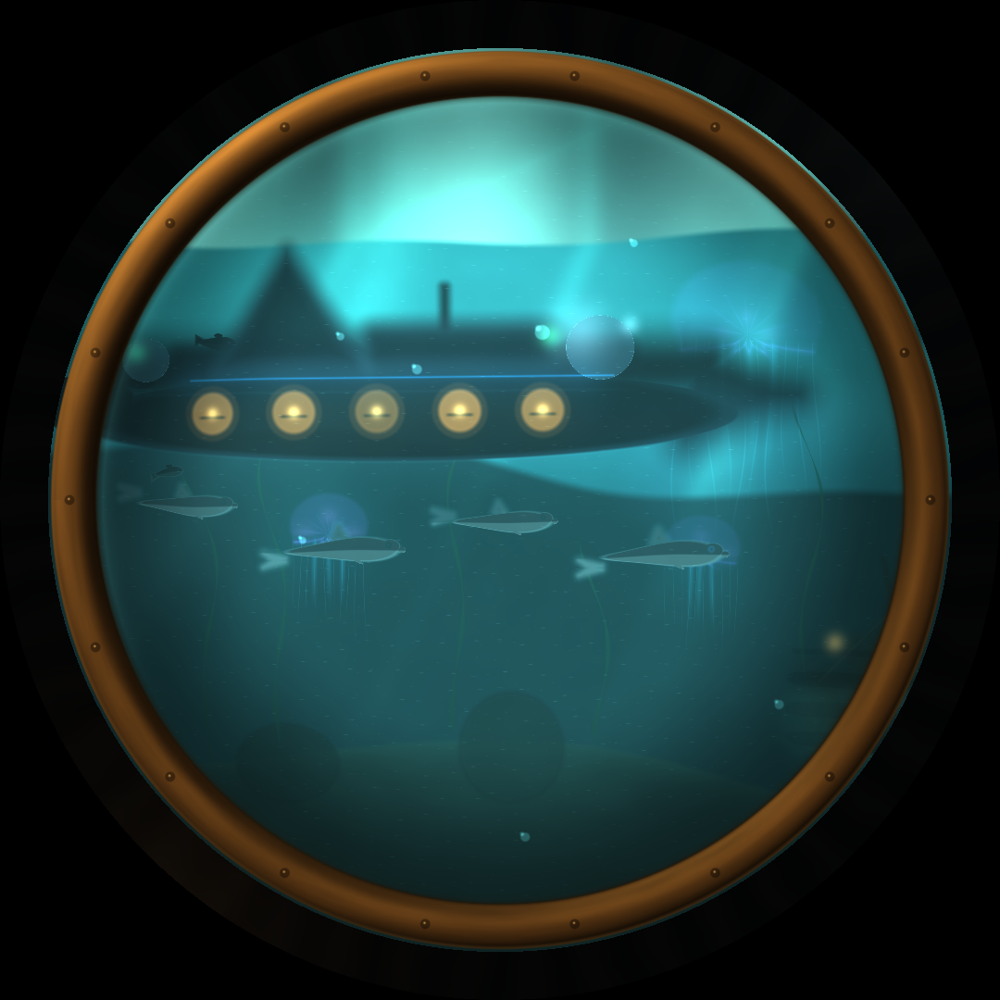
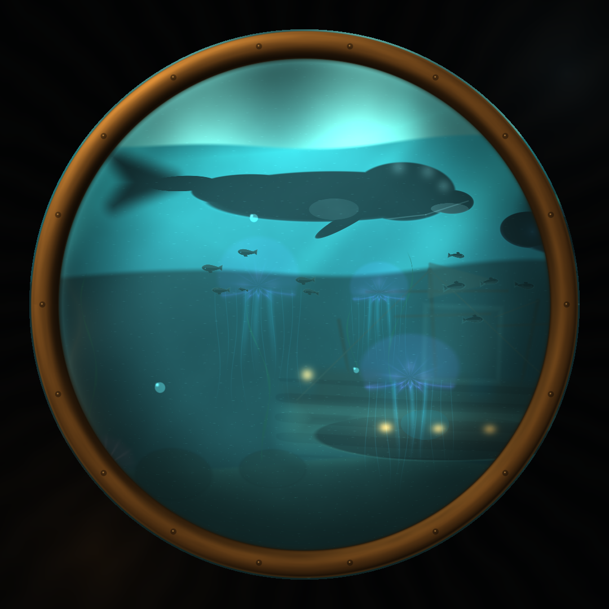

# Spotify Round

A round, 1080 × 1080 **Spotify now-playing display** for the Raspberry Pi 5, written in Rust with
[Slint](https://slint.dev) for the interface and [Animato](https://github.com/AarambhDevHub/animato)
for motion.

<p align="center">
  
  
  
  
  
  
  
</p>

The display is a **remote control and a visualiser**, not a speaker: it drives whichever Spotify
device is currently active (phone, speaker, desktop app). Playback control therefore needs a
Spotify **Premium** account.

---

## Features

- **Now playing** with square album art (softened corners) and a progress ring around the rim of the
  panel, drawn by a wgpu shader rather than re-tessellated Slint paths.
- **Ambient colour**: the accent, glow and controls take their palette from the artwork, and
  cross-fade perceptually when the track changes.
- **Controls**: play/pause, previous, next, seek, shuffle and repeat (off / all / one).
- **Output device**: the player names the Spotify Connect device it is driving; tap the pill under
  the track to list every device that is open (phone, speaker, TV, desktop app) and move playback
  there without touching anything else. Devices Spotify lists but does not let the API control — a
  Chromecast that is casting, for instance — are shown dimmed with the reason, instead of vanishing
  from the list.
- **Playlists** screen: browse your library, tap to start playing.
- **Queue** screen: the current track plus everything up next — tap an entry to play from there. The
  list opens on the track that is playing, so switching playlists never leaves you scrolled into the
  middle of a stale queue.
- **Motion**: an overshooting artwork reveal, a pulsing "current track" ring and sliding screen
  transitions between the pages.
- **Idle visualisers**: when nothing is playing — or a track has been paused for half a minute — one
  of the procedural scenes takes over the screen, chosen at random on every visit. The **Earth** is a
  rotating Blue Marble with Black Marble city lights, drifting clouds, sun glint and a sunlit
  atmosphere. The **diving bell** is a first-person porthole onto a moving submarine cruise: seabed,
  kelp, vents and wrecks stream past as new terrain is generated, while two shoals of fish, pulsing
  jellyfish, a right whale, a pod of dolphins and a reference-style submarine pass under slanting
  sunbeams. Swipe down on the player to summon the visualiser, tap anywhere on it to fade back.
- **Touch first**: swipes are the only navigation — right for the queue, left for playlists, with the
  player in the middle — and dragging along the rim of the screen scrubs. Everything is laid out
  inside the circle so nothing hides in the corners of the round panel.
- **Demo mode** (`--mock`) with a built-in library and procedurally generated covers — no Spotify
  account or network needed, useful for developing on a laptop.
- **PKCE OAuth** with a loopback listener, a QR code on screen, and a CLI flow for headless setups.
  A phone that scans the code cannot call back to `127.0.0.1` on the display, so the display also
  serves a small login page on the local network that takes the authorization code back.
  Refresh tokens are stored with `0600` permissions.

---

## Hardware

| Part | Notes |
| --- | --- |
| Raspberry Pi 5 (2 GB is enough) | Raspberry Pi OS Bookworm, 64-bit |
| 5″ round HDMI display, 1080 × 1080 | e.g. Waveshare 5″ 1080×1080 round LCD with USB touch |
| USB touch panel | shows up as a normal libinput touchscreen |

The UI is authored at exactly 1080 × 1080 logical pixels and keeps interactive elements inside a
~500 px radius, so it also looks right in a window on a desktop.

---

## 1. Create a Spotify application

1. Open the [Spotify developer dashboard](https://developer.spotify.com/dashboard) and create an app.
2. Add this **redirect URI** (character-for-character):

   ```
   http://127.0.0.1:8888/callback
   ```

   Spotify only allows `http://` for **loopback IP literals**; `http://localhost` is rejected.
   If you change `redirect_port` in the config you must register the matching URI.

3. Copy the **client ID** (no client secret is needed — the app uses PKCE).

Playback control requires Spotify Premium; without it the display still shows what is playing but
Spotify answers `403 PREMIUM_REQUIRED` for transport commands.

---

## 2. Build

On the Pi (or on any machine, for the demo mode):

```bash
sudo apt update
sudo apt install -y build-essential pkg-config libfontconfig1-dev libfreetype6-dev \
    libxkbcommon-dev libwayland-dev libegl1-mesa-dev libgl1-mesa-dev fonts-inter \
    libvulkan1 mesa-vulkan-drivers

curl --proto '=https' --tlsv1.2 -sSf https://sh.rustup.rs | sh
source "$HOME/.cargo/env"

git clone <this repository> spotify-round
cd spotify-round
cargo build --release
```

`fonts-inter` gives the intended typography; without it Slint falls back to the system sans-serif.

Debug builds are usable too: `Cargo.toml` keeps the app at `opt-level = 1` with line tables but
optimizes every dependency (`opt-level = 2`). Unoptimized Slint/femtovg/wgpu cannot repaint a
1080 × 1080 scene at 60 Hz — the UI stutters at ~14 fps even on a fast desktop GPU — while the
optimized dependencies reach the frame budget.

---

## 3. Configure

The app reads (and creates on first run):

| Platform | Path |
| --- | --- |
| Linux | `~/.config/spotify-round/config.toml` |
| Windows | `%APPDATA%\spotify-round\config\config.toml` |

```toml
client_id = "your-client-id"

# Must match the redirect URI registered in the Spotify dashboard.
redirect_port = 8888

# Host a phone should use to reach the login page. Defaults to the address of
# the default route (for example 192.168.1.24); set it when the display has
# several interfaces or a name that resolves on your network.
# login_host = "spotify-round.local"

# Playback polling interval. Spotify's rate limit is generous at one second.
poll_ms = 1000
```

`SPOTIFY_ROUND_CLIENT_ID` and `SPOTIFY_ROUND_CONFIG_DIR` override the file and the directory, which
is handy for systemd units.

---

## 4. Authorize once

### From a phone (the QR code on the display)

Tap **Authorize**: the display starts listening, shows a QR code and opens the authorization URL in
its own browser if it has one. Scan the code with the phone.

Spotify redirects to the registered `http://127.0.0.1:8888/callback`, which on a phone means the
phone itself and cannot work — Spotify refuses any other `http://` redirect. The QR code therefore
points at a login page the display serves on the local network instead:

1. Open the page (`http://<display-address>:8888/`, also printed in the log), tap **Open Spotify**
   and approve access.
2. The phone ends up on a `127.0.0.1` page that does not load. That is expected: copy the whole
   address from the address bar.
3. Go back to the login page and paste it into the field; pasting submits the form. The display
   exchanges the code and starts.

The listener exists only while a login is running, accepts nothing but the page, the redirect and
the paste, and the code is useless without the PKCE verifier that never leaves the display.

### On the display (has a browser)

Start the app and tap **Authorize**. It opens the authorization URL with `xdg-open` and finishes the
login on the built-in loopback listener.

```bash
spotify-round
```

### On the display (no browser, e.g. Pi OS Lite)

Run the flow on a computer that has a browser, then copy the token file over:

```bash
# on the laptop, with the same client ID configured
spotify-round auth

# then
scp ~/.config/spotify-round/tokens.json pi@spotify-round.local:~/.config/spotify-round/
```

### Over SSH

`spotify-round auth --no-browser` prints both URLs and waits. Either forward the callback port so
the redirect reaches the Pi, or open the printed login page in any browser on the network and paste
the address back:

```bash
ssh -L 8888:127.0.0.1:8888 pi@spotify-round.local 'spotify-round auth --no-browser'
# open the printed URL in the browser on your laptop
```

---

## 5. Run

```bash
spotify-round              # full screen, Spotify
spotify-round --windowed   # a 1080×1080 window, for development
spotify-round --mock --windowed   # demo library, no account needed
```

### Controls

| Gesture | Action |
| --- | --- |
| Tap the artwork or the big button | play / pause |
| Tap the device pill under the track | move playback to another Spotify Connect device |
| Tap ◀ / ▶ | previous / next (dimmed when Spotify has nowhere to go) |
| Drag along the ring at the edge | seek / scrub (the arc follows the drag) |
| Tap shuffle / repeat | toggle shuffle / cycle repeat |
| Swipe left | playlists |
| Swipe right | queue |
| Swipe down | idle visualiser — it picks Earth or the diving bell at random (a tap returns to the player) |
| Tap a playlist | start it and return to now playing |
| Tap a queue entry | restart the playlist from that item |

---

## Run as a kiosk on the Pi

### Raspberry Pi OS with the desktop

Copy `deploy/spotify-round.desktop` to `~/.config/autostart/` and log in automatically. Hide the
mouse pointer if you only use touch:

```bash
sudo apt install unclutter
```

### Raspberry Pi OS Lite + cage

```bash
sudo apt install cage
```

`deploy/spotify-round.service` is a systemd **user** unit:

```bash
mkdir -p ~/.config/systemd/user
cp deploy/spotify-round.service ~/.config/systemd/user/
systemctl --user daemon-reload
systemctl --user enable --now spotify-round.service
loginctl enable-linger "$USER"
```

On Lite, wrap the binary in a Wayland kiosk compositor by changing `ExecStart` to:

```ini
ExecStart=/usr/bin/cage -- /home/pi/spotify-round/target/release/spotify-round
```

and run the unit as a **system** service for the `pi` user with access to `video` and `render`
groups (see `deploy/cage-kiosk.service`).

### Without any compositor (DRM/KMS)

cage costs a little GPU time and memory that the Pi can spend elsewhere. Building with the `kms`
feature lets the app own the display and draw through DRM/KMS on its own:

```bash
sudo apt install libseat-dev libinput-dev libudev-dev
cargo build --release --features kms
```

Run it from a virtual console (or from a systemd unit with `StandardInput=tty`, `TTYPath=/dev/tty1`,
`TTYReset=yes`) as a user in the `video` and `render` groups. `SLINT_BACKEND` overrides the choice if
you want to experiment (`winit-software`, `linuxkms-femtovg`, …).

### Panel geometry

Most 1080×1080 round HDMI panels need the mode forced. In `/boot/firmware/cmdline.txt` add:

```
video=HDMI-A-1:1080x1080@60
```

and in `/boot/firmware/config.txt`:

```
disable_overscan=1
hdmi_drive=2
```

The app requests full screen and draws a 1080×1080 surface; if your panel reports a different mode,
use `SLINT_SCALE_FACTOR` or the compositor's output scaling.

---

## How it is built

```
src/
├── main.rs            CLI entry point, logging, rustls provider
├── app.rs             controller: polling, commands, view models, animation tick
├── ui.rs              every Slint property write + offscreen preview renderer
├── motion.rs          Animato: accent tween, reveal, pulse
├── visuals.rs         idle scene registry and the render thread; picks a scene at random
├── globe.rs           idle scene: the Earth, a wgpu fragment shader over the day, night, cloud, relief and water maps
├── dive.rs            idle scene: the diving bell renderer; the procedural world lives in dive.wgsl
├── dive.wgsl          the diving-bell fragment shader: water, terrain, whale, submarine, dolphins and wreck
├── ring.rs            the progress rim: one wgpu fragment shader for track, arc and head dot
├── gpu.rs             the single wgpu/Vulkan device, handed to Slint before the window exists
├── artwork.rs         download → decode → rounded mask → accent colour → cache
├── browser.rs         xdg-open / start / open
├── config.rs          config.toml, token paths, permissions
├── format.rs          time and pluralisation
├── service/
│   ├── mod.rs         `Source` = live Spotify API or demo backend
│   ├── api.rs         typed Spotify Web API client
│   ├── auth.rs        PKCE OAuth, callback listener and phone login page, token refresh
│   └── mock.rs        in-memory demo library
ui/
├── main.slint         window, ambience, screen router
├── theme.slint        design tokens
├── state.slint        Player / Devices / Library / App / Idle globals
├── components/        icons, buttons, artwork, rim ring, rows, toast…
└── screens/           now playing, device picker, playlists, queue, login, idle
assets/earth/          Blue Marble day, night and clouds (8K), relief and water maps (2K)
```

**Threading.** Slint runs on the main thread. A Tokio runtime polls `/me/player` once a second and
performs commands; results are marshalled back with `upgrade_in_event_loop`. `slint::Image` is not
`Send`, so artwork is decoded to a `SharedPixelBuffer` on a worker thread and turned into an image on
the UI thread. A timer on the UI thread ticks once per frame at the panel's refresh rate (16⅔ ms for
60 Hz, not the 16 ms that would make it 62.5 Hz) and advances the progress clock between polls. The
rim is not a Slint path: `ring.rs` draws the track, the played sector and the head dot with one
fragment shader into one of three textures, and Slint only composites the latest one. That removes
per-frame SVG parsing and stroke tessellation, and a paused track repeats the same input so the rim
is not redrawn at all.

**Hardware acceleration.** Before any window exists, `src/gpu.rs` opens a wgpu device (Vulkan first)
and hands it to Slint with `BackendSelector::require_wgpu_30(WGPUConfiguration::Manual { .. })`, so
femtovg composites the whole UI through Vulkan (`-v` logs the adapter and the graphics API in use).
That API sits behind Slint's `unstable-wgpu-30` flag, so the feature and `slint::wgpu_30` names move
with wgpu releases; the idle scenes and the progress rim render on the same device and their frames are
handed over as textures, so nothing round-trips through the CPU. On a Pi without a compositor build
with `--features kms` to draw straight through DRM/KMS instead of winit:

```bash
cargo build --release --features kms
```

that feature pulls in libseat and libinput, so `libseat-dev`, `libinput-dev` and `libudev-dev` have to
be installed for the build. Playback position is interpolated from a monotonic clock and a poll only
re-anchors it when it disagrees by more than a second, which keeps the rim moving forwards at a
constant rate instead of twitching as the answers arrive.

**Optimistic UI.** Commands apply their result before Spotify confirms it, so the display never lags
behind a press. Play/pause, shuffle, repeat, seek, skips and playlist starts update the model
immediately; a `Pending` record marks what was asked for, and a poll that still describes the old
state is ignored until Spotify agrees (or three seconds pass). Skips borrow the upcoming item from a
warm `/me/player/queue` cache and keep a short history, so `next` and `previous` change the artwork
on the press; starting a playlist shows that playlist's cover with "Starting playlist" until the
first track is reported. Spotify's `actions.disallows` flags grey out a skip button that would have
nowhere to go, and a refused skip dims it for that item. The device picker lists
`/me/player/devices` when it is opened (the answer is reused for ten seconds), and picking a device
posts it to `PUT /me/player`; the player's device pill switches on the press, before the next poll
confirms it. The device model is deliberately loose, because the API is: `id` and `type` are both
nullable, `type`'s casing varies (`CastVideo`, `TV`, `AVR`), and a device with `is_restricted` or no
id is listed but cannot be driven. Rejecting any of those would fail the whole response — including
the playback poll — so they are decoded into `Option`s and handled per row.

**Motion.** [Animato](https://github.com/AarambhDevHub/animato) computes the values that need
continuous simulation: a `Tween<Color>` for the ambilight (interpolated in linear-light space), an
`EaseOutBack` tween for the artwork reveal and a ping-pong tween for the queue's current-track pulse.
Geometry transitions (screen slides, fades) use Slint's declarative animations so they run at the
display refresh rate.

**Idle visualisers.** `screens/idle.slint` fades a full-screen overlay in when there is nothing left to
show: three seconds after Spotify reports nothing playing, or thirty seconds after a loaded track was
paused. Resuming playback closes it again, and a tap on the visuals returns to the player and keeps
them away until playback resumes.

Each visit picks a scene at random from the renderers that came up. `visuals.rs` owns that registry and
the render thread: a scene implements `Visual`, is added to `Scene`, and gets a block of three render
targets; the UI only needs a scene index and a frame, so adding another visualisation does not touch
the Slint screens. Both scenes are drawn with [wgpu](https://wgpu.rs) on the Vulkan device the UI itself
uses, straight into textures that Slint samples from the same device. Nothing is read back or
re-uploaded, so a frame never leaves the GPU. Frames are drawn at 60 fps and only while the overlay is
visible; at rest the thread sleeps and the display draws no power at all. `-vv` logs the achieved rate.

**Earth.** The planet is drawn in `globe.rs` with one fragment shader that projects the sphere, samples
the maps and lights it.

- **Day side** — NASA Blue Marble; **night side** — Black Marble city lights, warm and blown out a
  little.
- **Sun** — one light that travels once round the planet every half hour, so the terminator sweeps
  across the disc: full daylight, then a few minutes of the night side with its city lights, then
  daylight again. Sunlight scatters through the air well past the terminator, so the ground fades out
  over a wide, warm band rather than stopping at a line, and a faint earthshine keeps the dark
  hemisphere from turning into a black hole.
- **Relief** — the normal map tilts the lighting, so mountain belts and trenches catch the light.
- **Water** — the specular map adds the sun glint on the oceans, broken up by the cloud sheet.
- **Clouds** — a sheet that is part of the surface, so it turns with it instead of drifting over it.
  It is lit by the same sun, stays faintly visible at night, and hides the city lights underneath.
- **Air** — a blue halo outside the limb that only appears where the sun reaches the atmosphere, plus
  a haze just inside the lit limb. The planet is drawn at 95 % of the frame, and the glow fades out
  just inside the square edge so it is never cut off, however large the planet gets.

The maps go up at their native size — nothing is resampled on the CPU — and the GPU builds a mip chain for
each of them, with a little extra level of detail bias when sampling: that is what keeps the city lights
from sparkling as the map is minified, and sampling is anisotropic where the driver offers it. 8K day and
night plus the 8K cloud sheet and the 2K relief and water maps come to roughly 420 MB of GPU memory and
170 MB of working set; the whole display, globe at 60 fps included, costs about a third of a core, which
suits a Pi 5 with 4 GB that runs nothing else. On a smaller board or a driver whose largest texture is
4096, the maps are shrunk to fit and a warning is logged. `SIZE`, `FPS`, `REVOLUTION`, `SUN_PERIOD`,
`PLANET`, `ATMOSPHERE`, `TERMINATOR`, `TWILIGHT`, `DUSK` and `NIGHTSHINE` are the knobs.

Earth textures: NASA **Blue Marble** (day) and **Black Marble** (night lights), as distributed by
[solarsystemscope.com](https://www.solarsystemscope.com/textures/) under
[CC BY 4.0](https://creativecommons.org/licenses/by/4.0/). They live in `assets/earth/`.

**The diving bell.** `dive.rs` drives one procedural fragment shader, `dive.wgsl`: no textures, one
uniform buffer, and a fresh world seed on every visit, so the seabed, wreck, whale, jellyfish and
shoals are never quite the same twice.

- **Porthole** — a brass rim with eighteen rivets, brushed metal, a glass tint, grime, an edge
  reflection and a soft lamp glow on the casing. The glass bends the view slightly at its edge, and
  the whole bell sways.
- **Moving world** — the camera travels forward through a procedural seabed. The water and the far
  ridge drift at different rates from the floor, kelp, boulders, vents and wrecks, and every feature is
  generated from a world-space cell, so new terrain keeps arriving for as long as the dive runs.
- **Water** — a depth gradient under a moving surface, caustic light, slanting volumetric sunbeams and
  two noise layers of murk.
- **Seabed** — two parallax ridges, boulders, a kelp forest that sways out of step, a hydrothermal vent
  with a glowing plume, fan corals and galleon wrecks with masts, rigging, a torn sail and lanterns
  still burning.
- **Shoals** — two species in different sizes and directions. The fish are drawn along the school's
  velocity, with a swimming bend, tail beat, dorsal and pectoral fins, a pale belly and an eye, so a
  shoal always points where it is going.
- **Jellyfish** — translucent pulsing bells with a scalloped rim, radial canals, gonads, trailing oral
  arms and a fan of fine tentacles. Each one has its own pulse and tint.
- **The right whale** — a huge head with the pale callosities of a North Atlantic right whale, a curved
  mouth, a white flank patch, broad pectoral flippers and forked flukes, crossing every minute or so.
- **The submarine** — a sleek dark hull with a pointed bow, five round windows lit from inside, a cyan
  light strip, glass domes, a swept dorsal fin, marker lights, a bow plane and a turning propeller. A
  pod of four dolphins rides the water beneath it.

Only the porthole is opaque glass; the rest of the round panel is the bell's casing. The scene is
rendered at 1080 × 1080 so the porthole meets the physical rim.

The Pi needs a Vulkan driver: `sudo apt install libvulkan1 mesa-vulkan-drivers`. If the adapter cannot be
created the overlay is simply left empty and a warning is logged; nothing else in the display depends on
it.

**Tap versus swipe.** Slint reports a click for every press and release on a `TouchArea`, however far
the finger travelled, and the pages slide under the finger while swiping — so a swipe that ended over a
list row would also select it. Rows therefore use `components/tap_area.slint`, which compares the
release point with the press point and stays quiet once the finger has moved more than a few pixels.

**Why square artwork with a rounded mask?** Slint clips to rectangles, so the artwork pipeline applies
an anti-aliased rounded-rectangle mask while decoding. The same decoded buffer provides the accent
colour used for the rim, glow and buttons. The slider lives on the rim of the panel, outside the
pager, so it stays put while the screens slide.

---

## Development

```bash
cargo fmt
cargo clippy --all-targets -- -D warnings
cargo test
```

There is also an offscreen renderer used for design review. It renders the real UI with the
software backend into `target/preview/*.png`:

```bash
cargo test preview -- --ignored --nocapture
```

Handy environment variables:

| Variable | Effect |
| --- | --- |
| `SLINT_BACKEND` | Override the backend, e.g. `winit-software` or `linuxkms-femtovg` |
| `SLINT_FULLSCREEN` | `1` to start full screen (the systemd unit sets it) |
| `SLINT_SCALE_FACTOR` | Render the 1080 px design at another physical size |
| `SPOTIFY_ROUND_LOG` | `tracing` filter, e.g. `spotify_round=debug` |

---

## Troubleshooting

**"Open Spotify on a device, then try again"** — there is no active Spotify Connect device. Start
playback somewhere first; the display controls that device. The device pill on the player lists
whatever Spotify can see, so a device that is missing there needs to be opened in the Spotify app.

**A Chromecast or Google Home is missing from the device list** — Spotify's Web API only sees
Spotify Connect devices, and it says as much: the endpoint returns "available Spotify Connect
devices", with "some device models … not supported". A Cast endpoint only joins the list once
Spotify's Cast receiver is running on it, which means starting playback there from the Spotify app;
spotcast's documentation puts it plainly: Cast devices "will not show unless active". Waking a
sleeping Cast device needs the Google Cast protocol, which the Web API does not expose, so the
display cannot do it. Devices that are listed but not controllable carry `id: null` and
`is_restricted: true` — Spotify's guidance is that such a device returns a null id — and the picker
shows them dimmed with "pick it in the Spotify app" rather than dropping them. If the list is empty
altogether, check that the token was granted `user-read-playback-state` (the app always requests it;
an old token file may not have it — re-authorize).

**Commands do nothing / `403 PREMIUM_REQUIRED`** — Spotify requires Premium for remote control.

**"Spotify is busy, retrying shortly"** — a rate limit was hit; the poller backs off automatically
and resumes.

**Authorization fails immediately** — the redirect URI must match the dashboard exactly, including
the port, and must be a loopback IP (`127.0.0.1`), not `localhost`.

**The phone says "can't connect to 127.0.0.1"** — expected: that address is the phone. Paste the
address from the address bar into the login page the display serves, or set `login_host` if the
detected address is not the one your phone can reach (a VPN, several interfaces, or a name that
resolves on your network). The page is only reachable while a login is running.

**Window is huge on my laptop** — run with `--windowed` and, if your screen is smaller than 1080 px,
`SLINT_SCALE_FACTOR=0.6`.

**Blurry text on the Pi** — install `fonts-inter` and make sure the compositor is not scaling the
output away from 1:1.

**The animation stutters** — check the log for `graphics context ready`. A `NativeOpenGL` renderer
means the GPU is drawing; a warning about the graphics API means Slint fell back to the software
renderer (usually a missing `/dev/dri` device or a VNC session).

---

## License

MIT — see [LICENSE](LICENSE).
