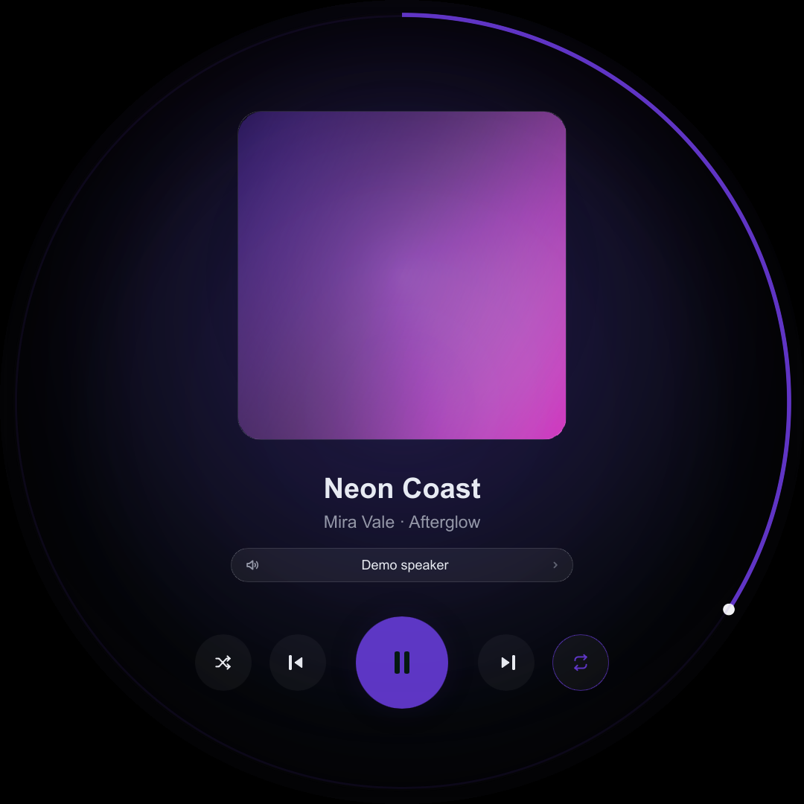
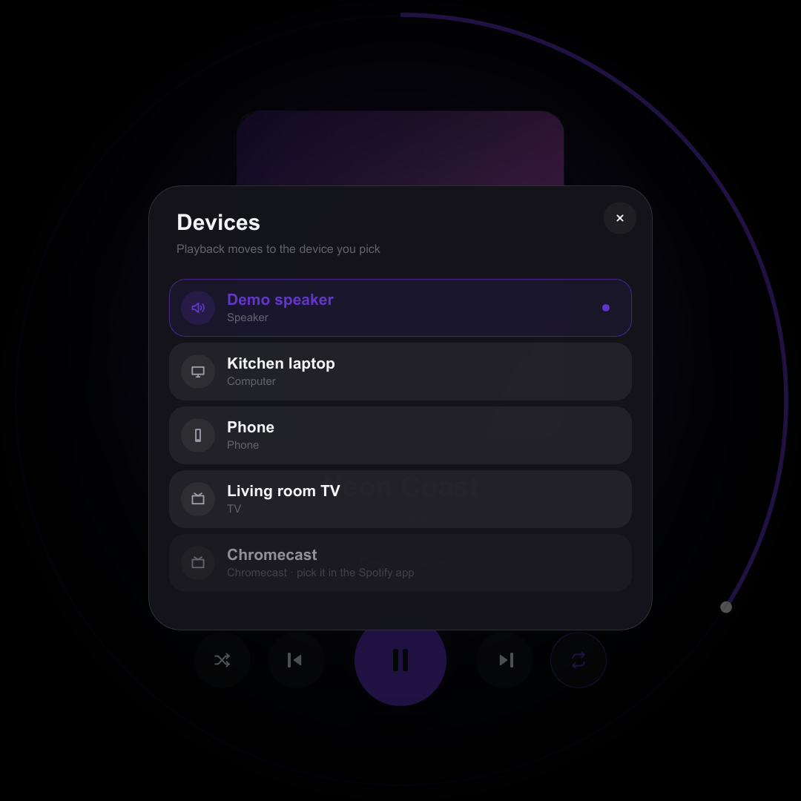
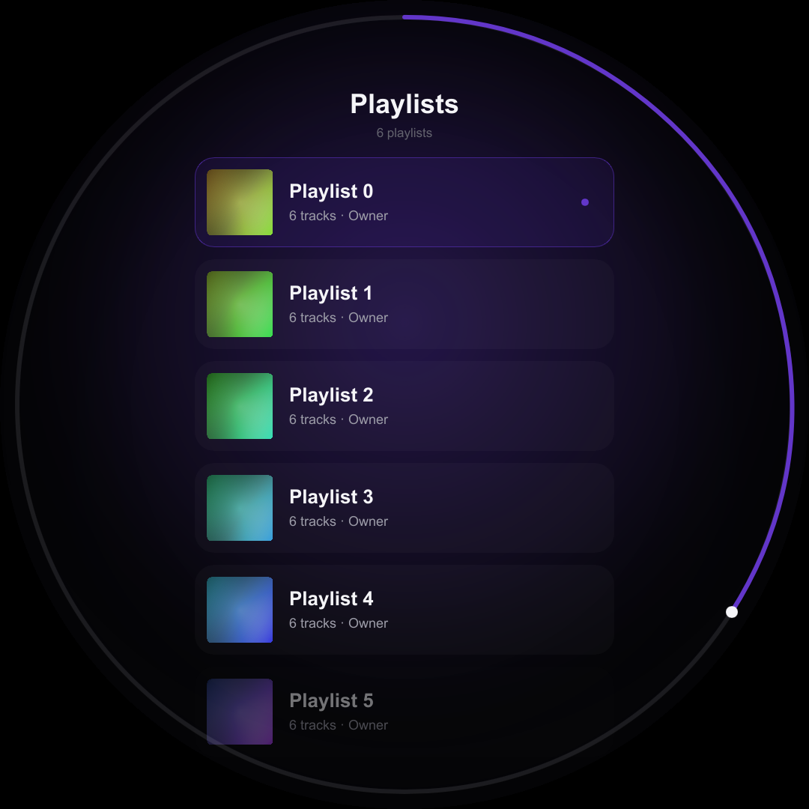
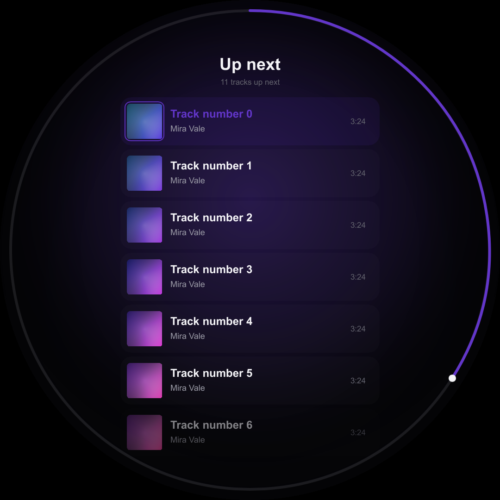
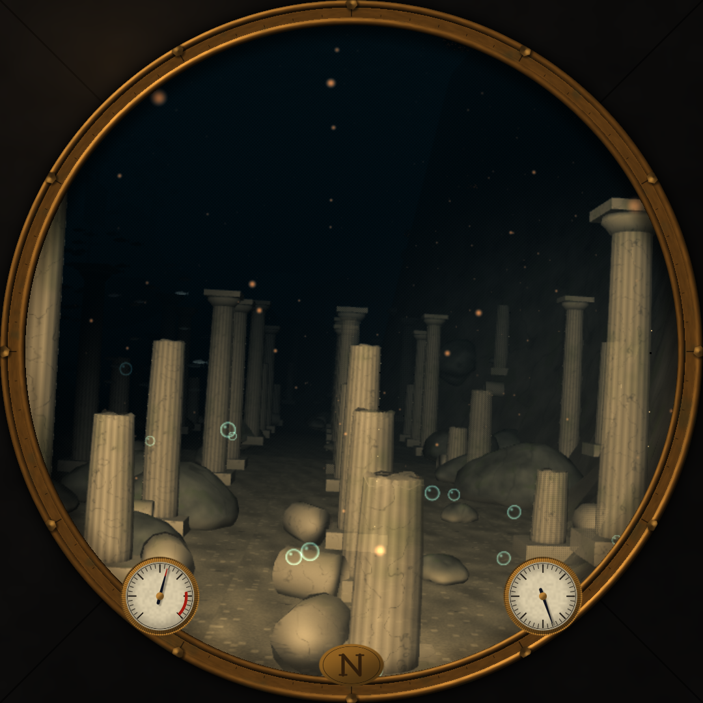

# Spotify Round

A round, 1080 × 1080 **Spotify now-playing display** for the Raspberry Pi 5, written in Rust with
[Slint](https://slint.dev) for the interface and [Animato](https://github.com/AarambhDevHub/animato)
for motion.

<p align="center">
  
  
  
  
  
  
</p>

The display is a **remote control and a visualiser**, not a speaker: it drives whichever Spotify
device is currently active (phone, speaker, desktop app). Playback control therefore needs a
Spotify **Premium** account.

---
## Features

- **Now playing** with album art, a progress ring round the rim and colours taken from the artwork.
- **Controls**: play/pause, previous, next, seek, shuffle, repeat, and moving playback to another
  Spotify Connect device.
- **Playlists** and **queue** screens, navigated by swiping; tap to play.
- **Idle visualisers** when nothing plays: a rotating [Earth](docs/globe.md), the
  [Nautilus](docs/nautilus.md)' undersea voyage and a [tour of invented star systems](docs/solar.md),
  with a now-playing card over each.
- **Demo mode** (`--mock`) that needs no Spotify account, for developing on a laptop.
- **Login from a phone** by QR code (PKCE OAuth), or from the command line.

The full list, with the details of each screen, is in [docs/features.md](docs/features.md).

## Documentation

| Page | What it covers |
| --- | --- |
| [docs/features.md](docs/features.md) | Every feature and how the player behaves |
| [docs/globe.md](docs/globe.md) · [docs/nautilus.md](docs/nautilus.md) · [docs/solar.md](docs/solar.md) | The three idle scenes |
| [docs/architecture.md](docs/architecture.md) | Source layout, threading, the shared wgpu device, rendering choices for the Pi |
| [docs/benchmarking.md](docs/benchmarking.md) | Measuring GPU cost, the shader-db check, screenshot and benchmark tests |

---

## Hardware

| Part | Notes |
| --- | --- |
| Raspberry Pi 5 (2 GB is enough) | Raspberry Pi OS Bookworm, 64-bit |
| 5″ round HDMI display, 1080 × 1080 | e.g. Waveshare 5″ 1080×1080 round LCD with USB touch |
| USB touch panel | shows up as a normal libinput touchscreen |

The UI is authored at exactly 1080 × 1080 logical pixels and keeps interactive elements inside a
~500 px radius, so it also looks right in a window on a desktop.

---

## 1. Create a Spotify application

1. Open the [Spotify developer dashboard](https://developer.spotify.com/dashboard) and create an app.
2. Add this **redirect URI** (character-for-character):

   ```
   http://127.0.0.1:8888/callback
   ```

   Spotify only allows `http://` for **loopback IP literals**; `http://localhost` is rejected.
   If you change `redirect_port` in the config you must register the matching URI.

3. Copy the **client ID** (no client secret is needed — the app uses PKCE).

Playback control requires Spotify Premium; without it the display still shows what is playing but
Spotify answers `403 PREMIUM_REQUIRED` for transport commands.

---

## 2. Build

On the Pi (or on any machine, for the demo mode):

```bash
sudo apt update
sudo apt install -y build-essential pkg-config libfontconfig1-dev libfreetype6-dev \
    libxkbcommon-dev libwayland-dev libegl1-mesa-dev libgl1-mesa-dev fonts-inter \
    libvulkan1 mesa-vulkan-drivers

curl --proto '=https' --tlsv1.2 -sSf https://sh.rustup.rs | sh
source "$HOME/.cargo/env"

git clone <this repository> spotify-round
cd spotify-round
cargo build --release
```

`fonts-inter` gives the intended typography; without it Slint falls back to the system sans-serif.

### Building on a Mac or another arm64 machine

Building on the Pi takes a while. With Docker, `deploy/build-for-pi.sh` builds the same binary in an
arm64 Debian 13 container, which matches Raspberry Pi OS, and leaves it in `target/pi/`; on a Mac
with Apple silicon the container runs natively, so it is quick, and rebuilds are incremental. Copy it
over the one the kiosk runs, and restart it:

```bash
deploy/build-for-pi.sh
scp target/pi/spotify-round <user>@<pi>:spotify-round/target/release/spotify-round.new
ssh -t <user>@<pi> 'cd spotify-round/target/release && mv spotify-round.new spotify-round \
    && sudo systemctl restart cage-kiosk'
```

`--tests` also builds the test binary, `target/pi/spotify-round-tests`, to run the benchmarks on the
Pi without a Rust toolchain there, for example `./spotify-round-tests dive3d::tests::frame_cost
--ignored --nocapture`. Arguments after `--` go to cargo: `deploy/build-for-pi.sh -- --features kms`.

Debug builds are usable too: `Cargo.toml` keeps the app at `opt-level = 1` with line tables but
optimizes every dependency (`opt-level = 2`). Unoptimized Slint/Skia/wgpu cannot repaint a
1080 × 1080 scene at 60 Hz — the UI stutters at ~14 fps even on a fast desktop GPU — while the
optimized dependencies reach the frame budget.

---

## 3. Configure

The app reads (and creates on first run):

| Platform | Path |
| --- | --- |
| Linux | `~/.config/spotify-round/config.toml` |
| Windows | `%APPDATA%\spotify-round\config\config.toml` |

```toml
client_id = "your-client-id"

# Must match the redirect URI registered in the Spotify dashboard.
redirect_port = 8888

# Host a phone should use to reach the login page. Defaults to the address of
# the default route (for example 192.168.1.24); set it when the display has
# several interfaces or a name that resolves on your network.
# login_host = "spotify-round.local"

# Playback polling interval. Spotify's rate limit is generous at one second.
poll_ms = 1000

# Show the frame-rate readout from the start (the F key toggles it).
# show_fps = false
```

`SPOTIFY_ROUND_CLIENT_ID` and `SPOTIFY_ROUND_CONFIG_DIR` override the file and the directory, which
is handy for systemd units.

---

## 4. Authorize once

### From a phone (the QR code on the display)

Tap **Authorize**: the display starts listening, shows a QR code and opens the authorization URL in
its own browser if it has one. Scan the code with the phone.

Spotify redirects to the registered `http://127.0.0.1:8888/callback`, which on a phone means the
phone itself and cannot work — Spotify refuses any other `http://` redirect. The QR code therefore
points at a login page the display serves on the local network instead:

1. Open the page (`http://<display-address>:8888/`, also printed in the log), tap **Open Spotify**
   and approve access.
2. The phone ends up on a `127.0.0.1` page that does not load. That is expected: copy the whole
   address from the address bar.
3. Go back to the login page and paste it into the field; pasting submits the form. The display
   exchanges the code and starts.

The listener exists only while a login is running, accepts nothing but the page, the redirect and
the paste, and the code is useless without the PKCE verifier that never leaves the display.

### On the display (has a browser)

Start the app and tap **Authorize**. It opens the authorization URL with `xdg-open` and finishes the
login on the built-in loopback listener.

```bash
spotify-round
```

### On the display (no browser, e.g. Pi OS Lite)

Run the flow on a computer that has a browser, then copy the token file over:

```bash
# on the laptop, with the same client ID configured
spotify-round auth

# then
scp ~/.config/spotify-round/tokens.json pi@spotify-round.local:~/.config/spotify-round/
```

### Over SSH

`spotify-round auth --no-browser` prints both URLs and waits. Either forward the callback port so
the redirect reaches the Pi, or open the printed login page in any browser on the network and paste
the address back:

```bash
ssh -L 8888:127.0.0.1:8888 pi@spotify-round.local 'spotify-round auth --no-browser'
# open the printed URL in the browser on your laptop
```

---

## 5. Run

```bash
spotify-round              # full screen, Spotify
spotify-round --windowed   # a 1080×1080 window, for development
spotify-round --mock --windowed   # demo library, no account needed
spotify-round --fps        # start with the frame-rate readout showing
```

Tap the top of the circle, or press **F** on a keyboard, to show or hide the frame-rate readout: a pill at the top of the circle,
where the round glass still has room for it, with the frames the window presented in the last
second, the milliseconds the UI thread spent drawing each (`ui`) and the GPU milliseconds per frame
(`gpu`). The player only draws when something changes, mostly the ring moving half a pixel, so its
frame rate follows the track's length (about 30 fps for a 3½-minute song); the milliseconds show how
much of the 16.7 ms budget a frame takes. While the visualizer runs it shows the window's frames,
the visualizer's own frame rate, the milliseconds its thread spent on each frame and the GPU
milliseconds per frame. On the Pi the GPU figure comes from the V3D render engine's cumulative busy
counter in `/sys/class/drm/card*/device/gpu_stats`, sampled once a second and divided by the frames
drawn; for the visualizer, where the adapter has timestamp queries and `SPOTIFY_ROUND_PROFILE` is
set, it comes from `wgpu-profiler` instead. If neither source exists the readout says `gpu —` rather than inventing a
number. Above 16 ms the GPU cannot keep
60 fps. The window only counts frames from the first time the readout is shown, because counting
costs the Pi a render pass a frame. With `SPOTIFY_ROUND_FULL_SPEED` set, the same one-second line is
also written to `/tmp/spotify-round-fps` — window fps, screen, idle, scene fps, scene ms and gpu ms
(-1 when no GPU source exists) — for measuring a kiosk whose console cannot be read over SSH.

### Controls

| Gesture | Action |
| --- | --- |
| Tap the artwork or the big button | play / pause |
| Tap the device pill under the track | move playback to another Spotify Connect device |
| Tap ◀ / ▶ | previous / next (dimmed when Spotify has nowhere to go) |
| Drag along the ring at the edge | seek / scrub (the arc follows the drag) |
| Tap shuffle / repeat | toggle shuffle / cycle repeat |
| Swipe left | playlists |
| Swipe right | queue |
| Swipe down | idle visualiser — it picks Earth or the Nautilus at random (a tap returns to the player) |
| Swipe left / right on the Nautilus | travel on to the next stretch of sea / back to the last |
| Tap a playlist | start it and return to now playing |
| Tap the top of the circle | show / hide the frame-rate readout (also over the visualiser) |
| Tap a queue entry | restart the playlist from that item |

---

## Run as a kiosk on the Pi

### Raspberry Pi OS with the desktop

Start the display when you log in, with either of these (not both, or it starts twice):

- **Autostart entry:** copy `deploy/spotify-round.desktop` to `~/.config/autostart/` and set its
  `Exec` to the binary in your checkout. Autostart does not expand `~`, so the path must be absolute.
- **systemd user unit:** this one restarts the display if it ever exits.

  ```bash
  mkdir -p ~/.config/systemd/user
  cp deploy/spotify-round.service ~/.config/systemd/user/
  systemctl --user daemon-reload
  systemctl --user enable --now spotify-round.service
  ```

  It expects the checkout at `~/spotify-round`; edit `ExecStart` if yours is elsewhere.

Set the Pi to log in to the desktop automatically (`sudo raspi-config` → System Options → Boot /
Auto Login).

Full screen, the display hides the mouse pointer itself, so nothing else is needed for that: many
round panels' touch controllers report themselves as a mouse, and the compositor would otherwise
draw an arrow over the screen. (`unclutter` would not help anyway: it only works under X11, and
Raspberry Pi OS and cage both run Wayland.) Run with `--windowed` to keep the pointer.

### Raspberry Pi OS Lite + cage

[cage](https://github.com/cage-kiosk/cage) is a Wayland compositor that shows one application full
screen and nothing else. `deploy/cage-kiosk.service` is a **system** unit that runs the display in it
on tty1, with a login session of its own so cage can take over the screen and the touch input. It
takes over directly from the [boot splash](#boot-splash), so tty1's login prompt is switched off
(SSH still works, and Ctrl+Alt+F2 reaches a login console):

```bash
sudo apt install cage
sudo cp deploy/cage-kiosk.service /etc/systemd/system/
sudo cp deploy/cage.pam /etc/pam.d/cage
sudo systemctl disable getty@tty1.service
sudo systemctl daemon-reload
sudo systemctl set-default graphical.target
sudo systemctl enable --now cage-kiosk.service
```

Edit the unit first: it runs as `pi` from `/home/pi/spotify-round`. Current Raspberry Pi OS has no
default `pi` user, so put in the user you created and the path to your checkout. That user needs
to be in the `video`, `render` and `input` groups, as the first user on Raspberry Pi OS is:
`groups` shows them, and `sudo usermod -aG video,render,input <user>` adds any that are missing. The
display logs to the journal: `journalctl -u cage-kiosk -f`.

The app hides the pointer over its own window, but cage draws its arrow before the app has a say:
when the touch controller enumerates as a mouse, cage puts its arrow on the screen, and touches never
move it into the app. Make every cursor transparent for the kiosk's user, once (no root needed;
cage picks it up when it next starts):

```bash
python3 deploy/invisible-cursors.py
```

### Without any compositor (DRM/KMS)

cage costs a little GPU time and memory that the Pi can spend elsewhere. Building with the `kms`
feature lets the app own the display and draw through DRM/KMS on its own:

```bash
sudo apt install libseat-dev libinput-dev libudev-dev
cargo build --release --features kms
```

Run it from a virtual console (or from a systemd unit with `StandardInput=tty`, `TTYPath=/dev/tty1`,
`TTYReset=yes`) as a user in the `video` and `render` groups. `SLINT_BACKEND` overrides the choice if
you want to experiment (`winit-software`, `linuxkms-femtovg`, …).

### Panel geometry

Most 1080×1080 round HDMI panels need the mode forced. In `/boot/firmware/cmdline.txt` add:

```
video=HDMI-A-1:1080x1080@60
```

and in `/boot/firmware/config.txt`:

```
disable_overscan=1
hdmi_drive=2
```

The app requests full screen and draws a 1080×1080 surface; if your panel reports a different mode,
use `SLINT_SCALE_FACTOR` or the compositor's output scaling.

### Boot splash

Out of the box the Pi shows the rainbow square, then scrolling kernel and systemd logs, then a login
prompt, before cage takes over. To show a splash from early in boot until the display is up
instead:

1. **Silence the console.** In `/boot/firmware/cmdline.txt` (one line), change `console=tty1` to
   `console=tty3` so the logs go to a console nobody looks at, and append:

   ```
   quiet splash loglevel=3 logo.nologo vt.global_cursor_default=0 plymouth.ignore-serial-consoles
   ```

   In `/boot/firmware/config.txt`, make sure these are set. The first removes the rainbow square;
   the second (the default) builds the initramfs that Plymouth starts from:

   ```
   disable_splash=1
   auto_initramfs=1
   ```

2. **Install Plymouth and the theme.** `deploy/plymouth/kiosk` shows the Spotify logo
   (`splash.png`, 250 × 250) centred on black. Replace `splash.png` to show another image; it is
   scaled down to fit the screen, never up. Without a `splash.png` the theme shows "Spotify Round"
   as text instead, which is what `plymouth-label` is for.

   ```bash
   sudo apt install plymouth plymouth-label
   sudo cp -r deploy/plymouth/kiosk /usr/share/plymouth/themes/
   sudo plymouth-set-default-theme -R kiosk   # -R rebuilds the initramfs
   ```

3. **Hand over to cage.** `deploy/cage-kiosk.service` already does this: it starts while the splash
   is still up and closes it with `plymouth quit --retain-splash`, so the splash's last frame stays
   on the screen until cage draws its first frame. That only works on tty1, where Plymouth draws, and
   with tty1 left uncleared. That is why the unit runs on tty1, has no `TTYReset` or
   `TTYVTDisallocate`, and the getty on tty1 is disabled.

Reboot. The splash appears about 2.5 s into boot and the display takes over at about 13 s on a
Pi 5. To see the splash without rebooting (from SSH, with the kiosk stopped):

```bash
sudo plymouthd && sudo plymouth --show-splash && sleep 5 && sudo plymouth quit
```

### Display stays black after power-on

A round panel powered from the Pi's USB port (the Waveshare's touch cable carries its power) starts
up at the same moment as the Pi. About half the time its controller then never locks onto the HDMI
signal and stays black, even though the Pi is sending a picture. Re-sending the signal does not
help. Turning the panel's power off and on once HDMI is running always does.

The Pi cannot tell when this has happened. HDMI connect status, the EDID and hotplug events all run
off the 5 V the Pi puts on the HDMI cable, so they look the same whether the panel is working,
stuck or switched off. The panel does not answer on CEC either. So every boot power-cycles the panel
once, early, through the USB ports. On a Pi 5 every port shares one power switch, which only cuts
power when all of them are off:

```bash
sudo apt install uhubctl
sudo install -m 755 deploy/display-power-cycle /usr/local/sbin/
sudo cp deploy/display-power-cycle.service /etc/systemd/system/
sudo systemctl daemon-reload
sudo systemctl enable display-power-cycle.service
```

It runs about 2.5 s into boot without holding anything up. Power is off for 4 s and the panel is back
at about 9 s, well before the app at about 13 s, so boot takes no longer. If the panel still comes
up black now and then, give it longer off with `OFF_SECONDS` in the script. Every USB device drops
off the bus for those seconds, so don't use this if you boot from a USB drive.

---

## Development

```bash
cargo fmt
cargo clippy --all-targets -- -D warnings
cargo test
```

`cargo test` also validates every WGSL shader with naga, so a shader that does not compile fails CI
without a GPU. The tests that need a GPU (screenshots, reference sheets, cost measurements) are
`#[ignore]`d; [docs/benchmarking.md](docs/benchmarking.md) lists them and when to run each. **Run
`deploy/v3d-shaderdb/check.sh` before committing a shader change** (see the same page).

There is also an offscreen renderer used for design review. It renders the real UI with the
software backend into `target/preview/*.png`:

```bash
cargo test preview -- --ignored --nocapture
```

Handy environment variables:

| Variable | Effect |
| --- | --- |
| `SLINT_BACKEND` | Override the backend, e.g. `winit-software` or `linuxkms-femtovg` |
| `SLINT_FULLSCREEN` | `1` to start full screen (the app already does, unless run with `--windowed`) |
| `SLINT_SCALE_FACTOR` | Render the 1080 px design at another physical size |
| `SPOTIFY_ROUND_LOG` | `tracing` filter, e.g. `spotify_round=debug` |
| `SPOTIFY_ROUND_SCENE` | `globe`, `nautilus` or `solar`: show that idle scene from the start |
| `SPOTIFY_ROUND_FULL_SPEED` | Render as fast as possible and log the frame rate |
| `WGPU_BACKEND` | `vulkan` or `gl` |

---

## Troubleshooting

**"Open Spotify on a device, then try again"** — there is no active Spotify Connect device. Start
playback somewhere first; the display controls that device. The device pill on the player lists
whatever Spotify can see, so a device that is missing there needs to be opened in the Spotify app.

**A Chromecast or Google Home is missing from the device list** — Spotify's Web API only sees
Spotify Connect devices, and it says as much: the endpoint returns "available Spotify Connect
devices", with "some device models … not supported". A Cast endpoint only joins the list once
Spotify's Cast receiver is running on it, which means starting playback there from the Spotify app;
spotcast's documentation puts it plainly: Cast devices "will not show unless active". Waking a
sleeping Cast device needs the Google Cast protocol, which the Web API does not expose, so the
display cannot do it. Devices that are listed but not controllable carry `id: null` and
`is_restricted: true` — Spotify's guidance is that such a device returns a null id — and the picker
shows them dimmed with "pick it in the Spotify app" rather than dropping them. If the list is empty
altogether, check that the token was granted `user-read-playback-state` (the app always requests it;
an old token file may not have it — re-authorize).

**Commands do nothing / `403 PREMIUM_REQUIRED`** — Spotify requires Premium for remote control.

**"Spotify is busy, retrying shortly"** — a rate limit was hit; the poller backs off automatically
and resumes.

**Authorization fails immediately** — the redirect URI must match the dashboard exactly, including
the port, and must be a loopback IP (`127.0.0.1`), not `localhost`.

**The phone says "can't connect to 127.0.0.1"** — expected: that address is the phone. Paste the
address from the address bar into the login page the display serves, or set `login_host` if the
detected address is not the one your phone can reach (a VPN, several interfaces, or a name that
resolves on your network). The page is only reachable while a login is running.

**The round display is black after power-on, but the Pi is running** — the panel missed the HDMI
signal while it was starting up. See [Display stays black after power-on](#display-stays-black-after-power-on).

**Boot logs or a login prompt show before the display** — see [Boot splash](#boot-splash).

**Window is huge on my laptop** — run with `--windowed` and, if your screen is smaller than 1080 px,
`SLINT_SCALE_FACTOR=0.6`.

**Blurry text on the Pi** — install `fonts-inter` and make sure the compositor is not scaling the
output away from 1:1.

**The animation stutters** — check the `-v` log for the `graphics` line. `backend=Vulkan` with a
`V3D` adapter means the GPU is drawing; anything else means wgpu fell back to another backend
(usually a missing `/dev/dri` device or a VNC session). Then press **F**: the readout's `gpu` figure
is how long the GPU took for the visualizer's last frames, which tells a scene that is too heavy
from a screen that is waiting on something else.

---

## License

MIT — see [LICENSE](LICENSE). The solar tour's nebula and plasma-storm gas is ported from
[space-3d](https://github.com/wwwtyro/space-3d) by wwwtyro, released into the public domain under the Unlicense.
