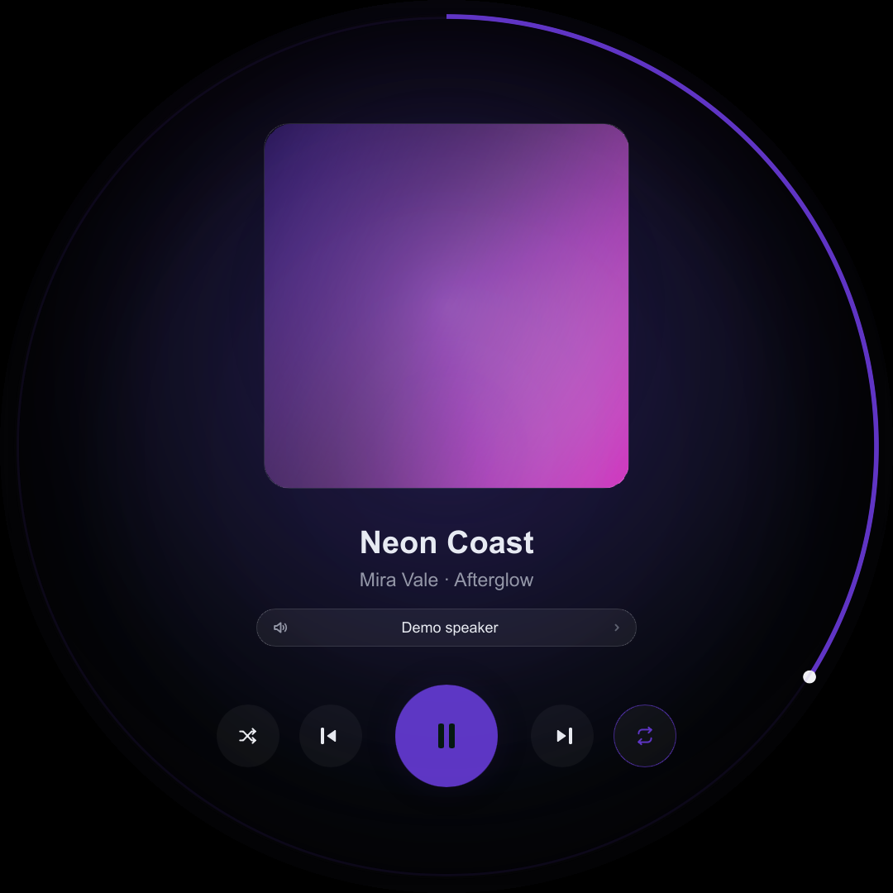
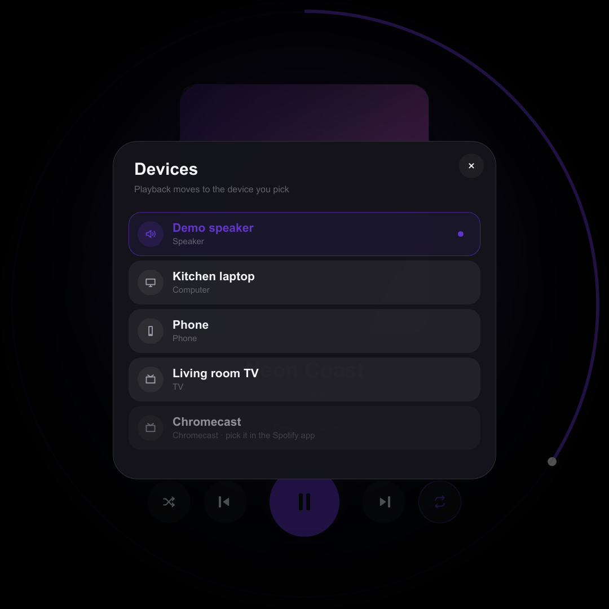
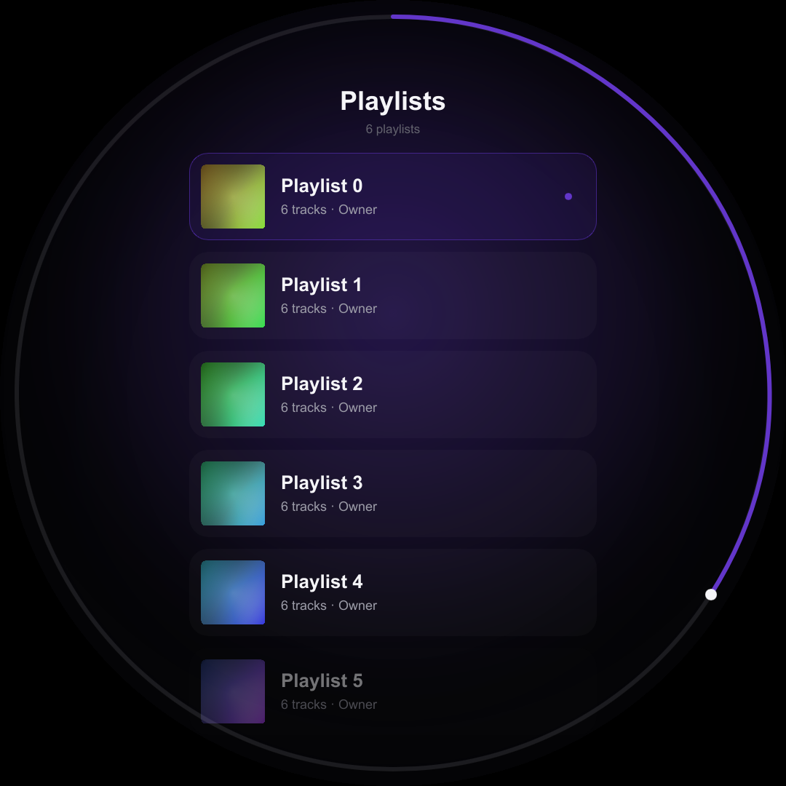
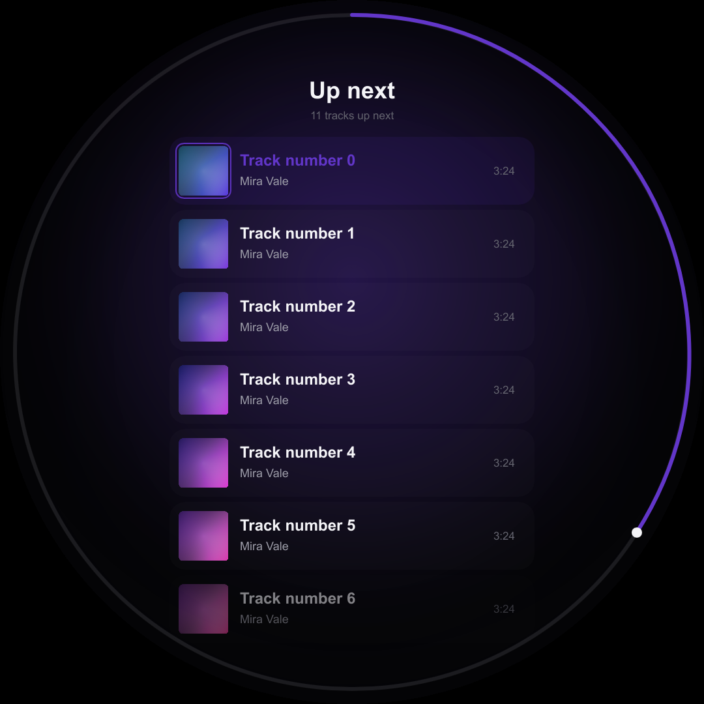
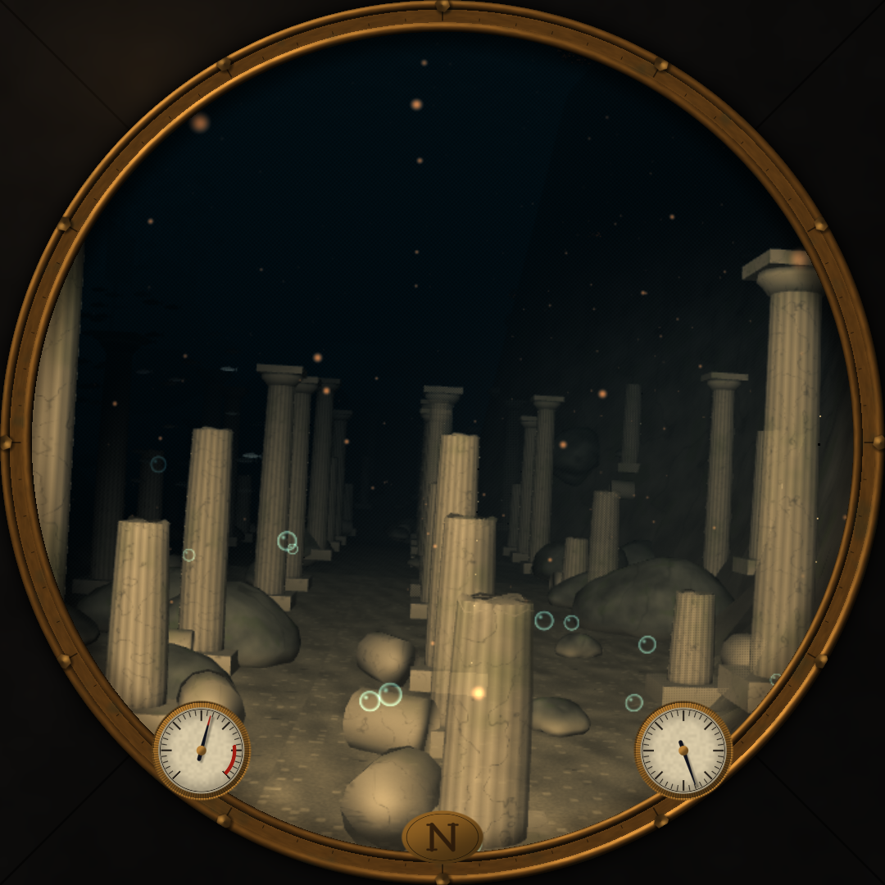
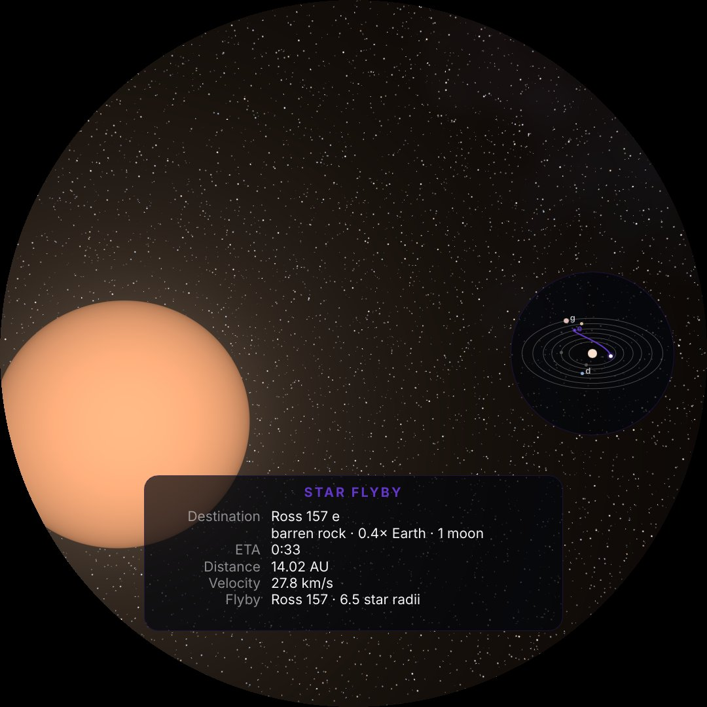
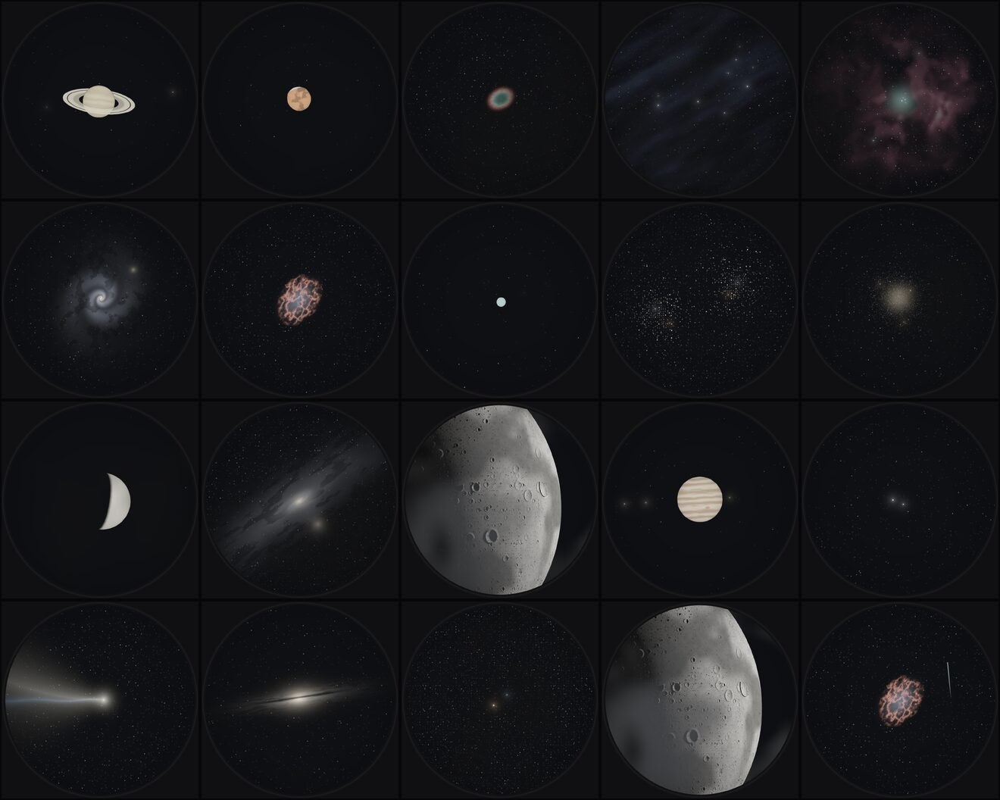
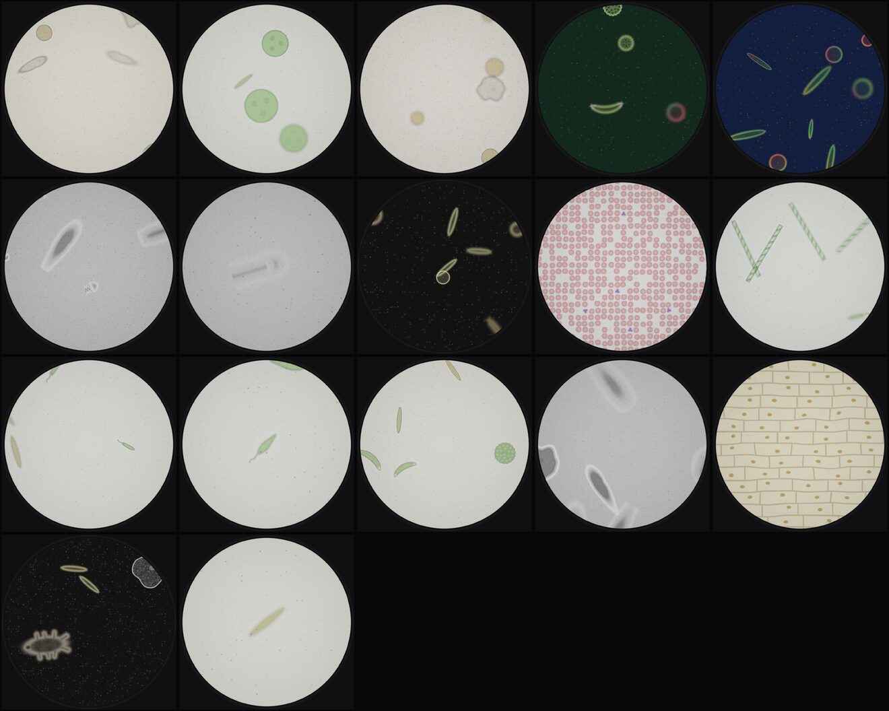

# Features

The README has the short list; this is the long one. The idle scenes have pages of their own:
[the Earth](globe.md), [the Nautilus](nautilus.md), [the Solar tour](solar.md),
[the Observatory](observatory.md) and [the Microscope](microscope.md). How it all fits
together is in [architecture.md](architecture.md).

  
  
  
  
  

## The player

- **Now playing** with square album art (softened corners) and a progress ring around the rim of the
  panel, drawn by a wgpu shader rather than re-tessellated Slint paths.
- **Ambient colour**: the accent, glow and controls take their palette from the artwork, and
  cross-fade perceptually when the track changes.
- **Controls**: play/pause, previous, next, seek, shuffle and repeat (off / all / one).
- **Output device**: the player names the Spotify Connect device it is driving; tap the pill under
  the track to list every device that is open (phone, speaker, TV, desktop app) and move playback
  there without touching anything else. Devices Spotify lists but does not let the API control — a
  Chromecast that is casting, for instance — are shown dimmed with the reason, instead of vanishing
  from the list.
- **Playlists** screen: browse your library, tap to start playing.
- **Queue** screen: the current track plus everything up next — tap an entry to play from there. The
  list opens on the track that is playing, so switching playlists never leaves you scrolled into the
  middle of a stale queue.
- **Motion**: an overshooting artwork reveal, a pulsing "current track" ring and sliding screen
  transitions between the pages.
- **Now-playing card** on every idle scene: the cover, the track, its artists and the playlist (or
  album) it plays from, with previous, play/pause and next, and an add button that shows whether
  the track is in your Liked Songs and saves or removes it. Once the visualiser is up it stays
  when playback resumes — the card shows what plays — until you tap the scene. The button needs
  the `user-library-read` and `user-library-modify` scopes; a token granted before them asks you to
  sign in again.
- **Touch first**: swipes are the only navigation — right for the queue, left for playlists, with the
  player in the middle — and dragging along the rim of the screen scrubs. Everything is laid out
  inside the circle so nothing hides in the corners of the round panel.
- **Demo mode** (`--mock`) with a built-in library and procedurally generated covers — no Spotify
  account or network needed, useful for developing on a laptop.
- **PKCE OAuth** with a loopback listener, a QR code on screen, and a CLI flow for headless setups.
  A phone that scans the code cannot call back to `127.0.0.1` on the display, so the display also
  serves a small login page on the local network that takes the authorization code back.
  Refresh tokens are stored with `0600` permissions.

## Idle visualisers

When nothing is playing — or a track has been paused for half a minute — one of the procedural
scenes takes over the screen, chosen at random on every visit. The **Earth** is a rotating Blue
Marble with Black Marble city lights, drifting clouds and their shadows, sun glint, sunset colour
along the terminator and a scattering atmosphere. The **Nautilus** is the view from its salon window
on a Jules Verne voyage, drawn as a 3D scene: seventeen seas from sunlit kelp shallows, a coral reef
and a seagrass meadow to a blue hole, a lava cave, a drowned city, a glass-sponge reef, the abyss
and the polar ice (see [docs/nautilus.md](nautilus.md)). The **Observatory** is the view through a
telescope's eyepiece over a night: eighteen targets from the Moon's terminator and the planets to
nebulae, galaxies, a comet, clusters and double stars, slewing from one to the next through air
that makes the image dance, on a night that may be steady or poor, clear or cloudy, with
satellites, meteors and aircraft crossing the field (see [docs/observatory.md](observatory.md)).
The **Microscope** shows fourteen slides, of pond life and of stained tissue, in bright field, dark
field, Rheinberg lighting and phase contrast: paramecia, Euglena, diatoms, volvox, amoebae,
Vorticella, Spirogyra, a tardigrade and more, under a focus that drifts through the drop and an
objective that turns to a stronger one partway through (see [docs/microscope.md](microscope.md)).

Swipe down on the player to summon the visualiser, swipe left or right on the dive to travel on to
the next sea or back (on the telescope to the next target, on the microscope to the next slide),
and tap anywhere to fade back.

  
  
  
  
  

## Behaviour in detail

**Optimistic UI.** Commands apply their result before Spotify confirms it, so the display never lags
behind a press. Play/pause, shuffle, repeat, seek, skips and playlist starts update the model
immediately; a `Pending` record marks what was asked for, and a poll that still describes the old
state is ignored until Spotify agrees (or three seconds pass). Skips borrow the upcoming item from a
warm `/me/player/queue` cache and keep a short history, so `next` and `previous` change the artwork
on the press; starting a playlist shows that playlist's cover with "Starting playlist" until the
first track is reported. Spotify's `actions.disallows` flags grey out a skip button that would have
nowhere to go, and a refused skip dims it for that item. The device picker lists
`/me/player/devices` when it is opened (the answer is reused for ten seconds), and picking a device
posts it to `PUT /me/player`; the player's device pill switches on the press, before the next poll
confirms it. The device model is deliberately loose, because the API is: `id` and `type` are both
nullable, `type`'s casing varies (`CastVideo`, `TV`, `AVR`), and a device with `is_restricted` or no
id is listed but cannot be driven. Rejecting any of those would fail the whole response — including
the playback poll — so they are decoded into `Option`s and handled per row.

**Motion.** [Animato](https://github.com/AarambhDevHub/animato) computes the values that need
continuous simulation: a `Tween<Color>` for the ambilight (interpolated in linear-light space), an
`EaseOutBack` tween for the artwork reveal and a ping-pong tween for the queue's current-track pulse.
Geometry transitions (screen slides, fades) use Slint's declarative animations so they run at the
display refresh rate.

**Tap versus swipe.** Slint reports a click for every press and release on a `TouchArea`, however far
the finger travelled, and the pages slide under the finger while swiping — so a swipe that ended over a
list row would also select it. Rows therefore use `components/tap_area.slint`, which compares the
release point with the press point and stays quiet once the finger has moved more than a few pixels.

**Why square artwork with a rounded mask?** Slint clips to rectangles, so the artwork pipeline applies
an anti-aliased rounded-rectangle mask while decoding. The same decoded buffer provides the accent
colour used for the rim, glow and buttons. The slider lives on the rim of the panel, outside the
pager, so it stays put while the screens slide.
