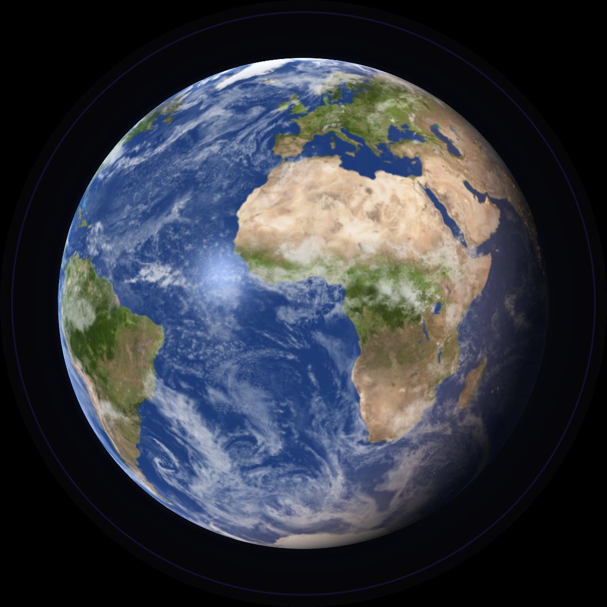

# The Earth

One of the idle visualisers (see the [feature overview](features.md)), drawn in `src/globe.rs`.

**Earth.** The planet is drawn in `globe.rs` with one fragment shader that projects the sphere, samples
the maps and lights it through a model of the atmosphere, in linear light.

- **Day side** — NASA Blue Marble; **night side** — Black Marble city lights, warm amber where they
  are faint and whiter where they are dense, dimmed by cloud.
- **Sun** — one light that travels once round the planet every half hour, so the terminator sweeps
  across the disc: full daylight, then a few minutes of the night side with its city lights, then
  daylight again. The planet turns on its axis, tilted 23.4°.
- **Air** — Rayleigh scattering, strongest in the blue. Sunlight crossing a long path of air near the
  terminator is reddened, so the ground and, a little longer, the cloud tops glow with sunset colour
  there; the air in front of the ground dims it and adds a blue haze that thickens toward the limb;
  and outside the limb the air glows where the sun reaches it, thinning out exponentially with
  height and lingering past the terminator, where the high air is still lit. On the night side only
  a faint green line of airglow remains.
- **Relief** — the normal map tilts the lighting, so mountain belts and trenches catch the light.
- **Water** — the sea darkens and catches the sun in a soft glint spread by the waves, with a Fresnel
  sheen of sky toward the limb, broken up by the cloud sheet.
- **Clouds** — a sheet that turns a little faster than the ground, so the weather visibly moves over
  the continents. It casts shadows away from the sun, longer as the sun sinks, and hides the city
  lights underneath.

The maps are 4096 × 2048 (2048 × 1024 for relief and water), which on the 850-pixel disc is still about
one and a half texels per pixel at the centre. `build.rs` builds every mip chain (the day map's in linear
light, so it stays gamma-correct) and compresses every level to the block formats the Pi's GPU samples
directly (`src/etc.rs`): the day map as ETC2 with the water mask in its alpha, the city lights and the
clouds as EAC R11, the relief's two slopes as EAC RG11. A little extra level of detail bias when sampling
keeps the city lights from sparkling as the map is minified; sampling is 4x anisotropic for the day map,
the clouds and the lights. All of it comes to 25 MB of GPU memory (80 MB as RGBA8, 420 MB for the 8K maps
this replaced), nothing is decoded at start-up, and the frame is 0.6 ms faster on the Pi than with the
uncompressed maps. A GPU without ETC2 gets the same maps decompressed on upload. `SIZE`,
`FPS`, `REVOLUTION`, `SUN_PERIOD`, `PLANET`, `ATMOSPHERE`, `AIR`, `SCALE_HEIGHT`, `SUNLIGHT`,
`CLOUD_DRIFT` and `OBLIQUITY` are the knobs.

Earth textures: NASA **Blue Marble** (day) and **Black Marble** (night lights), as distributed by
[solarsystemscope.com](https://www.solarsystemscope.com/textures/) under
[CC BY 4.0](https://creativecommons.org/licenses/by/4.0/). They live in `assets/earth/`.
