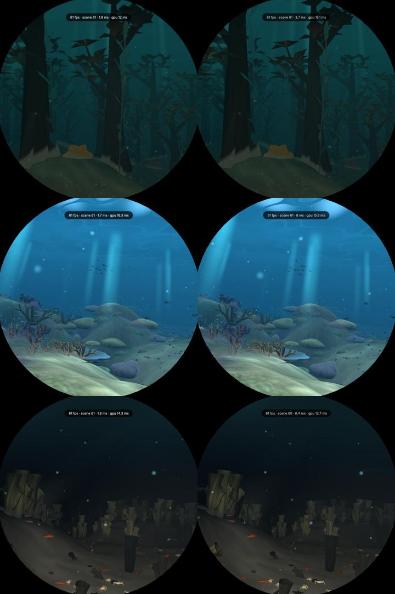

# D1: OpenGL ES on the kiosk's display

Branch `d1-display`, from `main` 578bf6e. Built on `display-gl` (0fe8015), which got
the GL device presenting under cage.

## Result

With the femtovg changes below, **GL + femtovg beats Vulkan + Skia live on the dive**:
the same 61 fps, the same frame gaps, and **1.0-1.6 ms less GPU time per frame**.
Stock femtovg ran at 46-47 fps. **The globe goes the other way**: 53 fps on GL against
61 on Vulkan. That is why the default stays **Vulkan + Skia**, and one variable switches
the display to GL with no rebuild:

```
SPOTIFY_ROUND_DISPLAY=gl      # or vulkan; unset = DISPLAY_GL_DEFAULT (false) in src/gpu.rs
```

Whether to switch is the user's call (see *For the user* below).

## What changed

- **Presenting** (from `display-gl`): `vendor/i-slint-backend-winit` (1.18.1) adds
  `request_graphics_api_for_display`. `gpu::install` opens the device on the event
  loop's own `wl_display`, which wgpu 30's EGL backend needs before it presents to a
  Wayland window.
- **Both renderers in one binary.** Default features are now `skia` and `femtovg`. The
  vendored winit backend gives a device opened on GL to femtovg, because Skia cannot
  draw on a GL wgpu device. Every other device gets Skia, as before.
  `gpu::backend_order` puts GL first for the display when `display_on_gl()` says so.
  If GL does not open, it falls back to Vulkan. `WGPU_BACKEND` still overrides
  everything.
- **femtovg 0.27.0 vendored** (`vendor/femtovg`), with four changes in
  `src/renderer/wgpu.rs` and `wgpu/shader.wgsl`. Each one has an environment variable
  that switches it off, for comparison (`Tuning`):
  1. *Specialised shader* (`FEMTOVG_NO_SPECIALIZE`). femtovg draws everything with one
     fragment shader that branches on a uniform: 869 instructions, two threads,
     44 temps on the V3D (captured live with `V3D_DEBUG=shaderdb`). Each pipeline
     already has its own shader type, so the type and "uses the glyph texture" are now
     override constants, and Mesa drops every other branch. The 1080 x 1080 dive image
     is then drawn by a small textured-quad shader: route (a) of the brief, without
     special-casing the image.
  2. *Stencil cleared, not loaded* (`FEMTOVG_NO_STENCIL_CLEAR`). Every femtovg fill
     leaves the stencil at zero, so each pass clears it and discards it at the end.
     Before, the tiler read and wrote it through memory on every pass.
  3. *A full-target clear becomes the load op* (`FEMTOVG_NO_COLOR_CLEAR`). Slint starts
     each frame with `clear_rect` over the window. It was a quad shaded over a
     framebuffer that had first been loaded back from memory.
  4. *A flush that only clears is carried into the next one* (part of the same switch).
     With a rendering notifier set, Slint flushes the window's clear on its own. The
     kiosk sets one because `show_fps = true` is in its config. On GL that was a
     render job that cleared and stored the whole frame, followed by one that loaded it
     back. The renderer now remembers the clear, and the next flush to the same view
     starts with it. That is one render job less per frame (360 to 300 jobs/s).
- `SPOTIFY_ROUND_SEED=<u64>` fixes the dive's world seed (`visuals::world_seed`), so
  two live runs sail the same sea. The screenshots below show that it does.
- `deploy/live-pi.sh` is the live measurement script. It runs on the Pi and takes
  `/tmp/nautilus-bench.lock`. It freezes the kiosk with SIGSTOP and resumes it on every
  exit. The build under test runs `--mock` as a second Wayland client under the kiosk's
  cage, so neither the kiosk's binary nor its Spotify tokens are touched. The script
  logs the visualizer's debug line and takes a `grim` screenshot mid-run, which proves
  the window presents. It also reads the V3D's `gpu_stats`: render, bin and TFU queue
  time per second, and job counts.

## Live measurements (Pi 5, cage, 2026-11-02)

Settings: 45 s per run, the first 12 s left out. `--mock`, `show_fps = true` as on the
kiosk, `SPOTIFY_ROUND_ADAPTIVE` off so both backends draw at full resolution, and
the dive paced by its timer, as on the kiosk. The "GPU" column is the V3D's
render-queue time per dive frame, for the whole display: dive, UI, present and
cage's composite. It is the visualizer's `gpu_ms`, as a median of one-second samples.

| sea (seed) | display | fps (min) | GPU ms/frame (min-max) | long gaps/s median (max) | render thread ms |
|---|---|---|---|---|---|
| kelp forest (11) | Vulkan + Skia | 61 (60) | 14.03 (11.7-15.7) | 0 (1) | 1.8 |
| | GL + femtovg, this branch | 60 (59) | **12.94** (12.7-15.2) | 0 (2) | 9.2 |
| reef (22) | Vulkan + Skia | 61 (60) | 14.89 (12.4-16.5) | 0 (1) | 1.6 |
| | GL + femtovg, this branch | 61 (60) | **13.30** (13.1-13.5) | 0 (1) | 12.0 |
| dark seabed (33) | Vulkan + Skia | 61 (60) | 12.75 (10.5-14.2) | 0 (1) | 1.5 |
| | GL + femtovg, this branch | 61 (59) | **11.72** (11.6-12.3) | 0 (1) | 8.7 |
| unseeded | GL + stock femtovg | 47 (46) | 19.37 (18.7-19.8) | 1 (4) | 14.1 |

Short gaps (frames never shown) were 0 everywhere. Vulkan's GPU time spreads more:
reef up to 16.5 ms, which is where the kiosk's adaptive scale starts lowering the
dive's resolution. GL's stays within about 0.5 ms.

Steps on the way, on the same seeds: specialisation, stencil clear and colour clear
alone gave 14.86 / 15.07 / 12.47 ms, at 6 render jobs a frame. Carrying the
notifier's clear brought that to 12.94 / 13.30 / 11.72 at 5 jobs a frame.

Other screens:

| screen | display | fps | GPU |
|---|---|---|---|
| globe | Vulkan + Skia | 61 (60-61), 0 long gaps | 15.05 ms/frame |
| globe | GL + femtovg | **53** (52-55), 7 long gaps/s | 17.59 ms/frame |
| player, `SPOTIFY_ROUND_FULL_SPEED` | Vulkan + Skia | 61 | 624 ms/s render, 452 jobs/s |
| player, `SPOTIFY_ROUND_FULL_SPEED` | GL + femtovg | 61 | 611 ms/s render, 331 jobs/s |

Under femtovg the UI itself is no dearer than under Skia (the player screen). The
globe's shortfall is its own frame on GL. Its fragment shader is 602 instructions,
2 threads and 56 temps under GL. The closest Vulkan shader is 572 instructions,
44 temps. The globe has no depth, so GL's early-Z gives it nothing back. The globe
also has no adaptive scale (`set_render_scale` is the trait's no-op), so it drops
frames instead.

The render thread's time on GL (8.7-12 ms against 1.6) is waiting, not work. wgpu's GL
backend holds its context lock through `eglSwapBuffers`, which blocks until the
compositor's frame callback, and the dive thread's buffer writes wait for that lock.
It never cost a frame in these runs. With `vblank_mode=0` (Mesa swap interval 0;
winit still paces redraws by frame callbacks), that time drops to 1.6-1.9 ms. The GPU
time then rises by 0.5-0.9 ms (13.87 / 13.83 ms on seeds 11 and 22), so it is not
the default.

Pictures (the same seeds, Vulkan left, GL right). The readout shows GPU 12 against
15.1 ms on the kelp seed at the moment of the shot:



The pictures match, so femtovg's changes draw the same frame.

## Gates

`deploy/v3d-shaderdb/check.sh .`: ok, with no change to the dive's shaders.
`cargo test --release`, `cargo clippy --all-targets -- -D warnings` and
`cargo fmt --all -- --check`: clean. The two warnings left come from upstream femtovg's
own code (an unused import and an unused method), which is a dependency.

## What is left

- **The globe on GL** (53 fps): the only reason the default is still Vulkan. Getting
  its frame shader to four threads would help both backends. So would letting it use
  the adaptive scale, or drawing the space behind the planet only outside it. After
  that, `DISPLAY_GL_DEFAULT = true` in `src/gpu.rs`, or the variable in the unit.
- Route (b), Skia's GL surface through an EGL image, was not needed. The specialised
  femtovg already draws the UI no dearer than Skia.
- wgpu-hal's GL present still blits the frame with a Y flip before `eglSwapBuffers`,
  one full-screen pass a frame that Vulkan does not have. Removing it means patching
  wgpu-hal.
- Both renderers in one binary make it 1.6 MB larger (46.9 MB against 45.3 MB).

## For the user

To run the kiosk on GL (faster dive, slower globe), add this to
`/etc/systemd/system/cage-kiosk.service.d/adaptive.conf`, or to a drop-in of its own:

```
Environment=SPOTIFY_ROUND_DISPLAY=gl
```

Then restart the kiosk. A black screen with only the cursor would mean the window is
not presenting: remove the line. It presented in every run here.
