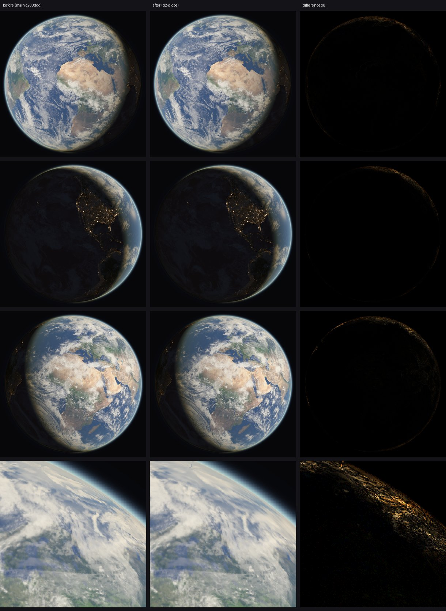

# D2: the globe on GL

Branch `d2-globe`, from `main` c208ddd.

## Result

The globe now holds **61 fps with no long gaps on GL**. Before, it ran at 54 fps with 7 long
gaps a second. Its GPU time is **14.09 ms a frame on GL** (was 17.60) and **14.50 on Vulkan**
(was 15.05). GL now matches or beats Vulkan + Skia on every scene measured, so
**`DISPLAY_GL_DEFAULT = true`** in `src/gpu.rs`. `SPOTIFY_ROUND_DISPLAY=vulkan` switches back
with no rebuild.

## Where the globe's time went

These are headless timings of the globe pass alone (`globe::tests::frame_time`, back to back,
kiosk frozen), on the Pi:

| | GL | Vulkan |
|---|---|---|
| main (one shader, 2 threads, 16x anisotropy) | 9.31 ms | 10.12 ms |
| split into regions (disc at 4 threads) | 9.32 | 10.08 |
| + anisotropy 4x, relief and cloud shadow without it | **6.41** | **7.23** |

What each texture fetch cost, removed one at a time from the 2-thread split (GL): day map
2.0 ms, both cloud fetches 2.05, relief 1.5, cloud shadow 0.75, city lights 0.6. The two
per-pixel tables (`textureLoad`) and the store came to 2.6 ms together, and a constant disc to
1.8. Anisotropy alone: 16x 9.31, 4x 6.99, 2x 5.96, 1x 5.64 ms.

So the frame is bound by **texture filtering, not by registers**. The old comment in
`globe.rs` said the Pi's V3D clamps anisotropy to 1. It does not: Mesa's v3d applies it on
both GL and Vulkan, and at 16x it cost 3.7 ms of the 9.3.

**Shader statistics** (`deploy/v3d-shaderdb`, which now also compiles the globe; confirmed on
the Pi through GL with `V3D_DEBUG=shaderdb`):

| shader | offline (Vulkan) | Pi, GL |
|---|---|---|
| `fs_main`, before: the whole frame | 696 inst, 2 threads, 57 temps | 602 inst, 2 threads, 56 temps |
| `fs_disc`: inside the planet, 68% of the frame | 417 inst, **4 threads**, 31 temps | 354 inst, **4 threads**, 32 temps |
| `fs_main`: the 2-pixel edge, about 6 k pixels | 696, 2, 57 | 602, 2, 56 |
| `fs_halo`: limb glow over space | 154, 4, 15 | 133, 4, 14 |
| `fs_space`: the corners | 46, 4, 9 | 49, 4, 9 |

The limb, the space behind the planet and the anti-aliasing blend pushed the one shader past
the V3D's 32 registers for four threads. The planet's inside alone fits. Four threads helped
very little on their own (9.31 to 9.32 ms on GL), because the TMU was the limit. They matter
once the filtering is cheaper, and they keep the planet's shader off the cliff.

**femtovg's share.** With the globe replaced by a constant colour, the whole display costs
9.78 ms/frame of GPU on GL and 9.40 on Vulkan + Skia. That covers the UI, the Y-flip blit,
cage's composite and the 1.8 ms constant pass. Hiding the FPS readout (`show_fps = false`)
takes GL to 8.67. The rim ring the globe screen draws costs nothing measurable: hidden, the
time was the same. femtovg is therefore not the gap. The globe's own pass was dearer on GL
live (about 7.8 ms against 5.7 on Vulkan, by subtraction) and is 4.3 / 5.1 ms now.

## What changed

- **The frame is cut into four regions** (`Region` in `globe.rs`). Each region is an annulus of
  128 quads that `vs_region` builds from the vertex index, drawn with its own pipeline in one
  pass. Shared edges come from the same numbers, so the regions meet with no gap and no
  overlap. The regions are: the disc a pixel inside the limb (`fs_disc`), the 2-pixel edge (the
  old `fs_main`), the halo out to the atmosphere (`fs_halo`) and the corners (`fs_space`).
  `shade` became `surface` (the lit ground in linear light) plus the limb and blend around it.
  `fs_disc` and `fs_main` share that code.
- **Anisotropy 4x** (`ANISOTROPY`) for the day map, the clouds and the city lights. A second
  sampler without anisotropy covers the relief and the cloud shadows. On GL a texture can be
  sampled through one sampler only, so the cloud map is bound a second time (`shadow_map`,
  binding 9) for the shadows. Pi previews at 16/16, 8/1, 4/1, 4/2, 2/1, 2/2 and 16/1 (main/soft)
  were compared pixel by pixel, and 4/1 was chosen. Taking the city lights off anisotropy as
  well (soft 1) changed the night side visibly more, so they stayed on the main sampler.
- **Timer pacing keeps the beat.** A frame late by less than one frame no longer restarts the
  timer (`visuals.rs`). On GL, wgpu holds the context lock through `eglSwapBuffers`, so the
  visualizer's submit waits whenever the UI is presenting (up to 14 ms here; D1 saw the same).
  With the beat restarted after each wait, the globe drew 60 frames in a little over a second:
  60 fps and one long gap a second, even with a constant-colour globe at 9.8 ms. The dive was
  not affected because its waits fall the same way every frame. `vblank_mode=0` fixes it too,
  and so does `SPOTIFY_ROUND_PACE=display`, but both cost the dive: vblank_mode 0.5-0.7 ms of
  GPU, and display pacing 60 fps with a long gap a second.
- `deploy/v3d-shaderdb` compiles the globe as well (`globe::tests::the_frame_is_round` before
  the dive's previews), and the baseline now holds its pipelines. The dive's shaders are
  unchanged.
- `deploy/live-pi.sh` writes its logs next to itself instead of always to `/tmp/d1`.

## Live measurements (Pi 5, cage, 2026-11-03)

All runs are from one session, interleaved: `live-pi.sh`, 45 s each with the first 12 s left
out, `--mock`, `show_fps = true` as on the kiosk, `SPOTIFY_ROUND_ADAPTIVE` off, timer pacing.
GPU is the V3D's render-queue time per dive frame for the whole display, as a median of
one-second samples (min-max). The V3D clock held at 960 MHz throughout.

| scene | display | build | fps (min) | GPU ms/frame | long gaps/s median (max) |
|---|---|---|---|---|---|
| globe | Vulkan + Skia | main | 61 (60) | 15.05 (14.79-15.12) | 0 (0) |
| | | **d2** | 61 (60) | **14.50** (11.50-14.63) | 0 (0) |
| | GL + femtovg | main | **54** (52) | 17.60 (17.42-17.84) | **7** (9) |
| | | **d2** | **61** (60) | **14.09** (14.03-14.23) | **0** (1) |
| | default (unset) | d2 | 61 (60), backend Gl | 14.09 | 0 (1) |
| dive, reef (seed 22) | Vulkan + Skia | main | 61 (60) | 15.18 (12.30-16.49) | 0 (1) |
| | | d2 | 61 (60) | 13.65 (12.29-16.51) | 0 (1) |
| | GL + femtovg | main | 61 (59) | 13.26 (13.08-13.59) | 0 (3) |
| | | d2 | 61 (59) | 13.40 (13.09-14.97) | 0 (3) |
| dive, kelp (seed 11) | Vulkan + Skia | main | 61 (60) | 14.00 (11.55-15.77) | 0 (1) |
| | | d2 | 61 (60) | 13.52 (11.55-15.68) | 0 (1) |
| | GL + femtovg | main | 61 (59) | 12.92 (12.67-13.74) | 0 (3) |
| | | d2 | 61 (58) | 13.41 (12.66-15.31) | 0 (3) |

Short gaps (frames never shown) were 0 in every run. The dive's code did not change. Its
differences between main and d2 (up to 1.5 ms on Vulkan reef, 0.5 on GL kelp) are run-to-run
spread. An earlier session with the same d2 code measured GL kelp at 12.84 and GL reef at
13.43. Vulkan did not get worse anywhere. On GL the globe has 2.3 ms of headroom under the
16.4 ms refresh.

## Pictures

GL previews rendered on the Pi (`globe::tests::previews`) at the same moments, main against
d2, with the difference amplified 8x. The bottom row is a 2x crop of the limb. Under 0.6% of
the pixels differ by more than 4 levels, all along the limb, where 4x anisotropy is a little
softer than 16x. The edge ring also differs by a pixel's mip choice.

## Gates

- `deploy/v3d-shaderdb/check.sh .`: ok. The 24 changed rows are all the globe's new pipelines,
  and the baseline was updated.
- `cargo test --release`: 129 passed.
- `cargo clippy --all-targets -- -D warnings` and `cargo fmt --all -- --check`: clean. The two
  warnings left are upstream femtovg's, as in D1.

## What is left

- The edge shader still runs at two threads. It covers about 6 k pixels, too few to matter.
- The globe has no adaptive scale. With 2.3 ms of headroom on GL it does not need one.
- The FPS readout costs about 1.1 ms of GPU a frame on GL, because Slint flushes the window
  clear on its own once a rendering notifier is set (D1). It only matters while
  `show_fps = true`.
- wgpu-hal's GL present still blits the frame with a Y flip (D1).

## For the user

GL is now the display's default, so deploying this build switches the kiosk to GL with no
unit change. If the screen ever shows only the cursor, add
`Environment=SPOTIFY_ROUND_DISPLAY=vulkan` to a drop-in of `cage-kiosk.service` and restart.
That puts back Vulkan + Skia, which also got the faster globe.
