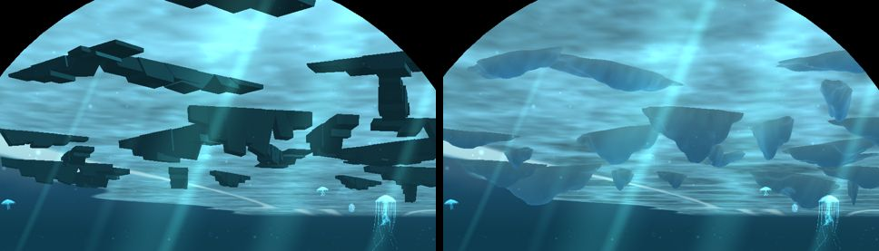
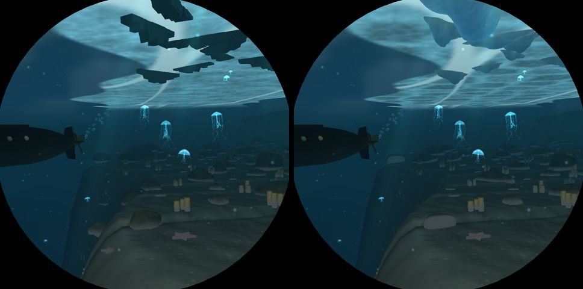
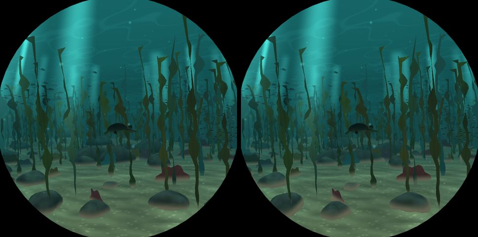
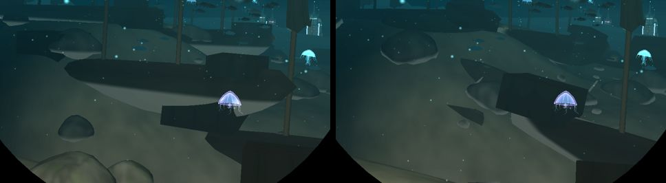
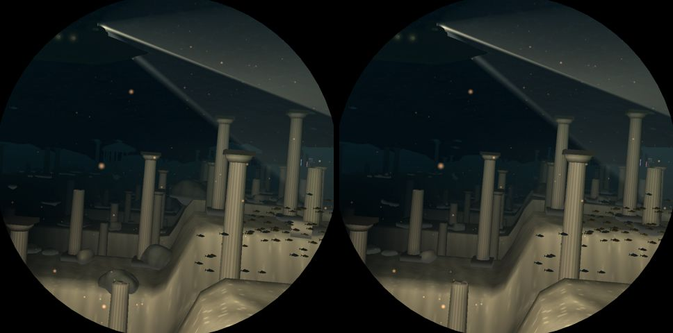
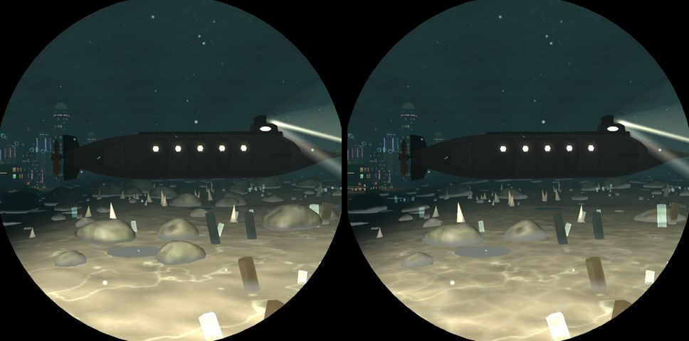
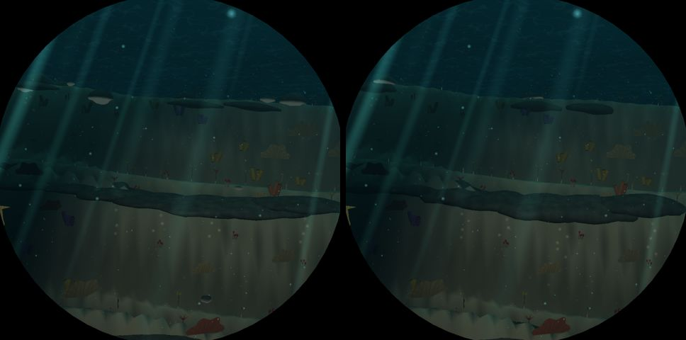

# Ground: V3 (ice less blocky) and V4 (terrain integration, placement realism)

Branch `ground`, from `main` 9e10613. Pictures are before | after, from `deploy/shots.sh run`
(`ground-before` on 9e10613, the after run on this branch).

## V3: the polar ice

- **Keels** (`mesh::keel`): the extruded slabs are now pressure ridges of rubble worn round: nine
  overlapping flat-bellied lobes of different depths on a subdivided icosphere (`mesh::blob`,
  2562 / 642 / 162 vertices at its three levels of detail, so the full shape only near the
  window), a ragged outline where it meets the sheet, smooth normals.
- **Lit through**: the vertices carry the light scattered in the ice, pale blue-white where it is
  thin (by the sheet, at the edges) and glacial blue down the thick middle; keels are drawn in the
  ice's own pipeline (`material::ICE`, marked `world::ICE_KEEL`), at the sheet's brightness, a
  little brighter at the silhouette, and with the sheet's thinner haze. Before they were dark
  silhouettes against the sheet. The ice pipeline's vertex shader skips the lights entirely (the
  sheet never read them), its frost texture runs round and down a keel, not streaked from above.
- Now and then (14 % of keels, off the lane by 3 units) a **berg**: broader (1.6 to 2.5) and
  deeper (0.65 to 0.9, kept above the sisters' ceiling under the ice).
- **Floes** (`world::floe_light`, in the ice bake): the pack is cells of different thickness,
  rounded where they ground together, with brighter refrozen seams; the bake only works its
  fields out where the arctic's share reaches 0.3 (cheaper than before outside the arctic).
- **Texture** (`textures::Surface::Ice`): melt scallops with bright thin rims, frost platelets,
  bubbles and fractures, softer than before.

## V4: bedded into the seabed, rules as data

- `world::Bed` and the rows of `world::bed` (`STONE`, `OUTCROP`, `FLAT`, `GROWN`, `WRECK`, `DRUM`,
  `BUILT`): how much of a thing is sunk, how far it leans with the slope, the steepest ground it is
  found on and how far the ground may fall away under its footprint. `world::seat` samples the
  ground at the thing's middle and four points round it and returns its height and slope, or
  `None` where it would hang off a lip or lie on too steep a bank. `Seat::tilt(yaw)` gives the
  pitch and roll that lay it along the slope.
- **Stones** sink about a third and lie with the slope, never on lips (the rocks perched on
  Atlantis' terrace edges are gone). Per-sea tables `STONES` (how stony the bottom is) and
  `OUTCROPS` (how many boulders are bedrock): stony abyss, trench and vents; few stones on the
  Sargasso's silt, the bloom's ooze and the brine's crust (which now reads as a crust plain);
  almost none on the reef (as before); no outcrops in Atlantis' paving. Seas keeping 0.45 keep
  exactly their old stone cells.
- **Outcrops**: long, half sunk, tilted with the slope plus a dip of their strata, with three
  scree stones below them down the slope.
- **Wrecks** settle along the slope (pitch and list from the ground), sunk to the bilge, in the
  first berth near their cell where `bed::WRECK` lets them lie (`wreck_berth`, shared with the
  sisters' `tall_things`), with **scour pits** at bow and stern and **debris** down-current:
  planks, a bronze gun, ballast stones (`wreck_debris`).
- **Ruins**: fallen drums roll to rest along the slope with chips beside them; temple fronts stand
  only on ground level enough to build on (`bed::BUILT`), with fallen drums and entablature blocks
  in front.
- **Trench** slabs are thick and bedded back into the rim, only their lip over the drop (they read
  as floating discs before); the sediment spills from the new lip.
- **Starfish** lie along the slope; polar sponges and the shallows' fans keep off ground they
  could not root on.
- **Shader** (`vs_model`, grounded pipelines only): the sand line follows the slope under the
  model (`world::ground_under` packs the slope into `floor.w`), so a stone on a bank is buried
  evenly instead of having a level band through it; silt drifts against the side facing the
  current (`CURRENT`). The per-frame grounding pass now skips the cached scenery, which found its
  ground when the cache was built (it was redone every frame).
- The divers' obstacles follow the same stone rules.

## Switches and costs

- `part::SEDIMENT` (shader switch `NO_SEDIMENT`): the slope-following sand line and silt drifts.
- `part::DEBRIS`: everything marked `world::DEBRIS` (scour, planks, guns, ballast, chips, rubble,
  scree).
- Keels are still `effect::ICE_KEELS`.
- shaderdb: grounded vertex shaders +37 to +46 instructions (still two threads, as before); the
  ice's fragment shader 97 to 154 (four threads); its vertex shader 146 to 188 (four threads). The
  grounded ice pipelines (never used) are no longer built. Baseline updated.

MEASUREMENTS

## Left

- The rock meshes themselves are still smooth lumpy spheres; a rock with facets and strata would
  sell the outcrops more.
- Vents' chimneys and the city's props are not seated by the rules (the vents' plumes and lights
  are tied to their cells; the city's streets are flat).
- No scour geometry in the terrain itself (the heightmap must match the shader); the pits are
  dark lenses on the sand.
- The ordinary keels near the lane can still hang deeper than the boat's ceiling under the ice
  (as before this branch).
