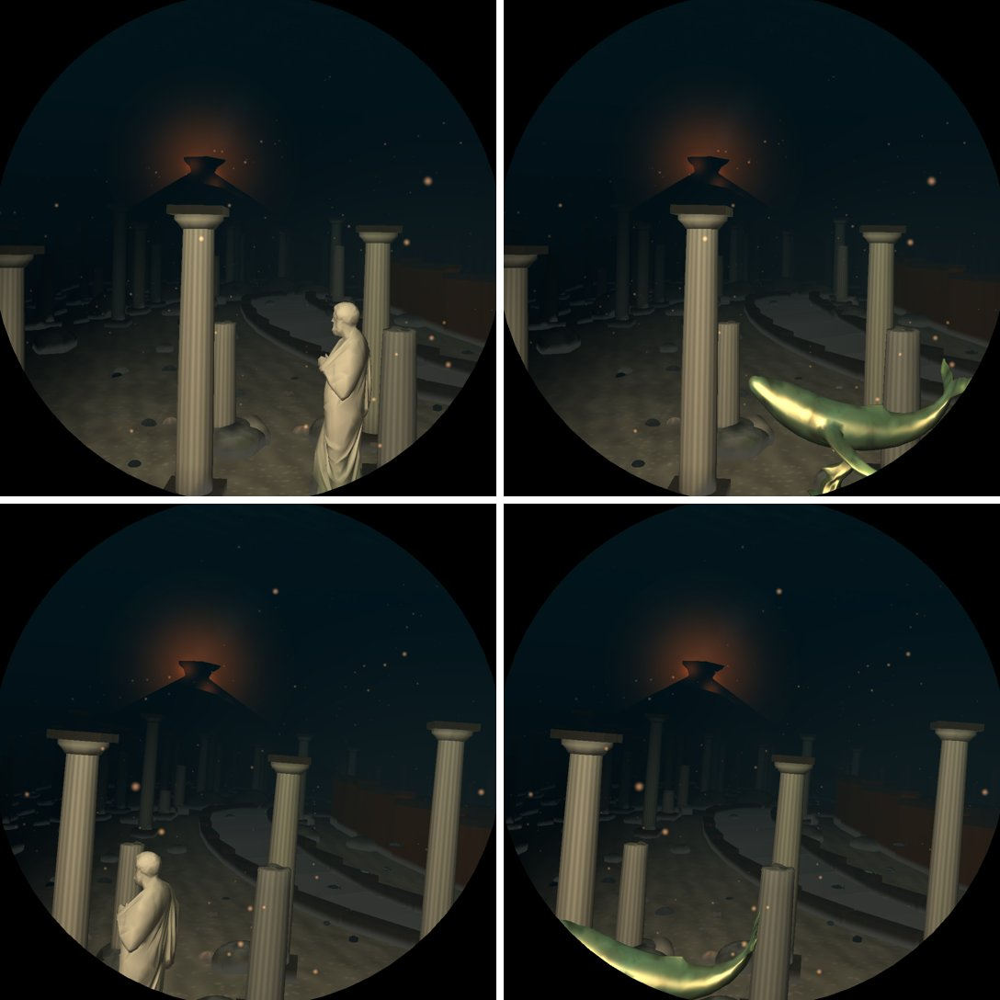
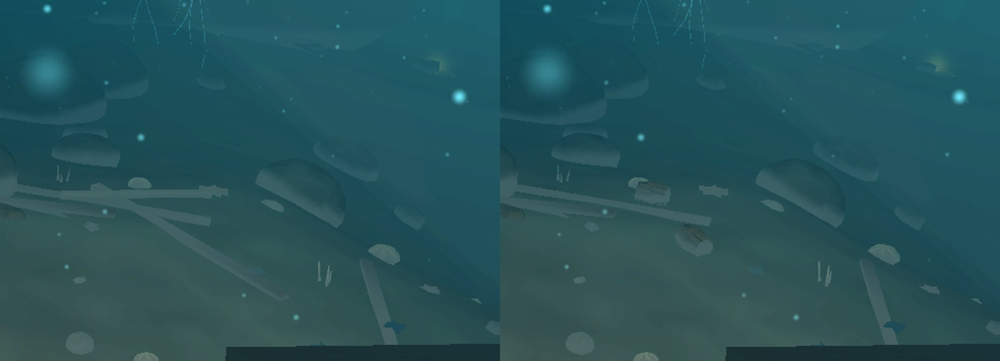

# M1: imported models (Poly Haven's glTFs)

Branch `m1-gltf`, from `main` dea7068. Pictures from `deploy/shots.sh run` on the Mac; timings
from `deploy/bench-pi.sh` on the Pi (GL).

## What changed

- **A glTF reader in `tools/decimate`** (`gltf` crate): every primitive of the scene, placed by its
  node's transform, welded on position (the vertices a UV seam split are one, their colours
  averaged), each vertex coloured by its material's base colour: the texture sampled bilinearly
  at its UV, times the factor. The OBJ it writes carries `v x y z r g b`. `IN#PICK` keeps only
  some of a kit's nodes (`a,b` names containing a or b, `-c` drops those containing c), which
  M2's hulls without rigging and M3's fort modules need.
- **`deploy/models.sh`**: a source `polyhaven:ASSET[#PICK]` fetches the asset's 1k glTF with its
  buffer and textures from `api.polyhaven.com` into `target/models/polyhaven-ASSET/` (once);
  `deploy/models.sh FILE ...` rebuilds only those files. The 1k glTF shares the full-resolution
  mesh, so a higher quality level later is a bigger count in `models.tsv` and a rerun.
- **`mesh::cast`** takes the file's own colours (times the sea's crust from the foot up), and
  `cast_creased` keeps hard edges for made things (a chest's planks and bands) where a statue is
  smoothed. Imports now have **coarser levels of detail** like the procedural models: a quarter of
  the triangles a step, by meshoptimizer's sloppy simplifier (edge collapse destroyed the chest's
  thin panels below about 1,500 triangles; clustering keeps their volume). This also gives the
  SMK statues LODs they never had.
- **Atlantis: bronze statues** (Poly Haven's `bronze_shark_statue`, `bronze_ray_statue`,
  `bronze_whale_statue`, by Tina) on some of the avenue's plinths in place of Sophocles, side on to
  the window, toned from the scans' polished brown toward verdigris, under the copper material's
  searchlight highlight. `Model::BronzeShark`, `BronzeRay`, `BronzeWhale`.
- **The wrecks' cargo**: Poly Haven's `treasure_chest` (Rico Cilliers) by each wreck's bow in place
  of the box, a third sunk and tipped with the sand, and a barrel from `wooden_barrels_01`
  (James Ray Cock) among the debris field, on its side and half buried or stood on end.
  `Model::Chest`, `Model::Barrel`.
- Credits in `assets/models/CREDITS.md`.

## Switches

- `DIVE3D_SKIP_ELEMENTS` bit 20 (`element::BRONZES`): the bronzes. Their models are also in the
  `atlantis plan` effect group.
- `DIVE3D_SKIP_ELEMENTS` bit 21 (`element::WRECK_GOODS`): the chests and barrels. Their models are
  in the `wreck` effect group.

## Measurements (Pi 5, GL)

`bench-pi.sh run m1-before2` (main dea7068's binary) against `run m1-after3` (this branch), the
full default (four visits, every sea, 204 places), one session:

| run | places | median ms | worst place ms | over 11 ms |
|---|---|---|---|---|
| before (dea7068) | 204 | 7.14 | 10.39 (atlantis 500000 @0.15) | 0 |
| after (m1-gltf) | 204 | 7.27 | 10.54 (meadow 0 @0.15) | 0 |

Per sea (median ms, before -> after): wrecks 6.80 -> 6.94, atlantis 8.47 -> 8.49; every other
sea within +-0.05 (abyss 6.46, arctic 6.94 -> 6.96, coral 9.34 -> 9.35, shallows 8.98 -> 8.99,
vents 6.31 -> 6.39 ...). The worst place, meadow 0 @0.15 (+0.29), has nothing of this branch in
it (same instances, same GPU time 7.23 ms; `run m1-after2` measured it 10.32): run-to-run noise
on the CPU side. The worst single frame in either run is 11.45 / 11.53 ms, one frame of six at
one place, as before.

`bench-pi.sh features` (what dropping each costs, median / worst over the places it is in view):

| feature | switch | seas | median ms | worst ms |
|---|---|---|---|---|
| bronzes on the avenue's plinths | `DIVE3D_SKIP_ELEMENTS` bit 20 | atlantis (its first stretch, measured at the preceding leg's 0.72/0.80) | 0.04 | 0.12 |
| wrecks' chests and barrels | `DIVE3D_SKIP_ELEMENTS` bit 21 | wrecks | 0.09 | 0.14 (wrecks 0 @0.15) |

Before the imports had LODs (`run m1-after2`) the chests and barrels cost 0.24 / 0.37 ms and the
wrecks' median was 7.04: the 2,000-triangle chest drawn at full detail a few pixels across.

Gates: `deploy/v3d-shaderdb/check.sh .` unchanged (no shader change), `cargo test --release` 129
passed, `cargo clippy --all-targets -- -D warnings` and `cargo fmt --all -- --check` clean.

## Not done, and why

- **Quaternius** (the house source): its Google Drive still answers "Quota exceeded" for every file
  on 2026-11-02 (the ships pack's OBJ folder lists, but each download returns the quota page).
  Nothing from it was imported.
- **Rocks** from Poly Haven's `coast_rocks_*` / `rock_07`: not done. The rocks were redone
  procedurally in V10 (faceted, strata) on the user's word, they are the most numerous instances
  in every sea, and T1 is reshaping the terrain they sit on at the same time; a scanned rock set is
  better tried after T1 lands, priced per sea.
- Amphorae: Poly Haven's vases are modern (a blue-and-white pot, jugs), not amphorae; the
  procedural amphora stays.
- The chest's lid could be a separate model to open it (`treasure_chest#lid`); it is closed.
