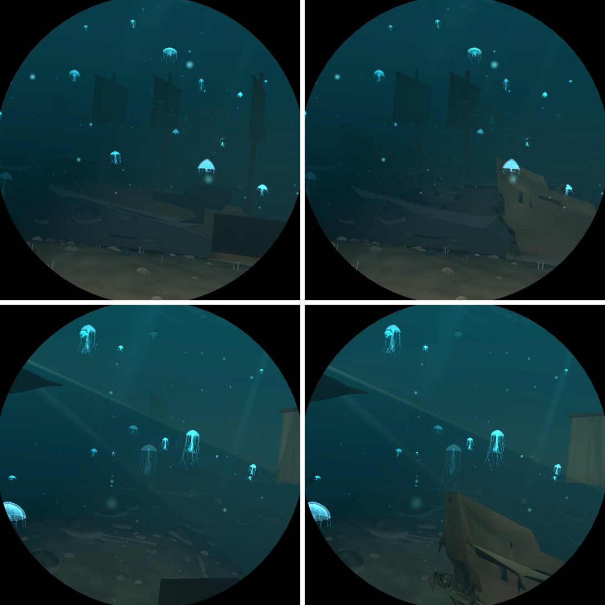
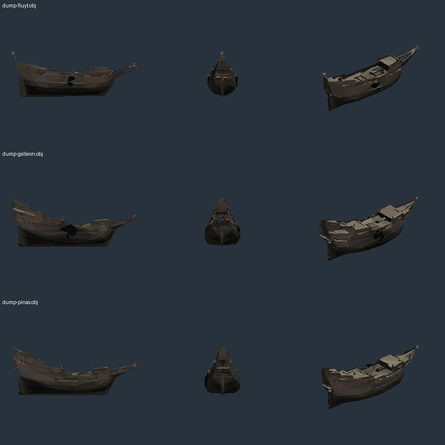

# M2: ships as wrecks

Branch `m2-wrecks`, from `m1-gltf` (M1's glTF reader). Quaternius's ships pack was the brief, but
its Google Drive still answers "Quota exceeded" (2026-11-02: the OBJ folder lists Boat, Sail ship,
Viking boat ..., each download returns the quota page), so the wrecks are Poly Haven's Dutch
ships, which the brief names as the fallback.

## What changed

- **Three hulls** (`assets/models/wreck-{fluyt,galleon,pinas}.obj`): `dutch_ship_medium`,
  `dutch_ship_large_01` and `_02` (James Ray Cock, Rico Cilliers, Nicolò Zubbini; CC0), the
  `#hull` node only (no rigging or sails), 1,200-1,500 triangles each, their textures baked into
  the vertices' colours. `Model::WreckFluyt`, `WreckGalleon`, `WreckPinas`: a unit long from the
  bowsprit, bow to +x, keel on y = 0 (`mesh::upright` keeps an import's own proportions).
- **Worn down first** (`mesh::wreck`): paint and wood greyed and darkened, silt on everything that
  faces up (decks, wales, the castles' tops), the sea's crust from the keel up (`cast`), and two
  breaches per hull: a ragged black gap laid over the planking (an 18-point fan following the
  hull's curve) with the wood round it darkened. Cutting real holes was tried first: the reduced
  hull's faces are larger than a breach, so a crack-free local refinement was needed to give the
  hole an outline, and that tripled the triangles (6-10 k a hull) for +2.2 ms median / +3.7 worst
  in the wrecks; the laid-over gap costs 18 triangles.
- **`world::wrecks`**: each galleon is now one of the three hulls (by the cell's hash), on the
  same berth and `bed::WRECK` seating, her keel where the procedural hull's lay, scaled 1.15 for
  the bowsprit. She lists harder (up to 0.31 rad, was 0.18). Her masts lean with the list; most
  are snapped (55 % the main, 70 % the fore) at 0.12-0.24 of her length, with the rest of the mast
  lying on the sand on the side she leans to; a mast still standing keeps its yard and torn sail.
  The procedural castles (two boxes) are gone: the imports have their own. `tall_things` knows
  the new heights, so the sister boat still clears them.
- The procedural `Model::Hull` stays in the library (the template and fallback), unused by the
  wrecks now; the landmarks test looks for any of the three hulls.

## Switch

`DIVE3D_SKIP_ELEMENTS` bit 22 (`element::WRECK_HULLS`): the hulls and the fallen masts (the
stumps and any standing mast stay). The hull models are also in the `wreck` effect group.

## Measurements (Pi 5, GL)

`run m2-before2` (M1's binary, `m1-gltf`) against `run m2-after2`, full default, one session:

| run | places | median ms | worst place ms | over 11 ms |
|---|---|---|---|---|
| before (m1-gltf) | 204 | 7.19 | 10.38 (atlantis 500000 @0.15) | 0 |
| after (m2-wrecks) | 204 | 7.30 | 10.39 (atlantis 500000 @0.15) | 0 |

Wrecks: median 6.93 -> 7.03 ms, worst place 8.52 -> 8.91 (500000 @0.15); by place +0.0 to
+1.46 (0 @0.15, 7.22 -> 8.68), where two or three hulls fill the view. Every other sea within
+-0.15 of before (vents 6.34 -> 6.49 and sargasso 7.72 -> 7.82 have no wrecks: noise). Worst
single frame 10.45 ms.

`features m2-wrecks2 DIVE3D_HOTSPOT_SCENES=wrecks`: the hulls (bit 22) cost 1.19 ms median, 2.06
worst (0 @0.15) against no hull at all; the procedural hull they replace cost about 0.3 (the
`wreck` group before). Chests and barrels 0.09 / 0.13.

Gates: `cargo test --release` 129 passed, clippy and fmt clean, shaderdb unchanged (no shader
change).

## Left

- Quaternius's ships (Boat, Sail ship, Viking boat ...) when its Drive allows downloads again:
  `models.tsv` rows plus a `wreck(...)` arm each.
- A hull broken in two, or a stern castle collapsed, would need a cut through the model; the
  breaches are laid over, not cut.
- The hulls cost about 1 ms where they fill the view; the coarser LODs (a quarter of the
  triangles a step) do the rest. A 900-triangle hull would save a little more if the budget gets
  tight.
