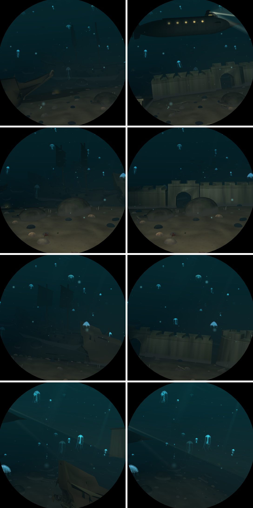

# M3: a drowned fort

Branch `m3-fort`, from `m2-wrecks` (M1's glTF reader, M2's wrecks).

## What it is

`world::fort`, a static placer: a colonial fort on the bank above the wrecks' anchorage, built from
Poly Haven's Modular Fort 01 (Rico Cilliers, CC0) and its Cannon 01 (James Ray Cock, Yann Kervran,
CC0), once per wrecks leg at half way (`FORT_AT`), 2.6 off the lane on the side the window looks
to (`FORT_ABEAM`), its battered face turned to the lane.

- **Modules** (`Model::FortWall`, `FortTower`, `FortGate`, `FortEnd`; `assets/models/fort-*.obj`,
  300-1,200 triangles each, picked from the kit by node name, `#wall_thick_straight_01` ...).
  `tools/decimate` got a `metres` fit: a kit's modules keep the source's own size (centred on
  their footprint, on y = 0), so they fit together as built; `FORT_SCALE` = 0.07 world units a
  metre, the scale of M2's 40 m ships, puts the 8.5 m rampart 0.6 over the sand.
- **The plan** (in the kit's metres, a table in `fort`): the round corner tower with a wall
  running back from it, two lengths of rampart with the gate between, a third toppled forward
  down the bank onto its face, and the rampart's broken end leaning out. Each rests on the
  lowest ground under its middle and ends, buried 22-50 % of its height, tipped half as far as
  the bank falls along it, leaning a little; the colours greyed and silted where they face up
  (`mesh::drowned`, shared with the wrecks), the sea's crust from the foot up (`cast`), the rock
  texture near.
- **Cannon** (`Model::Cannon`, 900 triangles, without its balls): eight spilled down the bank
  toward the anchorage on their carriages, slewed every way, a third turned over, half in the
  sand, never within 1.25 of the lane (copper skin for the bronze).
- The wrecks keep clear of it (`clear_of_fort`), and `tall_things` knows its rampart and tower so
  the sister boat climbs over it.

## Switch

`DIVE3D_SKIP_ELEMENTS` bit 23 (`element::FORT`); the models are also the `fort` effect group
(`DIVE3D_SKIP_EFFECTS` bit 52).

## Measurements (Pi 5, GL)

`run m3-before` (M2's binary) against `run m3-after`, full default, one session:

| run | places | median ms | worst place ms | over 11 ms |
|---|---|---|---|---|
| before (m2-wrecks) | 204 | 7.31 | 10.38 (atlantis 500000 @0.15) | 0 |
| after (m3-fort) | 204 | 7.28 | 10.38 (trench 250000 @0.85) | 0 |

Wrecks: median 7.04 -> 7.12, worst place 8.62 -> 8.48; the places nearest the fort got cheaper
(-0.6 to -0.95 at 0.15 and 0.45 in three visits), since the fort stands where two or three hulls
lay, and one got dearer (0 @0.85, +0.29). Every other sea within noise. Worst single frame 10.69.

`features m3-wrecks DIVE3D_HOTSPOT_SCENES=wrecks DIVE3D_FEATURE_PLACES=0.1,0.15,0.2` (half way
through the leg, where the fort is): the fort and its cannon cost 0.35 ms median, 0.65 worst
(0 @0.15).

Gates: `deploy/v3d-shaderdb/check.sh .` ok (no shader change), `cargo test --release` 129 passed,
clippy and fmt clean (the main crate and `tools/decimate`).

## Left

- The brief allows the blue hole's bank instead; the wrecks' anchorage was chosen because the
  fort explains the wrecks. Moving it is `fort_site`'s biome and `FORT_AT`/`FORT_ABEAM`.
- More of the kit: the walkways and stairs (`wall_walkway_*`, `wall_stairs_straight_01`) behind
  the rampart, the thin-wall corners, a second tower, would make the fort deeper than a line;
  each is a `models.tsv` row with `#node` and a line in the plan.
- Cannonballs (`cannon_01#ball`) strewn by the guns.
