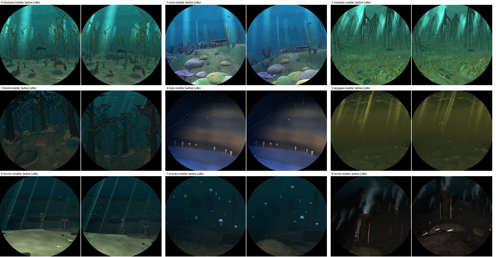
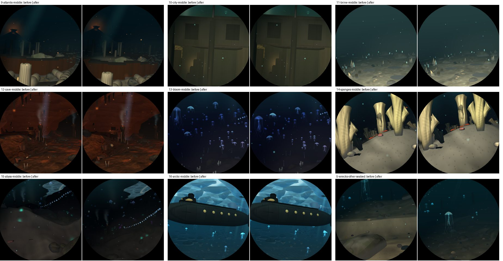
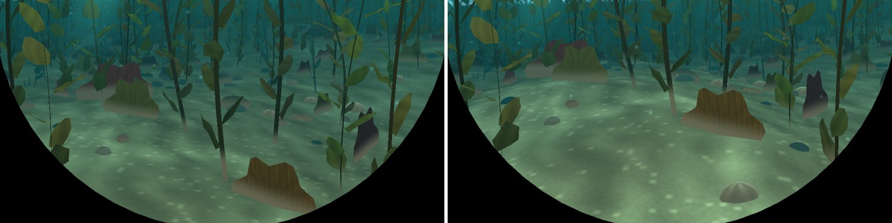
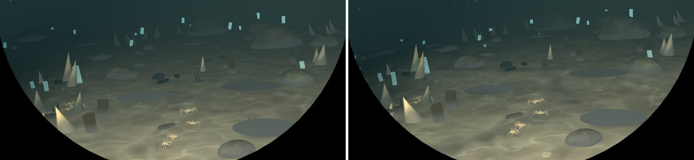
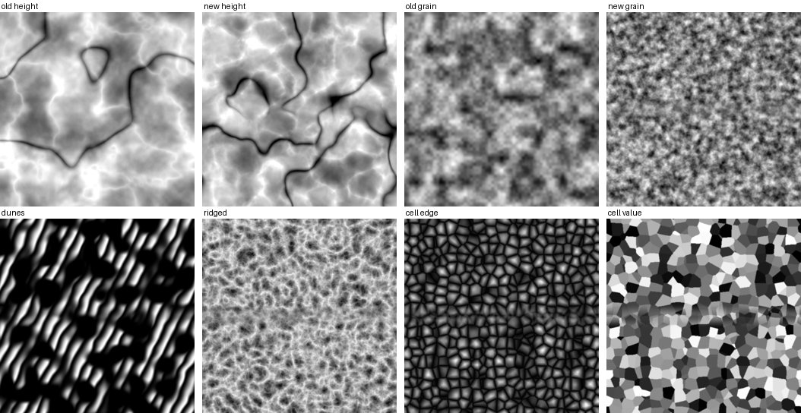

# T1: terrain noise from FastNoiseLite

Branch `t1-terrain`, from `main` dea7068.

## What changed

The seabed's heightmap (`dive3d/heightmap.rs`) is built with `fastnoise-lite` 1.1.1 (MIT), not
the hand-rolled value noise:

- **Height:** OpenSimplex2 fBm over a domain warped by OpenSimplex2 (progressive, 3 octaves,
  2.5 units), plus ridged OpenSimplex2 for the ridges and a slow OpenSimplex2 whose zero line cuts
  the canyons. The weights (`ROLL`, `SCALE`, `LIFT`, `CANYON`) bring it to the old height's spread
  (mean 0.35 / sd 0.33 before, 0.32 / 0.35 after), so every sea's `RELIEF` keeps its measure. The
  ground is sharper: the median slope rises from 0.15 to 0.19.
- **Grain** (the fine field the seas fold into their floors): OpenSimplex2 fBm, same spread as
  before (sd 0.28).
- **Forms**, a second tile (`Seabed::forms`, 256 texels square, channels in `heightmap::Form`):
  `DUNES`, crests along a warped line with a long stoss side and a short lee, in fields with bare
  sand between; `RIDGED`, ridged OpenSimplex2; `EDGE` and `CELL`, a cellular (Voronoi) mosaic's
  edge distance and cell value, with the risers rounded over about half a unit.

Which sea uses what (`world::biome_shape`):

| sea | before | after |
|---|---|---|
| shallows | two crossed sines for sand waves | warped dunes |
| wrecks | sine drifts | the dunes at twice the size, as long drifts |
| sargasso | a sine swell | the dunes at twice the size |
| abyss, vents | folds from the grain, `1 - 2|grain|` | ridged noise (same mean, sharper crests) |
| brine | sine terraces in rows, round pans from the grain, a skewed grid of cracks | polygonal Voronoi terraces, pools sunk into the highest cells with a rim of crust left round each, and finer cellular cracks (about a unit across) in the crust's colour (`terrain::shade`, worked out per vertex) |
| the other ten | unchanged shape terms | unchanged, over the new height and grain |

No sea went back to its old noise: none looked worse in the shots. The ten seas in the last row
kept their own shape terms (sines, reef field, sponge mounds, tunnel ledges, hole), so they keep
their character and change only through the shared height and grain.

**Seamless and deterministic.** FastNoiseLite does not repeat, and the tile must, every 64 units.
x goes round a cylinder in the 3D noise (exact, no seam). z runs from -32 to 32 and fades into its
own far side over the last 4 units (28 to 32 units off z = 0; the corridor stays within 3 units of
it and the furthest sight is 16), so the fade is never in view. The seeds come from the visit as
before. `heightmap::tests::the_seabed_has_relief_and_wraps` checks the wrap, that no seam steps
more than the tile's own texels do, and that a visit always gives the same seabed.
`world::tests::the_biome_shapes_wrap` replaces `the_biome_shapes_match_the_shader_and_wrap`. Its
shader copy had nothing to match since P7 removed the shader's relief.

`places.rs` picks places by leg and time, not by terrain, so every place is still found. Things
seated by `world::bed` still sit right, because the seabed and the bed read the same
`Seabed::ground`.

## Measurements (Pi 5, GL, `bench-pi.sh`, four visits, every sea, 204 places)

Two sessions, each with the base commit's binary and this branch's back to back:

| session | median ms | worst ms | over 11 ms |
|---|---|---|---|
| 1 (first after build) | 7.15 -> 7.16 | 10.39 -> 10.41 | 0 -> 0 |
| 2 (final, 7512f40) | 7.14 -> 7.23 | 10.36 -> 10.48 (coral 0.15, s750000) | 0 -> 0 |

Per-sea medians, session 2 (session 1's change in brackets). The GPU cost moves only through the
shape: where the boat rides and how much floor fills the window. Places move by up to ±0.4 ms
between runs, so most of this is noise:

| sea | before | after | change |
|---|---|---|---|
| abyss | 6.43 | 6.50 | +0.07 (-0.00) |
| arctic | 6.93 | 7.00 | +0.06 (+0.04) |
| atlantis | 8.52 | 8.42 | -0.11 (-0.22) |
| bloom | 6.50 | 6.69 | +0.18 (+0.13) |
| brine | 6.01 | 6.02 | +0.00 (-0.31) |
| cave | 7.19 | 7.19 | -0.00 (-0.06) |
| city | 7.09 | 7.34 | +0.24 (+0.01) |
| coral | 9.33 | 9.16 | -0.18 (-0.19) |
| forest | 8.48 | 8.66 | +0.17 (+0.16) |
| hole | 7.35 | 7.34 | -0.02 (-0.08) |
| meadow | 8.18 | 8.09 | -0.08 (+0.02) |
| sargasso | 7.73 | 7.97 | +0.24 (+0.18) |
| shallows | 8.98 | 9.06 | +0.08 (+0.07) |
| sponges | 6.62 | 6.87 | +0.24 (+0.20) |
| trench | 6.78 | 6.69 | -0.09 (-0.15) |
| vents | 6.29 | 6.53 | +0.24 (+0.12) |
| wrecks | 6.82 | 6.64 | -0.17 (-0.24) |

The kiosk shows Vulkan, about 1-2.6 ms a frame slower than these (D1).

**CPU** (`dive3d::tests::cpu_cost`, three runs each on the Pi, kiosk frozen):

| | before | after |
|---|---|---|
| new seabed (heightmap + forms, once at start-up and at each new visit) | 96 ms | 94-98 ms |
| seabed tiles, a visit's worth (82 467 vertices) | 40.0 ms | 42.9 ms |

On the Mac: 30 -> 29 ms and 16.0 -> 17.6 ms. The first version took 154 ms on the Pi. It now
bakes across the cores (`std::thread::scope`), keeps the forms at half resolution and drops the
rolling ground's two faintest octaves (1 % of its height). The tiles cost 7 % more, from the
forms lookups and the brine's per-vertex cracks. So start-up changes by the seabed's build alone,
about -2 ms of 96. Nothing else in `Nautilus::new` or the first frame changed, and I did not time
the whole start-up separately.

**Shaders:** `deploy/v3d-shaderdb/check.sh` shows no change (no shader edited).

## Pictures

`deploy/shots.sh compare t1-before t1-after`: every place changes, because the boat rides the new
ground and so frames every view a little differently.

The shallows' floor, before | after: dune fields in place of the even sines.

The brine flats, before | after: the crust's polygon mosaic and the pools sunk into its cells.
It is subtle, since the floor's fine detail fades within a few units and the caustics dominate.

The fields themselves (first visit, 64 units square): the old and new height and grain, then the
forms. The faint band across the middle of the cell channels is the seam's fade, at z = ±32.

## Not switchable

The new noise replaces the old in place: the old generator is gone, and there is no
`DIVE3D_SKIP` bit, since this is not a new element and the GPU cost changes only with the shape.
To compare against the old noise, check out dea7068.

## Left to do

- The brine's cracks would read better in the fragment shader, at pixel scale. Per vertex they
  are about as sharp as the old grid was.
- The other ten seas could take forms too: cellular cracked ooze in the bloom, ridged ledges in
  the trench, warped swells in Atlantis. Each needs a look in the shots.
