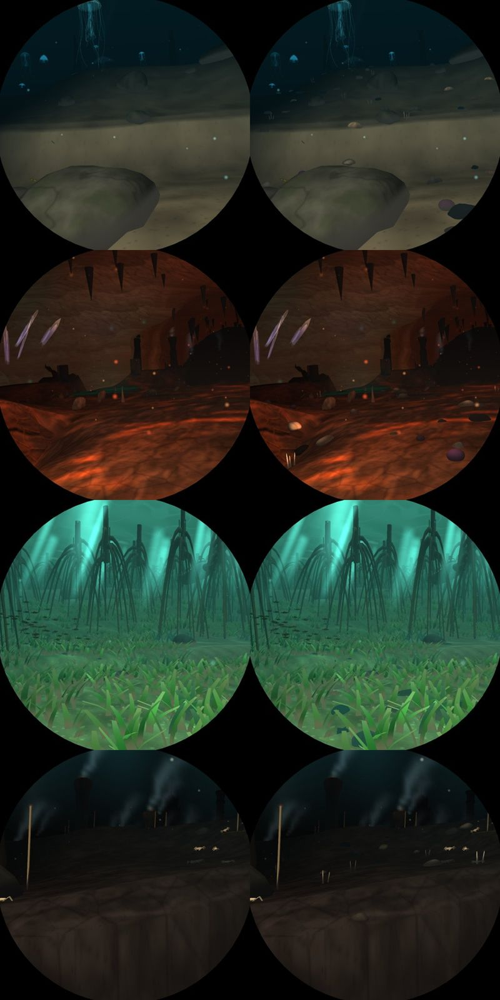

# V10: detail where there is headroom (first part: the near seabed)

Branch `v10-detail`, from `main` 4655725.

## What it is

`world::near_detail`, a static step in every sea: in cells of 0.16 from 0.35 to 3 units out,
the seabed just under the window carries pebbles (the three rock models, flattened), shells,
sea stars (pale, thin-armed brittle stars in the abyss, trench and glass sponges; orange, red or
purple ones elsewhere), urchins, sea cucumbers (pink in the deep, brown higher up) and tufts of
three chalky worm tubes. `STREWN` sets, per sea, the share of cells that carry something
(0.15 in the abyss and trench, 0.35 in the wrecks, none on the coral reef, which has no budget
left) and the odds of each kind. Each cell takes one of the two seas it lies between, dithered by
the blend, so a change of sea is a mix rather than a seam.

## Switch

`DIVE3D_SKIP_ELEMENTS` bit 19 (`element::NEAR_DETAIL`).

## Measurements (Pi 5, `bench-pi.sh`, GL)

| run | places | median ms | worst ms |
|---|---|---|---|
| off (bit 19 skipped) | 204 | 6.80 | 10.19 (hole 0.85) |
| on | 204 | 6.98 | 10.19 (hole 0.85) |

None over 11 ms. Per place it costs 0.13 ms at the median and 0.42 at most (arctic 0 @0.85).
Note the kiosk shows Vulkan (see `agent-tasks.md`, D1), about 1-2.6 ms a frame slower than these.

## What is left of V10

- Rocks with facets and strata (Poly Haven scans, with M1's glTF reader).
- The volcano and the abyss wall: nearer, or glowing.
- More near detail where a sea has room: the seas' medians run 6-8 ms, so most have 2-3 ms.
