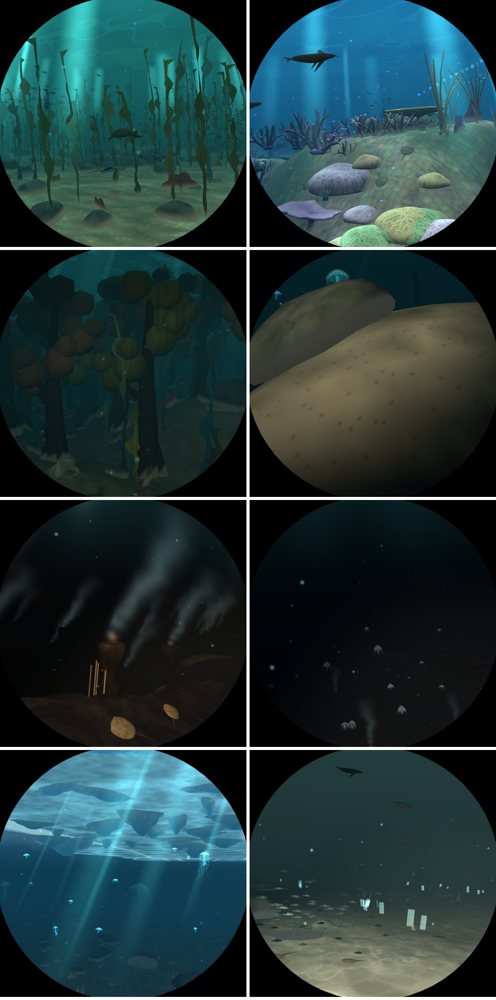
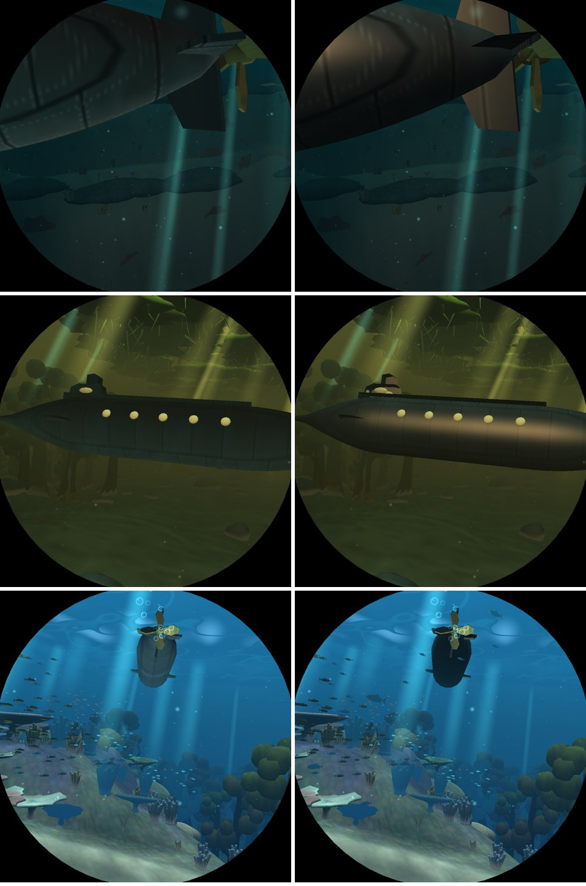

# V5: wildlife specific to each sea

Branch `v5-life`, from `main` ef449c1. Pictures are from `deploy/shots.sh run`.

## What is new

- **Creatures** (`world::LIFE`, placed by `world::wildlife`, a per-frame step): ten kinds,
  each with the seas it lives in, a way of moving (`Motion`: cruise, lurk, rest, glide, walk,
  play, chain) and its spacing along the lane. All are placed **to port**, where the window
  looks.
  - moray eels lurking out of rocks and ruins (`Model::Eel`)
  - the gulper eel of the abyss (`Model::Gulper`)
  - rays resting on the sand and gliding over it (`Model::Ray`)
  - crabs walking the vents, the brine and the trench (`Model::Crab`, `bed::WALKER`)
  - lobsters (`Model::Lobster`)
  - seals playing under the ice (`Model::Seal`), sea lions in the kelp forest
    (`Model::SeaLion`)
  - reef sharks cruising
  - a siphonophore: a chain of 22 glass bells with glowing lures, in the deep
- **Shoals** gained four species (`world::SPECIES`, gated by `part::LIFE`): chromis, anthias,
  garibaldi and vent shrimp.
- **Lit right way out**: `mesh::loft` wound its triangles inward, so every lofted body (fish,
  shark, whale, dolphins, turtle, manta, the submarine) was lit from inside. Fixed, with the
  test `lofted_bodies_face_out`. The submarine's hull is darkened to [0.21, 0.215, 0.23] so it
  keeps its look.

## Switches

- `DIVE3D_SKIP` bit 40 (`part::LIFE`): all the new creatures and the four new species.
- `DIVE3D_SKIP_EFFECTS` bits 43–46 (`effect::EELS`, `RAYS`, `CRABS`, `SEALS`): per model group.

## Measurements (Pi 5, `bench-pi.sh`, 168 places)

| run | median ms | worst ms |
|---|---|---|
| main (dfd5809) | 6.80 | 10.16 (coral s0 0.15) |
| V5 | 6.99 | 10.45 (coral s250000 0.15) |

None over 11 ms. Coral's median rises most (8.47 to 9.06). Feature rows (`features`):
wildlife pass 0.15 median (worst 0.48, shallows); crabs 0.04, rays 0.02, eels 0.02, seals
0.01, sharks 0.01.

## Next

- The animals are hand-built lofts. Queue task M1 replaces them with Quaternius's CC0 models
  (the user's choice of style), fitted to these as templates.
