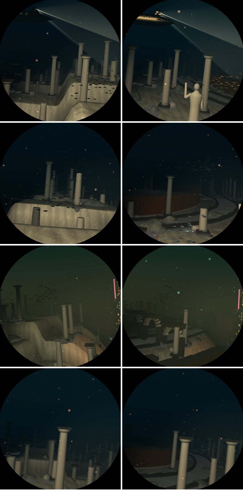
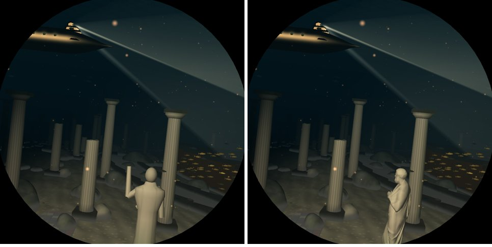

# V6: Atlantis laid out as a city, over a rolling seabed

Branch `v6-atlantis`, on `v5-life`. Pictures are from `deploy/shots.sh run`.

## The plan

The city is laid out as Plato's: rings round an acropolis (`world::atlantis`, a static step
after the ruins). The acropolis stands 5 units abeam of the Atlantis leg's middle; everything
else is placed relative to it, and kept clear of the corridor where it would cross the window
(`clear_of_plan`, `crossings`). The scattered ruins skip the cells the plan takes.

Fourteen elements, each switched off by its bit in `DIVE3D_SKIP_ELEMENTS` (`world::element`,
named in `world::ELEMENTS`; the element number rides in `anim[1]`):

| bit | element |
|---|---|
| 1 | debris (V4's, moved onto this mark from `surface[3]`, which clobbered the LOD's axis) |
| 2 | the acropolis, its round temple and Poseidon |
| 3 | the great stair |
| 4 | the fallen colossus (a head) |
| 5 | ring walls of orichalcum, tin and brass |
| 6 | ring canals and quays |
| 7 | the bronze gate |
| 8 | statues on plinths |
| 9 | inscribed stelae |
| 10 | mosaic floors |
| 11 | the aqueduct |
| 12 | sunken triremes |
| 13 | amphora fields |
| 14 | the harbour's lighthouse |

New models: `Statue`, `Torso`, `Head`, `Amphora`, `Trireme`, `Aqueduct`, `Stele`, `Mosaic`,
`Lighthouse`. Model group switch `effect::ATLANTIS_PLAN` (bit 47).

## The seabed (the user: "not straight floors … a rolling seascape")

- The Atlantis term of `biome_shape` lost its terraces: two crossing swells and mounds.
- Paving shows only in patches (`terrain.rs`), not as a floor.

## Imported statues (the user asked for open models)

Statue, torso and head are scans of the SMK's public-domain casts (Sophocles, the Belvedere
Torso, a bearded head), reduced to 3,000 triangles (`assets/models/`, credits in
`assets/models/CREDITS.md`). `mesh::cast` fits a scan to the procedural model it replaces,
which stays as the template and fallback, and copies `aux` from it. `deploy/models.sh` fetches
the full-resolution originals into `target/models/` and rebuilds the files with
`tools/decimate` (meshoptimizer): a higher quality level later is a bigger triangle count in
`assets/models/models.tsv`.

## Measurements (Pi 5, `bench-pi.sh`, 168 places)

| run | median ms | worst ms | atlantis median / worst |
|---|---|---|---|
| main (dfd5809) | 6.80 | 10.16 | 7.14 / 9.09 |
| V5 | 6.99 | 10.45 | 7.24 / 9.65 |
| V6 | 6.94 | 10.44 | 7.72 / 9.64 |
| V6, plan elements off | 6.88 | 10.47 | 7.07 / 9.62 |

None over 11 ms. The plan costs 0.65 ms of Atlantis' median and nothing at its worst place.
Per element (`features`, medians where it shows): ring walls 0.20 (worst 0.65, trench), canals
0.12, amphorae 0.12, triremes 0.11, aqueduct 0.09, acropolis 0.07, the rest 0.02 or less. The
scans were measured with the merge into `main` (`docs/feature-costs.md`).

## Next

- Queue M1: Quaternius (CC0) as the house source for the rest (the user's choice). Its Google
  Drive folders were over their download quota on 2026-11-01; retry, or fetch through
  Poly Pizza.
- Queue M2: Quaternius's ships as worn wrecks.
