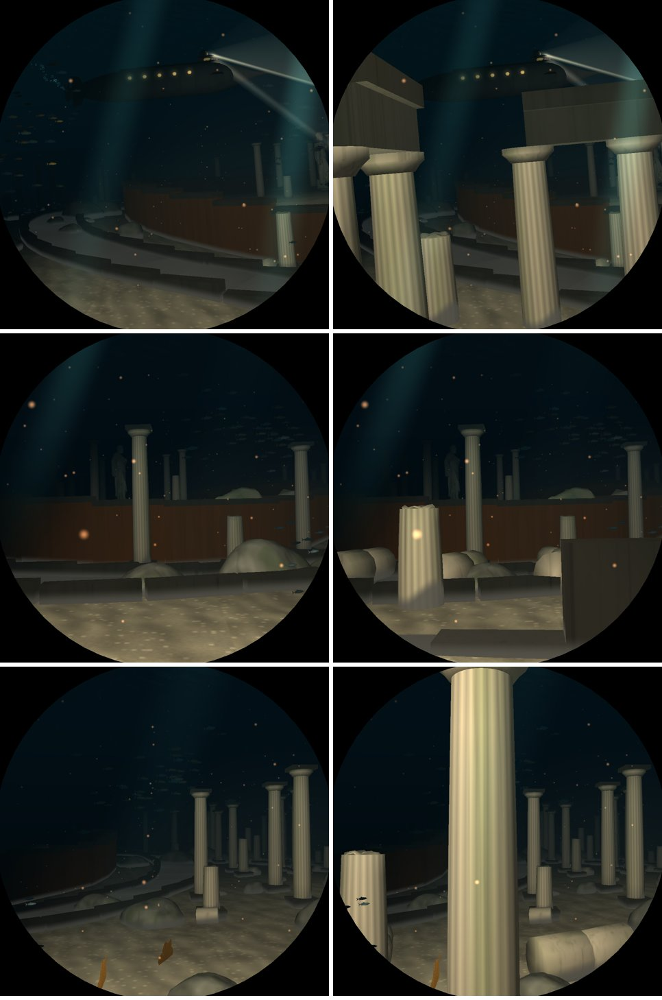

# V7: the Doric temple in Atlantis

Branch `v7-temple`, from `main` ac8db57. Pictures are from `deploy/shots.sh run`: the temple's own
places, with `DIVE3D_SKIP_ELEMENTS=32768` (no temple) | with it.

## What it is

An octastyle Doric peripteros, eight by thirteen columns like the Parthenon (`world::temple`, a
static step after `atlantis`), laid along the corridor inside the middle ring wall so that it ends
0.6 units before the bronze gate (`Temple::of` finds the gate by bisection). The boat sails in at
its front, down the roofless cella and out at the back.

- **Stylobate and three steps**, the floor level near the lowest of the ground along the way
  through: the silt drifts over the floor where the seabed swells, and the floor never rises
  under the boat, which keeps to the seabed's height (`helm.rs` knows nothing of models).
- **Columns**: 0.085 radius, 0.92 shaft (five and a half diameters) with capitals. On the long
  sides 72 % stand, on the fronts 55 %; the rest are broken (a stump with drums at its foot) or
  fallen outward in a line of five drums. The middle columns of each front are gone: nothing
  stands in the boat's way.
- **Entablature**, architrave and cornice, over every bay whose two columns both stand; not over
  the fronts' middle bays.
- **Pediments** fallen in three pieces before and behind the temple, clear of the way.
- **Cella**: walls of blocks, ruined lowest on the window's side and where the doorways were;
  the goddess (the SMK Sophocles scan) on a base to port at the back, facing across.
- **Sea life**: fans, sponge clusters and anemones on the stone.
- **Light**: ten dim shafts let down through the roof that is gone (`temple_light`, per frame).
  At Atlantis' depth the sun's strength is near zero, so they carry their own (`tint.w`, as the
  cave's chimneys do).

The ruins and the avenue of statues, stelae and mosaics keep clear of it (`in_temple`).

Five new screenshot places follow the passage: `N-atlantis-temple-approach`, `-front`, `-cella`,
`-back`, `-gate` (`places.rs`).

## Switch

`DIVE3D_SKIP_ELEMENTS` bit 15 (`world::element::TEMPLE`).

## Measurements (Pi 5, `bench-pi.sh`, 168 places, one session)

| run | median ms | worst ms | atlantis median / worst |
|---|---|---|---|
| main (ac8db57) | 6.94 | 10.39 (coral) | 7.75 / 9.61 |
| V7 | 6.93 | 10.41 (coral) | 7.95 / 9.64 |

None over 11 ms. The temple costs 0.20 ms of Atlantis' median and 0.03 ms at its worst place.
`features` (atlantis, trench and vents places): 0.18 ms in Atlantis, 0.13 median where it shows, worst
0.18.

## Next

- The temple reads best from inside: from the approach the window (to port) sees only its
  flank. A pass with the helm turning to look ahead as it nears would show the front.
- The goddess is the imported statue; a seated cult statue (an import, task M1) would suit.
