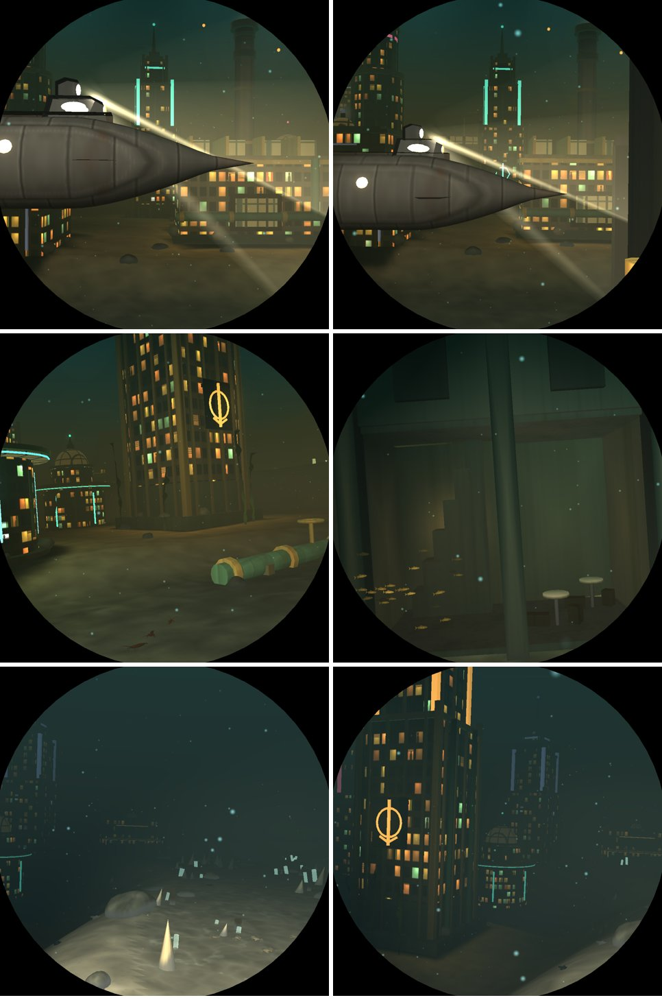
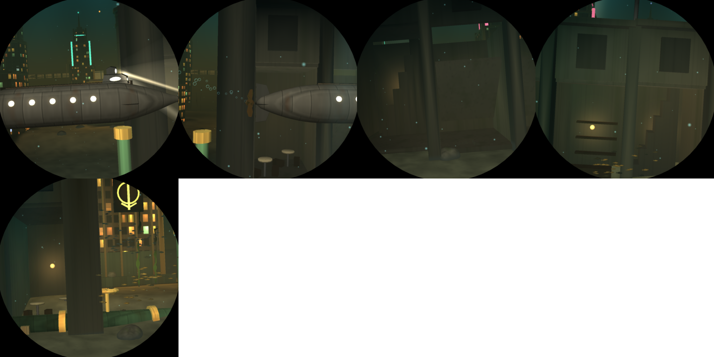

# V8: the drowned city's galleria

Branch `v8-lostcity`, from `main` 0d2bf28. Pictures are from `deploy/shots.sh run`.

## What it is

The avenue through the drowned city roofed over for seven units by an iron-and-glass barrel vault
on arcaded fronts, as the great shopping galleries were (`world::gallery`, a static step after
`city`). It starts 2.2 units before the city leg's 0.45 point, so the 0.45 place is inside it.

- **Fronts** 1.95 either side of the corridor, bay by bay (0.7): pilasters, arched openings a
  unit high, the wall over them with a dark upper window, a cornice. A great arch at each end.
- **The vault** springs at 1.55 above the floor and rises 0.75: a rib of eight iron lengths on
  every bay line, purlins between them, the glass gone. A lamp hangs from every other rib's crown,
  most still burning, with a glow.
- **Rooms** behind every arch on the window's side, 0.78 deep: floor, party wall, back wall,
  and by the bay's hash a café (round tables, chairs, one knocked over), a shop (counter,
  shelves), a stair up the back wall to a hole in the ceiling, or the ceiling fallen in with
  rubble. A lamp on the back wall in most (`room`).
- **Light** let down through the open vault and the holed ceilings (`gallery_light`, per frame,
  its own strength: the sun is all but gone at the city's depth).

## The boat

- **Never through the vault:** `Seabed::ceiling` comes down under the vault's crown along the
  galleria, so the helm keeps the hull below it.
- **On the corridor's line:** the gate's weave and the swing ease out over the five units either
  side of it, as for the cave's tunnel (`helm::open`). Down the galleria the window is 1.8 units
  from the port front. The legs after the city change a little (the boat comes out of it on a
  different line), as intended.
- **The city makes way:** buildings along it keep clear of the rooms' back walls (`building`).

Five new screenshot places follow the passage: `N-city-gallery-approach`, `-entrance`, `-rooms`,
`-deep`, `-exit` (`places.rs`).

## Switch

`DIVE3D_SKIP_ELEMENTS` bit 16 (`world::element::GALLERY`).

## Measurements (Pi 5, `bench-pi.sh`, 168 places, one session)

| run | median ms | worst ms | city median / worst |
|---|---|---|---|
| main (0d2bf28) | 6.91 | 10.42 (coral) | 7.37 / 8.86 |
| V8 | 6.94 | 10.43 (coral) | 6.84 / 9.25 |

None over 11 ms. The city's median falls by 0.53 ms (the fronts hide the towers behind them, and
the buildings nearest the avenue make way); its worst place rises by 0.39.

## What is left

- From a side window a corridor's wall fills the view; the rooms read best where a lamp burns.
  A wider hall (a crossing under a dome, half as wide again) would give the "halls" of the brief.
- The rooms are simple boxes; imported furniture and fittings (task M1) would enrich them.
