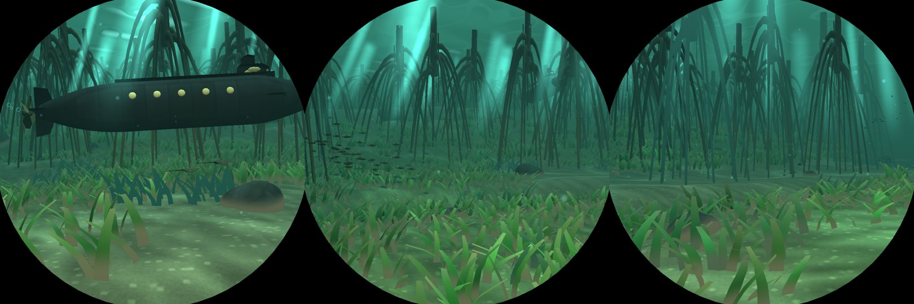
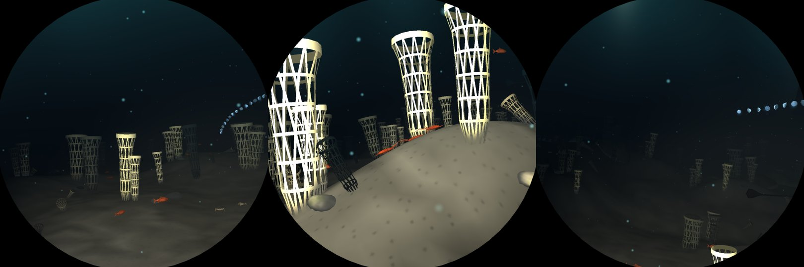
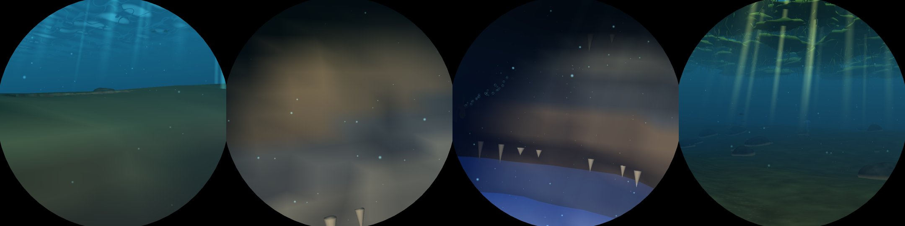

# V9: three new seas

Branch `v9-biomes`, from `main` 6142b25. Pictures are from `deploy/shots.sh run`.

## What they are

Biomes 14 to 16 (`world::MEADOW`, `SPONGE_REEF`, `BLUE_HOLE`), seventeen in all: every per-sea
table on both sides grew by three (`voyage.rs`, `world.rs`, `terrain.rs`, `mod.rs`, the shader's
`albedos` and `layers`), and the shader's `g.order` grew a fifth vector for the seventeen legs. The
canonical circuit is now shallows, coral, **meadow**, forest, **blue hole**, sargasso, trench,
wrecks, vents, Atlantis, city, brine, cave, bloom, **glass sponges**, abyss, polar ice.

### Seagrass meadow (`world::meadow`)

A sunlit shelf, green-lit and clear (sight 11): beds of swaying strap grass (`Model::Seagrass`, a
patch of 40 blades in one instance), standing a little proud where the roots hold the sand and cut
by shallow tidal channels; bare blowouts between with cushion stars and conchs. To port the shelf
shoals toward a mangrove shore: red mangroves' prop roots (`Model::Mangrove`) arch down out of the
surface to the floor, crusted with oysters and sponges low down, green with algae higher. Turtles
graze, rays rest and glide, fry and silversides; sun shafts.

### Glass-sponge reef (`world::sponge_reef`)

Cold and deep before the abyss (sight 8.5, no sky): silt mounds (`sponge_mound`) crowned with glass
sponges (`Model::GlassSponge`): slender lattice tubes flaring at the rim, their ribs spiralling
both ways with hoops across, open so the water shows through, faintly lit; the dead ones grey,
short and fallen on the flanks, with broken skeletons in the silt. Rockfish hang over them (a new
`LIFE` entry), crabs and squat lobsters walk, siphonophores drift through.

### Blue hole (`world::blue_hole`)

A shallow white bank, turquoise under a clear sky, and in the middle of the leg an elliptic shaft
(4.2 along the voyage, 3.3 across, 6.5 deep) the helm follows down to its floor and out up the far
wall. The wall is one model (`Model::HoleWall`) in the ellipse's frame: lumpy rock banded with pale,
grey and ochre strata, darker down the shaft, two broken ledges with recesses under them, green
growth at the top and a lip turned out over the bank. The seabed only gives it a floor, dropping
just behind the wall's model so the model's ledges never meet the heightmap's slope. Stalactites
hang under the ledges; the halocline is a shimmering sheet across the shaft a little under the
first ledge. The clearest water of the voyage (sight 16): turquoise over the bank, ultramarine down
the shaft. Mantas, turtles and sharks over the bank.

Six new screenshot places follow the descent: `N-hole-rim`, `-descent`, `-halocline`, `-floor`,
`-ascent`, `-out` (`places.rs`).

## Switches

- `DIVE3D_SKIP_EFFECTS` bits 48 seagrass, 49 mangroves, 50 glass sponges, 51 the hole's wall.
- `DIVE3D_SKIP_ELEMENTS` bits 17 stalactites, 18 halocline. The galleria's bit 16 was missing
  from `world::ELEMENTS` (so from the feature table); it is listed now.

## Measurements (Pi 5, `bench-pi.sh`)

| run | places | median ms | worst ms |
|---|---|---|---|
| main (6142b25) | 168 | 6.95 | 10.38 (coral 0.15) |
| V9 | 204 | 6.81 | 10.25 (hole 0.85) |

None over 11 ms. The new seas: meadow 7.60 / 9.78, glass sponges 6.33 / 9.27, blue hole 7.02 /
10.25 (median / worst). A first version with three-sponge clumps and a finer lattice reached
14.8 ms where the sponges come in; halving the lattice (about 500 triangles a sponge), two-sponge
clumps and placing them out to 7 units brought it to 9.3. The other seas' timings move both ways
(the circuit's order changed, so each sea's places fall on other ground and other neighbours).

Feature costs (`features`, the new seas only): glass sponges 1.32 ms median in their sea (3.72 at
the worst place, where they come in), seagrass 1.08, mangroves 0.50, the hole's wall -0.33 (it
hides the bank beyond it), stalactites 0.02, halocline 0.01. The rows are in
`docs/feature-costs.md`.

## Tests changed

- `swipes_back_and_forth_add_up`: two legs on from the shallows is now the meadow.
- `bubbles_never_pop`: the forest's walking party is a leg later; its scene moved from 630 s to
  1040 s, where its trails cross the glass.

## What is left

- The blue hole's wall reads soft close up: the rock texture streaked on the vertical faces, so the
  wall is untextured with vertex strata, which the haze washes out at a few units. A scanned cliff
  (Poly Haven, M1 and the rocks task) would give it real faces.
- The halocline is additive, so it can only brighten: the hydrogen sulphide cloud under it (a
  darkening, milky layer in real blue holes) needs a blended pass.
- Mangroves stand evenly; clumping them into islets with channels between would read better.
- Glass sponges are one shape at several scales; cloud sponges (folded, lumpy) and chimneys would
  vary the reef.
