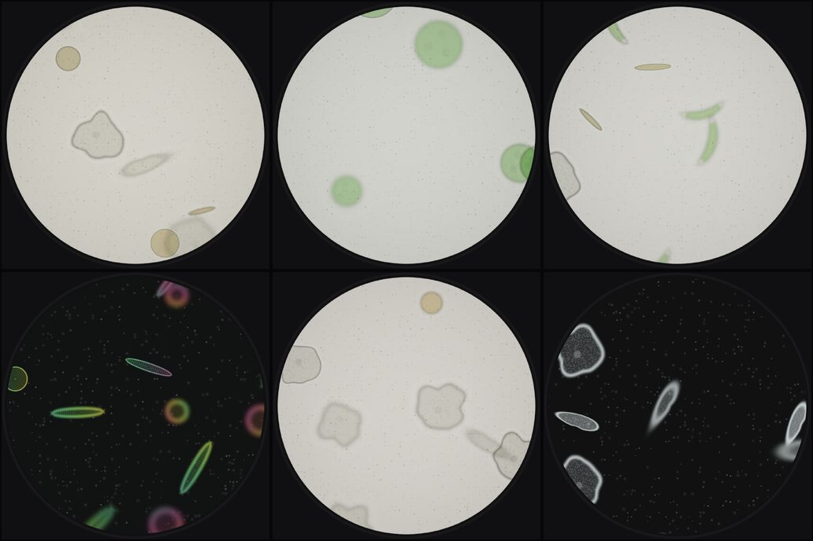

# The Microscope

One of the idle visualisers (see the [feature overview](features.md)): a naturalist's slides of
pond life under the objective. The code is `src/microscope.rs`, its shader
`src/shaders/lens/microscope.wgsl`; the plumbing it shares with the [observatory](observatory.md)
is in `src/lens.rs`.

## The slides

| Slide | Lighting | On it |
| --- | --- | --- |
| Pond water | Bright field | Paramecia, amoebae, Closterium and diatoms |
| Diatoms | Dark field | Pennate and centric diatoms, their glass edges shining in colour |
| Volvox | Bright field | Rolling colonies with daughter colonies inside |
| Desmids | Bright field | Green crescents of Closterium, with crystals dancing in their tips |
| Hay infusion | Dark field | A crowd of paramecia |
| Amoebae | Bright field | Amoebae creeping among diatoms |

A slide stays under the objective for 85 seconds, in an order shuffled on every visit. Changing it
takes five seconds: the view blurs and the stage slides away, then the next slide slides in and
comes into focus. A **swipe** changes to the next slide or back; a tap returns to the player.

## What lives there

Each organism is a small signed-distance shape with its own fine structure:

- **Paramecium**: a slipper with an oral groove, cilia beating round the edge in a travelling wave,
  granular cytoplasm and two contractile vacuoles filling and emptying in turn. It swims on a
  curving path, swaying.
- **Pennate diatoms** (*Navicula*): glass boats with rows of pores across them and the raphe down
  the middle, gliding back and forth along it.
- **Centric diatoms** (*Cyclotella*): pill boxes of radial ribs and rings of pores.
- **Volvox**: a sphere of cells that rolls as it drifts, three daughter colonies turning inside.
- **Amoeba**: a blob whose pseudopods slowly reach out and pull back, with a nucleus and granules.
- **Closterium**: a tapering green crescent with clear tips.
- **Debris**: specks jiggling in Brownian motion, each at its own depth.

They live on a torus a little wider than the field, so one that swims out of view comes back on
the other side, and wraps only outside the field stop. Every pose is a pure function of the clock
and the visit's seed.

## Light and focus

The **fine focus** drifts slowly down through the drop and back, once a minute, so one organism
sharpens as another blurs: away from the focal plane an outline spreads and its fine structure
fades. In **bright field** pigment absorbs the lamp's light, outlines are darkest, and a refracting
edge throws a faint bright halo just outside itself. In **dark field** only scattered light shows:
bright outlines on black, and a diatom's glass edge in colour.

## Cost

One draw a frame from one 576-byte uniform block: up to sixteen organisms, each skipped by a
bounding test for pixels nowhere near it, and one hashed cell of debris.
`cargo test --release lens::tests::frame_time -- --ignored` times it; on the same adapter it
costs about a third of the Earth's frame.
