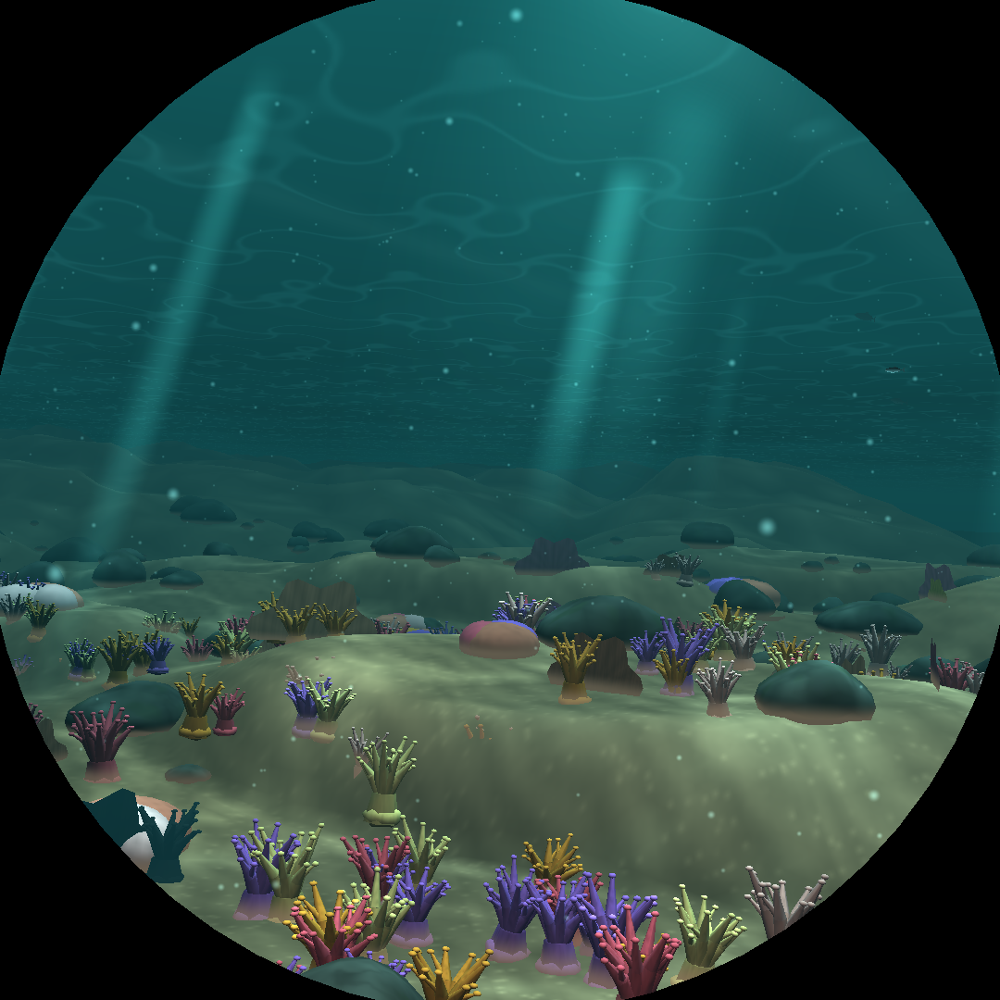
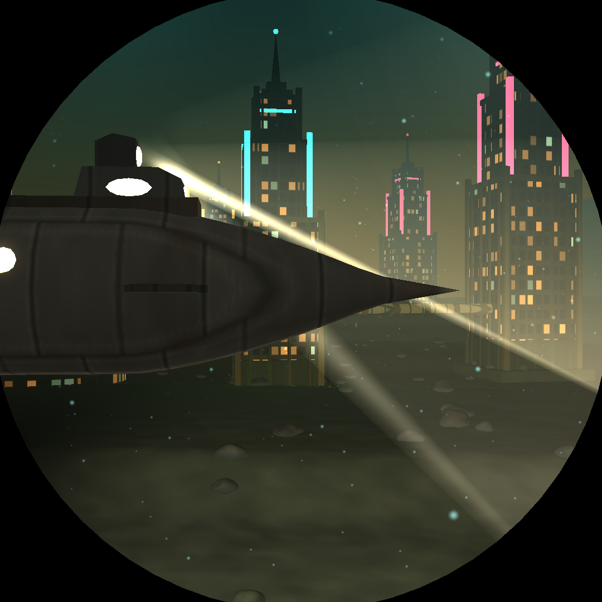
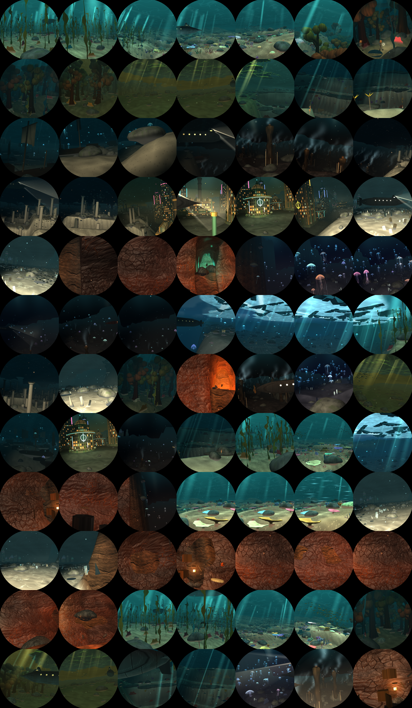

# The Nautilus: requirements

The Nautilus is one of the idle visualisers: the view from the salon window of Captain Nemo's
submarine on a voyage after *Twenty Thousand Leagues Under the Seas*, drawn as a real 3D scene in
`src/dive3d/` with its shaders in `src/shaders/scene.wesl`. This page says what the scene must do
and look like: first what holds everywhere, then what each of its fourteen seas must contain. How
the frame spends its time is in [pipeline-optimization.md](pipeline-optimization.md).

<p align="center">
  
  
  
</p>

---

## General requirements

### The voyage

- The voyage is a circuit of **fourteen legs of five minutes each**, one sea to a leg. Every visit
  shuffles the order (`voyage::order_for`) from its seed; seed 0 is the canonical reference circuit.
- Every visit gets a **new seabed**: a random heightmap of rolling ground, folded ridges and the odd
  canyon, periodic over 64 units. It shelves between the seas, so the boat drops into the abyss and
  climbs out to the ice.
- The same seed always gives the same world: a rock stands in the same place every time the boat
  passes it, and `places.rs` can name any moment of any visit.
- A **swipe left** carries the boat on to the next leg, a **swipe right** back to the last, as a
  short fast-forwarded passage behind a rush of bubbles; a **tap** fades back to the player.
- The course **weaves at every boundary**, so each sea gives way to the next in the middle of a turn
  rather than at an invisible line.
- Each biome keeps its id in every per-biome table (the original eight first, the six newer seas
  after them, the drowned city last, as biome 13), in Rust and in the shader alike.

### The boat and the window

The boat is sailed as the hull it is: twenty metres long and three high (about 1.8 × 0.27 units),
with the salon window halfway along its port side. `helm.rs` steers it.

- **Pace**: a survey pace of about 1.2 knots, varying only a few percent.
- **It goes where it points.** Its track is the corridor's meander plus a slow wander of the
  helmsman's own, and it never turns tighter than about three hull lengths.
- **It is not a side-scroller.** In open water the helmsman swings the boat **up to 50° off its
  track** over a couple of minutes, so the window looks well ahead up the boat's way or back down
  it, dipping a little as it looks ahead and lifting as it looks back. Among the ruins of Atlantis,
  whose columns stand beside the lane, it is held nearly straight.
- **Attitude**: it climbs and dives on ballast and planes at under a metre a second, noses up or down
  at most about six degrees and banks under two and a half into a bend. It heels a few degrees to
  port along the trench's rim so the window looks over the edge.
- **Clearance**: every point of the hull, not just the window, keeps about a metre of water under it,
  between it and the tunnel's walls, and under the surface or the ice. It reads the ground and the
  roof several hull lengths ahead, so it starts over a ridge in good time and sails over a gully
  rather than ducking into it.
- **Swell**: near the surface it heaves a few decimetres and rolls a fraction of a degree, less the
  deeper it goes.
- **A swipe's passage** runs the climbs and dives on the voyage's own clock, and the attitude turns
  at most three times its cruising rate.
- The **depth gauge** reads the boat's real depth.

### What the window must never show

- **Nothing pops in.** Things that come and go fade: encounters fade over the rim of the glass as
  they swim into view, a sea's scenery fades by coverage as its biome comes and goes, the ice fades
  at its edges, and placers fade at the edge of their range. The static scenery cache is rebuilt
  once the window has moved 0.2 units or turned 0.04 rad, and placed for a view widened by that
  much, so nothing is missing at the rim or at a placer's depth cut-off in between.
- **No hard switches of detail.** A model is drawn coarser only where the difference from the full
  model, in shape, colour and shading, is below what the window can show at that distance and in
  that sea's haze. Far coral becomes a cut-out card only where its branches no longer read, and the
  card dissolves as the model takes over.
- **No seams.** The seabed's tiles meet without cracks across their levels of detail, and every
  biome's shape agrees between Rust (`world::biome_shape`) and the shader.
- **No bubble on the glass.** Bubbles keep at least 1.2 units from the window and fade before they
  reach it.
- **Nothing in the corners.** The panel is round; the corners of the square the sea is drawn into
  are masked off before anything is drawn, and nothing outside the round window is drawn at all.

### Water, light and sky

- The **ceiling of every shallow sea is water**: the underside of the surface as a soft, slow,
  low-contrast shimmer of swells and sun, a backdrop rather than a second scene.
- The **sky shows only where a ray can leave the water**: inside Snell's window overhead and through
  the leads in the polar ice. The cave, the vents, the bloom, the drowned city and the abyss have no
  sky at all.
- **Daylight loses its red first** on the way down, so the deeper the boat, the bluer the light.
- Each sea has its **own water**: its colour, its haze with distance and how much sun reaches it.
  The haze also sets how far the window can see and how coarse a distant model may be.
- **Sun shafts** slant down where the sea is shallow and bright enough, rooted in a grid fixed in the
  world so the boat sails among them, breathing and swaying with the waves above.
- **Light sources**: the sun through the surface, the searchlight as a real spotlight turning with
  the boat, and up to eight point lights nearest what the window looks at (lava, vents, the volcano,
  lamps, lures).

### Life and encounters

- **Schools** are patchy, mostly small and now and then a great cloud, each fish beating its tail in
  step with its speed.
- Every couple of minutes a **sister of the Nautilus** may cross the window, passing the other way,
  overtaking, keeping pace alongside, far off across the water or nosing out of the gloom. She is
  steered as a heavy hull, kept clear of the scenery, and in dark seas her searchlight sweeps ahead.
- Animals move in the **vertex shader** from the clock and their own phase: tails sweep, flukes and
  wings beat, kelp and fans sway, bells pulse and tentacles trail.

### Performance on the Raspberry Pi 5

- The sea is the panel's **1080 × 1080 with one sample**; there is no smaller profile, and building
  without the `full-hd` feature is a compile error.
- **Every place must fit the 16.7 ms frame of a 60 Hz panel**, with room for the rest of the app:
  the kiosk has about 2 ms of its own, so a place should measure **at most about 14 ms** in the
  `hotspots` benchmark.
- On the Pi's VideoCore VII, fragment cost follows **instruction count and register pressure**. A
  shader too large for its registers runs at fewer threads for every pixel it draws, so a feature
  costs its registers even where a branch skips it: what does not show is removed, not gated.
  Work is baked into vertices or textures where it can be, and each material has its own pipeline
  so no other model pays for it.
- The CPU builds the scene in about a millisecond a frame on the Pi; the static scenery is cached.

---

## Per scene

### Shallows

- Sunlit **kelp** swaying over pale sand and rocks; sea fans and clams in the gardens.
- A **right whale** near the surface, **dolphins**, **manta rays** and **green turtles**, and schools.
- Bright water with **sun shafts** and **Snell's window** overhead.

### Coral reef

- A **shallow tropical reef**: flat-topped bommies and the ridges joining them, with winding sand
  gutters between, and coral covering about two thirds of the ground.
- Colonies laid out in **stands of one species** (staghorn thickets, table terraces, brain boulders,
  bush, finger and soft corals), with the odd stray of another kind; bigger on the bommies' tops.
- **Muted, living colours** (ochre, brown, mauve, olive, cream), as under a few metres of water, not
  the saturated colours of a lit photograph, and the same hazy blue water as the other seas.
- **Reef fish** hovering in swarms over the colonies, as one-quad impostors in the static cache;
  turtles and mantas along the reef.
- Colonies are models within 3.2 units and cards out to 8; beyond 4.5 units a thicket or a terrace
  is only its biggest heads.
- *Open*: views looking into the reef are the slowest on the Pi (about 15–16 ms), and the bommies
  are still smooth hills rather than lumpy coral heads.

### Forest of Crespo

- The **submarine forest**: tall algae branching like trees, each tree one model (trunk, boughs,
  clustered crown) at three levels of detail.
- Kelp, sea fans and clams among them; **turtles** rowing through.
- A **party of divers** in Rouquayrol-Denayrouze suits walking the seabed, the leader carrying a
  Ruhmkorff lamp, on paths that bend round the trees.
- **Sun shafts** falling between the trees.

### Sargasso

- **Golden weed rafts** floating overhead as the sea's ceiling, with fish under them.
- Gold light coming down through the weed, over **olive silt**; thick golden water.

### Trench

- The boat sails along the **rim**, with the gulf beside the window: gullies cut across the rim, the
  near wall steps down in terraces to a floor some sixty metres below, and the far wall climbs back
  in terraces above the rim.
- All of it is the **seabed's own height** (`world::trench_profile`, mirrored in the shader), so no
  pixel pays for the walls.
- Slabs of rock jutting over each drop, **sediment** spilling from their lips; sponges, sea fans and
  tube worms on the far wall; faintly glowing **sea pens** and crinoids on the terraces; **lights
  blinking** in the dark at the bottom.
- Clear water, so sunlight slants down into it. The boat **heels to port** to look over the edge.

### Wrecks (Vigo Bay)

- The **galleons of Vigo Bay**, half buried, their **treasure spilling out**.
- **Sharks**, mantas and drifting jellyfish; sun shafts over the wrecks.

### Hydrothermal vents

- **Black smokers** with tube worms round their feet, smoking into nearly black water.
- Almost no sun; the vents' own glow is the light.

### Atlantis

- **Colonnades along avenues**, many columns broken with their drums fallen beside them, and
  **temple fronts** farther off, on a nearly flat paved seabed.
- The **volcano** whose fire lights the drowned city.
- The **divers** walk here too; mantas among the ruins.
- The boat is **held nearly straight**: the columns stand close beside the lane.

### Drowned city

- A Milliard City sunk off its propeller island: **towers of brass and iron**, square and stepped
  behind cornices, round under glass cupolas, a stepped hall, an arcade, works and a picture palace,
  in blocks either side of a **clear avenue** the boat follows and on into the haze, where only their
  lit windows show.
- **Glass domes** over halls, lit **walkways** strung between towers, **great pipes** and valves
  along the avenue, **neon** roundels on the facades, **searchlights** sweeping from the crowns, kelp,
  barnacles and bubbles at their feet.
- **Lit windows** on a grid, some flickering, with a **lift** riding up some faces. Behind each lit
  pane is a **room painted flat**: a lamp to one side lighting the ceiling, darker floor and corners,
  its own wallpaper, and in some curtains, a blind, or someone pacing. From the street a room's depth
  does not read, so it is not modelled.
- Glass and polished brass **mirror one water tone**, stronger at grazing angles; building feet are
  silted and shadowed; warm **pools of light** lie on the seabed under the lit windows.
- Teal-green, clear water; no sky. The city's lights are one material (`city_light`), within the
  Pi's register budget.

### Brine flats

- **Salt spires** built up by seeping brine, crusted lumps and broad, shallow **salt terraces**.
- Dark, still **brine pans** sunk into the crust, with the odd **brine shrimp** glinting over them.
- Pale, milky water over a pale, almost neutral crust.

### Lava cave

- A **massif** rises across the corridor; the boat enters through a **mouth in its cliff face** and
  leaves by the far one.
- The **tunnel runs nearly the whole leg**: a ragged arch of basalt veined with molten rock, hung
  with stalactites, with **three halls** joined by **narrows**:
  - the **forge**: a lava fall down the far wall into a glowing river along its foot;
  - the **grotto**: breathing luminous colonies and a still pool;
  - the **colonnade**: a shaft of pale light from the vault.
- Off the tunnel open the cave's **five secrets**, the same in every cave in an order of the seabed's
  own: a passage down to a chamber of molten rock with embers drifting out, a grotto of luminous
  creatures, a gallery of violet crystals, a doorway of dressed stone with signs on its lintel and
  steps up into a warm light, and a chimney letting down a shaft of light. Each bends round a corner,
  so its end is never seen.
- **Nooks** in the walls: a landing party's camp, a crystal pocket and a still lava pool, with
  stalagmites, rubble and flowstone between them.
- At dead slow the helmsman sets the boat **up to 60° across the tunnel** so the window looks up it
  and into each hall, never farther than the hull clears both walls.
- No sky. The rock's lighting is **baked into the tunnel's vertices**, and the tunnel has a material
  and pipeline of its own.

### Bloom

- A **dense drift of jellyfish**, the moon jelly the bloom's own, over a soft blue-grey ooze.
- **Glass sponges**, violet fans and glowing **sea pens** on the floor.
- Deep indigo water; no sky.
- Jellyfish are the most detailed animals: a scalloped, canalled bell with an inner shell and a warm
  stomach, frilled oral arms and a fringe of trailing tentacles, in five species, lit as separate
  materials in the additive glass pass.

### Abyss

- A **steep drop** into rugged, deep ground, in nearly lightless water.
- The **giant squid**, the poulpe of chapter XVIII.
- Helmet and crystal jellies and comb jellies; black smokers.
- The sister submarine is little more than her lights.

### Polar ice

- The **underside of the pack ice**, with keels of broken ice hanging from it and its edges fading.
- **Leads** in the ice opening on to the real sky, where the **aurora** shows; the sky is a baked
  cubemap.
- **Penguins** flying past and **narwhals**; sponges and starfish on the polar floor.

---

## How the requirements are checked

| What | How |
| --- | --- |
| Every sea, moment and effect | `DIVE3D_SHEET=docs/dive3d-scenes.png cargo test --release dive3d::tests::scenes_sheet -- --ignored`, with the labelled [index](dive3d-scenes.html) |
| Full-size shots of every place | `DIVE3D_SHOTS_DIR=<dir> cargo test --release dive3d::tests::screenshots -- --ignored`; `DIVE3D_SHOTS=cave` keeps the places whose names contain `cave`, `DIVE3D_SHOTS_SEED=<visit>` shoots another circuit |
| The hull's motion and clearances | `dive3d::helm::survey::the_hull_moves_like_a_heavy_boat`; `HELM_LOG_DIR=<dir> cargo test --release survey -- --ignored` logs the voyages |
| No pop-in from the scenery cache | `dive3d::world::tests::the_static_cache_never_lags_the_window` |
| Biome shapes agree with the shader | `dive3d::world::tests::the_biome_shapes_match_the_shader_and_wrap` |
| No bubble on the glass | `bubbles_keep_off_the_glass`, `bubbles_never_pop` |
| Sister submarines move like hulls | `dive3d::world::tests::submarines` |
| Frame time per place on the Pi | `hotspots` (below) |

**Measuring on the Pi.** Build the test binary on the Mac with `deploy/build-for-pi.sh --tests`
(touch `src` first when switching between trees, since builds share one cargo target volume), copy
`target/pi/spotify-round-tests` to the Pi and freeze the kiosk while it runs:

```sh
P=$(pgrep -x spotify-round); kill -STOP $P; trap "kill -CONT $P" EXIT
DIVE3D_HOTSPOT_SEEDS=0,250000,500000,750000 DIVE3D_HOTSPOT_FRAMES=6 DIVE3D_HOTSPOT_DIR=/tmp/hot \
  ./spotify-round-tests dive3d::tests::hotspots --ignored --nocapture
```

`hotspots` times every leg of each visit at three places in it (`DIVE3D_HOTSPOT_PLACES`, default
`0.15,0.45,0.85`). `DIVE3D_HOTSPOT_SCENES=coral,city` limits it to some seas, and `DIVE3D_SKIP`
(pass-level parts) and `DIVE3D_SKIP_EFFECTS` (model groups and sprite kinds, see `dive3d::part` and
`dive3d::effect`) leave parts out, to price them without a rebuild. `effect_cost` prices every
switch at once over all legs, `frame_time` averages each leg, and `cpu_cost` the CPU side.
`spotify-round-tests gpu_cost::videocore_vii --ignored` confirms the adapter really is the Pi 5's
V3D before a measurement is trusted.

On 2026-10-31 (`hotspots`, four visits, 168 places): median **11.1 ms**, 10 places over 14 ms, the
worst 15.9 ms (a shallows view looking into the reef).


