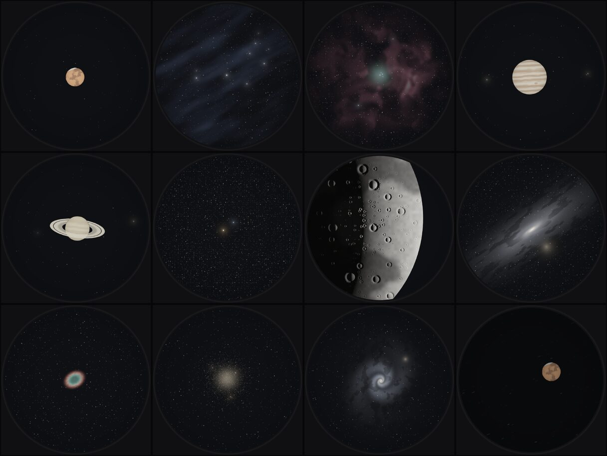

# The Observatory

One of the idle visualisers (see the [feature overview](features.md)): a night at the telescope,
seen through its eyepiece. The code is `src/observatory.rs`, its shader
`src/shaders/lens/observatory.wgsl`; the plumbing it shares with the [microscope](microscope.md)
is in `src/lens.rs`.

## The tour

The telescope holds each target for 70 seconds, in an order shuffled on every visit:

| Target | What shows |
| --- | --- |
| The Moon | A stretch near the limb, with the terminator crossing the field: maria, and craters of two sizes lit low from the side, their rims bright and their bowls in shadow |
| Jupiter | Belts and zones, the Great Red Spot, and Io, Europa, Ganymede and Callisto strung along the equator where this visit puts them |
| Saturn | The globe, the rings with the Cassini division, the near side crossing the globe and the far side behind it, and Titan |
| Mars | A small disc with dark markings and a polar cap, at the highest power |
| M42, the Orion Nebula | Glowing gas round the four stars of the Trapezium, dark dust lanes through it |
| M31, the Andromeda Galaxy | A long tilted disc with dust lanes, the bright core, and M32 beside it |
| M51, the Whirlpool Galaxy | A face-on spiral with its companion, NGC 5195 |
| M57, the Ring Nebula | A small smoke ring, red outside and green within, round a faint central star |
| M13, the Hercules Cluster | A ball of thousands of faint stars over an unresolved glow |
| M45, the Pleiades | The bright blue stars of the cluster in streaks of reflection nebula |
| Albireo | A double star, gold and blue, in the rich Milky Way field of Cygnus |

Between targets the telescope **slews** for six seconds: the stars streak along the way it moves
and the view fades, then the next target comes up out of focus and sharpens. A **swipe** slews on
to the next target or back; a tap returns to the player.

The HUD at the top of the circle names the target and what it is, then its distance, its visual
magnitude and the eyepiece in use, the magnification to suit it.

## The sky

- **Seeing.** The air dances the image as a whole by a pixel or two, more at the high powers
  the planets need, and the edges boil faintly over that. Bright stars twinkle.
- **Stars** are seeing discs, not points; a bright one also shows the first ring of its
  diffraction pattern and a soft glow. Field stars come from two hashed grids of different pitch,
  at most one star a cell, so a rich field shows no grid; each target has its own density.
- **Tracking.** The mount follows the sky well but not perfectly, so the field wanders slowly.
- **The eyepiece**: the field stop is a soft circle just inside the panel, with the lip of the
  barrel catching a little light round it and a slight darkening toward the edge.

## Cost

Everything is worked out per pixel from one 320-byte uniform block: no maps, no meshes, one draw
a frame. Each branch of the shader is a few lines (a disc and its bands, a domain-warped cloud, a
log spiral, one hashed cell of stars), and the target's own stars are at most twelve.
`cargo test --release lens::tests::frame_time -- --ignored` times it; on the same adapter it
costs about a third of the Earth's frame.
