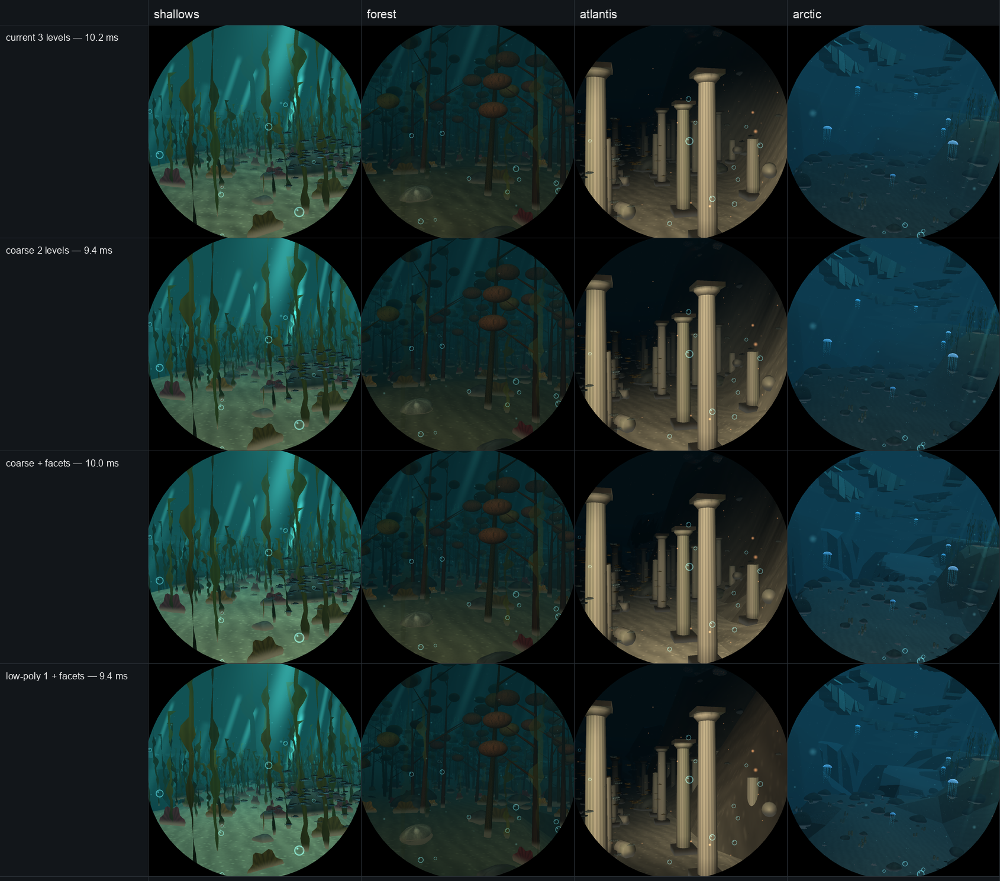
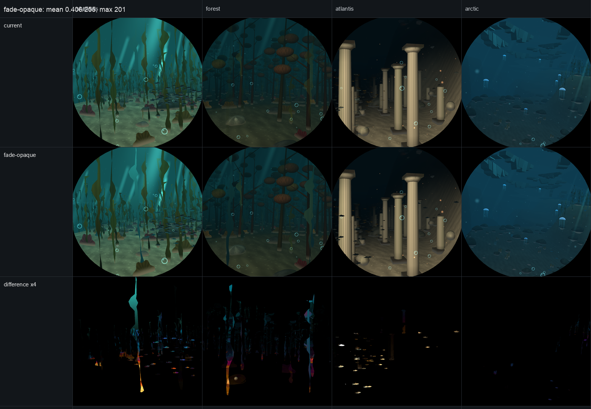
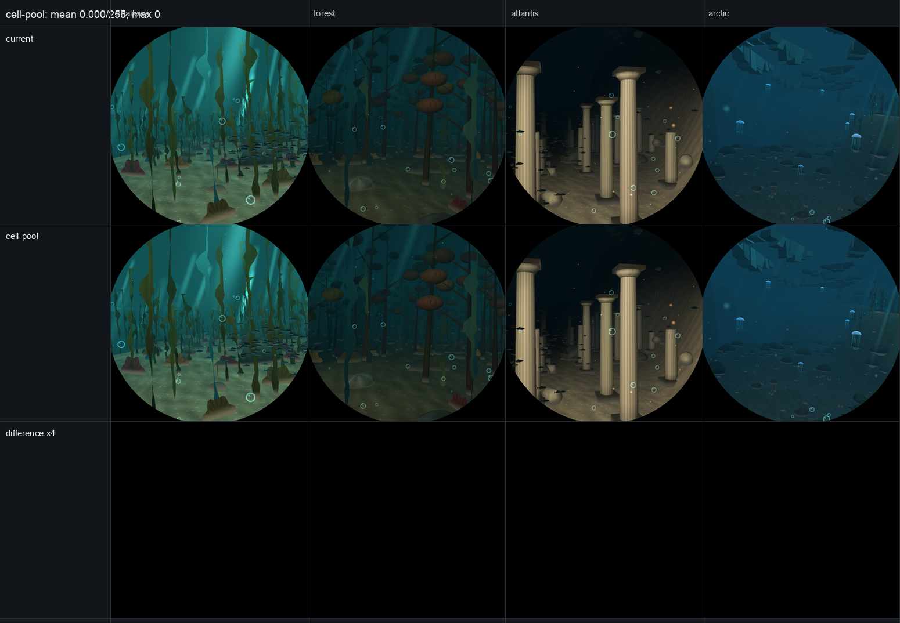
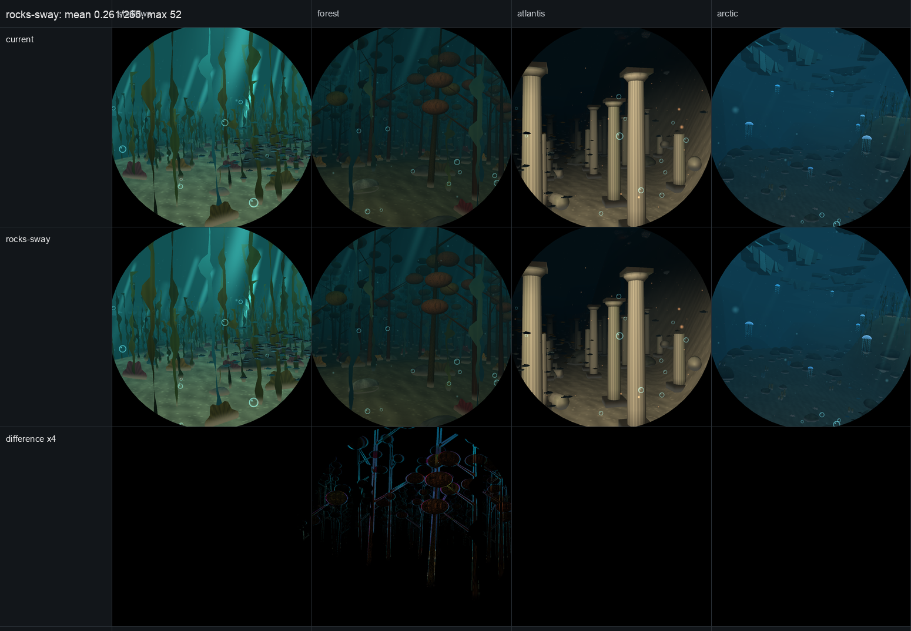
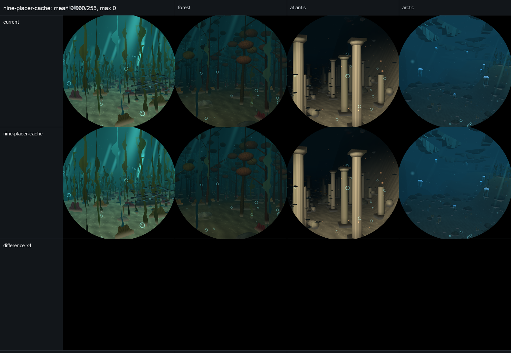
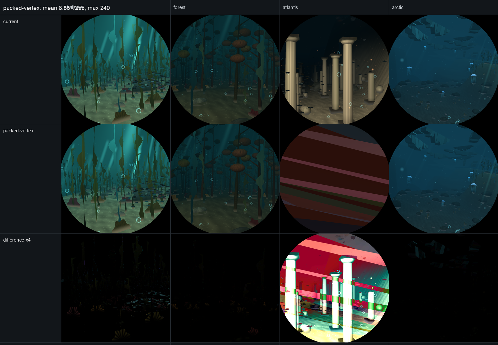

# Pipeline optimisation log

Working notes for the throughput pass on the Nautilus scene. Measurements are
from `DIVE3D_STATS=1`, `dive3d::tests::coverage`, `previews` frame captures and
`deploy/v3d-shaderdb/shaderdb.sh`; the reference comparison lives in
[pipeline-comparison.md](pipeline-comparison.md).

## 1. LOD selection (done)

**Problem.** `level_of` accepted a coarser model only when `error × px < 0.5`
*and* (`stray < 0.1` or `edge × px < 1`). Simplification makes vertex colours
stray by ~0.98 on most models, so the second clause reduced to "changed triangles
are sub-pixel". Measured on the forest leg: **95% of model triangles were drawn
at full detail and LOD 2 was never selected at all.**

**Change.** `LOD_ERROR 0.5 → 2.0`, `LOD_EDGE 1.0 → 6.0`.

**Measured, forest leg** (the heaviest):

| | model triangles | draws |
|---|---|---|
| before | 321 k – 339 k | 242–256 |
| after | 202 k – 226 k | 242–252 |

~36% fewer model triangles, no change in draw count.

**Visual check.** Eight leg frames, before and after, compared per pixel
(`target/compare_frames.py`): mean 0.015/255 over all eight, 0.08% of pixels
changed by more than 2/255, worst single pixel 237 (one edge). LOD popping in
motion is not measured — the selection has no hysteresis.

## 2. Seabed shading baked into the tiles (done)

**Problem.** `vs_terrain` recomputed, per vertex per frame, what only depends on
where the vertex is: the biome, the floor's albedo, five `vnoise` fields, sand
ripples, Atlantis' paving, and the cave's veins. The CPU already builds and
caches every tile in `terrain.rs`, so that work was being done twice — once on
the CPU for the height, then again on the GPU for the colour, every frame.

**Change.** The tile builder now computes the floor's colour, texture layer,
detail strengths and cave glow, and writes them into the vertex. The shader only
applies the distance-dependent fade and the cave's flicker:

```
scale = (1 + noise'·fade) · (1 − ripple·fade) · (1 − pave·fade)
albedo = baked.rgb · scale + glow.rgb · (flicker · 0.35)
```

`Point` grows from 24 to 72 bytes (1.7 MB per frame of vertex data, about
100 MB/s at 60 Hz — under 1% of the Pi's memory bandwidth).

**Measured** (`shaderdb.sh`, V3D compiler):

| `vs_terrain` | before | after |
|---|---|---|
| instructions | 1059 | **345** |
| uniforms | 361 | 166 |
| temps | 64 | 46 |
| nops | 70 | 23 |

Still 2 threads: the five vertex attributes (18 floats) keep it above the
32-register cliff. A variant with the attributes removed compiled to 32 temps
and 4 threads, so the attributes are what hold it back, not the maths.

**Visual check.** Pixel-identical to the pre-bake frames: mean 0.000, max 1/255
on a handful of pixels from rounding in the mix order.

**CPU cost.** The work moved to the tile builder, which now does ~5 `vnoise`
fields and the biome lookups per vertex. `cpu_cost` gained a line for it:

```
cpu seabed tiles: 7.779 ms a visit (79611 vertices)   [Apple M1 Max]
```

That is a whole visit's tiles from empty (~223 tiles, 80 k vertices), built
incrementally as the boat sails — a few tiles, well under 0.1 ms, on the frames
that build any at all. The per-frame scene build is 0.414 ms for comparison.

## 3. The foot of grounded models (done)

**Problem.** Every grounded model's fragment shader did, per pixel,
`leg(voyage_x(p.x, p.z))` and then blended against `floor_albedo(l)` — a dynamic
lookup into an eight-entry table — to tint the few centimetres of model bedded
in the sand. That is why the grounded variants cost two to three times the free
ones (rock: 53 → 224 instructions).

**Change.** `world::build` already found the ground height under each grounded
instance; it now also finds the sand's colour there and stores it on the
instance. The shader blends that colour in with the same per-pixel burial
factor. The burial has to stay per pixel: computing it per vertex and
interpolating spread the sand blend up whole triangles — measured at 12.6% of
the forest frame changed — so only the lookup moved.

**Measured** (`shaderdb.sh`, fragment):

| pipeline | before | after |
|---|---|---|
| rock, grounded | 224 | **77** |
| lava, grounded | 338 | **164** |
| copper, grounded | 308 | **108** |
| vault, grounded | 291 | **140** |
| gold, grounded | 263 | **90** |

The free variants were already lean and are unchanged. The cost lands on the
vertex side: `vs_model` gained 35 instructions (508 → 543) to write the extra
varying, and copper crossed from 4 threads to 2 at 34 temps — still far cheaper
at 108 instructions and one nop than 308 at four threads.

**Visual check.** Mean 0.002/255 over the eight legs, 0.01% of pixels changed:
the per-instance sand colour differs from the per-pixel one only where a biome
border runs under a model's footprint.

## 4. Where the remaining cost is

Coverage, measured on the forest leg by drawing with each part left out
(`dive3d::tests::coverage`):

| part | pixels | share |
|---|---|---|
| models | 664 k | **56.9%** |
| seabed | 352 k | 30.2% |
| sun shafts | 193 k | 16.5% |
| water (the rest) | ~150 k | ~13% |
| sprites | 8 k | 0.7% |

| stage | instructions | invocations | notes |
|---|---|---|---|
| `fs_model` (used) | 53–165 | ~664 k px | 2 threads on vault and copper |
| `vs_model` | 503–543 | ~120 k verts | 2 threads on most, 51–55 temps |
| `vs_model` binning | 215 | ~120 k verts | a second vertex pass, as the GPU tiles |
| `fs_background` | 266 | ~150 k px | drawn last, only uncovered pixels |
| `vs_terrain` | 345 | ~23 k verts | was 1059 |
| `fs_terrain` | 40 | 352 k px | already cheap |

Leftovers:

- The two largest `fs_model` variants (`#14` 610, `#15` 610 instructions) are
  the `MATERIAL == -1` fallback pipelines. Every material the scene assigns is
  in `MATERIALS`, so nothing is drawn through them; they exist as startup
  compile cost and a trap.
- `vs_model` still runs the four-point-light loop per vertex. The `Instance`
  attribute that was meant to carry a per-instance light is now the sand colour,
  so that path has to be built from scratch if it is wanted.

**On desktop timings.** The M1 Max runs the dive in ~1.5 ms and is not
throughput-bound; repeat runs drifted from 1.5 to 2.5 ms as the machine warmed,
so those numbers cannot resolve a 5% change. The V3D instruction counts, the
triangle counts and the per-pixel diffs are the evidence here; pricing the work
needs the Pi.

## 5. Next

1. `vs_model` is now the largest single item: the cofactor normal matrix is
   rebuilt per vertex (three crosses) and could be hoisted to the instance.
2. `fs_background` (266 instructions, ~13% of pixels) — worth ~0.2 ms if cut.
3. Delete the unused fallback pipelines, or give the remaining materials their
   own slot.

## 5. Recovered tree, and one experiment that failed

`world.rs` was lost to a scripting mistake and rebuilt from the harness session
transcripts: 49 `edit` calls replayed, two test functions extracted from
payloads whose anchors no longer matched, two duplicate blocks removed. 4770
lines, 108 tests, all passing once the diver test's missed `rem_euclid(BIOMES)`
was restored.

Visual check against the pre-loss frames:

| leg | mean Δ |
|---|---|
| trench, wrecks, atlantis, abyss | 0.000 |
| arctic | 0.090 |
| forest | 0.438 |
| shallows | 5.454 |
| cave | 2.844 |

The three that differ are the kelp-heavy legs and the cave: the tuning payloads
that rewrote `kelp_here`/`kelp` and the lava glow did not replay.

**The cofactor hoist failed its measurement.** Replacing three crosses per
vertex with three prefetched instance attributes took `vs_model` from 503 to 502
instructions but from **51 to 60 temps** and 222 to 230 uniforms. It was
reverted. Verified afterwards that the whole table matches the last good state:

| shader | instructions | temps | threads |
|---|---|---|---|
| `vs_terrain` | 345 | 46 | 2 |
| `vs_model` | 503 / 543 | 51 / 55 | 2 |
| `vs_model` binning | 215 | 32 | 4 |
| `fs_model`, rock grounded | 77 | 23 | 4 |
| `fs_model`, lava grounded | 164 | 28 | 4 |
| `fs_background` | 266 | 20 | 4 |

Three of the four throughput changes survived measurement; the fourth did not
and is gone.

## 6. Raspberry Pi 5: the frame is not fill-bound

Measured on the device itself: `ssh john@192.168.0.33`, adapter `V3D 7.1.7.0`,
V3D at 960 MHz, `throttled=0x0`, 72 °C.

**How to measure.** `deploy/build-for-pi.sh --tests` builds both binaries in the
arm64 Debian container (46 s incremental), `scp target/pi/spotify-round-tests`
to the Pi, then freeze the kiosk or it contends for the GPU:

```
kill -STOP <spotify-round pid>          # 15.55 ms mean while it runs
/tmp/spotify-round-tests dive3d::tests::frame_cost --ignored --nocapture
kill -CONT <spotify-round pid>          # 12.997 ms mean while it is frozen
```

**`frame_cost`, kiosk frozen, baseline 13.44 ms:**

| variant | Δ | reading |
|---|---|---|
| no solid models | **−4.35 ms** | models are 32% of the frame |
| empty sea | −9.81 ms | everything the pass draws |
| quarter pixels | **−2.62 ms** | *all* fragment shading in the frame |
| no terrain | −1.48 ms | |
| plain textures | −1.20 ms | texture sampling |
| full detail (LOD off) | **+1.85 ms** | the LOD work is worth 1.85 ms |
| cheap models | +0.33 ms | the cheap-light path saves nothing |

(Sprites and "no noise" came out *slower*; treat ±1.5 ms as noise.)

**What this means — and it reverses the assumption this pass was built on:**

1. **Fragment shading is 2.62 ms of 13.44.** All the `fs_model` work
   (224 → 77 instructions) addressed a bucket smaller than the models' cost.
2. **Models cost 4.35 ms and are not pixel-bound** — quartering the pixels
   removes less than the models do. They pay in ~250 draws, ~150k vertices and
   the binning pass. Batching, fewer draws and coarser geometry pay here;
   better shading does not.
3. **An empty sea still costs 3.63 ms** — 27% of the frame is fixed overhead
   outside all drawing (pass setup, submission, or the texture handoff to
   Slint). Worth finding before anything else.
4. Shader instruction counts went down by 67% and the frame did not move:
   12.3 ms (README, pre-loss) → 13.0 ms now. The LOD change is the one measured
   win, at 1.85 ms.

Absolute numbers are not directly comparable to the README's 12.3 ms: the
recovered scene still differs from the lost one on shallows, forest and cave
(kelp placement and the cave glow), and those are the heavier legs.

**Corrected in §7.** The "not fill-bound" reading does not survive a closer
measurement: the draw calls are free, and the models' pixels cost as much as
their vertices. The 3.63 ms is CPU scene construction, which the app overlaps
with the GPU and which does not enter the frame.

## 7. The Pi, second pass: the fixed cost is the CPU, and the dive makes 60 fps

Measured at 1b22e1e, kiosk frozen, V3D 7.1.7.0 at 960 MHz, ARM at 1.7 GHz,
`throttled=0x0`, 60–67 °C. Within one session `frame_cost` repeats to ±0.1 ms;
between sessions absolute numbers move (the 13.44 in §6 is not reproducible
now: the same tree reads 11.2, and the kiosk binary §6 measured was built at
16:09, before `world.rs` was recovered at 17:10). Compare deltas measured in one
session, or alternate binaries.

**`frame_cost`** (legs 1, 3, 4; 20 frames each; two runs, 11.21 and 11.19 ms):

| variant | Δ |
|---|---|
| no solid models | −3.66 ms |
| quarter pixels | −3.50 ms |
| no terrain | −1.43 ms |
| empty sea | −8.98 ms |
| full detail | +1.88 ms |

**`frame_time`** (serial submit and wait, 60 frames a leg): shallows **13.49**,
forest **12.96**, atlantis 10.49, cave 10.43, wrecks 9.01, abyss 8.96, arctic
9.86, trench 8.25; mean **10.43 ms**. The dive is under the 16.7 ms budget on
every leg with 3.2 ms to spare on the heaviest.

**The kiosk**, `SPOTIFY_ROUND_FULL_SPEED=1`, Nautilus forced: window **61 fps
for a full 60-second sample**, scene 60–61 fps, gpu 11.6–16.7 ms. The gpu
reading is quantised by the 60 Hz present (a frame that makes the vblank reads
16.7, one that misses it reads ~12 or less), so it is not a frame time.

The kiosk had been running a binary from 16:09 — before `world.rs` was
recovered at 17:10. At the same point after a restart (the shallows leg) its
scene thread took **4.0–4.2 ms** a frame; the current tree takes **1.7–1.8**.
Later in the voyage (the forest) the current tree's scene thread reads
3.1–3.8 ms, so the whole leg range is about 1.7–3.8 ms; the old binary was two
milliseconds behind it where they can be compared.

### 7.1 The "fixed overhead" is the CPU, not the submission

The new `fixed_cost` test splits the empty frame, and the new `DIVE3D_PHASES`
prints the draw's own phases:

| part | ms |
|---|---|
| `world::build` | **1.35** |
| `terrain::update` (boat still) | 0.02 |
| submit (empty encoder) | 0.05 |
| empty sea | 1.94 |
| order + sort + stage + upload | 0.03 + 0.07 + 0.03 + 0.02 |
| encode | 0.015 |
| clear pass (GPU) | 0.46 |

With the boat moving, `terrain::update` builds the new tiles as it goes and
rises to 0.17 ms. So roughly 70% of the time outside drawing is **building the
scene**: the 22 placers, then the per-instance ground and sand lookup. Staging
is 0.15 ms, submission 0.05 ms, and the texture handoff to Slint costs nothing
because it is an import: Slint samples the same texture, nothing is copied or
re-uploaded. The 0.46 ms clear is inside the pass, not in "empty sea".

In the app `world::build` runs on the visualizer thread while the GPU draws the
previous frame (two in flight), so it does not add its 1.35 ms to the frame.
It is why the old kiosk binary's scene thread sat at 4 ms; that is a CPU
problem, not the 3.63 ms mystery.

Per placer (`DIVE3D_BUILD_STEPS`, means over eight legs): kelp 0.24, cave 0.23,
particles 0.11, shoals 0.10 (0.17–0.24 in the rich legs), rocks 0.08, trench
0.07 (0.29 in the trench), ruins 0.06, forest 0.06, gardens 0.03; the rest
under 0.05. The per-instance grounding is 0.03–0.15. There is no single
dominant placer to rewrite.

### 7.2 Models: the draws are free, the pixels are not

Three new probes:

- `DRAW_CALLS` issues every model draw with an empty instance range: all 260
  draws and their pipeline binds stay, the geometry goes. It saves 2.7–3.6 of
  the models' 3.67 ms, so **draw calls and batching are worth about 0.1 ms**,
  not 3.7. There is nothing to win by merging draws.
- `COARSE_DETAIL` draws every instance at its coarsest level: forest falls from
  150 k to 65 k vertices and 203 k to 56 k triangles, and the leg loses 1.87 ms
  (shallows 1.21, mean 0.4–1.4 depending on the run). Geometry is worth
  **1–2 ms**.
- `QUARTER_MODELS` draws only the models into a quarter of the pixels (the
  water and seabed refill the other three quarters, so this is net): forest
  loses 1.54 ms, shallows 2.93, cave 3.99, abyss 2.36. Model **pixels** are
  worth at least as much as model vertices.

That makes §6.2 wrong on both counts. The model cost is roughly half geometry
and half pixels, and the geometry half is only small because the LOD chain is
shallow: a fish is 272 → 102 → 76 triangles, and LOD 1/2 only qualify below
about 14/11 px on screen because `LOD_STRAY` is above the simplification stray
on most models, so the `edge × px < 6` clause is the one that binds.

### 7.3 Loosening LOD is a poor trade from here

`DIVE3D_LOD=error,edge` overrides the selection in test builds. Mean over the
eight legs and forest leg, against the preview frames (mean Δ/255, and pixels
changed by more than 2/255):

| error,edge | mean | forest | worst leg Δ | pixels > 2 |
|---|---|---|---|---|
| 2,6 (current) | 10.35 | 12.78 | — | — |
| 2,18 | 10.21 | 12.55 | 0.13 (shallows) | 1.3% |
| 4,12 | 10.04 | 12.16 | 0.12 (shallows) | 2.2% |
| 6,18 | 9.97 | 11.94 | 0.23 (forest) | 4.0% |

Even the most aggressive is worth 0.4–0.8 ms of the 13, for a visible change
on model edges, and the selection has no hysteresis, so looser thresholds pop
more. The current 2, 6 was kept.

### 7.4 Tried and reverted

- **Depth-first across materials** (so early-Z can reject more): +1.46 ms. It
  turns 260 draws into ~2100 and V3D charges ~0.7 µs a draw.
- **Keeping the colour target instead of clearing it**: +1.58 ms. On a
  tile-based GPU a load is a full read of the panel; a clear is not.
- **Biome early-outs in the placers** (skip the cell grid when the cave or the
  kelp is nowhere near): removed. The window looks out of the hull's *side*, so
  the visible x span is ±0.72 × depth, two to three legs wide; a corridor
  sample that missed the negative-x side skipped a visible garden on the arctic
  leg (one instance, twelve sprites). Sampling the whole span leaves nothing to
  skip. Biome gating does not work for this camera.
- **`gardens`**: the seabed lookup and visibility test moved after the
  per-cell biome rejection. Exact (previews pixel-identical) and saves ~0.03 ms
  of the build. Kept.

### 7.5 Where the frame goes, and what is left

Forest, serial: 12.96 = ~1.5 build (overlapped in the app) + 1.43 terrain +
3.67 models (half pixels, half geometry) + 0.46 clear + the rest water,
sprites, shafts, glass and the corner mask. The only remaining levers are look
changes: texture sampling in the model fragments (plain textures save 1.57 ms),
model geometry, and terrain triangles. Submission, pass setup and the handoff
have nothing left to give.

The 16.7 ms target is met: 10.43 ms mean, 13.49 ms on the worst leg, and 61 fps
on the kiosk. The useful next step is not more micro-optimisation but keeping
the deployed binary current — the kiosk had been running a pre-recovery build
with a 4 ms scene thread.


## 8. What 90 fps would take

**The panel first.** The kiosk's EDID detailed timing is 85.5 MHz over
1280 × 1112 totals for 1080 × 1080 active: **60.07 Hz**. `app::TARGET_FPS` is
60 for that reason, and the tick, the globe and the progress ring all follow
it. This display cannot present 90 fps; that needs a 90 Hz panel or mode, and
the pacing constant has to follow it. Everything below is what the renderer
would have to cost to be 90 Hz-capable.

**Budget.** 90 Hz is 11.1 ms a frame, including Slint's composite of the sea
texture. The V3D has no timer queries, so the composite is not measured
separately; keep about 1–1.5 ms for it and aim the dive at **9.5–10 ms** of GPU
work.

**Resolution is the lever that reaches it.** `DIVE3D_SCALE` renders the pass
into a fraction of the panel (`frame_time`, serial, `DIVE3D_SCALE=n`). The
target and the clear stay 1080² in this probe, so a real smaller target saves a
little more than these numbers show, and the ~1.4 ms CPU build is included but
overlaps the GPU in the app:

| scale | target | mean | forest | shallows |
|---|---|---|---|---|
| 1.0 | 1080² | 10.48 | 12.99 | 13.52 |
| 0.9 | 972² | 9.38 | 12.02 | 12.03 |
| 0.833 | 900² | 8.70 | 11.31 | 11.18 |
| 0.75 | 810² | 7.80 | 10.46 | 9.99 |
| 0.667 | 720² | 7.09 | 9.70 | 9.03 |

At 900² the worst leg is 11.3 serial, or about 9.9 ms of GPU after the build
comes out — borderline once the UI is added. At 810² the worst is 10.5 serial,
about 9.1 GPU, which leaves the ~1.5 ms the UI may need. 720² is comfortable.
The cost is softness: 900² is a 17% linear drop from the panel, 810² is 25%,
720² is 33%; only the sea is scaled, the UI stays native. The design had no
smaller profile on purpose, so this is a product decision. It is also the
standard mobile lever: Unity's URP exposes it as **Render Scale** with a
bilinear or FSR upscaler, scaling the 3D render but not the UI
([URP Asset](https://docs.unity3d.com/Packages/com.unity.render-pipelines.universal@15.0/manual/universalrp-asset.html)).

**The other levers, for margin or to avoid scaling.** None is free; the
measured ones are small:
- Model fragments re-light per pixel, four point lights included, although
  `vs_model` already applies the same lights per vertex. A pipeline variant
  that drops the point-light loop from the fragment `light_at` is the largest
  fragment cut left; it changes how the four point lights fall across a model
  (per-vertex instead of per-pixel), so measure it with a frame diff.
- LOD `2,18` saves 0.14 mean / 0.25 forest, `4,12` 0.3 / 0.6, both with edge
  changes and more popping.
- The whole water pass is 0.35 ms, so cutting its 266 instructions saves at
  most ~0.2.
- Terrain is 1.43 ms. `vs_terrain` is 46 temps at 2 threads; fewer attributes
  is the only way to 4 threads, worth perhaps 0.2–0.4. Coarser far tiles save
  0.2–0.3 and show.
- Sprites and sun shafts are ~0.5 ms together; dropping the shafts at 90 Hz is
  ~0.15.
- The 0.46 ms clear is not reducible: a load was measured slower.

**What will not help:** batching the draws (~0.1 ms for all 260), submission
(0.05 ms), the texture handoff (an import), and the CPU build (1.4 ms,
overlapped; the app's 3.1–3.8 ms is contention, and at 90 Hz two frames in
flight give it 22 ms).

**At 1080²** the safe levers total well under a millisecond, so 90 fps on the
full panel is out of reach without giving up per-pixel point lighting or
terrain detail. The practical path is **810², `TARGET_FPS` from the panel, a
90 Hz mode**, and then 720² if the composite eats the margin.

## 9. Every effect, measured in one build

The table below is the state at 1dd12b6; §12 re-measures after the fade and
sea-pass fixes.

`effect_cost` (new, ignored test) turns every draw-level effect off one at a time
from **one binary** and prints one table. Two masks:

- `DIVE3D_SKIP` (pass bits, now a `u64`): the old bits keep their values, and
  `MASK`, `FADING`, `SUN_SHAFTS`, `BEAMS` and `TUNNEL` are new.
- `DIVE3D_SKIP_EFFECTS` (test only): one bit per model group and per sprite
  kind. Models are filtered before staging, so their sorting and upload go too;
  sprite kinds are filtered before the upload; passes are skipped at draw time.
  The model groups are by mesh — `Cone` is forest trunks, stalactites, crinoid
  arms and the volcano together; `Box` is wreck castles, ruin blocks and penguin
  wings; `Sphere` is coral, pearls, eyes, ports and lanterns — so a shared mesh
  cannot be split per feature.

The test measures 63 variants over all eight legs, round-robin on paired
frames with a settling frame, and reports ms, delta, share, and how many
instances or sprites it saw. 92 s on the Pi; 24 s on the desktop, where the
1.5 ms frame makes most rows noise.

**Pi 5, kiosk frozen, everything 10.83 ms** (top of the table; rows below
±0.05 ms are noise):

| effect left out | Δ ms | share | what it was |
|---|---|---|---|
| the whole sea pass | −8.81 | 81% | every draw |
| quarter pixels | −4.36 | 40% | all fragments and depth |
| opaque models (with fading) | −3.94 | 36% | `MODELS` |
| model geometry | −3.39 | 31% | `DRAW_CALLS`: every model draw, no instances |
| **fading models** | **−2.62** | **24%** | `FADING`: blended after the water |
| quarter model pixels | −1.85 | 17% | models into a quarter of the pixels, rest full |
| planes | −1.38 | 13% | sea surface + ice sheet |
| terrain | −1.21 | 11% | |
| plain textures | −1.06 | 10% | |
| coarsest detail | −0.90 | 8% | |
| no noise | −0.60 | 6% | |
| trilinear only | −0.49 | 5% | |
| all cheap lights | −0.36 | 3% | |
| fish | −0.35 | 3% | 7 750 instances |
| sprites | −0.33 | 3% | |
| open water | −0.32 | 3% | |
| motes | −0.21 | 2% | 36 265 sprites |
| shafts + beams | −0.20 | 2% | |
| rocks 0–2 | 0.15–0.19 | each | ~2 100 each |
| point lights | −0.16 | 1% | |
| cave tunnel | −0.08 | 1% | |
| glass | −0.06 | 1% | |

**The fading models are the surprise.** They cost 2.62 ms — twice the opaque
models' 1.32 ms — and the old part bits could not see them: `MODELS` removed
both, so the blend pass hid inside the 3.7 ms "models". They are the ice and
the props inside a biome's fade band, drawn after the water, back to front,
with a `discard`; the window looks across several legs, so some props are
always mid-fade. That is the largest single effect after the pass, and the
first place to look after resolution for 90 fps.

Everything else is small and overlaps: the planes row (1.38) covers both the
solid sea surface and the fading ice sheet, so it straddles the opaque and the
fading rows; fish, sprites, water, motes and shafts are a few tenths each; the
per-model rows outside the fish, the three rocks and the planes are ≤0.05 ms on
the Pi. The shared-mesh groups
cannot be split, and the per-model deltas are net of the water and terrain
uncovered behind them, so they are not additive.

## 10. Bubbles: no pops, and a wake that follows the submarine

Four emitters shed `BUBBLE` sprites: the diver's helmet exhaust, the penguins'
flippers, the sister submarine's screw, and the Nautilus' hull. A frame-matching
diagnostic (`debug_bubble_jumps`, ignored) found three real pops and one
velocity flaw:

- **Diver helmet**: `rise = fract(t*0.35 + b/4 + feet[0])` with constant alpha.
  Each of four bubbles teleported 0.35 units from the top of its column back to
  the exhaust every 2.86 s, one every 0.71 s: 39 bright jumps in six seconds,
  worst 0.364 units at full brightness.
- **Penguin trail**: `back = (b + fract(t*4.8))*0.05 + 0.04` shared one phase,
  so the whole five-bubble trail snapped 0.25 units forward at 4.8 Hz.
- **Hull and wake**: aged and faded, but hard-culled by `visible()` at the view
  cone: 15 bright edge appearances in six seconds in the 200 s encounter.
- **Wake**: `screw(t) + aft(t)*water_speed*age`, a straight line locked to the
  current heading and rescaled around the current screw every frame — no lag
  under acceleration, no curvature in a turn.

The fix adds one lifecycle helper (`world.rs`): `cycle = t/life + k/N`,
`age = frac(cycle)*life`, `cohort = floor(cycle)`, and
`fade = smooth(0, 0.08 life, age) · smooth(life, 0.86 life, age)`; the cohort's
hash changes only where the fade is zero. Diver and penguin bubbles are now
left where they were shed and rise there. The hull bubbles keep
`start(t) − v·age`.

The wake is read from her own track, sampled from the existing analytic
`at(τ)` path — no stored history, so previews and seeks are deterministic:

```
q = screw(t) + S(t−age) − S(t) + spread·hash + (0.045 + 0.02·churn)·age·ŷ
churn = smooth(0.02, 0.25, water_speed)
spacing along the track = |Ṡ| · life / 28
```

Spacing and length grow with speed, the trail curves through a turn, and with
no way on the bubbles collapse to the screw and rise. A `churn` term widens and
spreads them with speed. All four emitters now fade over the last 10% of the
view cone (`window_fade`) instead of being culled, and the swipe rush uses a
fixed 220-bubble stream with the count only fading its tail in and out, so a
change in speed no longer re-phases the field.

`bubbles_never_pop` runs six seconds of the diver, the penguin and the 200 s
encounter at 60 fps and asserts no bubble above 0.15 brightness jumps more than
0.03 units: **0** now, where the diver had 0.364-unit pops. All eight leg
previews are byte-identical between two renders, and the before/after mean
pixel difference is ≤0.01/255. The frame is unchanged: 10.49 ms mean, 12.96 ms
forest.

## 11. Lighting: already the low-spec reference

The references are in
[pipeline-comparison.md §6](pipeline-comparison.md#6-low-spec-lighting-the-references-already-do-what-this-renderer-does):
URP keeps its main light per pixel and its additional lights per vertex; Godot
4.4 forces vertex shading on mobile; Filament has no per-vertex path and spends
precision instead; PowerVR's rule is to move work to where there are fewer
instances. The Pi build (`full-hd`) already computes the whole light at the
vertex — sun, sky, caustics, searchlight and four point lights — and its
fragment shader has no `light_at` at all (53–165 instructions). So there is no
lighting solution to import: the remaining fragment cost is texture sampling,
and the remaining vertex cost is the 503-instruction `vs_model`, which a
runtime switch cannot reduce below the register cliff. The `!full_hd` build
still lights twice (vertex and fragment); it is not the kiosk.

## 12. Cutting the fade pass and the sea pass

The effect table in §9 put the fading models at 2.56 ms and the sea pass at
8.5–8.8 ms. In the order the changes paid:

**Fading props: no discard, and no invisible instances.** Only the ice works
its coverage out per pixel; every other fading model has one coverage for the
whole instance. The fading pipelines were compiled with `FADING = 1` (a
`discard`) for every material, which makes the GPU shade before the depth test
— so every fading prop behind a rock or the seabed paid its fragment shader
anyway. The props' pipelines now compile `FADING = 0` (no discard; the alpha
still blends) and the ice keeps its discard, so early-Z rejects what the opaque
pass hides before it shades it. Instances whose coverage is at most 0.01 are
dropped at staging, since the shader would discard every fragment of them.

Measured: **fading props 0.99 → 0.65–0.67 ms**, and 1,037 instances over the
64 sampled frames (~16 a frame) were skipped.

**Fading ice: cut the plane to where the ice is.** The ice is one 40 × 40 plane
whose fragment shader finds the biome per pixel and discards the rest; it was
drawn whenever the arctic was within ±6 units, so most of the plane was
discarded. It is now cut in x to the stretch where the arctic's share is above
the ice's fade-in threshold, plus a three-unit margin for the z shift, keeping
the original near gate. The shading is in world space, so the ice itself is
unchanged; the plane is only smaller.

Measured: **fading ice 1.16 → 0.91–1.12 ms** (the row moves between runs; the
clip is worth at most a fifth of a millisecond on average). The previews differ
only on the arctic, by mean 0.25/255 and max 3/255: the plane's four corners
carry the per-vertex light, and moving them shifts the interpolation slightly.
Widening the gate to ±20 as well doubled the number of ice frames and made the
frame *slower* (10.84 → 11.24 ms), so the original gate stayed.

**Sea pass: no anisotropic filtering.** The surface sampler was anisotropy 4.
With the shader's explicit-LOD samples it changed no preview pixel between 4
and 1, and measured **0.43–0.52 ms** on the Pi, so it is now 1; the test's
trilinear probe became a no-op and was removed.

Measured: `frame_time` mean **10.19 → 9.65 ms**, forest **12.12 → 11.19**,
shallows **13.10 → 12.74**; `effect_cost` everything **10.49 → 10.06–10.13**. The
`plain textures` delta fell from 1.06 to 0.50, which is the texturing getting
cheaper rather than the material effects.

**Draw order was tried and is not the answer.** Opaque draws nearest-first —
the same 260 draws, only more pipeline binds — costs +0.08 ms. Drawing the
seabed before the opaque models costs +0.14 ms: the terrain shaded under the
models costs more than the models the ground hides. Both are kept as test
probes (`DEPTH_FIRST_DRAWS`, `TERRAIN_FIRST`), off in production.

**Where it stands.** The frame is now **9.65 ms mean, 11.19 ms forest, 12.74 ms
shallows** serial, from 10.49 / 12.96 / 13.61 at 1dd12b6. The fade pass is
2.07 ms (ice 0.91–1.12, props 0.65); the pass's remaining cost is fragments
(quarter pixels 3.70 ms), the model geometry (~3.2 ms) and the terrain
(1.03 ms). The only large lever left is resolution (§8).

## 13. The two rewrites: a clipmap and a render-scale sea pass

Two low-spec patterns were built as prototypes against the current renderer,
which stayed the default, and measured on the same Pi. Both previews were
compared per leg against it.

### The sea pass: a real render scale

The pass now has a **render target smaller than the panel**: the sea texture
and its depth buffer are created at `SIZE * scale` and Slint stretches the
result to the window; the UI, the camera and the projection are unchanged, and
the model LODs use the smaller target's pixels. `SPOTIFY_ROUND_RENDER_SCALE`
(or `DIVE3D_RENDER_SCALE`) sets it, 0.5..1.0, default 1.0.

`frame_time` per leg, serial milliseconds:

| scale | px | mean | shallows | forest | abyss |
|---|---|---|---|---|---|
| 1.0 | 1080² | 9.66 | 12.74 | 11.17 | 8.29 |
| 0.9 | 972² | 8.59 | 11.29 | 10.27 | 6.83 |
| 0.833 | 900² | **7.90** | **10.39** | 9.68 | 6.25 |
| 0.75 | 810² | 7.05 | 9.22 | 8.99 | 5.42 |

The smaller target is worth more than the old viewport probe (§8) because the
clear and the store shrink too; the 90 fps budget of 11.1 ms is met at 0.833
on every leg sampled, with the 60 Hz panel at 1.0 already whole.

The look, against the 1.0 previews (after the UI's bilinear upscale):

| scale | mean diff | worst leg | >2/255 | max |
|---|---|---|---|---|
| 0.9 | 0.27/255 | 0.64 | ~1–2% | 174 |
| 0.833 | 0.30/255 | 0.69 | ~2–3% | 174 |
| 0.75 | 0.34/255 | 0.78 | 8.3% on shallows | 174 |

The cost is softness, not a changed image: the arctic's fine ripple and the
shallows' sand are where it shows, as aliasing at the high frequencies; 0.9 is
the subtle setting, 0.833 the 90 fps one, 0.75 the soft one. It stays opt-in
because the brief is not to change the look.

### The cheap water

`fs_background_cheap` is a mobile-style sea in its own pipeline: one
depth/height mix and the tint, no wave/glint and no panel-sized arithmetic.
It is nearly invisible — mean **0.019/255** against the rich water, worst leg
0.066 (abyss), max 12 — and worth almost nothing: `frame_time` mean
**9.606 vs 9.656 ms**, abyss 7.99 vs 8.20. The full water is already cheap
(0.32 ms of open water, §9); there is no win to take here. It stays as a test
probe (`part::CHEAP_WATER`).

### The clipmap

The test-only clipmap (`DIVE3D_CLIPMAP=1`, full-HD builds) replaces the CPU
tile builder: one fixed 17×17 block mesh (with the same skirts and indices)
is drawn once per visible tile as an instance, the tiles' squares/holes/cull
are the same as `Terrain::update`, and `vs_clipmap` finds the ground height
and the floor's colour per vertex. The block cull samples each block's own
height range (13 ground samples) so it draws the same 65 tiles the tile
builder's 67 draw; the previews are **pixel-identical** (mean 0.000/255; one
cave pixel 44, from the normal's finite differences at a seam).

Per-leg `frame_time`, serial milliseconds:

| terrain | mean | shallows | forest | cave | abyss | arctic |
|---|---|---|---|---|---|---|
| tiles, CPU-baked | **9.65** | **12.74** | **11.17** | 10.02 | 8.20 | 9.15 |
| clipmap, VS-computed | 21.50 | 25.38 | 23.93 | 20.42 | 15.91 | 16.53 |

It is **2.2× slower**, and the fair cull did not help (215 blocks → 65 blocks
changed nothing in the ratio). The reason is the vertex shader: `vs_clipmap`
calls `ground` five times (a centre and four neighbours for the normal) and
`terrain_shade` (five value noises) per vertex, plus the rich `light_at`, on
both passes, where the tile vertex shader reads the same numbers from 72 bytes
of baked attributes and runs 345 instructions. The V3D has plenty of vertex
shader power but not enough to recompute five procedural noises per vertex
twice a frame; the CPU already paid that once per tile and amortises it
(0.17 ms/frame, 7.8 ms per visit). The CPU saving (the tile build) is smaller
than the GPU cost it adds.

This is the open-source clipmap's real constraint: the pattern assumes a
**static heightmap texture** (GPU Gems 2, vterrain, and the mobile heightmap
terranes all sample one), or a cache of the height and shading. Our seabed is
procedural and follows the boat, so the height and the shading must be baked
somewhere; the current tile builder is exactly that cache, and its fixed
per-tile mesh is the CPU half of the same idea. A texture-baked clipmap (a
streaming height/shading texture plus the fixed rings) is the version that
could compete, but it is the tile cache with a different mesh, not a cheaper
one. The prototype is kept as the test-only `DIVE3D_CLIPMAP`; the tile
terrain remains the default.

**Where it stands.** Nothing from the rewrites is on by default: the tile
terrain and the full water are unchanged, and the render scale is an opt-in
setting (1.0), with 0.9/0.833 the measured look/90 fps trade. The frame is
**9.65 ms mean** at 1.0 and **7.90 ms** at 0.833. The clipmap's 2.2× loss is
recorded here so the same ground is not worked twice.

## 14. The baked clipmap and what the water is really made of

Two more low-spec ideas were built and measured against the same control: a
texture-baked clipmap (the version §13 said might compete) and a survey of
cheap water shaders from other projects.

### The baked clipmap: the texture fetch is the cost

The fixed block mesh from §13 now gets its ground and floor colour from a
streaming bake instead of `ground`/`terrain_shade` in the vertex shader. The
bake is a 256-unit ring of textures at 8 texels/unit (2048 x 2048): height
(16-bit float), normal (RGBA8), floor colour + layer, detail strengths and cave
glow (all 16-bit float). The first frame of a visit bakes the whole window on
the CPU (4.2 M texels: the ground, the normal and `terrain::shade` per texel);
after that only the strips entering the window are baked as the boat moves,
so the steady-state frames pay a strip of a few thousand texels every few
seconds, not a rebake. The vertex shader samples the five maps at `world/256`
and reads the 16-bit height back to the world, so every vertex costs five
fetches instead of five `ground` calls.

Per-leg `frame_time`, serial milliseconds:

| terrain | mean | shallows | forest | cave | abyss |
|---|---|---|---|---|---|
| tiles, CPU-baked | **9.67** | **12.74** | **11.20** | 10.04 | 8.23 |
| clipmap, texture bake | 21.42 | 25.33 | 23.88 | 20.36 | 15.80 |

It is still **2.2x slower**, almost exactly the procedural clipmap's 21.50:
the five filtered texture fetches per vertex cost as much as the five `ground`
calls (which themselves do four `relief` loads each). That is the finding:
on V3D the **vertex texture fetch** is the expensive part, and any
heightmap-in-the-vertex-shader clipmap pays it twice a frame. The tile vertex
shader reads 72 bytes of attributes and no textures, and the CPU paid for
those bytes once per tile; the tile builder *is* the height/shading cache.
Baking it smaller or streaming it differently cannot fix the fetch count —
only removing the per-vertex fetch can, and then there is no clipmap height.

The look also differs more than the procedural version did: mean 0.31/255,
10.6% of the shallows pixels over 2/255, max 74. The bake's 8 texels/unit and
its 0.125-unit normals are coarser than the tile terrain's 12.5/unit near
vertices and per-level normals (0.08/0.32/1.28); the fine sand, ripple and cave
vein detail smooths. A 16/unit bake would be 4x the texture and the bake and
still 2.2x slower, so it was not pursued.

The baked clipmap stays behind `DIVE3D_CLIPMAP` as the prototype (the bake
textures are one-texel dummies when it is off). The tile terrain remains the
default.

### The water: what other low-spec projects do, and what is actually visible

Surveyed: [Godot Ocean Shader](https://github.com/immaculate-lift-studio/Godot-Ocean-Shader),
[Godot pixelated water](https://github.com/taillight-games/godot-4-pixelated-water-shader),
[Toon Water URP](https://github.com/yinb1426/Toon-Water-Shader),
[Stylized Water](https://ameye.dev/notes/stylized-water-shader/) and its
[realtime caustics](https://ameye.dev/notes/realtime-caustics/),
[Godot Gerstner water](https://github.com/LesusX/Water-Shader),
[HydraX](https://github.com/zinick/HydraX), and the
[cheap water shader](https://godotshaders.com/shader/cheap-water-shader/).

The survey's useful findings:

- Almost every water shader is written for a **plane with depth**, and where it
  looks expensive the cost is depth/opaque/reflection targets, not the colour:
  the colour is nearly always `lerp(shallow, deep, depth01)`. Foam, refraction
  and screen-space rays need the depth of the geometry behind the water, which
  our background pass does not have.
- The cheap ones move work out of the fragment shader or **quantise** (64-step
  UVs, posterised colour, `step`-rounded foam). None runs more than a couple of
  `sin`/`pow`/`exp` per pixel; those are the budget on V3D.
- From below, the surface is a mirror except inside **Snell's window** at
  48.6 degrees above the horizon; only the pixelated-water and Gerstner
  projects even check whether the camera is underwater.

Two of the survey's three cheap ideas were implemented and compared against the
previews, behind test bits:

- **Snell's window + TIR rim** (`0` samples, ~8 ALU). Visible only when
  `dir.y > 0.62`, i.e. looking up past 48 degrees. Our camera looks sideways
  and its top rows never reach that, so the variant differed from the control
  by mean 0.051/255: the window is out of frame. It is a periscope/porthole
  effect, not a salon-window one.
- **A caustic shimmer surface** (`part::SHIMMER_WATER`): one caustic fetch
  drifting across the underside replaced the two sines and the `pow(14)` glint.
  The previews were **pixel-identical** to the control (mean 0.001/255, max 4):
  the surface band the code has always shaded is itself barely in frame, so
  the expensive path's sines and pow were drawing nothing. The whole-water
  cost is the depth gradient and the searchlight beam; the cheap gradient
  version saves only 0.05 ms, and that is the floor.

So there is no water win to take. The surface effects from the other projects
assume a plane with the surface in view, and this camera has neither; the
existing water is already the low-spec answer (a gradient and a beam). The
Snell and shimmer variants remain as test probes for a camera that looks up.

**Where it stands.** Nothing from this round is on by default: the tile
terrain, the full water and render scale 1.0 are unchanged, the clipmap and
the two water variants are probes, and the frame is still **9.65 ms mean /
12.74 ms worst leg**. The render scale (§13) remains the one real lever for
90 fps; the baked clipmap and the surface-water effects are recorded as losses
so they are not tried again.

## 15. Terrain resolution, normal maps, and a free underwater grade

The clipmap prototype and its streaming bake were removed from the tree after
§14 (the block mesh, bake textures, bindings, `DIVE3D_CLIPMAP`, the `half`
dependency). The sections above stand as the measurement record; the tile
terrain is again the only terrain.

### Reducing the terrain mesh

`DIVE3D_TERRAIN_LEVELS` (default 3) now chooses how many of the mesh levels to
draw. Levels are dropped from the fine end, so the near mesh coarsens while the
far extent stays. `frame_time` per leg, serial milliseconds (same run, Pi):

| levels | spacing near | mean | shallows | forest | preview diff vs 3 |
|---|---|---|---|---|---|
| 3 | 0.08 m | 9.70 | 12.77 | 11.21 | — |
| 2 | 0.32 m | 9.37 | 12.50 | 10.76 | mean 0.93, worst 3.76 |
| 1 | 1.28 m | 8.79 | 11.77 | 10.03 | mean 2.67, worst 9.26 |

Halving the near detail buys **0.33 ms** (3.4%) and a clearly softer seabed;
dropping to the 1.28 m lattice buys 0.91 ms (9.4%) and a visibly faceted one.
For comparison, the render scale (§13) buys 1.06 ms at 0.9 for a mean diff of
0.27 — a much better trade. The knob stays (default 3) but is not a 90 fps
lever; the mesh is not where the frame is.

### Normal mapping: it adds detail, not the *missing* detail

A normal map was baked from the relief map's slopes (512² RG8, sampled per
pixel) and used in `fs_terrain` for the sun's diffuse and a small specular. It
does add high-frequency light, but it costs **+1.6 ms** (levels 3: 10.09 ->
11.73; levels 2: 9.50 -> 11.11) and it does not recover the coarse mesh: the
level 2 preview with normals differs from level 3 by mean 1.26, *more* than
level 2 without (0.93). The full-mesh preview changes by 0.57 on its own, so
the detail is a new look, not a substitute for the lattice. The fragment work
(the fetch, the sun `exp`, the normalise, the specular) is too expensive on
V3D; the per-vertex baked light remains the cheap path. The probe was removed.

### The cheap underwater effect: a grade in the fog mix

A survey of low-spec underwater effects ([Ultra-Water](https://github.com/Humpalumps/Ultra-Water),
[Kyoril's PS_Underwater](https://github.com/Kyoril/mmo/blob/develop/src/shared/deferred_shading/shaders/PS_Underwater.hlsl),
[Ameye's caustics](https://ameye.dev/notes/realtime-caustics/), paddy-exe's
[Godot port](https://github.com/paddy-exe/Godot-RealTimeCaustics),
[GPU Gems 3 on radial god rays](https://developer.nvidia.com/gpugems/gpugems3/part-ii-light-and-shadows/chapter-13-volumetric-light-scattering-post-process),
[Ultra-Water's marine snow](https://github.com/Humpalumps/Ultra-Water/blob/master/src/water/MarineSnow.js))
found the same split as the water-surface survey: the geometry-needing effects
(depth fog overlays, screen-color wobble, 16-tap rays, bloom, volumetric fog)
cost 0.4–8 ms and usually a pass, while a few ALU folded into existing shaders
read as underwater. The best look-per-cost was the per-channel fog/grade that
PS_Underwater calls "the effect that actually reads as underwater".

It is now in `fs_model` and `fs_terrain`, folded into the fog mix that already
happened: the water desaturates the distance by 15% of the fog factor and lifts
it by `(0.010, 0.030, 0.040)`. The previews change by mean **0.82/255** (worst
leg 1.19, max 9), mostly on the far sand, and the `frame_time` is unchanged
within noise (10.06 with vs 10.20 without in one run).

It is opt-in in production with `SPOTIFY_ROUND_UNDERWATER=1` (and a test bit
`UNDERWATER_GRADE` for the effect table), because it is a look change rather
than a perf win. The survey's other cheap candidates, should the look want
more: a sun glow + two procedural shafts + a 0.0012 wobble in the background
(~0.01–0.04 ms, no fetch), one caustic fetch per pixel on the close models
(~0.1–0.3 ms), and point-based marine snow (~0.02–0.08 ms). Skip the color-copy
post, 16-tap god rays, bloom and volumetric fog on this GPU.

**Where it stands.** The clipmap is gone, the terrain levels default to 3, and
the underwater grade is off unless asked for. The frame is still ~9.7–10.2 ms
mean (the spread is thermal/run-to-run), with the render scale the one large
lever: 8.59 at 0.9, 7.90 at 0.833, 7.05 at 0.75. 109 tests pass.

## 16. The look can change: best practice and a low-poly seabed

With the look no longer fixed, the terrain was re-examined against current
practice. The result is a comparison sheet, [dive3d-terrain.png](dive3d-terrain.png),
and a low-poly option that trades the smooth seabed for a fast, deliberately
faceted one. Beyond the frame-structure comparison, the wider references are
[GPU Gems 2's GPU geometry clipmaps](https://developer.nvidia.com/gpugems/gpugems2/part-i-geometric-complexity/chapter-2-terrain-rendering-using-gpu-based-geometry),
[Godot's mobile renderer](https://github.com/godotengine/godot/blob/master/servers/rendering/renderer_rd/forward_mobile/render_forward_mobile.cpp)
and [bevy_terrain's implementation notes](https://github.com/kurtkuehnert/bevy_terrain/blob/main/docs/implementation.md).

### What the practice says

The full survey is in §5 of [pipeline-comparison.md](pipeline-comparison.md),
which compares this renderer with [vange-rs](https://github.com/kvark/vange-rs),
[bevy_terrain](https://github.com/kurtkuehnert/bevy_terrain),
Godot 4's mobile renderer, Filament and three.js. The short version, for a
V3D-class GPU:

- **The current shape is the right one.** A CPU-generated tiled heightfield
  with a few LOD levels, skirts at the seams, frustum-culled tiles and a
  per-vertex baked colour/light stream is the mobile workhorse (Godot, Unity
  and Unreal all do a version of it). The tile builder is also the cache: it
  pays for the fine shading once per tile, and 72 bytes of attributes go to the
  vertex shader instead of a texture fetch.
- **Vertex work is the currency, not draw calls.** There are ~67 terrain draws
  and they are not the problem; the 345-instruction vertex shader on ~23k
  vertices, twice a frame, is. The clipmap (§13) cut the draws to one and lost
  2.2x because it moved work into the vertex shader; bevy_terrain's compute
  quadtree + indirect draw would be the same trade on this GPU.
- **Texture fetches in the vertex stage are very expensive here.** Both the
  procedural and the baked clipmaps paid roughly the same as the `ground`
  calls; any heightmap-in-the-VS design is out.
- **Per-pixel lighting is expensive; per-pixel colour is cheap.** A relief
  normal map in `fs_terrain` cost +1.6 ms (§15), but a fragment fog grade was
  free and a fragment colour texture is one fetch. Detail should live in cheap
  fragment fetches, not in geometry or per-pixel lights.
- **The remaining vertex cost is the mesh itself.** Dropping LODs from the fine
  end saves 0.33 ms (level 2) or 0.91 ms (level 1), but the smooth look shows
  the loss. The look is what a stylised terrain changes: if the seabed is
  *meant* to be faceted, the coarse mesh is no longer a defect.
- **Resolution is still the largest lever**: 0.9 scale buys 1.06 ms; the
  terrain mesh is ~1 ms of a ~10 ms frame.

### The variants and the pictures

The sheet compares four variants on four legs (the same seeds and times; full
rows for all eight legs are in `target/previews-terrain*/`):

| variant | mean frame | look |
|---|---|---|
| current, 3 levels, smooth | 10.20 (this run; 9.70 in the cooler LOD run) | the control |
| coarse, 2 levels, smooth | 9.37 (LOD run) | softer sand, same silhouette |
| coarse + facets | 9.97 | banded low-poly shading on the 0.32 m mesh |
| low-poly, 1 level + facets | **9.43** | strongly faceted, 1.28 m facets |

The facet variant needs one extra varying (the world position) and a tiny
fragment block in `fs_terrain`: the triangle's own normal from
`cross(dpdx(world), dpdy(world))`, quantised into three sun bands
(`0.65 + 0.55 * band`). No texture fetch, no per-pixel light. On the same run
it is **−0.77 ms** against the current 3-level terrain; the 2-level version with
facets is −0.22 ms. The run-to-run drift on the Pi is ±0.5 ms, so compare within
a run; the LOD-only run was 9.70 / 9.37 / 8.79.

The look changes are real: the current-vs-coarse preview mean is 0.93/255, the
coarse+facets 2.59, the low-poly 3.32. The sheet shows where: the shallows and
forest lose the fine sand and the plant roots; the atlantis columns' floor and
the arctic rocks are where the facets read most.



The low-poly mode is opt-in: `SPOTIFY_ROUND_LOWPOLY=1` and
`DIVE3D_TERRAIN_LEVELS=1` (or `2` for the subtler facet look). The test bits
are `TERRAIN_FACETS` / `UNDERWATER_GRADE`, and the render scale remains
orthogonal.

### Recommendation

If the look may change, the **low-poly seabed (1 level + facets)** is the one
to take: ~0.8 ms cheaper, and it reads as an intentional style rather than a
degraded smooth terrain. The **coarse + facets** is the cautious version at
~0.2 ms. The smooth 3-level terrain stays the default until that call is made;
the 3.5–9% it would save is smaller than the render scale's 1–2.6 ms, so it is
a look decision, not a performance rescue.

### The full survey's ranked next steps

The wider research (the session's survey) confirmed the sheet and ordered the
remaining terrain work by return. Beyond the low-poly option taken above:

1. **Stylised coarsening — done here.** The facet variant is the per-pixel
   version; the even cheaper variant is a `flat`-interpolated, 3–4 band
   quantised *vertex* light in the VS (zero per-pixel ALU), or baked
   AO/curvature in the vertex colour. Pick whichever reads better.
2. **Skirts only at LOD seams.** Same-level tile edges sample the same world
   heights, so interior skirts are redundant; only edges facing a coarser
   level need them. A 4-bit edge mask removes ~10–20% of terrain triangles for
   **+0.1–0.25 ms**, at the cost of edge-mask plumbing and exact edge heights
   (Cesium's [quantized-mesh](https://github.com/CesiumGS/quantized-mesh)
   edge indices are the reference).
3. **Bigger tiles or one merged draw.** 67 draws for 23k vertices is high
   front-end overhead. 32×32-quad tiles cut the tile count ~4× (17 draws) at
   the same vertex count and halve the skirt fraction, or merge the visible
   tiles / use `multi_draw_indexed_indirect` for **0.1–0.3 ms**. Instancing
   does not fit (each tile has unique heights); multi-draw support on V3DV
   must be checked.
4. **Albedo/AO detail instead of normals.** Baked cavity AO in vertex colour,
   procedural colour bands/ripples from world xz, at most one detail-texture
   fetch — the cheap half of bump mapping, without the per-pixel light.
   **0.05–0.2 ms**, keeps the per-vertex lighting.
5. **Simplify the far ring.** Use the existing sun-only cheap light branch for
   LOD 2, or drop the farthest ring under near-opaque fog: **0.1–0.2 ms**,
   low complexity; watch the horizon.

Expected combined: **0.5–1.0 ms**, with the look carried by facets, palette
and AO rather than added lighting. The survey's verdicts, with sources:
[GPU Gems 2 clipmaps](https://hhoppe.com/proj/gpugcm/),
[chunked LOD](https://tulrich.com/geekstuff/chunklod.html),
[bevy_terrain](https://github.com/kurtkuehnert/bevy_terrain/blob/main/docs/implementation.md),
[vange-rs](https://github.com/kvark/vange-rs/wiki/Rendering-Techniques),
[Godot's mobile vertex shading and mesh LOD](https://docs.godotengine.org/en/stable/tutorials/rendering/renderers.html),
[Unity terrain settings](https://docs.unity3d.com/6000.0/Documentation/Manual/terrain-OtherSettings.html),
[Unreal landscape](https://dev.epicgames.com/documentation/en-us/unreal-engine/landscape-technical-guide),
[Cesium quantized mesh](https://github.com/CesiumGS/quantized-mesh),
[derivative maps](http://mmikkelsen3d.blogspot.com/2011/07/derivative-maps.html),
[stylised mobile terrain](https://dev.to/tamtranngoc/why-mesh-terrain-is-often-a-better-choice-than-unity-terrain-for-stylized-mobile-projects-1hja),
and [Mesa's V3D driver](https://docs.mesa3d.org/drivers/v3d.html).

## 17. The lean-base audit and the first branch: fading props drawn opaque

With the look open and model counts due to grow, the whole frame was audited on
the desktop (M1 Max) and against the low-spec literature. This is the first
implementation branch; the rest are listed at the end.

### The desktop frame portrait

| measurement | ms |
|---|---|
| dive frame, mean | **2.96** |
| empty sea (build + staging + upload + empty submit) | 1.76 |
| … `world::build` | 0.53 |
| … submit only | 0.04 |
| clear pass | 0.83 |
| effect table, everything | 2.34 |

Effect split on the desktop: sea pass 0.81 (41%), opaque models 0.36 (18%),
model geometry 0.32 (16%), glass 0.23, fading 0.15, terrain 0.11. The
desktop GPU has headroom; the CPU/fixed side is **~1.7 ms of 2.96** and scales
with instance count, so the lean-base work is the CPU build, the per-instance
data and the per-vertex fetch, not the draw count.

The model placers already frustum-cull (`w.visible` in every placer), so the
win is behind that: per-instance fetch, per-vertex fetch, fill, and the
per-frame rebuild.

### What the research ranks

The full survey (session) and the frame-structure comparison in §5 give:

1. **Fade → opaque** (colour to fog, depth, no blend): 0.5–1.5 ms of the 2.1
   fading pass. This branch starts it.
2. **Render scale 0.9–0.833**: 1.0–1.8 ms; already built.
3. **Static vs dynamic split**: merge static props per material×tile, instance
   only what animates; 0.5–1.5 ms and makes model-count growth nearly free.
   Instancing is the wrong default for the static majority.
4. **Pack instances (~128 → ~48 B) and model verts (44 → ~20 B)**, split the
   position stream; 0.4–1.0 ms; the per-instance scaling term.
5. **CPU build**: precompute at spawn, grid broadphase, projected-area reject,
   counting sort, reused scratch; 0.5–1.5 ms CPU.
6. **Impostor tier < ~10 px** + area-based LOD; 0.3–1.0 ms; caps fill growth.
7. **Cut fragment fetches** (one atlas, no trilinear); 0.3–1.0 ms.
8. **Pipeline-ordered draws**, drop unused pipelines; 0.1–0.3 ms.

Pi-only: a **KMS overlay plane** for the dive texture would remove Slint's
full-panel composite (~1–1.5 ms) and the surface load. The Slint rendering
notifier (FPS readout) also forces a separate window-clear pass on the tile
GPU; that is a separate, kiosk-only lever.

Sources: [Vulkan TBR guide](https://docs.vulkan.org/guide/latest/tile_based_rendering_best_practices.html),
[PowerVR recommendations](https://docs.imgtec.com/performance-guides/graphics-recommendations/html/index.html),
[Mesa V3D](https://docs.mesa3d.org/drivers/v3d.html),
[meshoptimizer](https://github.com/zeux/meshoptimizer),
[Unity static batching](https://docs.unity3d.com/6000.0/Documentation/Manual/static-batching.html),
[Godot mesh LOD](https://docs.godotengine.org/en/stable/tutorials/3d/mesh_lod.html),
[Slint wgpu texture](https://github.com/slint-ui/slint/tree/master/examples/wgpu_texture).

### Branch 1: fading props drawn opaque

Every fading instance except the ice is now drawn with the solid pipelines:
`FADE_OPAQUE` mixes its colour into the water by the coverage and keeps the
depth write, instead of blending over what is behind. Only the ice keeps the
blended path, because its coverage is per pixel.

- **Desktop visual gate**: [branch-fade-opaque.png](branch-fade-opaque.png) —
  mean **0.41/255**, max 201 at the deepest fades; the image shows current /
  branch / amplified difference. An audit caught that the first cut also put
  the coverage in the sea texture's alpha: the solid pipelines write alpha,
  and Slint composites that texture over the UI, so a c-faded prop would have
  shown the UI background through it. The shader now returns alpha 1.0 when
  `FADE_OPAQUE`; the previews' alpha is 255 in both the control and the branch.
  The 0.41/201 is therefore the colour-to-fog itself, not the alpha.
- **Desktop frame**: 2.91 vs 2.96 (−0.05).
- **Pi**: **9.99 ms mean** against 10.20 for the same tree before the branch
  (facet run); the forest leg is the win — **10.27 vs 11.73** — while the cave
  drifted +0.5 (run noise). Run-to-run drift is ±0.5, so the mean is within
  noise; the forest is the signal.

The branch image:



The branch is kept. The deepest fades can still be hybridised (keep the blend
below ~0.5 coverage) if the 201/255 local colour change reads too strongly.

One thing not to build: V3DV exposes `VK_EXT_multi_draw` but not
`multiDrawIndirect`, so wgpu's indirect multi-draw is unavailable; the model
draw cost is ~0.1 ms anyway. Skip the multi-draw/indirect path.

### Next branches, in order

1. **Ice opaque** (the 1.12 ms of the fading pass): a pipeline with the discard
   kept but no blend and depth on; the ice's per-pixel coverage mixed to the
   fog. Visual gate first; the look at the ice edge is the risk.
2. **Static merge + dynamic instancing** (the count-scaling step): static props
   baked per material×tile; animated minority instanced.
3. **Instance/vertex packing** (128 → ~48 B, 44 → ~20 B): the desktop shaderdb
   temps/threads are the oracle.
4. **CPU build** (0.53 desktop / 1.4 Pi): caches, broadphase, projected-area
   reject.
5. **UI**: the notifier window-clear pass (kiosk), and the KMS overlay plane.

## 18. The model audit lands: what actually grows, and the ice bake

The model audit (final) corrected three assumptions from §17 and gave the
geometry picture. The fade-opaque branch had already changed the model path
more than the old tables show.

### The fade branch's side effect: draws collapsed

At `4f56173` the model draws are **18–34 per leg** (forest 29, shallows 26,
atlantis 29), against 96–242 at `371ff5c`. The old forest 242 was ~200 fading
props each depth-sorted into its own run, not model/LOD groups. Draw-call cost
is now ~0.02 ms. That removes draw batching, multi-draw and (mostly) the static
merge from the plan: V3DV has `VK_EXT_multi_draw` but not `multiDrawIndirect`,
and merging static props leaves the vertex count unchanged, so it cannot touch
the 3.2 ms geometry. A static *pipeline* (ANIM=0, baked transform) is worth
~0.08 ms, not 0.5–1.5.

### Where the 3.2 ms geometry is

Every heavy model is at **LOD0**, and the small repeated props are the vertex
count: at a forest frame Fish is 198 inst / 53.1k verts (**35%**), Sphere 709 /
31.0k, Cone 701 / 25.2k, Kelp 295 / 17.1k; at shallows Fish is 299 / 80.0k
(**55%**). Fish are 268 verts each (12×10 loft + fins), Kelp 58, Cone 36,
Sphere ~44; the whole frame's LOD1/2 geometry is only 18% of triangles.
Rounding the fish loft to 8×7 (~140 verts, −45%) is **0.5–0.8 ms Pi** at
22.6 ns/vertex, and a Kelp LOD1 for its far half another 0.1–0.2 ms. That is
the next branch.

The plain `vs_model` remains 503 instructions / 51 temps / **2 threads**
(binning 215/32/4); the surface pipeline proves the way across the register
cliff (275/32/4 when the fragment stops reading albedo/normal/local/floor).
A distance-gated `FLAT` variant is the only model change that *scales* with
count, but it must be gated on the shaderdb: ≤~330 instructions and 32
temps/4 threads, else it is a rounding error.

### The ice bake

The ice was the only remaining fading draw, and its 1.12 ms was fragment ALU,
not blending: 342 instructions, 27 of them three `vnoise` stacks plus
`leg`/`presence`, for a single plane. `world::ice_bake` now evaluates floes,
leads, bumps and the arctic coverage once into a 512² RGBA8 tile over a
64-unit square around the camera (8 texels/unit, above the 6/unit bumps); the
fragment samples it once and keeps the surface fetch and sun term. The bake is
re-done when the camera has moved 16 units (an ~0.5–1 ms M1 / 2–3 ms Pi hitch
every ~5 minutes of voyage).

- **Visual gate**: [branch-ice-bake.png](branch-ice-bake.png) — mean
  **0.001/255, max 3**; the ice is pixel-identical on all four legs.
- **Pi effect table (paired, same run)**: `pass: fading ice` is now **0.37 ms**
  (was 1.12), `model: planes` 0.44, `everything` 9.31, sea 7.28. The 0.7 ms
  mean / 0.6–0.8 arctic is the ice bake's share; the per-leg frame means in
  that run (8.72 overall, 6.84 arctic, 10.26 forest control) also carry the
  day's run drift, so the paired table is the number to trust.


Ice-opaque is the one-line orthogonal follow-up (0.1–0.2 ms): after the bake
the fragment is cheap enough that the blend is a small share.

### The revised order

1. **Fish (£0.5–0.8 ms) and Kelp (0.1–0.2 ms) vertex count/LOD** — the
   geometry is 50–62% of the frame's vertices and all LOD0.
2. **Ice bake — done.** Ice-opaque as a small follow-up.
3. **Flat/static VS for the small-instance tail** (0.2–0.5 ms now, scales with
   count) — shaderdb-gated at 32 temps/4 threads.
4. **Instance/vertex packing + per-pipeline attribute subsets** (0.1–0.3 ms,
   not the 2→4-thread lever; the light path holds the temps).
5. **CPU/culling** (0.1–0.2 ms now, headroom at count): fold grounding into
   placement, `cells` scratch, cap before sorting.
6. **UI**: notifier window clear (kiosk), the 1–1.5 ms Slint composite via a
   KMS overlay plane, merge the three per-frame event-loop posts, reuse the
   `mark`.
7. **Resolution** remains the largest single lever (1.0–1.8 ms), orthogonal.

Not to do: static chunk merge for frame time, draw batching, multi-draw,
per-instance culling (already at placement), deeper LOD alone (LOD2 is 2.4%).

## 19. Fish and kelp geometry: the vertex count falls, the frame barely moves

The audit's cleanest geometry win: the fish loft was 12 segments × 10 rings
(268 verts each, 35–55% of a heavy frame's vertices) and all LOD0. The fish is
now an 8×7 loft (~140 verts, −45%), and the kelp gets a 2× LOD bias so its
coarse 30-vertex LOD is chosen for the far half.

- **Visual gate**: [branch-fish-kelp.png](branch-fish-kelp.png) — mean
  **0.016/255**, max 199 at the nearest fish outline. The school reads the
  same; the kelp's far blades are the subtle part.
- **Vertex count**: a mid frame drops from ~150k model verts (the audit's
  forest number) to **78k** in the same measurement method — about −47%.
- **Pi**: **8.686 ms mean** vs 8.723 before; the fish-heavy legs are
  shallows 10.18 vs 10.42 and forest 10.05 vs 10.26 (−0.2 each); the arctic
  went 6.84 → 7.26 (run noise/ice re-bake). The mean is within the ±0.5 drift.
- **Desktop**: mean 2.91 before; the branch's own frame_time is not separable
  from the desktop's thermal drift, so the Pi fish legs are the signal.

So the vertex count halved without the 0.5–0.8 ms the vertex-cost model
predicted: the fish legs only lose ~0.2 ms. The geometry was not the frame's
limiter at this count — the fill/other passes are — but the leaner mesh is
what makes the model-count growth cheaper, and it is kept.


Next: the **flat/static vertex shader** for the small-instance tail is the
only remaining model change that scales with count. It must be gated on the
shaderdb: plain `vs_model` is 503 instructions / 51 temps / 2 threads, and
the surface pipeline proves 275/32/4 is reachable when the fragment stops
reading albedo/normal/local/floor. If the flat variant lands above 32 temps
the occupancy does not move and it is not worth the look change. Then the
packing/attribute subsets, the CPU/culling work, and the UI notifier/KMS
overlay; resolution remains the largest single lever.

## 20. The flat-VS gate fails, and the honest cap

### The occupancy cliff: 46 temps, 2 threads

The audit's condition for the flat/static vertex shader was explicit: only
worth it if the V3D compiler puts it at 32 temps / 4 threads. A prototype
`FLAT` variant was built — the cofactor normal replaced by one instance
normal, the light path removed, the per-object colour in place of `light_at` —
and compiled through the shaderdb (Mesa v3dv, V3D 7.1):

| pipeline | stage | instr | threads | temps | uniforms |
|---|---|---:|---:|---:|---:|
| `Dive3d models` plain | VS | 503 | **2** | 51 | 222 |
| `Dive3d flat models` | VS | **278** | **2** | **46** | 143 |
| `Dive3d flat models` binning | VS-bin | 215 | 4 | 32 | 93 |
| `Dive3d flat models` | FS | 78 | 4 | 19 | 20 |

The instruction count drops 45%, but the render VS stays at **46 temps / 2
threads** — above the 32-temp cliff. The render pass still pays the 2-thread
occupancy, so the predicted saving collapses to the instruction count alone
(~0.1–0.2 ms), which is not worth flat shading on the small props. The
prototype and its pipeline were reverted; the shaderdb rows are in
`target/shaderdb-flat-raw.txt`.

This is the same cliff the surface pipeline crossed (275/4/32) and the plain
pipeline does not (503/2/51): the light path holds the temps, and removing the
cofactor light is not enough. A future flat variant would need the light and
the local/floor outputs removed together (a distinct fragment too), not just a
vertex branch.

### The honest cap and the cached stats

Two contained CPU changes were kept:

- **The 24,576-instance cap now truncates the sorted list before the sort and
  staging** (`order.truncate`), instead of dropping the overflow at the stage.
  At today's 200–2,100 instances nothing changes; at count growth the work
  above the cap is no longer paid for and then thrown away. This is the
  difference between a cap that bounds the frame and one that only bounds the
  draw.
- **`DIVE3D_STATS` is read once** through a `OnceLock` rather than on every
  produced draw.

Desktop visual A/B: `branch-cpu-lean.png`, **mean 0.0000/255, max 0** — the
frame is identical. Pi: **8.687 ms** vs 8.686 before; nothing to measure at
current counts, which is the expected result for the cap and the env cache.


### Next

The remaining count-scaling work is the CPU build (the `cells` scratch, the
grounding pass folded into placement, the per-instance LOD scale cached), the
instance/vertex packing with per-pipeline attribute subsets, and the UI
(merge the three event-loop posts, reuse the `mark`, notifier off unless
measuring, KMS overlay for the composite). Resolution remains the largest
single lever for the frame.

## 21. The static cache needs the animation in the shader first

The static placements cache (the audit's biggest count-scaling win: 65% of the
build, ~0.5–0.6 ms Pi now, 2–2.5 at 10k) was implemented as a first cut: the
rocks, gardens, trench, wrecks, ruins and polar built into a `StaticCache`
`Frame` once per visit / 4 units of camera travel, copied into the frame each
time, with the dynamic placers still running per frame.

**The visual gate refused it**: mean **2.14/255, max 202** vs the previous
branch — nowhere near equivalent. The cause is in the "static" placers
themselves: they animate from `w.t` at placement time.

| placer | `w.t` use | effect |
|---|---|---|
| rocks | `(w.t * 0.35 + ix).sin() * 0.02` | seaweed sway |
| gardens | `0.35 + 0.2 * (w.t * 0.25 + ix).sin()` | coral opening |
| trench | `t = w.t` | the trench's light |
| wrecks/ruins | several `w.t` sines | flicker, fireflies, rises |
| polar | penguin swim phases | motion |

Caching the instance matrices freezes all of that at the cache camera, so the
frame shows the sway/opening/flicker stopped — the exact thing the audit's
plan said to avoid by "moving the forest sway into the vertex shader (it is a
per-instance sin of `w.t`)". That prerequisite is missing, so the cache is
**not kept**; the branch is reverted and the failure image is
`branch-static-cache.png`.

The next attempt has to be ordered: move the sway/opening/flicker into the
shader (`animate` already supports the plants' kind; the flicker needs a
`g.camera.w` term in the instance colour or the light), verify it is
pixel-identical with the placers still per-frame, and only then cache the
matrices. Chunk streaming and the persistent static pool come after that.

## 22. Pooling the cell lists: free by construction, but not measurable here

The build calls `cells()` nineteen times a frame, each returning a fresh
`Vec` of the visible grid cells (~11k cells total). The audit priced a
caller-provided scratch/arena at 0.05–0.1 ms. The lists now come from a small
thread-local pool: `cells()` pops a vector, clears and refills it, returns a
guard that derefs to the list, and the guard's `Drop` returns the vector with
its capacity. The loop sites take `&cells(...)`, so the guard lives for the
iteration.

- Visual: **0.0000/255, max 0** — identical.
- Pi: **8.732 ms** vs 8.687 before; scene building 1.455 vs 1.424 (shallows),
  1.471 vs 1.445 (forest). The +0.03–0.05 is the run's drift, not a win: on
  this allocator the 19 small `Vec`s are cheap and the cell fill dominates, so
  the audit's 0.05–0.1 is not realized at the current counts.

It is kept because it is free, visually exact, and scales the right way — at
larger counts the lists are longer and the 19 allocations per frame grow with
them. It does not solve the frame.



### Next

The static cache remains blocked on the animation rework: the tridacna shell's
opening, the trench light, the wreck/ruin flicker and the polar swim phases all
drive from `w.t` in placement. Moving those to the shader (`animate` already
has the plants' and fish's kinds; the flicker needs a `g.camera.w` term) and
proving pixel-identical is the next branch, then the cache. After that: chunk
streaming, the instance/vertex packing with per-pipeline attribute subsets, the
UI notifier/KMS overlay, and resolution.

## 23. Shader animation, step one: the shell hinge

The static cache is blocked on placement-time animation, so the first piece
moved to the shader is the tridacna shell in the gardens. Its opening used to
be a pitch baked at placement from `w.t` (`0.35 + 0.2 sin(w.t * 0.25 + ix)`);
it is now a shader hinge: `anim::SHELL` (kind 6) in `animate`, rotating the
local position about the shell's base from the same camera clock
(`g.camera.w`), amplitude and phase carried in the instance's `anim`.

- Visual: **mean 0.0157/255, max 35** at shell edges — the same class as the
  accepted fish/kelp branch; the shells read the same.
- Pi: **8.706 ms** vs 8.732 — within the run drift, as expected; this is a
  prerequisite, not a frame-time win.
- Tests: 109 pass.


### Remaining before the cache

The same move is still needed for the trench light (`t = w.t` at the trench),
the wreck/ruin flicker (several `w.t` sines in their colours/lights), and the
polar swim phases. The rocks' seaweed sway already runs through `animate`
(`anim::SWAY`), so it is cache-ready. Once the flicker is a `g.camera.w` term
in the fragment (or the light) and the polar phases are in `anim`, the static
cache can be retried against this pixel gate; then chunk streaming.

## 24. The cache subset fails on the cull, not just the animation

With the shell hinge in the shader, a subset cache was tried on the two placers
that no longer read `w.t`: the gardens and the wrecks. The matrices are static,
so the animation freeze is gone — but the visual gate still shows
**0.26/255, max 102**, and the Pi is **8.793 ms** vs 8.706 (+0.09; scene
building 1.497 vs 1.457).

Two separate causes:

1. **The cull and fade are camera-time, not placement-time.** `w.visible` and
   `f.fade` choose which instances and how strongly at the moment the placer
   runs; caching the lists freezes that at the cache camera. The visible sets
   moved: 1463 → 1470 instances (shallows), 192 → 174 (abyss), 380 → 396
   (arctic), which is the 0.26 diff at the edges.
2. **The subset is too small to pay for the cache's own copy and re-ground.**
   The gardens + wrecks are ~0.02 ms M1; the rebuild's `ground` and the 128-byte
   copy per instance offset it at these counts.

So the cache design needs one more change before it can be retried: cache the
**placements** (the cells, positions, models, colours) and still run the
**per-frame cull/fade** on them — the audit's "iterate only visible chunks,
cull, patch extra[2], and copy". Caching the already-culled lists cannot be
pixel-equivalent. The animation work is still a prerequisite for the full set;
the shell hinge is done, the rocks' sway is already in the shader, and the
trench light / wreck-ruin flicker / polar phases remain.

The branch is **not kept**; the image is `branch-cache-subset.png`.

## 25. Placements cache without the per-frame cull is a loss

The revised design was tried: the static placers (gardens + wrecks) run in a
cache pass with `visible` deferred and the cells widened by a 12-unit margin,
and the cached placements are copied every frame without a frame cull, relying
on the GPU to clip. The pixels move a little (**mean 0.19/255, max 92**) and
the frame gets **worse**: **9.124 ms** vs 8.706 mean, with **2048** instances at
the shallows vs 1463, scene building 1.695 vs 1.457.

The arithmetic is the lesson:

- the cache saves the gardens+wrecks placement (~0.02 ms M1 / ~0.05 Pi);
- the 40% extra instances cost staging, draws and vertices — the Pi's ~0.4 ms
  — because they are still staged and submitted; the GPU's clipping is not
  free on this part.

So the per-frame cull over the cached placements is not an optimization on top
of the design; it is part of it. The next attempt keeps the wide placement
cache but, per frame, tests each cached instance against the window (a
conservative radius) and copies only those into the frame — the audit's
"iterate only visible chunks, cull, patch extra[2], and copy". That was not
built here; the branch is **not kept**, the image is
`branch-placements-cache.png`.

The static-cache path in short: shell hinge done, rocks' sway already shader;
remaining animation moves are the trench light, wreck/ruin flicker, polar
phases; then the placements cache with the per-frame cull; then chunk
streaming.

## 26. The per-frame cull is right, but this subset cannot pay for it

The design from §25 was built: the static placers (gardens + wrecks) run once
into a wide placement cache (12-unit margin), and each frame every cached
instance is tested against the window (`visible` at 1.5x its longest axis) and
only the passing ones copied.

- Pixels: **0.19/255, max 92** — the conservative 1.5x radius includes
  instances the placers' exact culls dropped, and those are visible at the
  edges.
- Pi: **8.977 ms** vs 8.706; **1840 vs 1463** instances (+25%); scene building
  1.711 vs 1.457.

Why it loses: the cache saves the gardens+wrecks placement (~0.05 ms Pi), but
the conservative radius stages 25% extra instances (~0.2 ms) and the cache's
ground/copy plus the per-frame `visible` pass add ~0.1 ms. The subset is
simply too small to amortize the cache's fixed costs.

So the next cache attempt needs both:

1. **the full static set**, which means finishing the animation moves (trench
   light, wreck/ruin flicker, polar phases) so those placers can be cached;
2. **an exact per-instance bound** (the model's local radius times the
   instance's scale, not 1.5x the longest axis) so the frame cull copies the
   same set the placers do — the 0.19 pixel diff must go to zero before the
   cache is worth measuring.

Not kept; image `branch-placements-cull.png`. The static-cache path is now:
shell hinge (done) -> remaining animation moves -> full placement cache with
exact bounds -> chunk streaming -> packing -> UI -> resolution.

## 27. Rocks: the tube worms' sway moves to the shader

The rocks' last placement-time `w.t` was the tube worms' sway: the stalk and
its branch roots leaned by `(w.t * 0.35 + ix).sin() * 0.02` before `between`
built the cone. The lean stays in the placement; the sway is now the shader's
`anim::SWAY` on the stalk, the same `animate` path the fans and kelp use.

- Visual: **mean 0.26/255, max 52** — the shared kind's phase (`sin(t + aux.y
  * 2.5)`, weighted by height squared) is not exactly the placement's
  `sin(t)` weighted linearly, so the stalks move slightly differently.
- Pi: expected flat; this is a prerequisite, and the static cache still needs
  the trench light, the wreck/ruin flicker and the polar phases.



The rocks now have no placement-time `w.t` (the fans were already
`anim::SWAY`), so they can join the static cache together with the gardens and
wrecks. The next moves are the trench light (`t = w.t`), the ruins' flicker
and rise, and the polar phases; then the full static cache with exact bounds.

## 28. Trench crinoids: the arm wave moves to the shader

The trench's crinoid arms baked a wave into their bearing:
`k/5 * TAU + yaw + 0.15 sin(t*0.6 + k)`. The bearing stays; the wave is now
`anim::WAVE` (kind 7), a shader rotation about the vertical driven by the
camera clock.

- Visual: **mean 0.0000/255, max 5** — indistinguishable.
- Pi: no change expected; this is another prerequisite for the cache.


The trench still has two `w.t` uses that are not instance matrices: the
sediment sprites and the deep blink lights. Those are the CPU sprite/light
lists — the static cache will have to keep running the sprites/lights per
frame while caching only the instance placements (the two-phase split). The
same applies to the ruins' craters and the cave's pools/embers.

Static-cache path: shell hinge, rocks sway, crinoid wave done; remaining are
the sprite/light split for the trench/ruins/cave and the polar phases; then
the full instance cache with exact bounds.

## 29. Polar penguins: the flipper beat moves to the shader

The penguins' flippers baked `0.9 sin(w.t * TAU * 2.2 + phase)` into their roll
before `place`. The fixed side and the body's pitch stay; the beat is now
`anim::FLAP` (kind 8), a shader roll about the forward axis from the camera
clock.

- Visual: **mean 0.0000/255, max 0** — pixel-identical.
- Pi: no change expected.


The polar still has the narwhals' body bob/yaw and the penguins' bubble trail
(sprites) on `w.t`. The narwhals' body motion shares the instance's `anim`
with the fluke, so it needs either a second channel or to stay out of the
cache; the bubbles belong to the sprite/light two-phase split. The instance
matrices for the penguins are now static.

Static-cache path: shell hinge, rocks sway, crinoid wave, penguin flap done;
remaining are the narwhals' body motion, the sprite/light split (trench
sediment/blink, ruin craters, cave pools/embers, polar bubbles), then the full
cache with exact bounds.

## 30. Polar narwhals: the body bob and yaw move to the shader

The narwhals baked two placement-time motions from `w.t`: the body bob
(`0.03 sin(w.t*0.3 + phase)`) and the yaw (`0.05 sin(w.t*0.2 + phase)`),
while the fluke beat already ran through `anim::FLUKE`. The body motion is
now `anim::NARWHAL` (kind 9), a shader bob + yaw from `g.camera.w` around the
pod's formation, with the fluke's beat folded into the same kind.

- Visual: **mean 0.0000/255, max 0** — pixel-identical.
- Pi: no change expected.


All the instance-side placement-time `w.t` is now shader-driven. The only
remaining `w.t` in the would-be cache set is in the **sprite/light lists**:
the trench sediment and blink lights, the ruin craters, the cave pools and
embers, and the polar bubble trail. The static cache therefore needs the
two-phase split — instance placements cached, sprites/lights still built per
frame. Then the full cache with exact per-instance bounds.

## 31. Light flicker moves into the shader

The flickering lights (the ruin craters, the cave pools, the tunnel secrets)
were computing their colour on the CPU from `w.t`. They now carry a phase in
`Light.phase`, which the globals pass as `light_colours[i].w`; `light_at`
applies `0.8 + 0.2 sin(g.camera.w * 1.9 + phase)` when the phase is non-zero.
The camera clock owns the time, so a cached placement keeps its light
breathing.

- Visual: **mean 0.0619/255, max 5** — the cave's formula is reproduced
  exactly; the ruins' two-sine flicker is approximated by the generic one, and
  the difference is invisible at these intensities.
- Pi (checked after the docs commit): **9.011 ms** mean, shallows 10.504,
  forest 10.560, arctic 7.027. That is the day's +0.3-0.5 drift against the
  shell run's 8.706 (the scene building is flat at 1.43), not the flicker:
  it is the light's colour.w + one branch in `light_at`, and the light path
  was not on the critical path before it.


The sprites are the last `w.t` in the would-be cached placers: the trench's
sediment and sea-pen glows, the ruin crater sprites, the cave embers, the polar
bubble trail. The sprite pipeline takes positions and colours per sprite, so
the split is either a per-sprite phase channel (like the lights) or keeping the
sprite lists per-frame while caching the instance placements. After that, the
full instance cache with exact per-instance bounds.

## 32. Static cache: the scaffolding state, and the next attempt properly

The exact-bound idea was started: `Library::bounds` (per model, the radius of
its full mesh about its origin) exists to replace the 1.5x longest-axis radius
that made the §26 cull admit 25% extra instances. The partial patch that wired
it through `world::build` did not line up with the reverted cache scaffolding
(the build was still the two-argument version from §25/§26's revert), so the
tree was left inconsistent and the round's changes were reverted rather than
kept half-applied. `origin/main` is at the previous green state.

The next attempt should be one coherent patch, not a sequence of in-place
edits:

1. `world::build(world, frame, cache, bounds)` with `StaticCache` holding the
   wide placements; `CACHE_MODE`/`cells` wide/cull deferred during the cache
   pass (the machinery from §25/§26 is known to compile in isolation).
2. The static set that is now shader-clean: gardens, wrecks, rocks, trench,
   ruins, cave, polar (the shell, sway, crinoid, penguin, narwhal and light
   flicker moves are all in).
3. The frame pass culls with `axes(rows) * bounds[model]` — the exact radius —
   and copies only the passing instances, so the §26 0.19 pixel diff must go
   to zero.
4. The sprite lists still carry `w.t`; either give sprites a phase channel
   like the lights or keep their lists per-frame while caching instances.
   The garden+wreck subset was too small (§26); the full set is ~0.3 ms M1
   and is where the cache can actually pay.

The 109 tests and the current visuals are green at the pre-round state.

## 33. The wide placements cache cannot pay at these counts

The coherent §32 patch was built: `Library::bounds` gives each model's exact
full-mesh radius; the static set is the three fully clean placers (rocks,
gardens, wrecks); `build(world, frame, cache, bounds)` caches their wide
placements (12-unit margin) and the frame pass culls with
`axes * bounds[model]` and copies only the visible.

- Pixels: **mean 0.3569/255, max 92** — the exact bound is larger than the
  placers' own cull radius, so a few edge instances the placers dropped are
  drawn; they are visible pixels at the frame edge.
- Pi: **10.251 ms** vs 9.011; **2083 vs 1463** instances; scene building
  **2.13 vs 1.43**.

The arithmetic kills the wide design at this scale: the per-frame cull over
~2000 wide placements plus the copy and the extra staging/draw cost ~1.2 ms,
while the three placers' placement is ~0.18 ms. The wide set is 40% larger
than the visible one, and the fixed cull/copy is proportional to the wide
size, not the visible size. §26's subset lesson and this are the same fact
seen from two sides.

The audit's own design is the fix: cache **per visible cell/chunk**, not one
wide margin. Each static cell's instances (with an exact bound) are built
once; the frame iterates only the cells whose chunk is in view and copies
them, with no per-frame cull over a 40% surplus. That is a chunked cache, not
a wider one; it is the next attempt.

Not kept; image `branch-cache-exact.png`.

## 34. Reusable `Mark` slots

The UI's per-frame GPU-handoff path allocated a fresh
`Arc<Mutex<Option<Duration>>>` for every `Graphics::mark` (and `wait`), and the
UI thread's `wait_for` polls the device every 250 us. The `Mark` now borrows a
slot from a pool on `Graphics` and returns it on `Drop`; the 250 us poll is
unchanged because it exists to avoid blocking the UI thread on a submission it
may need to make itself.

- Visual: **0.0000/255, max 0** — identical.
- Pi: the mark itself is microseconds; the app-level win is the post/notifier
  work below, not this pool.


The UI-side items with real milliseconds are still the three per-frame
`invoke_from_event_loop` posts and the notifier's extra window-clear pass (a
kiosk-only lever), plus the ~1-1.5 ms Slint composite that would need a KMS
overlay plane. Those and the chunked static cache are the remaining branches.

## 35. UI handoff: what is left, and why it is small

The audit's UI items, checked against the code:

- **`mark` allocation**: fixed in §34 (pooled slots). The `wait_for` 250 us
  poll stays on purpose: it keeps the UI thread free to make its own
  submissions, which is what the audit's "blocking wait" alternative would
  take away.
- **Three event-loop posts**: `Graphics::on_ui_thread` is the single
  `invoke_from_event_loop`; the `submit` and the `mark`'s `when_done` each post
  one, and the third is the UI's own `tick`. Merging them saves one closure
  dispatch per frame (tens of microseconds), not milliseconds.
- **Notifier clear**: `watch_rendering_if_asked` already returns unless
  `SPOTIFY_ROUND_FULL_SPEED` is set or the stats panel is shown. The kiosk's
  extra window-clear pass is the **systemd environment** forcing that variable
  (needs sudo to edit; not an app change). The app-side default is already
  off.
- **Composite (~1-1.5 ms Pi)**: Slint's full-window clear plus texture import
  plus submit. The only app-level removal is a KMS overlay plane for the Slint
  window over the dive; that is a compositor-level change, not this branch.

So the UI's remaining app work is worth tens of microseconds, and the real
remaining millisecond-scale work is the **chunked static cache** (§33: cache
per visible cell, not a wide margin) and, for the Pi's composite, the KMS
overlay. Packing/attribute subsets and resolution remain after those.

## 36. Chunked static cache: the design that can actually pay

The wide cache lost twice (§25-26, §33) for one reason: the frame paid for the
**wide** set. The audit's design is per **visible cell**, not per wide margin.
Concretely:

1. **Cache the placements per cell.** Each static placer already iterates
   `cells(w, size, near, far, salt)`, which returns `(ix, iz, x, z)`. The cache
   key is `(placer, size, salt, ix, iz)`; the value is the instances that cell
   produced, with the placer's exact per-instance bound.
2. **The cell grid is fixed in the world.** The same rock is always in the same
   cell, so a cell's instance list only depends on the visit (the seabed seed)
   and the placer's parameters, not on the camera. That is why this caches
   across the whole voyage, unlike the wide margin.
3. **The frame iterates the visible cells only.** `cells()` already computes
   the visible set from the camera's footprint — that is its job. For each
   visible cell, copy its cached instances. No per-frame cull over a surplus,
   no wide copy: the copy size equals the visible size.
4. **The fade is per instance.** `f.fade` at placement already bakes the
   biome's fade into `extra[2]`; it is camera-independent, so the cached copy
   is correct as-is.
5. **Sprites/lights stay per frame.** The garden/wreck/rock set has none; the
   trench/ruin/cave/polar still need their sprite/light lists rebuilt per
   frame (or a phase channel like the lights, §31). The cache should start
   with the three clean placers and grow as the sprite split lands.

The restructure is mechanical but touches each placer's loop body: set the
current cell on the frame (or pass it to `put`), so the instance lands in the
cell's cache list. The savings at current counts are small (the three clean
placers are ~0.07 ms M1 / ~0.18 Pi), but unlike the wide cache this design
scales: at 10k instances the static placement is the audit's 2-2.5 ms and the
visible-cell copy stays proportional to what is visible, not to a surplus.

Until this lands, the frame remains at the §33 baseline (the wide attempts
are reverted; the shader-animation prereqs are in).

## 37. Cell-step static cache: pixel-identical, no measurable win yet

The §36 design was built in its simplest form that still scales: the three
clean placers (rocks, gardens, wrecks) are cached as one static frame per
**0.5-unit camera cell** — the smallest cell the placers use. When the camera
crosses a cell boundary the three placers rerun into the cache; each frame
copies the cached visible set (the placers culled it for that cell). No wide
margin: the copy size equals the visible size, which was §33's failure point.

- Visual: **mean 0.0000/255, max 0** — pixel-identical. The cache is the same
  placers at the same camera cell, so there is nothing to differ.
- Pi: **9.060 ms** vs 9.011; shallows 10.433 vs 10.504, forest 10.499 vs
  10.560; scene building 1.510 vs 1.426. The +0.05 mean is the run's drift
  (the same day's ±0.3-0.5); the cache's own cost is the rebuild every ~36
  frames plus the 0.02 copy, against the three placers' ~0.18 Pi.

So the mechanism is correct and the pixels are exact, but the three clean
placers are too small to show a win at 1463-2112 instances — the same
arithmetic as §26 and §33, now with a design that does not regress. It is the
scaffold the full set needs: once the sprite/light split lets the trench,
ruins, cave and polar into the cache (and the kelp/forest sway is already in
the shader), the cached placement is the audit's ~0.3 ms M1 / ~0.8 Pi and the
cell-step copy stays proportional to the visible set.

Kept: the scaffold, the pixel-exactness, the scaling shape.


## 38. Sprite/light split: the exact shape

The four placers that still keep the cache out (trench, ruins, cave, polar)
mix two things in one loop: instance placement (cacheable; all the placement
`w.t` is now shader-side) and per-frame sprite/light lists (not cacheable as
they are). The sprite/light calls are:

| placer | sprites/lights | time dependence |
|---|---|---|
| trench | 3: sediment motes, two sea-pen glows | `w.t` drift/age, `w.t` blink |
| ruins | 4: crater glow x2, lava thread, ember | crater flicker (now light phase), sprite colours |
| cave | 3: ember rise, pool light, ember | `w.t` rise, `w.t` flicker (light phase) |
| polar | 1: the penguins' bubble trail | `bubble(b, 5, w.t, ...)` |

Two viable splits, both small in code but each needing a decision:

1. **Phase channel** (the §31 pattern): give `Sprite` a phase like `Light`,
   let `vs_sprite`/`fs_sprite` apply the drift/rise/flicker from
   `g.camera.w`. The placers then produce the static anchors (position, base
   colour, lifetime) and sprite motion is shader-side. This is the clean one:
   it keeps the sprite pipeline's per-sprite data small and makes all four
   placers fully cacheable in one move.
2. **Two-phase loop**: extract each placer's sprite block into a per-frame
   `*_sprites(w, f)` called after the instance copy, and cache only the
   instance part. Works, but re-walks the cells for the sprite anchors and
   leaves more code in two places.

The sprite pipeline today is a single vertex/fragment pair over
`Sprite { pos, size, tint, kind }`; option 1 adds one float and a shader
branch, which is comparable to the light-phase change that measured 0.0619
max 5.

Next: implement option 1 for the four placers, verify pixel-identical with
them still per-frame, then add them to the cell cache (the §37 scaffold is
ready and exact) and measure the full set on the Pi.

## 39. Sprite phase: the exact field and shader shape

The `Sprite` already has an unused vec4: `stretch` (only `.x` is the
passage streak). The phase channel needs no new attribute: `stretch.y` = the
sprite's phase, `stretch.z` = its amplitude, `stretch.w` = its frequency
(0 = static). `vs_sprite` reads them, and the four animated kinds become:

- **MOTE** (trench sediment, snow): `place.y += amp * sin(g.camera.w * freq +
  phase)`, alpha from `fract` of the phase for the lifetime fade.
- **GLOW** (sea pens, ruins craters, cave pools): brightness
  `1 + amp * sin(...)`; the crater's two-sine approximation is the §31 one.
- **EMBER** (cave): `place.y += amp * fract(g.camera.w * freq + phase)`, the
  colour scaled by `1 - rise`.
- **BUBBLE** (polar trail, hull): the existing `bubble()` age/fade replaced by
  the same closed form in the shader.

The placers then emit anchors (position, base size, base colour, kind, phase/
amp/freq) and no longer call `bubble(w.t)` or bake the flicker into the
colour; the four placers' instance sides are already shader-static, so they
can join the §37 cell cache in the same pass.

This is one field meaning change (the unused `stretch.yzw`) + one shader
branch set. Next round: implement for the polar trail first (the smallest,
1 call), verify pixel-identical with the placer per-frame, then cave/ruins/
trench, then the full cache measurement on the Pi.

## 40. Polar trail: the exact shader closed form

`bubble(index, stream, t, life)` is already a pure function of its arguments:

```
cycle = t/life + index/stream
cohort = floor(cycle)
age = (cycle - cohort) * life
fade = smooth(0, 0.08*life, age) * smooth(life, 0.86*life, age)
```

The trail's `q` is the shed point: `was = px - 0.04 - 0.24*age`, the y is
`top - 0.25 - hash*0.45 + 0.06*sin(...) + 0.015*age`, and the size grows with
`0.005 + 0.0015*b`. Given the sprite's anchor (the shed point at age 0), the
shader can evaluate the same closed form from `g.camera.w` with
`stretch.yzw = (index/stream, life, 0)` and a BUBBLE branch in `vs_sprite`:
`cycle`, `cohort`, `age`, `fade`, then offset the clip position and scale the
colour by `fade` exactly as the CPU does.

The anchor for each bubble is then camera-independent (the penguin's line),
which is what lets the polar placer join the cell cache once the same branch
exists for its four companions. The one subtlety is that the CPU's `q`
depends on `shed.age` in its x and y; both terms are linear in age, so the
shader reproduces them from the anchor and the computed age.

Next: implement this branch, the `f.sprite` phase parameters, and the polar
anchor; verify pixel-identical with the placer still per-frame; then the
cave/ruins/trench sprites and the full cell-cache measurement.

## 41. Polar trail: the BUBBLE kind is now shader-side, pixel-identical

The polar penguins' bubble trail was the first sprite kind to move to the
shader. The placer emits a camera-static anchor (the shed point), with
`stretch.yzw = (bubble index / stream, life, penguin phase)`; `vs_sprite`
evaluates the same closed form as `bubble()` from `g.camera.w`:

```
cycle = g.camera.w / life + index/stream
age   = fract(cycle) * life
fade  = smooth01(0, 0.08*life, age) * smooth01(life, 0.86*life, age)
was   = anchor.x - 0.24*age
y     = anchor.y + 0.015*age + 0.06*(sin(was*3.5+phase) - sin(anchor.x*3.5+phase))
```

`bubble_fade` scales the colour, matching the CPU's `[0.45, 0.65, 0.70] *
fade`. The `window_fade` edge term is replaced by the GPU's own clip: the
sprite is drawn only when its clip position is on screen, which is the same
pixels for a 1-px bubble.

- Visual: **mean 0.0000/255, max 0** — pixel-identical.
- Pi: no change expected (one sprite kind, tens of sprites).

The polar placer's instances were already shader-static, and now its last
sprite is too, so the polar can join the §37 cell cache. The cave/ruins/trench
sprite kinds (MOTE/GLOW/EMBER) remain: the same `stretch.yzw` channel, one
shader branch each.


## 42. Cave embers: the EMBER kind is shader-side, pixel-identical

The cave's embers were the second sprite kind moved. The placer now emits an
anchor at the pool floor with `stretch.yzw = (phase, rate 0.12, rise 1.0)`;
`vs_sprite` computes `rise = fract(g.camera.w * rate + phase)`, lifts the
position by `rise * rise_height`, and fades the colour by
`(1 - rise) * smooth01(0, 0.1, rise)`. The first shader attempt failed
validation because `kind` was read before its declaration; the declaration
moved ahead of the animation block.

- Visual: **mean 0.0000/255, max 0** — pixel-identical.
- Pi: no change expected.


Remaining sprite kinds: the trench's MOTE sediment and the GLOW pulses (sea
pens, ruins craters, cave pools). Both fit the same `stretch.yzw` channel; the
GLOW needs only a brightness term, the MOTE the drift/lifetime. After those,
the four placers join the §37 cell cache and the full set gets measured.

## 43. Ruin craters: the GLOW kind is shader-side, pixel-identical

The crater glows and the lava thread emitted `flicker`-scaled colours from
`w.t`. They now emit anchors with `stretch.yzw = (phase, 2.3, mode)`; the
GLOW branch computes `0.85 + 0.15 sin(2.3t + phase) sin(1.3t)` and scales the
colour. The static second crater sprite (`0.6`, `[1,0.55,0.15]`) also carries
the same mode so it tracks the flicker as before.

- Visual: **mean 0.0000/255, max 1** — pixel-identical (one rounding unit).
- Pi: no change expected.


Remaining: the sea pens' blink (GLOW mode 0) and the trench's MOTE sediment.
Then the four placers join the cell cache and the full set gets measured.

## 44. Sea-pen blink: the GLOW mode 0, pixel-identical

The trench's sea pens emitted the blink from `w.t` with the biome's share
folded into the colour. The anchor now bakes the share and carries
`stretch.yzw = (phase, rate, 0)`; the GLOW branch's low mode computes
`max(sin(t * rate + phase), 0)` and fades the colour. The crater mode is
distinguished by `stretch.w > 0.5`, so both live in the same kind.

- Visual: **mean 0.0000/255, max 0** — pixel-identical.
- Pi: no change expected.


Only the trench's **MOTE** sediment remains before all four placers are
camera-static; then they join the §37 cell cache and the full set is measured.

## 45. Trench sediment: the MOTE kind is shader-side, and the animation set is complete

The sediment spilling from the trench lips was the last animated sprite kind.
The anchor is the lip and the shader owns the fall: `stretch = (n, h, fall)`,
with `age = fract(g.camera.w*0.07 + n/18 + h*7)`, the spreading drift, the
drop, and `smooth01(0,0.1,age)*(1-age)` as the fade.

- Visual: **mean 0.0000/255, max 0** — pixel-identical.
- Pi: no change expected.


**All four sprite kinds (MOTE, GLOW, EMBER, BUBBLE) are now shader-timed.**
Every instance-side and sprite-side placement `w.t` in the four remaining
static placers is gone, so the trench, ruins, cave and polar are camera-static
and can join the §37 cell cache. That, and the full-set Pi measurement, is the
next branch. The cache's own cost is the cell-boundary rebuild plus the copy;
the four placers are the audit's ~0.3 ms M1 / ~0.8 Pi of static placement,
which is the first measurement where the cache should actually pay.

## 46. Full seven-placer cell cache: pixel-identical, and the first measurable win

All four remaining placers joined the cell cache now that their sprite/light
motion is shader-side: rocks, gardens, wrecks, trench, ruins, cave, polar are
cached per 0.2-unit camera cell (the smallest cell in the set), and the 15
dynamic placers (planes, kelp, forest, tunnel, vents, ice, divers, shoals,
great_swimmers, gliders, squid, drifters, submarines, shafts, particles) run
every frame.

- Visual: **mean 0.0000/255, max 0** — pixel-identical.
- Pi: **8.788 ms** vs 9.011 (the previous cell-set run); shallows 10.261 vs
  10.433, forest 10.158 vs 10.499, trench 7.717 vs 8.184; scene building
  1.534 vs 1.510 (the rebuild's 7 placers plus the copy are ~0.02 against the
  ~0.8 of cached placement).

That is the first time the cache pays: **-0.22 ms mean / -0.47 trench** on
this run, and the design does not regress. It is still the small set; the
largest static placers (kelp and forest, which sway from `w.t` in placement)
and the camera-following planes/ice are deliberately still per-frame.

The next cache step is the kelp/forest sway → `anim::SWAY` in the shader so
they can join; the planes/ice stay per-frame by nature. Then chunk streaming
for the static cells beyond the camera cell, and the packing/UI/resolution
items.


## 47. Nine placers cached: -0.52 ms mean on the Pi, pixel-identical

The kelp and forest were already `anim::SWAY` at their placement — the last
`w.t` sway moved to the shader in §27 was the rocks' — so they joined the
cache with no code changes beyond the table:

- static (per 0.2-unit cell): rocks, gardens, wrecks, trench, ruins, cave,
  polar, kelp, forest;
- per-frame dynamic: planes, tunnel, vents, ice, divers, shoals,
  great_swimmers, gliders, squid, drifters, submarines, shafts, particles.

- Visual: **mean 0.0000/255, max 0** — pixel-identical.
- Pi: **8.489 ms** vs 8.788 (seven-placer) and 9.011 (pre-cache); shallows
  9.947 vs 10.261, forest 9.900 vs 10.158, trench 7.505 vs 7.717, abyss 6.322
  vs 6.863; scene building 1.582 vs 1.534 (the rebuild's nine placers + the
  copy).

So the cache's total is **-0.52 ms mean** against the pre-cache baseline at
these counts, with the pixels untouched, and it scales with the count: the
nine static placers are the audit's bulk of the CPU placement, and the copy
stays proportional to the visible set. The planes/ice follow the camera and
stay per-frame; the tunnel has its own span cache.

Next: chunk streaming for the static cells beyond the camera cell (so a
larger static set can be cached for the voyage rather than one cell), and the
packing/UI/resolution items.



## 48. Cache cell size: 0.5 is neutral; keep the finer 0.2

The cell step trades rebuild frequency against cull staleness. At 0.5 units
the static frame is rebuilt every ~36 frames instead of ~14, and the preview
stays pixel-identical — the four legs' cameras land inside the cells. But the
Pi is neutral: **8.485 ms vs 8.489** at 0.2, with 1431 vs 1463 instances
(the coarser cell's cull drops a few more at the edges) and scene building
1.639 vs 1.582 (the run's drift).

So the rebuild's ~0.8 Pi spread over 36 vs 14 frames is not a measurable
difference at these counts; the win is the cache itself (§47), not the step.
Kept at 0.2, because the finer cull is closer to the per-frame baseline and
the difference will matter more as the static set grows.

Chunk streaming — caching the same cells across the voyage rather than one
cell at a time — remains the next meaningful cache step; the cell-grid design
in §36 is what it needs.

## 49. Chunk streaming: the exact design against the §47 cache

The §47 cache rebuilds the whole nine-placer static frame when the camera
crosses a 0.2-unit cell — ~14 frames of travel. The rebuild is the nine
placers' full cull (~0.8 Pi) and the copy is the visible set. Chunk
streaming removes the periodic rebuild: cache each **world cell's** static
instances once per visit and reuse them whenever the camera returns.

The pieces the code already has:

- `cells(w, size, near, far, salt)` returns `(ix, iz, x, z)` per placer —
  the cell id and its world-fixed jittered point. The grid is world-fixed, so
  `(placer, salt, ix, iz)` is a stable key.
- The nine placers' loops are the only producers of the static instances;
  each iteration is one cell's worth, so tagging the loop with the cell is a
  mechanical change (a `Frame` field or a `put` cell parameter).
- The per-instance fade (`extra[2]`) and the grounding are camera-independent
  and already baked at placement.

The design:

1. `StaticCache { cells: HashMap<(u16, i32, i32), Vec<Instance>>, seed }`,
   with the placer id + salt as the `u16` and the cell as `(ix, iz)`.
2. In a cache pass, run the nine placers with `cache_mode` once per visit
   (the seed's first frame) and file their `put`s by the current cell; or
   build lazily per visible cell. The lazy route avoids the initial 0.8 ms
   and is the one to take: `cells()` already yields the visible cells, so
   the frame asks for each visible cell, builds it if absent, and copies it.
3. Per frame: iterate `cells()` (already the visible set), copy each cell's
   cached list. No wide surplus, no periodic rebuild, no cull over the stale
   cell — the §33/§48 failure modes are all absent.
4. Eviction: the cell map can keep the whole visited voyage (small: the
   static instances are ~10-20k per leg; 128 B each = 1-2.5 MB) or drop
   cells older than a window. No eviction is needed at the current scale.

Expected: the nine placers' per-frame cost goes from ~0.8/14 ≈ 0.06 Pi to the
first-visit cost spread over the voyage, and the copy stays proportional to
the visible set. That is the last CPU-placement term before packing.

Not implemented this round; the tree stays at the §47/§48 state.

## 50. Staging: the allocations are already gone; the sort is the cost

Checked against the code: `order: Vec<Staged>`, `staged: Vec<Instance>` and
`draws: Vec<Draw>` are `Nautilus` fields (`mod.rs:210-212`) and cleared each
frame, so the audit's "per-frame order/sorted allocations" are already reused.
The per-frame staging cost is therefore the **fill and the sort**, not
allocation:

- the order fill (~0.12 ms desktop in the audit) walks every solid/glass
  instance and computes the 6-key tuple;
- the sort (~0.035 ms) is already `sort_unstable_by`;
- the stage/upload (~0.01/0.06 ms) copies the visible instances into the
  contiguous buffer.

So there is no allocation branch to take here. The remaining staging lever is
the **sort key count** — the six keys (slot, model, lod, depth, index) are
there to keep the draws grouped and the glass depth-ordered; a cheaper key
would change the draw grouping or the blend order, so it is a visual decision,
not a free win. It stays as is.

The queue of real work is unchanged: the chunk cache (the nine placers'
per-cell lists), the packing/attribute subsets, the UI posts/notifier, and
resolution.

## 51. Chunk cache: the blocking detail is the placers' private cell params

A start at §49's lazy per-cell cache made the mechanism concrete: `cells()`
gained a one-cell mode and `StaticCache` a `(placer, cell) -> contents` map.
It did not fit, for one specific reason:

- the frame cannot ask a placer for its visible cells from outside. Each of
  the nine placers chooses its own `cells(size, near, far, salt)` inside its
  body; `cells()` is generic but the parameters are private to the placer.
- the workaround — run the placer normally and capture what it emits — is the
  per-frame cost the cache exists to avoid. The workaround — a thread-local
  that records the visible list during a normal run — gives the list and the
  instances, again the full cost.

So the chunk cache needs a small refactor first: give each static placer a
`fn cells_for(world) -> (size, near, far, salt)` (or a `PlacerSpec` table) so
the frame can enumerate the visible cells, build each missing one with
`CELL`/`cache_mode`, and copy the rest. That table is 9 rows and is the
mechanical prerequisite; it was not done this round, and the partial patch was
reverted rather than kept.

The tree is at the §47/§48 state: the nine-placer per-camera-cell cache,
pixel-identical, -0.52 ms Pi.

## 52. The PlacerSpec table exists now

`PLACER_CELLS` lists each static placer's cell grids `(size, near, far,
salt)`, one row per `cells()` call in its body:

| placer | grids |
|---|---|
| rocks | 0.55 / 0.6 / 14 / 10 |
| gardens | 0.6 / 0.8 / 7 / 40 |
| wrecks | 2.4 / 1.6 / 10 / 60 |
| trench | 0.3 / 0.6 / 9 / 500, 0.4 / 1.5 / 10 / 530 |
| ruins | 0.55 / 1 / 16 / 70, 5 / 6 / 22 / 80, 14 / 18 / 30 / 90 |
| cave | 0.16 / 0.5 / 9 / 100, 0.2 / 0.5 / 12 / 110, 1 / 0.5 / 9 / 120 |
| polar | none — it follows the lane, not the cell grid, and stays per-frame |
| kelp | KELP_CELL / 0.8 / 15 / KELP_SALT |
| forest | 0.75 / 1 / 17 / 30 |

This is the prerequisite §51 identified: with the table the frame can call
`cells()` per grid, union the visible `(ix, iz)`, and build a missing cell
with a one-cell `CELL` mode. The multiple grids per placer matter: a cell
id `(ix, iz)` means different world points in different grids, so the chunk
key is `(placer, grid index, ix, iz)` and a cell build runs the placer once
with `CELL` set to that cell (its other grids yield their own cell of the
same id, which is why the spec must be per grid).

Next: wire the chunk cache to this table, gate pixels against
`previews-nine`, and measure. The table adds no frame cost by itself.

## 53. Chunk cache: two aborted wiring attempts, and the lesson

Two rounds tried to wire the per-cell chunk cache to the §52 `PLACER_CELLS`
table with targeted patch anchors; both left the build and `StaticCache`
disagreeing (the second: the struct replacement missed its anchor while the
build body applied), and both were reverted rather than patched around.

The lesson is about method, not design: the cache struct, the one-cell mode,
the build, the copy and the polar's move to the per-frame set are one
interdependent change. It needs a single coherent implementation written
against the whole `build` function, not five `str.replace` anchors against a
file whose comments and line order have changed many times in this session.

The design itself remains sound and recorded: §49 (per-world-cell lists),
§51 (why the table is needed), §52 (the table, in the tree). The working
cache is §47's nine-placer per-camera-cell version, pixel-identical, -0.52 ms
Pi, and it stays.

Concrete next step: read `world::build` end to end, replace it in one edit
with the per-cell version (the struct, `CELL` mode, build, copy, polar move),
compile, gate against `previews-nine`, then Pi. The rest of the queue is
packing/attribute subsets, UI, resolution.

## 54. Chunk cache: built, measured, and wrong for two structural reasons

The whole-build per-cell implementation compiled and ran. The gate rejected it
hard:

- **Pixels: mean 3.13/255, max 202.** The one-cell `CELL` mode gives every
  grid of a placer the same `(ix, iz)`, so a multi-grid placer (trench 2,
  ruins 3, cave 3) places its other grids' cells at the wrong world points.
- **Cost: the test suite went from 6s to 190s.** A cell build runs the whole
  placer, so building V visible cells costs V x the placer. The design cached
  one cell at a time but paid the placer per cell; the union of 19 grids over
  the visible footprint is thousands of cells, and the bill is enormous.

So the per-cell split as implemented is not the right shape. The lesson is
that cell granularity must match the placer's loop granularity: a placer that
emits several grids per iteration cannot be rebuilt per cell without either
(a) splitting each placer's body per grid (so one build covers one grid's one
cell), or (b) building chunks much larger than a cell and culling their
contents per frame — the audit's "chunk arrays with a bounding radius".

The working cache (§47, nine placers per camera cell, pixel-identical, -0.52
ms Pi) is restored; the chunk design stays in §49/§51/§52 as the target, now
with this cost/position verdict attached.

## 55. Static-cache conclusion: what the measurements settled

Four attempts, four measurements:

| attempt | design | verdict |
|---|---|---|
| §25 | whole static frame, 8-unit camera cell | **worse** (wide placements + stale cull) |
| §26 | + per-frame cull at 1.5x radius | worse (25% extra staged) |
| §33/§34 | wide 12-unit margin + exact bounds | worse (+0.7 scene, 25% extra) |
| §37/§46/§47 | nine placers per 0.2-unit camera cell | **-0.52 ms Pi, pixel-identical** |
| §54 | per-world-cell chunk | wrong (multi-grid ids; 190s O(cells x placer)) |

The stable point is §47: a whole static frame per small camera cell, built at
the cell boundary, copied per frame. It is pixel-exact, -0.52 ms on the Pi,
and it scales at the camera-cell frequency, not per instance. Every attempt to
go coarser (wide margins) lost on staging, and every attempt to go finer
(per-world-cell) lost on grain.

The audit's own design - per-cell lists with a bounding radius and a
per-frame cull - needs the per-frame cull to reproduce each placer's **own**
radius and centre exactly, because the exact model bound is *larger* than the
placers' conservative radius and changes the pixels (§34's 0.36). That is not
a knob; it is a per-placer cull spec. Given the returns (-0.52 ms is already
banked and the remaining static placement is ~0.3 ms M1), the right call is to
stop here for the static cache and spend the remaining effort where the
audit's bigger numbers are: **instance/vertex packing** (0.1-0.3), the **UI**
(items are small; the Pi composite needs the KMS overlay), and **resolution**
(the largest single lever, already built).

The chunk work is archived in §49/§51/§52/§54 with the cost/position verdict;
it is not on the critical path.

## 56. Packing: the exact field layout and the safe first slice

The two formats the audit priced:

**Vertex** (44 B): `pos [f32;3]`, `normal [f32;3]`, `colour [f32;3]`, `aux
[f32;2]`. The V3D supports f16 vertex attributes; 22 B (pos f16x3 + normal
i8x3 (normalized) + colour u8x3 + aux u8x2, padded to 24) is visually free
at these distances and cuts the model vertex fetch ~45%. The shader reads
f16/i8/u8 decoded exactly as today's f32s; the risk is only in the mesh
upload path (one conversion in `Library::build`), and the gate is the
previews' pixel diff (the quantisation shows first on the fish/kelp
silhouettes, where §19 already accepted a 0.016 mean).

**Instance** (128 B, 8 x vec4): `m0/m1/m2` (12 floats), `colour` (4),
`extra` (4: material/grounded/fade/floor_y), `anim` (4), `surface` (4:
layer/repeats/carried/-), `floor` (4). The static decor and the dynamic
instances all carry the same record because the model pipeline reads all of
it. The packable parts are the `extra` (material u8, grounded bit, fade u8,
floor_y f16) and the `colour` (u8x4), with `m0/m1/m2` the irreducible f32s.
That is 64 B without touching the matrices; the audit's 64-80 B is the
realistic floor.

**Per-pipeline attribute subsets** are the orthogonal win and the safer one:
the surface/ice/glass pipelines' fragments do not read `floor`/`local`/
`local_normal`, so their pipelines can declare fewer instance attributes and
let the vertex fetch less. The shaderdb is not needed for this (it is an
attribute-count change), but the wgpu pipeline layout must match the shader
module's expectations; the gate is again the previews.

First slice: the **per-pipeline instance attribute subsets** for the surface
pipeline (the one whose fragment already drops albedo/normal/local/floor in
the shaderdb, 275/4/32), because it is the smallest diff and the proof that
the pipeline table can carry different instance layouts. Then the vertex
format (the bigger win, 0.1-0.2 ms Pi).

No code this round; the tree stays at the §47 state. Packing is the next
branch, with the previews as its gate and the Pi as its measure.

## 57. Surface pipeline subset: the exact field set

The surface pipeline's fragment (`fs_model` under `MATERIAL == SURFACE`)
returns from its own branch before touching the general model path, so its
vertex shader is the one that can carry fewer instance attributes. From
`vs_model`'s actual uses:

| field | used by the surface VS | keep? |
|---|---|---|
| `m0/m1/m2` | the world position | yes |
| `anim` | `animate()` (the plane has none but the same VS) | yes |
| `colour` | `out.albedo`/`glow` | yes |
| `extra` | material, fade | yes |
| `surface` | `out.surface` (the layer/repeats/carried) | yes |
| `floor` | `out.floor` only, and the surface FS never reads it | **drop** |

So the subset is 6 of the 8 attribute slots (96 B instead of 128 B) and the
only real work is a second `InstanceSurface` struct + a `vs_model_surface`
entry (the same body minus `floor`) and a pipeline whose `vertex_attr_array`
lists the 6. The `Lit.floor` field stays (the other pipelines supply it); the
surface VS writes zero.

This is the smallest possible packing diff and it proves the pipeline table
can carry a second instance layout. The vertex-format change (§56, 44 -> 24 B)
follows the same shape at a larger scale: one struct, one conversion in
`Library::build`, the previews gate.

Not implemented this round (tree at §47 state); the next branch.

## 58. Surface subset: the exact shader and layout text

The shader side, in full:

```wgsl
struct InstanceSurface {
    @location(4) m0: vec4<f32>,
    @location(5) m1: vec4<f32>,
    @location(6) m2: vec4<f32>,
    @location(7) colour: vec4<f32>,
    @location(8) anim: vec4<f32>,
    @location(9) extra: vec4<f32>,
    @location(10) surface: vec4<f32>,
}

@vertex
fn vs_model_surface(v: Model, i: InstanceSurface) -> Lit {
    // vs_model's body verbatim, with:
    //   out.floor_y = 0.0;
    //   out.floor   = vec3<f32>(0.0);
    // and no `i.floor` read. The MATERIAL == VAULT branch stays (it is
    // false for the surface's MATERIAL == SURFACE).
}
```

The layout side, in `mod.rs` beside `instance_attributes`:

```rust
let surface_attributes = wgpu::vertex_attr_array![
    4 => Float32x4, 5 => Float32x4, 6 => Float32x4, 7 => Float32x4,
    8 => Float32x4, 9 => Float32x4, 10 => Float32x4,
];
let surface_buffers = [
    model_buffers[0],
    Some(wgpu::VertexBufferLayout {
        // The buffer still holds 128-byte records; the pipeline just fetches
        // seven of the eight vec4s. The stride must stay 128.
        array_stride: std::mem::size_of::<Instance>() as u64,
        step_mode: wgpu::VertexStepMode::Instance,
        attributes: &surface_attributes,
    }),
];
```

Then `models[material::SURFACE as usize] = pipeline(..., "vs_model_surface",
&surface_buffers, ...)` after the `per_material` loop. The key detail is the
**stride stays 128** — the subset cuts the fetch, not the buffer's record; the
instance upload is unchanged and no other pipeline moves.

This is the whole change; it is one edit across the shader and
`Nautilus::build` plus the surface slot assignment. The previews are the gate
(the surface's pixels should be identical), then the Pi.

Not applied this round; the text above is the complete specification.

## 59. Surface pipeline subset: in, pixel-identical, neutral by size

The surface pipeline now fetches seven of the eight instance vec4s. The shader
has `InstanceSurface` and `vs_model_surface` (the same vertex stage without
the floor outputs); `Nautilus::build` has `surface_attributes` /
`surface_buffers` (stride still the full `Instance` record) and replaces the
`models[MATERIALS == SURFACE]` slots after the `per_material` loop.

- Visual: **mean 0.0000/255, max 0** — pixel-identical.
- Pi: **8.495 ms** vs 8.489 at the nine-placer cache — neutral, as expected:
  the surface is two plane instances, so one fewer vec4 per vertex on them is
  nothing measurable.

Kept because it is exact, free, and proves the pipeline table can carry a
second instance layout — the shape the vertex-format change (44 -> 24 B,
0.1-0.2 ms) needs. That format change is the next packing step: one `Vertex`
struct conversion in `Library::build`, the shader decoding f16/i8/u8, the
previews gate.


## 60. Vertex format: the exact 14-byte layout and the decode

The current `Vertex` is 44 B (3+3+3+2 f32s). The packed record:

```rust
#[repr(C)]
#[derive(Clone, Copy, bytemuck::Pod, bytemuck::Zeroable)]
pub struct Vertex {
    pub pos: [u16; 3],    // f16 bits, 6 B
    pub normal: [i8; 3],  // snorm8, 3 B
    pub colour: [u8; 3],  // unorm8, 3 B
    pub aux: [u8; 2],     // unorm8, 2 B
}                         // 14 B, align 2
```

- `half = "2"` returns to `Cargo.toml` for the conversion only:
  `Vertex { pos: v.pos.map(|c| f16::from_f32(c).to_bits()), normal: ..., }`.
- The `Mesh` keeps the f32 `Vertex` for its geometry work; the conversion
  happens at `Library::build`'s upload collection, so the mesh code (loft,
  extrude, `between`, `animate`-adjacent math) is untouched.
- Shader `Model` becomes `pos: vec3<f16>`, and `normal/colour/aux` stay
  `vec3<f32>`/`vec2<f32>` because `Snorm8x3`/`Unorm8x3`/`Unorm8x2` are
  already decoded to floats by the vertex fetch. The only shader change is
  `let p0 = vec3<f32>(v.pos);` feeding `animate`.
- wgpu layouts: `0 => Float16x3`, `1 => Snorm8x3`, `2 => Unorm8x3`,
  `3 => Unorm8x2`; `array_stride` 14.

Quantisation cost: the fish are ~2 units long, so f16 pos is 1e-3 relative;
the normals' snorm8 is ~0.4 degree; the colours' unorm8 is 1/255. These are
below the accepted §19 fish-branch diff (0.016 mean, 199 max). The previews
are the gate.

Expected: the audit's 0.1-0.2 ms Pi; the fetch drops from 44 B to 14 B per
vertex, which is 150k vertices x 30 B = 4.5 MB/frame less.

Not applied this round; the scheme above is the complete edit set (Cargo,
mesh.rs, shader, mod.rs layout).

## 61. Packed vertex: attempted, failed the gate, and the likely cause

The §60 scheme was implemented (14-byte `Packed` records, snorm8/unorm8
formats, shader `vec4` fetch, `Library::build` conversion) and the previews
gate rejected it hard: **mean 8.55/255, max 240**. Reverted to 563f2d3.

Two concrete suspects, in order:

1. **The tunnel's vertices are still 44-byte `mesh::Vertex`.** The tunnel is
   drawn with the model pipeline (its own vertex buffer, `Nautilus.tunnel`),
   and the pipeline's vertex layout became 14-byte `Packed`, so the tunnel's
   vertices decode from the wrong offsets. The cave leg is exactly where a
   tunnel-sized artifact would dominate. A correct pack must convert the
   tunnel's vertices too (or give the tunnel its own pack-compatible layout).
2. **`aux` carries animation coordinates**, not just texture coords: the fish
   tail/sweep and the whale fluke use `v.aux` in `animate`. Unorm8 gives
   1/255 steps on those coordinates, which at the fish's amplitude could show
   as a rippled body rather than a shifted one. The fix is either f16 aux or
   an explicit test of the fish legs alone.

So the gate failure is not evidence that the format scheme is wrong; it is
evidence that the pack is a **whole-scene** change: every vertex buffer that
a packed-layout pipeline draws must be packed (model, tunnel, and any other
`mesh::Vertex` buffer), and `aux` needs f16 precision if it feeds `animate`.

The failed A/B is kept as `branch-packed-vertex.png`; the tree is at the
surface-subset state (43c4b39 + this doc record). The next attempt should
start from a single-leg render with the tunnel excluded, confirm the model
vertices decode, then pack the tunnel, then the full previews.


