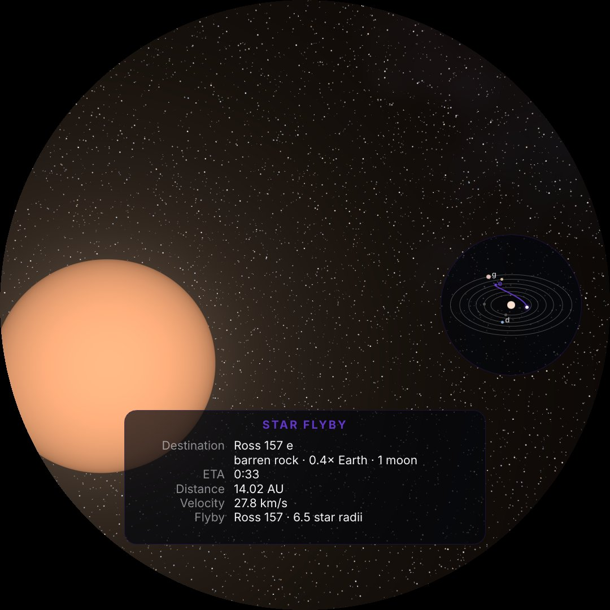
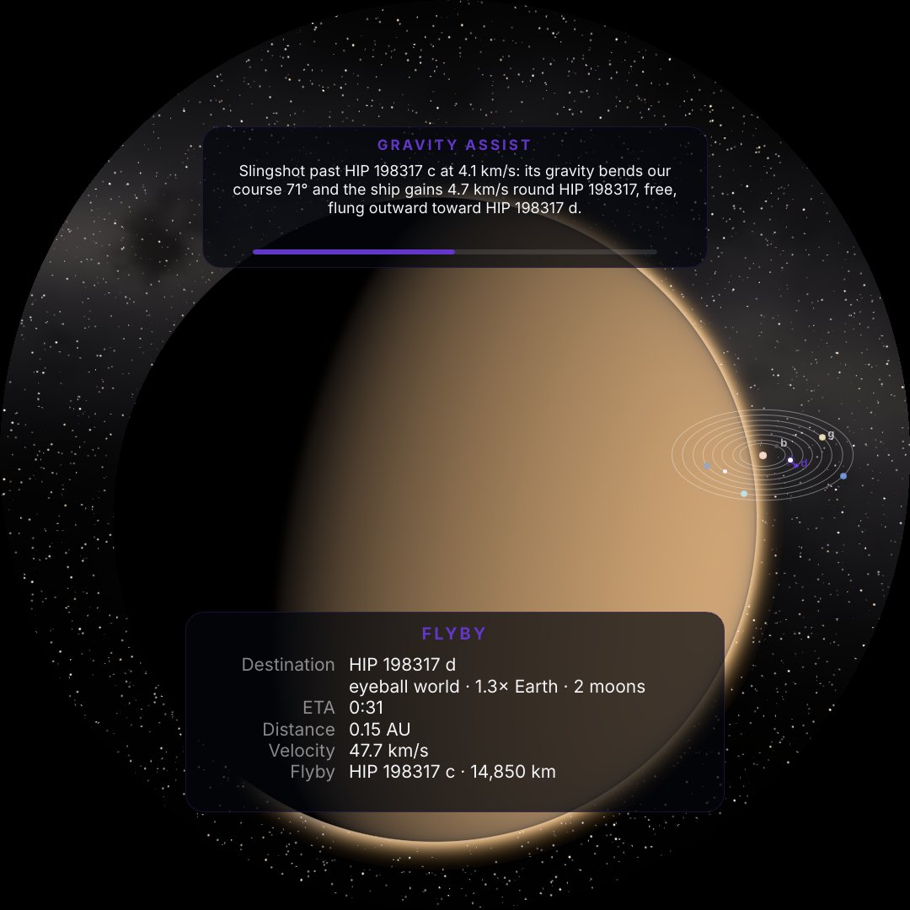
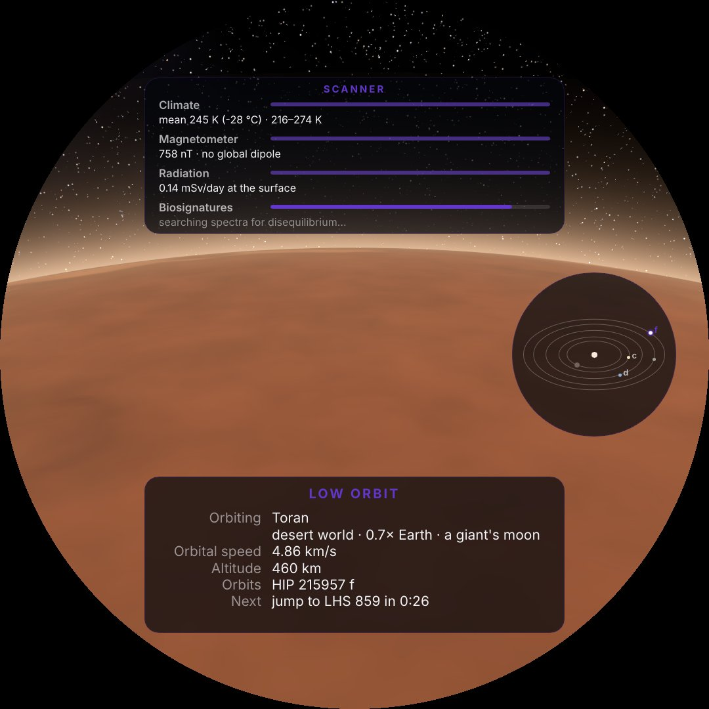
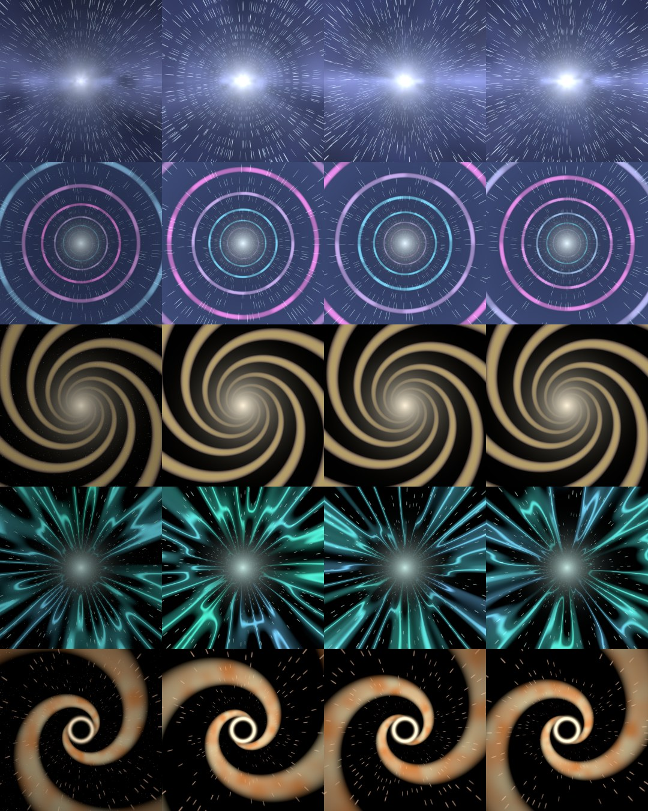
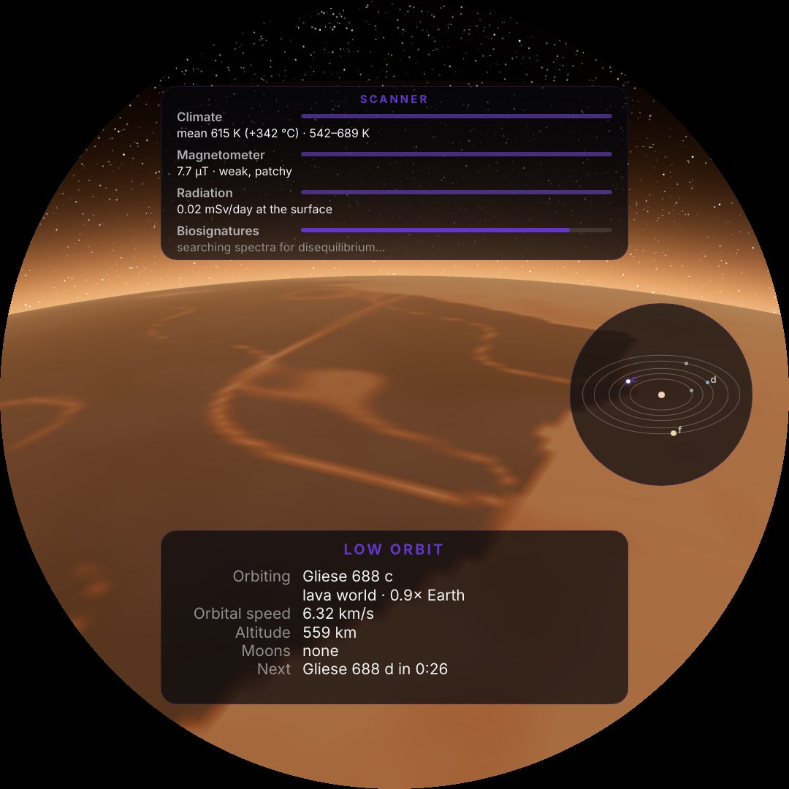
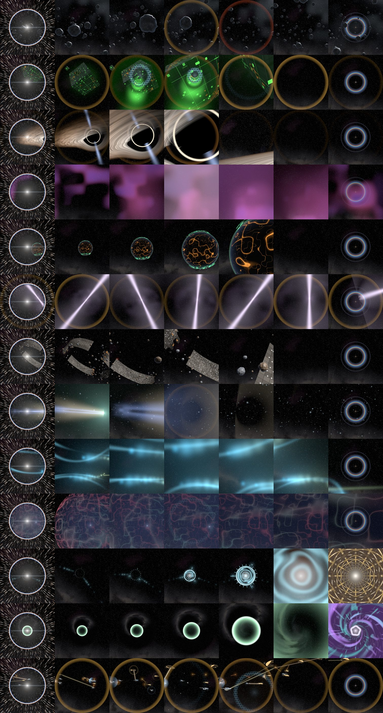
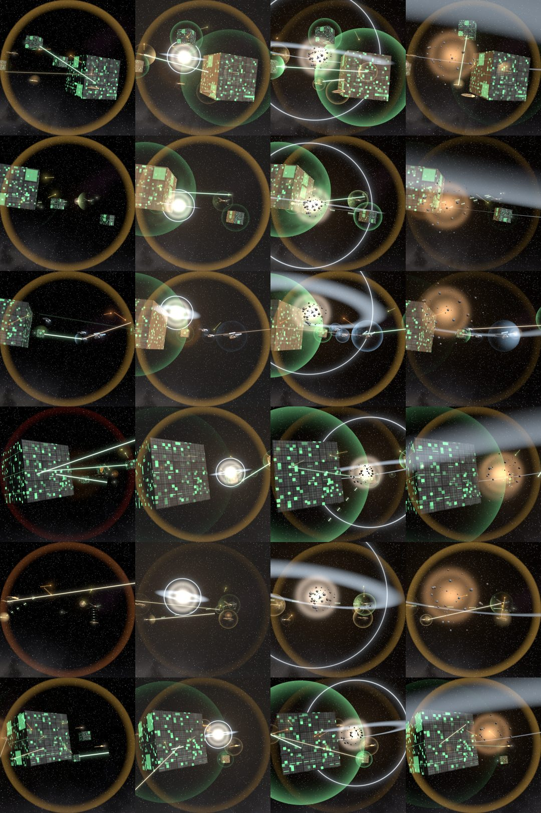

# The Solar tour

One of the idle visualisers (see the [feature overview](features.md)). The code is in `src/solar/`
(timeline in `tour.rs`, systems in `system.rs`, shaders in `frame.wgsl`, `encounter.wgsl` and
`generate.wgsl`); performance notes are in [solar-perf-plan.md](perf/solar-perf-plan.md).

## Systems and the tour

The **Solar tour** is a grand tour of invented star systems: a star — red, orange and yellow dwarfs,
white and blue stars, a swollen red giant or a tiny white dwarf, each lighting its worlds in its own
colour — five to eight planets (temperate, ocean, desert, ice, lava, barren, gas and ice giants,
some ringed) and moons of the kinds ours has (cratered, icy, volcanic, hazy, captured rock). Some
giants have a moon as big as a planet, a world of its own mapped in full with air, seas and clouds.
The tour drops out of a hyperjump, orbits three planets (and such a moon after its giant) while a
scanner surveys each, and jumps on to the next star. It never stops: transfers leave and enter each
orbit at its speed, the way it runs, and the camera keeps the destination in view.

## Manoeuvres

Crossings fly real manoeuvres, each named and explained on screen as it happens
([solar-assist.jpg](solar-assist.jpg)): a departure burn, a coast along a transfer ellipse round the
star (a Hohmann transfer when it sweeps half way round), a gravity assist past a planet on the way
(its turn and the speed traded worked out from the planet's mass), or an Oberth dive to perihelion
past the star, burning where thrust counts most, then a capture burn into orbit, and an escape burn
before the jump. Each burn shows from the cockpit: dust streaking past, the engines' glow round the
rim, a shudder, and an amber readout of the thrust and the change of speed set against what is done
of it.

## Close up

Close to a world a pass adds grain and lit slopes finer than the maps
([solar-low-detail.jpg](solar-low-detail.jpg), before and after), drawn only near the ground. Clouds
are shaded as a layer with depth — tops facing the sun bright and their far sides grey, thicker
toward the limb, thin edges glowing with the star behind them — and close up a second, higher shell
holds the densest clouds, so they stand up from the deck, slide past it as the camera moves and
break the horizon ([solar-cloud-layers.jpg](solar-cloud-layers.jpg), without and with).

## HUD and labels

A minimap of the system shows the orbits, the planets, the route and the ship
([solar-flyby.jpg](solar-flyby.jpg), [solar-moon.jpg](solar-moon.jpg)), beside a HUD of the
destination, ETA, distance and real orbital speeds. The nearest planet or moon in view carries a
label — a leader 45° up from its limb, its name and how far it is — and farther worlds get one too
where there is room; a label turns to the left near the rim or a panel, and a world filling more
than a quarter of the screen goes without.

## Drives and the scanner

Each jump uses one of five named drives, each with its own look — Lumen Drift, Tachyon Tunnel, Fold
Drive, Ion Slipstream and Bubble Drive ([solar-warps.jpg](solar-warps.jpg): Lumen Drift a blaze of
blue rays, Fold Drive a starfield streaming past warped space, Bubble Drive a lensing bubble round
the ship, the stars inside churned by its warp) — and in orbit round about one world in ten a
scanner surveys it with progress bars and results in real units: atmosphere (pressure and gas mix),
gravimetry, climate, magnetic field, surface radiation and a search for biosignatures
([solar-scanner.jpg](solar-scanner.jpg)).

## Encounters between the stars

A jump is no longer one long stretch of light: it is two or three legs of under half a minute, and
between them the ship meets something out in the deep ([solar-encounters.jpg](solar-encounters.jpg),
a row each, from the drop-out to the drive re-engaging): it threads an asteroid field, is pulled out
of the jump by a hive cube whose tractor beam it has to tear free of (each cube its own: size,
colour, scarring, escorts, beam and breakaway, [solar-hive-cubes.jpg](solar-hive-cubes.jpg)), slings
round a black hole past its lensed accretion disc, crosses a nebula lit by lightning, passes a
starless rogue planet glowing with lava cracks and aurorae, flies a broken derelict ring station, a
comet's tails, a pod of glowing leviathans and the filaments of a supernova remnant, or drops out on
the edge of a battle between two fleets and slips away unseen while stray fire passes close
([solar-battle.jpg](solar-battle.jpg), six battles from the fight through the blast). Each fleet is
one of six designs at its own scale — saucer cruisers on nacelles, vast wedge destroyers with
fighters, winged raiders, crescent warbirds, horseshoe traders, the cube collective — firing beams,
pulsed bolts and torpedoes that burst on flaring shields; a ship is lost, and its shock ripples out
through space, bending the stars, shoving the other ships aside as their shields take it on the
struck side, and rocking the ship. It may skirt a plasma storm's lightning-lit eyewall or pass a
Dyson swarm's rings of collectors round a dim star. Or the next leg is a star gate, its nodes
lighting as the ship lines up and its field throwing it down a golden conduit, or a wormhole with
another sky inside, dived into. Inside a leg there may be an ion storm, a convoy alongside, a
tachyon echo, a shortcut, a spacetime rift tearing across the field, warp whales swimming alongside
or a gravity wave rolling down it ([solar-fluxes.jpg](solar-fluxes.jpg)). Every encounter comes
round in a shuffled deck, never twice running, the alarm goes amber or red round the rim and on the
panel, and the trip between stars is shorter than the old 150-second jump (`SOLAR_ENCOUNTER=<name>`
forces one; `cargo test --release solar::tests::encounters -- --ignored` shoots them all).

## The ship's computer

A long press on the solar tour opens the **ship's computer**, a green-phosphor terminal on a curved
CRT with scan lines, in the style of a freighter's mainframe from the old science-fiction films
(`ui/screens/ship_console.slint`, `src/solar/console.rs`). It has three pages. NAVIGATION lists the
worlds of this system (behind the ship, where it is, or still ahead) and the next five stars out,
with their distances: pick a world and the ship flies on to it; pick a star and it goes to its jump
point and spools up for that star (in mid-jump, the jump turns toward it). ENCOUNTERS lists
everything the ship can meet between the stars, or a random contact, and drops the ship out into it.
INCIDENTS lists what can happen aboard. The terminal prints its confirmation while the tour makes
its cut behind it. Incidents also happen by themselves, none to two per system: a motion tracker
blip, a hull breach, a coolant leak, the ship's cat loose, more life signs than crew. Each shows as
an incoming transmission at the left of the circle, coloured by its alarm (green, amber or red).
Some change course: a signal of unknown origin leads to a derelict, and a tractor lock to a hive
cube, at the next drop-out.

## Developing

Planet maps stream in on the GPU a few rows a frame while it travels (`SOLAR_SEED`,
`SOLAR_GEN_ROWS`; screenshots of every key moment: `SOLAR_SHOTS_SEEDS=5,11 cargo test --release
solar::tests::screenshots -- --ignored`, and of every drive: `solar::tests::warps`). See [benchmarking.md](benchmarking.md) for the screenshot and cost tests.
